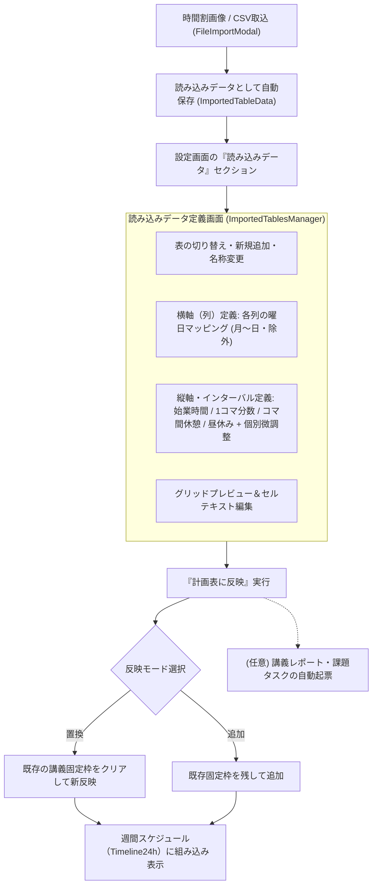

# 読み込みデータ管理・軸・インターバル定義＆計画表反映 実装計画書

ユーザー要望：「読み込んだ表は、読み込みデータという項目に入れられ、横軸と縦軸、インターバルの定義を済ませることで、計画表に組み込まれるようにしたいです。」

---

## 1. 全体アーキテクチャとデータフロー

---

## 2. 実装詳細仕様

### (1) データ型定義 (`src/types/index.ts`)

- `TableAxisConfig`:
  - `startTime: string`（始業時刻、例: `"09:00"`）
  - `periodMinutes: number`（1コマの長さ、例: `90` 分）
  - `intervalMinutes: number`（コマ間インターバル、例: `10` 分）
  - `hasLunch: boolean`（昼休み有無）
  - `lunchAfterPeriod: number`（昼休みの入る時限、例: `2` 限の後）
  - `lunchMinutes: number`（昼休みの長さ、例: `50` 分）
  - `customRowTimes?: Record<number, { startMinutes: number; endMinutes: number }>`（時限個別カスタム時間）
- `ImportedTableData`:
  - `id: string`
  - `name: string`（例: `"2026年度 前期時間割"`）
  - `createdAt: string`, `updatedAt: string`
  - `numRows: number`, `numCols: number`
  - `colHeaders: string[]`（横軸マッピング: `"月曜"`, `"火曜"` など）
  - `rowHeaders: string[]`（時限名: `"1限"`, `"2限"` など）
  - `axisConfig: TableAxisConfig`
  - `cells: GridCell[][]`
  - `appliedSlotIds?: string[]`

### (2) ストレージ層 (`src/lib/storage.ts`)

- `loadImportedTables(): ImportedTableData[]`
- `saveImportedTables(tables: ImportedTableData[]): void`
- Supabase連携同期のサポート

### (3) 新規コンポーネント `src/components/ImportedTablesManager.tsx`

- **左側 / 上部：表データセレクター＆メタ情報**
  - 保存済み表の一覧（複数管理：例「2026前期」「2026後期」）
  - タイトル変更、削除、新規インポートボタン
- **軸・インターバル設定バー（リアルタイム計算）**:
  - **横軸設定**: 各列の曜日（月・火・水・木・金・土・日・対象外）をワンクリックで変更・自動プリセット適用
  - **縦軸・インターバル一括設定**:
    - 始業時間（例: 08:50 / 09:00）
    - 1コマの分数（例: 90分、100分、50分）
    - コマ間インターバル（例: 10分）
    - 昼休み設定（例: 2限と3限の間に50分）
  - **時限個別微調整ドロワー**: 各時限の開始・終了時間を1分単位で手動微修正可能
- **グリッドエディタ＆プレビュー**:
  - 定義された時間・曜日がヘッダーと各セルに即座に反映
  - セル内の文字（講義名・教室名）の直接編集・クリア機能
- **「計画表に反映する」モーダル**:
  - 「既存の講義枠を置換」または「既存の枠に追加」
  - 「対応するレポート・課題タスクも自動生成する」チェックボックス（オン/オフ）

### (4) 設定画面統合 (`src/components/TaskManager.tsx`)

- 上部ナビゲーションタブまたはセクションに「読み込みデータ」を追加
- 日課・週次タスク・固定枠スタックと並んでスムーズにアクセス可能に

### (5) ファイル取込モーダルとの連携 (`src/components/FileImportModal.tsx`)

- 画像やCSVのグリッド読み取り完了時、「読み込みデータ」として名前をつけて保存
- そのまま「読み込みデータ設定」画面へ遷移して軸定義を行える導線を構築

---

## 3. 検証・品質計画

- 全単体テストの実行（`npm run test`）
- 型チェック（`npm run typecheck`）
- リントチェック（`npm run lint`）
- フォーマットチェック（`npm run format`）
- 本番ビルド検証（`npm run build`）
