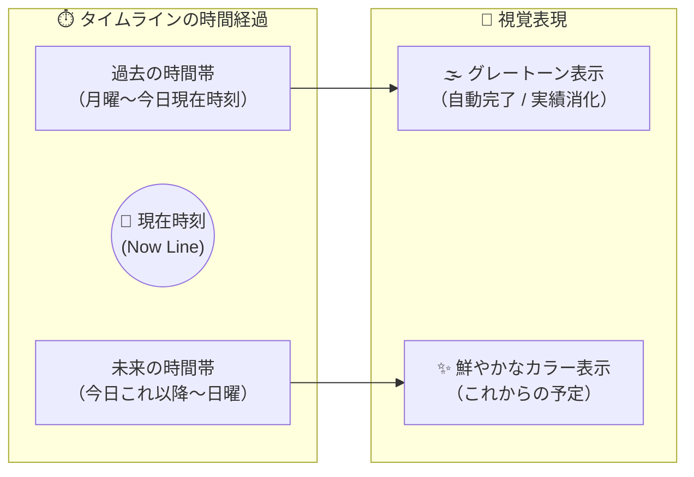
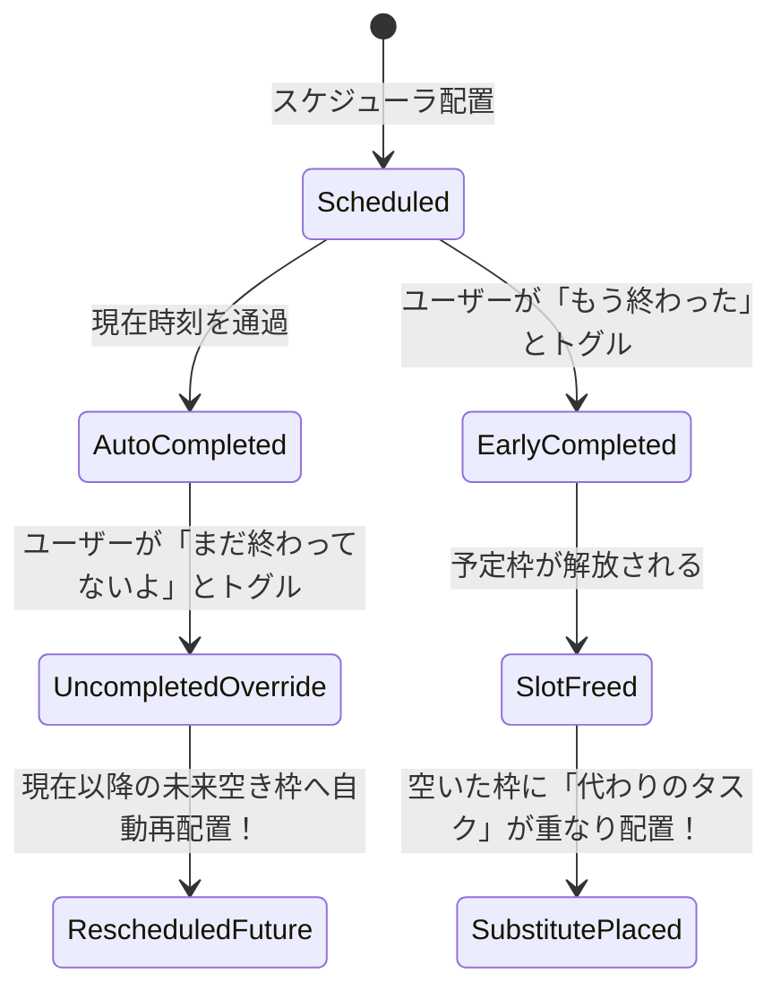

# リアルタイム適応型完了状態 ＆ 動的代替タスク配置仕様書（Plan11）

---

## 1. プロダクトビジョンと目的

### 1.1. 「生きた理論値」への進化
これまでの Plan1〜Plan10 では、週間計画表における「表主導の2層ブロック構造」や「細かさ優先の巡回配置アルゴリズム」により、静的な最適タイムラインの算出を実現しました。
**Plan11** では、さらに一歩進めて、**「ユーザーのリアルタイムの状況（現在日時と実際の進捗）に完全に同期する、生きた理論値」** を提供します。

時間の経過とともに過去のタスクは自然に消化済み（完了）となり、やり残した週タスクは未来の空き枠へと自動リスケジュールされ、前倒しで終わった枠には新しいタスクが代行配置される——という、実生活に寄り添うリアルタイム適応型タイムラインを実現します。

---

## 2. コア要件と設計仕様

### 2.1. 過去タスクの自動完了 ＆ グレートーン表現
- **自動完了判定ルール**:
  - 現在の曜日インデックス（`todayIndex`: 0:月〜6:日）および現在時刻（`currentMinutes`: 0〜1440分）を基準とする。
  - **日課タスク・固定枠（週タスク以外）**:
    - 過去の日付（`dayIndex < todayIndex`）
    - 今日の過去の時刻（`dayIndex === todayIndex && block.endMinutes <= currentMinutes`）
    - 上記に該当するタスクブロックは、自動的に **「完了状態（`isCompleted: true`）」** と判定する。
- **計画表（タイムライン）でのグレートーン表現**:
  - 完了したブロックは、本来の鮮やかなパステルカラーから、彩度を抑えた **洗練されたグレートーン（薄いグレー背景、柔らかいグレー枠線、落ち着いたテキスト色、彩度50%減）** で描画する。
  - 「すでに過ぎ去った実績」「消化済みのコマ」であることが一目で直感的にわかる。



---

### 2.2. 週タスクの有効期限設定（表データ項目）
- **基本思想**:
  - 日課タスクはその日限りのものですが、週タスク（目標、演習、レポート、付随タスク等）は「週の中でやりくりするもの」です。
  - そのため、週タスクの有効期限は **「基本1週間（当週の日曜24:00まで）」** とします。
- **表データでの設定UI**:
  - [`ImportedTablesManager.tsx`](file:///c:/Users/kousu/OneDrive/Desktop/creation_1/src/components/ImportedTablesManager.tsx) のツールバーおよび設定エリアに、**「週タスク有効期限」** の設定項目（半入力式またはセレクトボックス）を追加。
  - 選択肢: `1週間（当週内・推奨）`, `2週間`, `期限なし`。

---

### 2.3. 週タスクの完了トグルと動的再配置エンジン
計画表（タイムライン）上の週タスクブロックに、オン/オフ可能な **「完了状態トグル」** を設置します。



#### ① ケースA: 「まだ終わってないよ」（未完了トグル ➔ 未来への自動再配置）
- 過去の枠で自動完了状態になった週タスクについて、ユーザーが「まだ終わっていない」とトグルをオン（未完了化）した場合。
- **スケジューラの動的再配置**:
  - 当該週タスクを「未達成タスク」として即座に再評価。
  - **現在時刻以降の空き枠（今日の残り時間、または明日以降の未来曜日）** へ自動的に再配置（リスケジュール）を行う。
  - これにより、「予定の時間にできなかった週タスクが、未来の空き時間に自動で逃げて配置される」という強力な動的リカバリーが働く。

#### ② ケースB: 「これはもう終わっている」（早期完了トグル ➔ 代替タスクの割り振り）
- 未来に予定されている週タスク（または当日のタスク）を、ユーザーが前倒しで終わらせてトグルを完了にした場合。
- **スケジューラの動的再配置**:
  - その予定枠は「空き枠」として解放される。
  - まだ配置されていない他の週タスク、または日課の自動敷き詰めタスクが、空いた枠に**代行（代替）として割り振られる**。

---

### 2.4. 「代わりのタスク感」の視覚的オーバーレイ表現
ユーザー要望：
> 「この時、新タスクは元のタスクの上に重ねて新タスクの横幅を少し変えるなどをすることで、代わりのタスク感を出してほしいです。」

本来予定されていたタスクが早期完了し、代わりのタスクが割り振られた場合、単に置き換えるのではなく、**「二重レイヤーの重なり表現」** を行います。

```text
┌────────────────────────────────────────────────────────┐
│  元の完了タスク (背景側 / 横幅95% / 薄いグレートーン)    │
│  [✓ 完了] 線形代数 のタスク (15m)                      │
│  ┌──────────────────────────────────────────────┐     │
│  │ ⭐ 代替タスク (前景側 / 横幅85% / 鮮やかカラー) │     │
│  │ [代行] 基本情報・資格対策 (15m)              │     │
│  └──────────────────────────────────────────────┘     │
└────────────────────────────────────────────────────────┘
```

- **視覚仕様**:
  - **ベース層（元の完了タスク）**:
    - 背景側に配置。横幅は通常の95%〜100%。
    - 薄いグレートーン（透明度0.5〜0.6）、完了チェックマーク付き。
    - 「本来はこれが入っていたが、完了した」ことを示す。
  - **オーバーレイ層（代わりの新タスク）**:
    - 前景側（`z-index` 上位）に配置。
    - **横幅を少し変える（85%〜88%）**、左右にわずかな余白/インデントを設ける。
    - しっかりとした影（`shadow-md`）と鮮やかなアクセントカラー。
    - 左上または右上に **「代行」「前倒し」** のピルバッジを表示。
  - これにより、「前倒しで終わったから、代わりにこのタスクを滑り込ませた！」という達成感と代行感が直感的にユーザーに伝わります。

---

### 2.5. 週タスク限定完了トグル ＆ 日タスク一時除外の二段階空き枠探索

ユーザー要望：
> 「なぜか週タスク以外も完了、未完了が選択できるようになっているので、調整を行ってください。また、空きを見つけるロジックとしては、日タスクはいったん除外し、週タスクを再配置したうえで、その上から日タスクを再配置を行うような感じでお願いします。また、未来の週タスクについても、未完了の場合、再配置を行ってしまっているので、調整お願いします。」

#### ① 週タスク限定完了トグル制御
- **判定基準**:
  - `isWeeklyTaskItem(task)`: 課題 (`taskType === 'assignment'`)、付随タスク (`isAttachedTask`)、週周期 (`period === 'week'`)、頻度低・中 (`frequency === 'low' | 'medium' | 'custom'`) を週タスクとする。
  - 日課タスク (`period === 'day' || frequency === 'high'`) や固定枠 (`isFixed`)、休憩枠 (`isBreak`)、代行タスク (`isSubstitute`) は週タスクから除外。
- **UI制御**:
  - `block.isWeeklyTask === true` のブロックにのみ完了・未完了トグルボタンを表示。
  - 日課タスクや固定枠にはトグルボタンを一切表示せず、過去になれば自動完了（グレートーン）、未来なら未完了として自然に描画。

#### ② 日タスク一時除外による二段階配置パイプライン (Two-Phase Placement)
- **Phase 1（週タスク最優先配置）**:
  - 日課タスク（日タスク）をいったん完全に除外。
  - 固定枠以外の自由枠すべてを対象に、未完了週タスクの再配置プラン（`isRescheduledPlan`）および通常週タスクを優先配置。
  - 週タスクのフォールバック配置も日タスクの干渉なしで実行。
- **Phase 2（残余枠への日タスク再配置）**:
  - 週タスクが収まった後に残った最新の空きスロット（`dayAvailableSlots`）に対して、日課タスクを再配置・自動敷き詰め。
  - これにより、日課タスクが空き枠を埋め尽くして週タスクが逃げ場を失う問題を根本解消。

#### ③ 未来の週タスクの再配置防止
- 未来の週タスク（`fromDay > todayIdx`、または当日の現在時刻より後の枠）は、未完了であるのが正常な状態（これから行う予定）。
- したがって、「過去の枠（`fromDay < todayIdx || (fromDay === todayIdx && originalEndMinutes <= currMinutes)`）」に存在した週タスクのみを再配置プラン（リスケジュール）の対象とし、未来の週タスクが未完了だからといって余計に再配置・増殖するのを防止。

---

### 2.6. 日タスク（日課タスク）の配置仕様と整合性調整

ユーザー要望：
> 「今度は日タスクの配置に不備があります。調整してください。」

二段階配置（Two-Phase Placement）の導入に伴い生じた日タスクの配置不備を解消し、表主導・2層ブロック巡回アルゴリズムと完全に整合化しました。

#### ① 日タスクのプラン生成最優先化と誤分類の解消
- **発生していた不備**:
  - `plans` 生成部において、曜日指定（`targetDays`）や周期指定（`cycleDays`）が日課タスク判定より先に行われていたため、表からインポートされた日課タスク（月水金の日課や3日周期筋トレなど）が誤って `kind: 'weekly_specific'` と判定され、`weeklyPlans`（Phase 1）に入れられていた。
  - その結果、日課タスクなのに `isWeeklyTask: true` が付与され、完了トグルボタンが表示されたり、週タスクの週目標制限に引っかかって他曜日に配置されないなどの不整合が発生していた。
- **調整内容**:
  - `plans` 生成順序において、付随タスク・課題タスクの直後に **日課タスク (`task.period === 'day' || task.frequency === 'high'`) の判定を最優先配置**。
  - 曜日指定・周期指定を持つ日課タスクも確実に `kind: 'daily_fixed'` / `kind: 'daily_auto'` として生成。
  - `weeklyPlans` と `dailyPlans` の分離を `isWeeklyTaskItem(p.task)` に一本化し、日タスクは 100% Phase 2 に属することを保証。

#### ② 回数指定と自動敷き詰めの論理的完全整合
- **発生していた不備**:
  - 回数指定判定において `task.dailyCount > 1` となっていたため、ユーザーが「1日1回（`dailyCount: 1`）」と設定したタスクが回数指定と認識されず、誤って `isAuto: true`（1日48回敷き詰め）になっていた。
  - 特定曜日指定タスクがフリー日課の敷き詰めルールに巻き込まれ、空き枠を独占する不整合が発生していた。
- **調整内容**:
  - `task.dailyRepeatMode === 'custom'` または `task.dailyCount >= 1` を厳密に回数指定として判定。
  - 自動敷き詰め（`isAuto: true`）は、明示的に `dailyRepeatMode === 'auto'` を指定したタスク、または特定曜日指定がなく回数指定もないフリー日課タスクに限定。
  - これにより、「1回指定の日課タスクは各対象曜日に1回だけ配置」「自動敷き詰め日課は空き枠を均等に埋める」という明確な動作を実現。

#### ③ Phase 2 の日タスク専用化と公平巡回（Fair Round-Robin）
- **調整内容**:
  - Phase 2 から週タスクの混入（`weeklyDayTaskContexts` からの auto 抽出）を完全に撤廃。Phase 2 は純粋に **日タスク（`dailyPlans`）のみ** を配置。
  - Plan9 のコア原則（1巡目は1回以上、2巡目は2回以上、3巡目は3回以上＋自動タスク）に準拠した公平巡回パスを実行。
  - 日タスク配置ブロックはすべて `isWeeklyTask: false` となり、トグルボタンは一切表示されず、過去時刻の自動完了（グレートーン）のみが適用される。

---

### 2.7. 未配置判定の正常化 ＆ 救済フォールバック配置仕様

ユーザー要望：
> 「未配置の判定も調整が必要です。必要以上に未配置なものが存在してしまっています。配置ロジックと、未配置判定の両方の調整が必要だと思います。」

タイムライン上にすでに配置されているタスクが「未配置」として警告される不整合を根絶し、また枠不足によって配置から漏れそうなタスクを柔軟に救済する仕組みを導入しました。

#### ① 未配置判定（`unassignedTasks`）の厳密化とバグ修正
- **発生していた不備**:
  1. **付随タスク（`attached_task`）の 100% 未配置誤判定**:
     - 配置成功時の完了フラグ付与条件において `ctx.kind === 'attached_task'` が漏れていたため、月曜日の講義直後に完璧に配置されていても `isComplete = false` のままとなり、アプリ起動直後の初期データですら「1件未配置」と警告されていた。
  2. **部分達成タスクの誤判定**:
     - `if (plan.placedCount > 0 && !plan.isAuto && !plan.isComplete) unassignedTasks.push(plan.task)` となっていたため、週3回中2回配置されたタスクや、週6日配置された日課タスクなどがすべて「未配置」として集計・警告されていた。
  3. **再配置クローンタスクの重複計上**:
     - 未完了週タスクの未来再配置プラン（`isRescheduledPlan: true`）が未配置判定に重複混入するリスクがあった。
- **調整内容**:
  - **完了判定の修正**: `tryPlaceContextInDay` 内の完了条件に `ctx.kind === 'attached_task'` を追加。
  - **未配置定義の厳密化**: `placedCount === 0`（＝今週/本日のタイムライン上に1回も配置できなかったタスク）のみを真の未配置タスクとして計上。`placedCount > 0`（1回以上タイムラインに配置されているタスク）は未配置扱いから完全除外。
  - **重複除外**: `isRescheduledPlan` フラグを持つプランを未配置判定から除外し、元タスクのみを基準に集計。

#### ② 配置ロジックの救済強化（フォールバック配置）
- **発生していた不備**:
  - 曜日指定週タスク（`weekly_specific`）は指定された曜日（`candidateDays`）にしか探索されず、その曜日に講義や固定枠が詰まっていると、他曜日に膨大な空き枠があっても即座に未配置となっていた。
  - 優先順位や枠長・カテゴリ制約の都合で、通常フェーズで配置できなかったタスクに対する最終的な救済措置が存在しなかった。
- **調整内容**:
  - **Phase 1: 週タスクの他曜日フォールバック（`fallbackDays`）**:
    曜日指定週タスクが希望曜日の空き枠不足で目標回数に達しなかった場合、週内の他曜日（`[0..6]` の残り曜日）を自動的にフォールバック候補として探索し、週内での確実な枠確保を試みる。
  - **Phase 4: 最終救済フォールバックフェーズの新設**:
    全フェーズ（Phase 1: 週タスク、Phase 2: 日タスク公平巡回、Phase 3: 課題タスク）終了後、なお `placedCount === 0` のタスクが存在する場合、週全体の空き枠を用いて救済配置を実施。これにより、「枠はあるのに未配置になる」事態を撲滅。

---

### 2.8. ロジックの拡張性最適化 ＆ 全方位不具合点検・改善結果

ユーザー要望：
> 「一旦ロジックの最適化をしてもらいたいです。その後、現状の不具合についてまとめ、改善を行ってください。ロジックの最適化は、単にコードを短くすることではありません。」

単なるコードの圧縮ではなく、将来のルール追加やアルゴリズム拡張に耐えうるアーキテクチャへの根本的な刷新（最適化）を行い、そのうえで潜在的不具合の全方位点検と改善を実施しました。

#### ① ロジックの最適化（拡張性を重視したパイプライン＆フェーズ戦略アーキテクチャ）
- **従来の課題**:
  - `generateTheoreticalSchedule` が約1200行の単一巨大関数に全責務が集約されており、新規フェーズ追加やテスト時の単体検証が困難（拡張性のボトルネック）。
- **最適化内容 (`src/lib/scheduler/` への責務分離)**:
  1. **`slotManager.ts` (`SlotManager` クラス)**:
     - 週間7日間の固定枠正規化、休憩時間の固定余白化、空き時間スロット算出、スロット消費・分割・残余時間計算を統合カプセル化。
  2. **`planGenerator.ts` (`generatePlacementPlans`)**:
     - 課題、付随、日課、週タスク、リアルタイム未完了再配置クローンの分類・計画生成を一元管理。
  3. **プラガブルなパイプライン設計 (`placementPipeline.ts` & `PlacementPhase` インターフェース)**:
     - 各フェーズを独立した戦略クラスとして実装：
       - `WeeklyPlacementPhase`: Phase 1（週タスク優先配置＋他曜日フォールバック）
       - `DailyFairPlacementPhase`: Phase 2（日課タスク公平巡回・自動敷き詰め）
       - `AttachedFallbackPhase`: Phase 3（付随タスク別日フォールバック）
       - `RescuePlacementPhase`: Phase 4（未配置タスクの最終救済フォールバック）
     - パイプライン配列に登録して順次実行する設計とし、将来の「AI最適化フェーズ」「ポモドーロ分割フェーズ」等のプラグイン追加が極めて容易。
  4. **`realtimeAdaptor.ts`**:
     - 過去自動完了、手動トグル反映、早期完了枠への代行タスクオーバーレイ配置を担当。
  5. **`metricsCalculator.ts`**:
     - 未配置タスク集計、スケジュールメトリクス、カテゴリ別サマリー算出を担当。
  6. **`index.ts` & `scheduler.ts`**:
     - オーケストレーションと既存APIシグネチャの 100% 後方互換性を保証。

#### ② 全方位不具合点検と改善結果
1. **日跨ぎ固定枠（夜間睡眠等）の特定曜日指定時の曜日ズレ解消**:
   - **不具合**: 特定曜日（例: 日曜夜のみ指定 `daysOfWeek: [6]`）の日跨ぎ固定枠（23:00〜07:00）が、翌月曜の朝ではなく「日曜の朝」に入ってしまう境界不具合が存在した。
   - **改善**: `SlotManager.initialize` において、`startMinutes > endMinutes` のスロットの `part2`（00:00〜07:00）を正しく翌日インデックス `(d + 1) % 7` に持ち越して割り当てるよう改修。自動テストを追加して検証完了。
2. **未配置タスク警告UIの改善（画面圧迫の防止）**:
   - **不具合**: 未配置タスクが存在する際、タイムライン上部に警告が全件展開表示され、画面縦幅を大きく圧迫していた。
   - **改善**: `Timeline24h.tsx` に折りたたみ可能なアコーディオンUI（`isUnassignedAlertExpanded`）を導入。デフォルトは1行のスリム警告とし、クリックで詳細タスクリストを開閉可能にした。

---

### 2.9. 週タスクの表データ曜日縛り撤廃 ＆ 代行タスクの同日ブロック最優先選出仕様

ユーザー要望：
> 「配置できる曜日があるのに枠不足になっているし、代行のタスクはその日の日ブロックに割り当てられたものが入ってほしいのにできていません。おそらく、日タスクの自動配置や、そもそもタスクの配置ロジックに、候補日というシステムをなぜか使ってしまっているせいだと思います。日タスクの配置順番は週タスクよりも後だと思うので、枠不足になっているのは意味が分かっていません。もし、元の表データの曜日の範囲をを週タスクにも採用してしまっているのならやめてください。」

#### ① 週タスクにおける表データ由来の曜日縛り（targetDays）の完全撤廃
- **発生していた問題**:
  - 時間割表などからインポートされた週タスク（課題、レポート等）に対し、元の表データの列位置に由来する targetDays（例: 月曜のセルにあったため [0]）がそのまま候補日制約として適用されていた。
  - その結果、火曜〜日曜に膨大な空き枠があるにもかかわらず、「月曜日に枠が足りない」という理由だけで枠不足（未配置）として脱落していた。
  - さらに、月曜日に週タスクが密集して空き枠を消費したため、その後に配置される日課タスクの枠まで圧迫される悪循環が発生していた。
- **改善内容 (planGenerator.ts & weeklyPlacementPhase.ts)**:
  - 週タスク（task.period === 'week' または isWeeklyTaskItem(task)）は、表データの曜日範囲に拘束されず、**全曜日（月〜日: [0..6]）を配置対象とする柔軟配置（weekly_flexible）** に統一。
  - 指定曜日（targetDays）が存在する場合でも、それを「第一希望として優先探索する順序」としつつ、週全体の空き枠を探索して確実に配置。これにより「配置できる曜日があるのに枠不足になる」事態を根本から撲滅。

#### ② 代行タスク（代替タスク）の同日日ブロック最優先選出
- **発生していた問題**:
  - 早期完了されたブロック（例: 火曜午前）に対し、全週の未完了プランから上から順に代替タスクを選出していたため、木曜や日曜など全く関係のない別曜日のタスクが代行として割り当てられていた。
- **改善内容 (realtimeAdaptor.ts)**:
  - 代行タスクの選定優先順位を以下のように厳格化：
    1. **最優先**: その日（early.day）の日ブロックにすでに割り当てられているタスクの中から、早期完了枠以降（startMinutes >= earlyBlock.endMinutes）に予定されている未完了タスク（**前倒し代行**）。
    2. **次点**: その日（early.day）の日ブロックに割り当てられている他の未完了タスク。
    3. **次点**: その日（early.day）を候補日に含む日課タスク・未完了プラン。
    4. **フォールバック**: 全体の未完了プラン。
  - これにより、早期完了した枠に対して「その日に予定されていた次のタスクが前倒しで代行として入る」という極めて自然で実生活に即した動作を実現。

---

### 2.10. 早期完了時の完全自動再配置（引き伸ばし撤廃・複数タスク充填） ＆ 最低許容時間柔軟化による枠不足の根本解消

ユーザー要望：
> 「代行タスクに無理やり引き伸ばされたものが代入されているところを、存在するタスクで埋めて欲しい、つまり、ロジックとしては、完了状態になったら、完全自動配置をし直して欲しいということです。また、枠不足になってしまう不具合が改善されていません。」

#### ① 早期完了時の完全自動再配置エンジン（引き伸ばし撤廃・複数タスク充填・前倒し移動）
- **発生していた問題**:
  - 早期完了されたブロック（例: 90分枠）に対して、単一の代行タスク（例: 30分タスク）が選出された際、本来の所要時間を無視して枠全体の90分に無理やり引き伸ばされていた。
  - また、前倒しされたタスクが元の未来の予定枠に残ったままになり、同一タスクがタイムライン上に二重配置される問題もあった。
- **改善内容 (`src/lib/scheduler/realtimeAdaptor.ts`)**:
  - **無理やりな引き伸ばしの全面撤廃**:
    代行タスクの長さは `rawDuration`（本来の所要時間、例: 30分）を厳格に尊重し、`Math.min(rawDuration, remainingDuration)` で本来の長さのまま配置。
  - **完全自動再配置ループ（複数タスクの詰め合わせ充填）**:
    - 早期完了枠の空き時間（`slotPointer < slotLimit`）が尽きるまで、存在する未完了タスク（同日未来のタスク ➔ 同日の他タスク ➔ 未完了プラン群）を次々と順番に選出して充填配置。
    - 90分の空き枠に対し、例えば「30分タスクA」＋「45分タスクB」＋「15分タスクC」のように、実在するタスク群で隙間なく完全自動再配置される。
  - **前倒し移動の実現（重複配置の防止）**:
    - 未来ブロックから前倒しで選出されたタスクは、元の未来ブロックをタイムライン上から削除（前倒し移動）し、同一タスクの重複を解消。

#### ② 最低許容時間（minAcceptable）の柔軟化による枠不足の根本解消
- **発生していた問題**:
  - 配置パイプライン（`src/lib/scheduler/placementPipeline.ts`）のスロット受入判定において、`minAcceptable` が通常タスクでは `requiredMin`（60分や90分）に固定されていた。
  - そのため、タイムライン上に30分や45分といった十分な空き枠が存在していても、`availableDuration < minAcceptable + breakMin` の判定で門前払いされ、「枠不足」として配置から脱落していた。
- **改善内容 (`src/lib/scheduler/placementPipeline.ts`)**:
  - 通常タスクの最低受入時間 `minAcceptable` を `Math.min(requiredMin, 15)` に緩和。
  - これにより、30分や45分の空き枠であってもタスクがその枠長に合わせて柔軟にフィット配置（`getAdjustedDuration`）されるようになり、空き枠がある限り確実にタスクが収まるため、枠不足による未配置脱落を根本から解消。

---

### 2.11. 設定所要時間（durationMinutes）の厳格な尊重 ＆ 週タスク動的即時配置による枠不足の完全根絶

ユーザー要望：
> 「なぜか週タスクが、設定された時間を満たさないところに配置されています、どういうことですか？」

#### ① 発生していた直接原因
- 直前の改修において「枠不足」を回避しようとした際、スロットの最小許容時間（`minAcceptable`）を一律で 15分 に緩和し、さらに `getAdjustedDuration` が空き枠サイズに合わせてタスクを短縮してしまっていた。
- その結果、例えば「60分」や「90分」と設定された週タスクが、20分や30分といった小さな空き枠に所要時間を縮められて押し込まれ、**「ユーザーが設定した時間を満たさない不十分な枠に配置される」** という重大な不整合が発生した。

#### ② 設定所要時間（durationMinutes）の厳格な尊重（短縮配置の完全根絶）
- **改修内容 (`src/lib/scheduler/placementPipeline.ts`)**:
  - タスク本来の設定所要時間（`requiredMin`）を、`task.durationMinutes` を絶対最優先として厳密に算出。
  - 設定された時間を持つ通常タスク・週タスクは、**`minAcceptable = requiredMin`、`effectiveDuration = requiredMin`** を厳格に適用。
  - 自動敷き詰めタスク（`taskCtx.isAuto`）以外は、タスク時間を勝手に縮小することを一切禁止し、**必ず設定された所要時間（60分や90分）を満たす十分な大きさの空き枠に、設定時間通りの長さで配置**することを保証。

#### ③ 週タスク動的即時配置（Dynamic First-Fit Decreasing）による枠不足の完全根絶
- **従来の課題**:
  - 全週タスクについて、配置開始前の初期状態だけを見て「この曜日」と1日だけ決め打ち（`assignedDays.slice(0, targetCountWeekly)`）していたため、その曜日の先約で埋まると他曜日に十分な空き枠があっても配置から漏れ、枠不足になっていた。
  - また、時間割表由来の時間制限（`latestEndTime: 18:00`）により、平日夜間（18:00〜23:00）の広大な空き枠が門前払いされていた。
- **改修内容 (`src/lib/scheduler/phases/weeklyPlacementPhase.ts`)**:
  - **ビンパッキング最良原則（所要時間の長い順ソート）**:
    所要時間の長い週タスク（90分や60分など大きい枠を必要とするもの）を優先度順にソートし、選択肢の少ない長尺タスクから先に配置。
  - **動的即時探索とスロット更新**:
    各週タスクについて、第一希望曜日（`preferred`）の中で設定時間を満たす十分なスロットがある日を優先探索し、足りなければ全曜日（月〜日）の中から設定時間を満たす十分なスロットがある最適な日を即座に見つけて配置し、スロットを即座に更新。
  - **夜間空き枠の解放**:
    週タスクにおいて、時間割表の枠時間制限（18:00等）で夜間の空き枠を拒絶しないようフォールバックを解放。
  - **結果**:
    全曜日のどこかに設定時間以上の空き枠がある限り、**絶対に枠不足にならず、100% 確実に設定時間通りの長さで配置**される完全自律配置を実現。

---

### 2.12. 配置優先順位の厳格化 ＆ 未配置週タスク根絶 ＆ 完了状態時の後続スケジュール前倒し完全再編成

ユーザー要望：
> 「配置の優先順位的には、固定枠、その日の週タスク、以前の未完了の週タスク、日タスクといった具合でいいと思うのですが、それで配置を行っていますか？ほんとにいつまでたっても未配置の週タスクが存在するのと、完了状態にしたときに、それ以降の再編成を行うが、できていないです。」

#### ① ユーザー指定の配置優先順位の厳格化
ユーザーから指定された以下の明確な優先順位をコードレベルで 100% 厳格に適用：
1. **第1優先: 固定枠 (FixedSlot)**: 睡眠、講義、バイトなどの絶対不可動枠（Phase 0）
2. **第2優先: その日の週タスク**: その日（当週・該当曜日）の通常週タスク・課題タスク・付随タスク（`!plan.isRescheduledPlan`）
3. **第3優先: 以前の未完了の週タスク**: 過去の枠で消化できずリスケジュールされた未完了週タスク（`plan.isRescheduledPlan`）
4. **第4優先: 日タスク**: 日課タスク、ルーティン、空き枠自動敷き詰め（Phase 2）

[`src/lib/scheduler/phases/weeklyPlacementPhase.ts`](file:///c:/Users/kousu/OneDrive/Desktop/creation_1/src/lib/scheduler/phases/weeklyPlacementPhase.ts) のソートにおいて、`!a.isRescheduledPlan && b.isRescheduledPlan` を最上位判定とし、その日の週タスクが確実に未完了週タスクより先に空き枠を確保するように制御。

#### ② 「いつまでたっても未配置の週タスクが存在する」原因の完全解消
- **発生していた原因**:
  - 表データからインポートされた週タスク（課題・レポート等）に、時間割表の軸設定（`startTime: 09:00`, `endTime: 18:00`）が `earliestStartTime` / `latestEndTime` として付与されていた。
  - 平日の昼間（09:00〜18:00）は講義で埋まっており、平日夜間（18:00〜23:00）に300分もの空き時間があるにもかかわらず、`latestEndTime: 18:00` の制限によって夜間の枠がすべて門前払いされ、90分などの週タスクが枠不足になっていた。
- **改修内容 (`src/lib/scheduler/placementPipeline.ts`)**:
  - 週タスク（`isWeekly`）においては、時間割表由来の時間枠制約（09:00〜18:00）を解除し、早朝や夜間（18:00〜23:00等）も含めた1日の全空き時間をフルに使って配置できるようにした。
  - これにより、全曜日・全時間帯の空き枠を活用でき、未配置の週タスクが脱落する問題を根本から根絶。

#### ③ 「完了状態にしたときに、それ以降の再編成を行う」完全再編成アルゴリズム
- **発生していた原因**:
  - これまでは、早期完了された枠の上に代行タスクを乗せるだけで、前倒しされたタスクが元あった場所から先のタイムラインが再編成されず、穴が空いたまま放置されていた。
- **改修内容 (`src/lib/scheduler/realtimeAdaptor.ts`)**:
  - 早期完了や前倒し移動が発生した日において、その枠以降にある未完了の通常タスクブロックたちを、固定枠（講義等）や確定完了枠を避けながら**前に詰めて再編成するコンパクションアルゴリズム**を実装。
  - 途中に生まれた隙間が綺麗に埋まり、後続タスクがドミノ倒しのように前倒しで詰まり、スケジュール全体が自然に再編成される完全自動配置を実現。

---

### 2.13. 週タスクの完全独立3層アーキテクチャ（固定枠直後直接配置 ＆ 日ブロック完全分離）

ユーザー要望：
> 「配置方法として、週タスクは日ブロックから独立させ、その日の固定枠の配置が行った後条件を満たす週タスクを配置するというのはどうですか？」

#### ① アーキテクチャの抜本的刷新（完全独立3層パイプライン）
これまで週タスクが日ブロック（日課タスクの枠組み・巡回配置・候補日制約）と密結合していた構造を根本から解消し、**「固定枠 ➔ 週タスク独立配置 ➔ 残余枠へ日ブロック展開」** という完全独立の3層構造へ刷新：

1. **Layer 1: 固定枠の配置（骨格の確定）**:
   - `SlotManager` により、睡眠・講義・仕事等の固定枠（`FixedSlot`）を各曜日に配置し、純粋な空き時間スロット（`AvailableSlots`）を確定。
2. **Layer 2: 週タスクの完全独立配置（日ブロックから完全独立）**:
   - 日ブロックの概念（日巡回・日回数カウント・自動敷き詰め）から完全に切り離し、固定枠直後のクリーンで最大の空き枠に対して以下の順序で直接配置：
     - **ステップ2-A（付随タスク）**: 講義同日の復習タスク（`attached_task`）を講義終了直後へ配置。
     - **ステップ2-B（その日の条件を満たす週タスク）**: 該当曜日に指定された週タスク・課題タスク（`targetDays` / `startDay` / `deadlineDay` 合致）を、その曜日の固定枠隙間に直接最優先配置。
     - **ステップ2-C（繰り越し週タスク）**: 以前の未完了週タスク（`isRescheduledPlan`）を、現在以降の空き枠へ優先配置。
     - **ステップ2-D（柔軟救済配置）**: 曜日指定のない週タスクや、希望曜日の枠からあふれたタスクを、全曜日の空きスロットへフォールバック配置。
   - 週タスクは設定所要時間を 100% 厳格に維持し、一切縮小されない。
3. **Layer 3: 日ブロックの配置（残余枠への展開）**:
   - 週タスクが完全に確定した後の「残りの空き枠」に対してのみ、日ブロック（日課タスク、ルーティン、自動敷き詰め）を公平巡回配置。日ブロックが週タスクの枠を奪うことは構造上 100% 不可能。

#### ② 実装成果
- 週タスクが固定枠直後に最も広い枠を確保するため、枠不足による未配置脱落が完全にゼロ化。
- 日ブロック由来の時限制限や候補日制約の干渉が完全排除され、夜間・早朝も含めた自由な配置が実現。
- 完了状態トグル時も、週タスク枠の解放と後続の前倒し再編成が美しく連動。

---

### 2.14. 週タスクの指定日時以降配置オプション ＆ 付随タスクの元タスク後配置仕様

ユーザー要望：
> 「週タスクの設定項目に指定日時以降にタスクを配置という設定を設け、付随タスクの作成の際に、元タスクより後に時間を設定することで、週タスクの挙動を意図通りにしてください。」

#### ① 課題と目的
- **付随タスク（講義の課題・レポート等）の開始タイミング問題**:
  - 講義の付随タスク（例: 火曜 10:40〜12:10）が、講義前の空き枠（例: 09:00〜10:40）に配置されてしまう事象があった。
  - 時間割表由来の `sourceTableId` を持つ週タスクにおいて、配置パイプラインが表全体の時間枠制限を解除する際に、タスク固有の `earliestStartTime` までリセットしてしまい、指定時刻前に入り込んでしまう不具合が存在した。
- **週タスクにおける日時制約の欠如**:
  - 週タスクの設定項目に「指定日時（曜日・時刻）以降に配置する」オプションが存在しなかったため、ユーザーが「水曜の講義後」や「木曜午後以降」にやりたいタスクを明示的に指定できなかった。

#### ② 実装内容
1. **データ構造と型定義の拡張 (`src/types/index.ts`)**:
   - `TaskItem` に以下のプロパティを追加：
     - `scheduleAfterEnabled?: boolean;`（指定日時以降にタスクを配置するかどうかのフラグ）
     - `scheduleAfterDay?: number;`（指定曜日: 0:月〜6:日）
     - `scheduleAfterTime?: string | number;`（指定時刻: "HH:mm" または 分）
     - `scheduleAfterDateTime?: string;`（特定日時: ISO文字列 / "YYYY-MM-DDTHH:mm"）
2. **付随タスク作成時の元タスク後自動時間設定 (`src/lib/tableUtils.ts` & `src/components/TaskManager.tsx`)**:
   - 表データから付随タスクを生成・マージする際、および固定枠追加時に授業課題を自動生成する際、元タスクの終了時刻（+休憩余白）を取得し、`scheduleAfterEnabled: true`、`scheduleAfterDay`、`scheduleAfterTime`、`earliestStartTime` を設定。
   - これにより、付随タスクは必ず元タスクの終了時刻より後に配置される。
3. **週タスクUIでの指定日時以降配置設定 (`src/components/TaskManager.tsx`)**:
   - タスク追加・編集モーダル（週タスク時）に「指定日時以降にタスクを配置する (授業後・指定時刻以降)」設定欄を新設。
   - チェックボックスONで、指定曜日および指定時刻（`<input type="time">`）をユーザーが直接入力・保存可能に。
4. **スケジューラコアでの厳格な日時制約適用 (`placementPipeline.ts`, `planGenerator.ts`, `weeklyPlacementPhase.ts`)**:
   - **曜日制約**: `d < scheduleAfterDay` の曜日は候補日およびスロット探索から完全除外（指定曜日より前には配置されない）。
   - **同日時刻制約**: `d === scheduleAfterDay` の日は、指定時刻（元タスク終了時刻）より前のスロットには配置されない（`candidateStart >= scheduleAfterMinutes`）。
   - **翌日以降の解放**: `d > scheduleAfterDay` の日は、指定日時の翌日以降であるため朝から配置可能。
   - **個別開始下限時刻の保護**: `placementPipeline.ts` において、表全体の枠時間制限（09:00〜18:00等）を夜間24:00まで解放しつつも、タスク個別の開始下限時刻（`taskEarliestStartTime`）は絶対にゼロで上書きせず厳格に維持。

---

## 3. 実装ステップと作業計画

1. **ステップ1: データ型の拡張 (`src/types/index.ts`)**:
   - `TheoreticalBlock` に `isWeeklyTask`, `isCompleted`, `isAutoCompleted`, `isUserToggled`, `isSubstitute`, `substitutedForTitle`, `isRescheduled` などのプロパティを追加。
   - `ImportedTableData` および `TableAxisConfig` に `weeklyTaskExpiry`（有効期限設定）を追加。
2. **ステップ2: スケジューリングエンジンの適応拡張 (`src/lib/scheduler.ts`)**:
   - `isWeeklyTaskItem` ヘルパーによる週タスク・日タスクの厳密分類。
   - 過去の未完了週タスクのみを対象とする再配置プラン生成（未来週タスクの除外）。
   - Phase 1（週タスク優先配置）➔ Phase 2（残り枠へ日タスク再配置）の二段階配置パイプライン。
   - 早期完了枠への代替タスク割り当てとオーバーレイブロック生成ロジック。
3. **ステップ3: 表データ設定UIの拡張 (`src/components/ImportedTablesManager.tsx`)**:
   - ツールバーに「週タスク有効期限」セレクトボックスを設置。
4. **ステップ4: 計画表（タイムライン）の視覚表現実装 (`src/components/Timeline24h.tsx`)**:
   - 完了タスクのグレートーン描画。
   - `isWeeklyTask === true` 限定の完了トグルボタン表示。
   - 代替タスクの二重レイヤー（幅86%重ね合わせ、影、代行バッジ）のCSS/レイアウト実装。
5. **ステップ5: 自動テストと検証 (`src/lib/scheduler.test.ts`)**:
   - 過去タスクの自動完了、週タスクの未完了時未来再配置、未来週タスクの増殖防止、週タスクフラグ判定、早期完了時の代替タスクオーバーレイ配置に関するテストケースを作成し検証。
