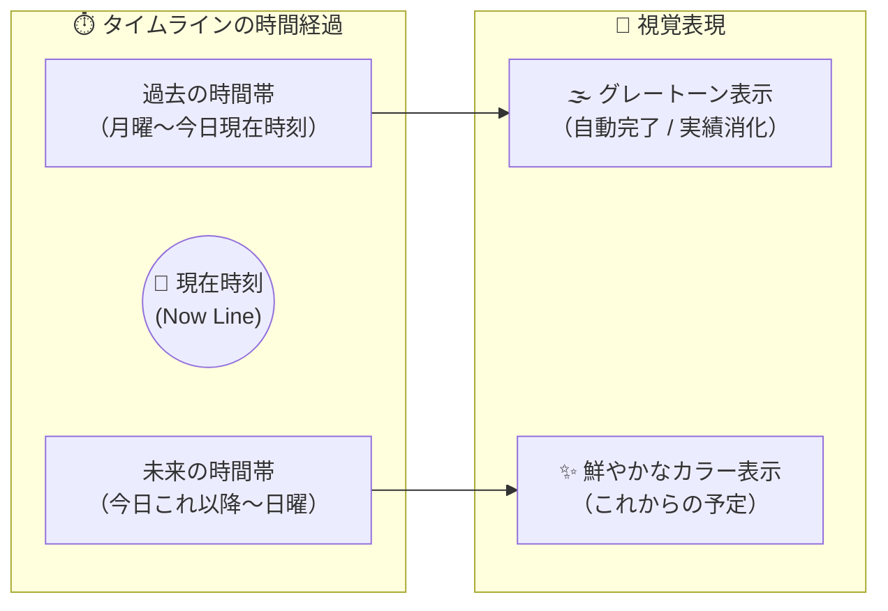
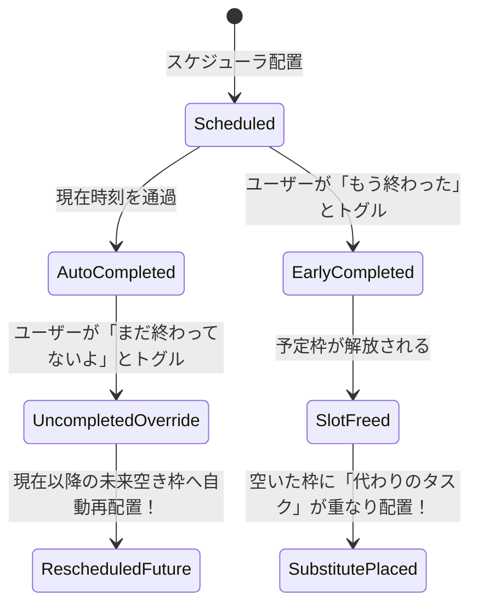

# リアルタイム適応型完了状態 ＆ 動的代替タスク配置仕様書（Plan11）

---

## 1. プロダクトビジョンと目的

### 1.1. 「生きた理論値」への進化
これまでの Plan1〜Plan10 では、週間計画表における「表主導の2層ブロック構造」や「細かさ優先の巡回配置アルゴリズム」により、静的な最適タイムラインの算出を実現しました。
**Plan11** では、さらに一歩進めて、**「ユーザーのリアルタイムの状況（現在日時と実際の進捗）に完全に同期する、生きた理論値」** を提供します。

時間の経過とともに過去のタスクは自然に消化済み（完了）となり、やり残した週タスクは未来の空き枠へと自動リスケジュールされ、前倒しで終わった枠には新しいタスクが代行配置される——という、実生活に寄り添うリアルタイム適応型タイムラインを実現します。

---

## 2. コア要件と設計仕様

### 2.1. 過去タスクの自動完了 ＆ グレートーン表現
- **自動完了判定ルール**:
  - 現在の曜日インデックス（`todayIndex`: 0:月〜6:日）および現在時刻（`currentMinutes`: 0〜1440分）を基準とする。
  - **日課タスク・固定枠（週タスク以外）**:
    - 過去の日付（`dayIndex < todayIndex`）
    - 今日の過去の時刻（`dayIndex === todayIndex && block.endMinutes <= currentMinutes`）
    - 上記に該当するタスクブロックは、自動的に **「完了状態（`isCompleted: true`）」** と判定する。
- **計画表（タイムライン）でのグレートーン表現**:
  - 完了したブロックは、本来の鮮やかなパステルカラーから、彩度を抑えた **洗練されたグレートーン（薄いグレー背景、柔らかいグレー枠線、落ち着いたテキスト色、彩度50%減）** で描画する。
  - 「すでに過ぎ去った実績」「消化済みのコマ」であることが一目で直感的にわかる。



---

### 2.2. 週タスクの有効期限設定（表データ項目）
- **基本思想**:
  - 日課タスクはその日限りのものですが、週タスク（目標、演習、レポート、付随タスク等）は「週の中でやりくりするもの」です。
  - そのため、週タスクの有効期限は **「基本1週間（当週の日曜24:00まで）」** とします。
- **表データでの設定UI**:
  - [`ImportedTablesManager.tsx`](file:///c:/Users/kousu/OneDrive/Desktop/creation_1/src/components/ImportedTablesManager.tsx) のツールバーおよび設定エリアに、**「週タスク有効期限」** の設定項目（半入力式またはセレクトボックス）を追加。
  - 選択肢: `1週間（当週内・推奨）`, `2週間`, `期限なし`。

---

### 2.3. 週タスクの完了トグルと動的再配置エンジン
計画表（タイムライン）上の週タスクブロックに、オン/オフ可能な **「完了状態トグル」** を設置します。



#### ① ケースA: 「まだ終わってないよ」（未完了トグル ➔ 未来への自動再配置）
- 過去の枠で自動完了状態になった週タスクについて、ユーザーが「まだ終わっていない」とトグルをオン（未完了化）した場合。
- **スケジューラの動的再配置**:
  - 当該週タスクを「未達成タスク」として即座に再評価。
  - **現在時刻以降の空き枠（今日の残り時間、または明日以降の未来曜日）** へ自動的に再配置（リスケジュール）を行う。
  - これにより、「予定の時間にできなかった週タスクが、未来の空き時間に自動で逃げて配置される」という強力な動的リカバリーが働く。

#### ② ケースB: 「これはもう終わっている」（早期完了トグル ➔ 代替タスクの割り振り）
- 未来に予定されている週タスク（または当日のタスク）を、ユーザーが前倒しで終わらせてトグルを完了にした場合。
- **スケジューラの動的再配置**:
  - その予定枠は「空き枠」として解放される。
  - まだ配置されていない他の週タスク、または日課の自動敷き詰めタスクが、空いた枠に**代行（代替）として割り振られる**。

---

### 2.4. 「代わりのタスク感」の視覚的オーバーレイ表現
ユーザー要望：
> 「この時、新タスクは元のタスクの上に重ねて新タスクの横幅を少し変えるなどをすることで、代わりのタスク感を出してほしいです。」

本来予定されていたタスクが早期完了し、代わりのタスクが割り振られた場合、単に置き換えるのではなく、**「二重レイヤーの重なり表現」** を行います。

```text
┌────────────────────────────────────────────────────────┐
│  元の完了タスク (背景側 / 横幅95% / 薄いグレートーン)    │
│  [✓ 完了] 線形代数 のタスク (15m)                      │
│  ┌──────────────────────────────────────────────┐     │
│  │ ⭐ 代替タスク (前景側 / 横幅85% / 鮮やかカラー) │     │
│  │ [代行] 基本情報・資格対策 (15m)              │     │
│  └──────────────────────────────────────────────┘     │
└────────────────────────────────────────────────────────┘
```

- **視覚仕様**:
  - **ベース層（元の完了タスク）**:
    - 背景側に配置。横幅は通常の95%〜100%。
    - 薄いグレートーン（透明度0.5〜0.6）、完了チェックマーク付き。
    - 「本来はこれが入っていたが、完了した」ことを示す。
  - **オーバーレイ層（代わりの新タスク）**:
    - 前景側（`z-index` 上位）に配置。
    - **横幅を少し変える（85%〜88%）**、左右にわずかな余白/インデントを設ける。
    - しっかりとした影（`shadow-md`）と鮮やかなアクセントカラー。
    - 左上または右上に **「代行」「前倒し」** のピルバッジを表示。
  - これにより、「前倒しで終わったから、代わりにこのタスクを滑り込ませた！」という達成感と代行感が直感的にユーザーに伝わります。

---

## 3. 実装ステップと作業計画

1. **ステップ1: データ型の拡張 (`src/types/index.ts`)**:
   - `TheoreticalBlock` に `isCompleted`, `isAutoCompleted`, `isUserToggled`, `isSubstitute`, `substituteForTitle`, `overlayWidth` などのプロパティを追加。
   - `ImportedTableData` および `TableAxisConfig` に `weeklyTaskExpiry`（有効期限設定）を追加。
2. **ステップ2: スケジューリングエンジンの適応拡張 (`src/lib/scheduler.ts`)**:
   - `generateTheoreticalSchedule` にリアルタイムコンテキスト（現在日時、ユーザーの完了オーバーライド状態マップ）を導入。
   - 過去タスクの自動完了フラグ付与。
   - 未完了週タスクの未来空き枠への再配置アルゴリズム。
   - 早期完了枠への代替タスク割り当てとオーバーレイブロック生成ロジック。
3. **ステップ3: 表データ設定UIの拡張 (`src/components/ImportedTablesManager.tsx`)**:
   - ツールバーに「週タスク有効期限」セレクトボックスを設置。
4. **ステップ4: 計画表（タイムライン）の視覚表現実装 (`src/components/Timeline24h.tsx`)**:
   - 完了タスクのグレートーン描画。
   - 週タスクブロックへの「完了トグルスイッチ/チェックボックス」の埋め込み。
   - 代替タスクの二重レイヤー（幅85%重ね合わせ、影、代行バッジ）のCSS/レイアウト実装。
5. **ステップ5: 自動テストと検証 (`src/lib/scheduler.test.ts`)**:
   - 過去タスクの自動完了、週タスクの未完了時未来再配置、早期完了時の代替タスクオーバーレイ配置に関するテストケースを作成し検証。
