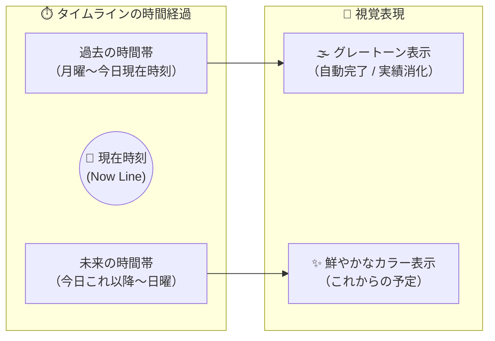
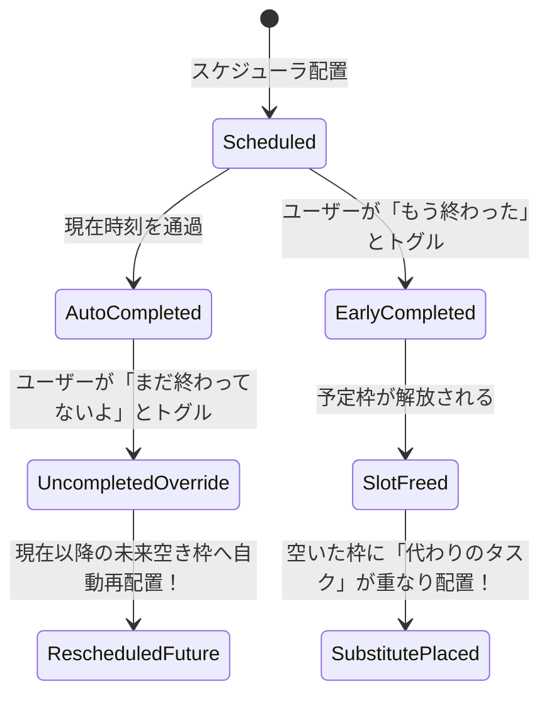

# リアルタイム適応型完了状態 ＆ 動的代替タスク配置仕様書（Plan11）

---

## 1. プロダクトビジョンと目的

### 1.1. 「生きた理論値」への進化
これまでの Plan1〜Plan10 では、週間計画表における「表主導の2層ブロック構造」や「細かさ優先の巡回配置アルゴリズム」により、静的な最適タイムラインの算出を実現しました。
**Plan11** では、さらに一歩進めて、**「ユーザーのリアルタイムの状況（現在日時と実際の進捗）に完全に同期する、生きた理論値」** を提供します。

時間の経過とともに過去のタスクは自然に消化済み（完了）となり、やり残した週タスクは未来の空き枠へと自動リスケジュールされ、前倒しで終わった枠には新しいタスクが代行配置される——という、実生活に寄り添うリアルタイム適応型タイムラインを実現します。

---

## 2. コア要件と設計仕様

### 2.1. 過去タスクの自動完了 ＆ グレートーン表現
- **自動完了判定ルール**:
  - 現在の曜日インデックス（`todayIndex`: 0:月〜6:日）および現在時刻（`currentMinutes`: 0〜1440分）を基準とする。
  - **日課タスク・固定枠（週タスク以外）**:
    - 過去の日付（`dayIndex < todayIndex`）
    - 今日の過去の時刻（`dayIndex === todayIndex && block.endMinutes <= currentMinutes`）
    - 上記に該当するタスクブロックは、自動的に **「完了状態（`isCompleted: true`）」** と判定する。
- **計画表（タイムライン）でのグレートーン表現**:
  - 完了したブロックは、本来の鮮やかなパステルカラーから、彩度を抑えた **洗練されたグレートーン（薄いグレー背景、柔らかいグレー枠線、落ち着いたテキスト色、彩度50%減）** で描画する。
  - 「すでに過ぎ去った実績」「消化済みのコマ」であることが一目で直感的にわかる。



---

### 2.2. 週タスクの有効期限設定（表データ項目）
- **基本思想**:
  - 日課タスクはその日限りのものですが、週タスク（目標、演習、レポート、付随タスク等）は「週の中でやりくりするもの」です。
  - そのため、週タスクの有効期限は **「基本1週間（当週の日曜24:00まで）」** とします。
- **表データでの設定UI**:
  - [`ImportedTablesManager.tsx`](file:///c:/Users/kousu/OneDrive/Desktop/creation_1/src/components/ImportedTablesManager.tsx) のツールバーおよび設定エリアに、**「週タスク有効期限」** の設定項目（半入力式またはセレクトボックス）を追加。
  - 選択肢: `1週間（当週内・推奨）`, `2週間`, `期限なし`。

---

### 2.3. 週タスクの完了トグルと動的再配置エンジン
計画表（タイムライン）上の週タスクブロックに、オン/オフ可能な **「完了状態トグル」** を設置します。



#### ① ケースA: 「まだ終わってないよ」（未完了トグル ➔ 未来への自動再配置）
- 過去の枠で自動完了状態になった週タスクについて、ユーザーが「まだ終わっていない」とトグルをオン（未完了化）した場合。
- **スケジューラの動的再配置**:
  - 当該週タスクを「未達成タスク」として即座に再評価。
  - **現在時刻以降の空き枠（今日の残り時間、または明日以降の未来曜日）** へ自動的に再配置（リスケジュール）を行う。
  - これにより、「予定の時間にできなかった週タスクが、未来の空き時間に自動で逃げて配置される」という強力な動的リカバリーが働く。

#### ② ケースB: 「これはもう終わっている」（早期完了トグル ➔ 代替タスクの割り振り）
- 未来に予定されている週タスク（または当日のタスク）を、ユーザーが前倒しで終わらせてトグルを完了にした場合。
- **スケジューラの動的再配置**:
  - その予定枠は「空き枠」として解放される。
  - まだ配置されていない他の週タスク、または日課の自動敷き詰めタスクが、空いた枠に**代行（代替）として割り振られる**。

---

### 2.4. 「代わりのタスク感」の視覚的オーバーレイ表現
ユーザー要望：
> 「この時、新タスクは元のタスクの上に重ねて新タスクの横幅を少し変えるなどをすることで、代わりのタスク感を出してほしいです。」

本来予定されていたタスクが早期完了し、代わりのタスクが割り振られた場合、単に置き換えるのではなく、**「二重レイヤーの重なり表現」** を行います。

```text
┌────────────────────────────────────────────────────────┐
│  元の完了タスク (背景側 / 横幅95% / 薄いグレートーン)    │
│  [✓ 完了] 線形代数 のタスク (15m)                      │
│  ┌──────────────────────────────────────────────┐     │
│  │ ⭐ 代替タスク (前景側 / 横幅85% / 鮮やかカラー) │     │
│  │ [代行] 基本情報・資格対策 (15m)              │     │
│  └──────────────────────────────────────────────┘     │
└────────────────────────────────────────────────────────┘
```

- **視覚仕様**:
  - **ベース層（元の完了タスク）**:
    - 背景側に配置。横幅は通常の95%〜100%。
    - 薄いグレートーン（透明度0.5〜0.6）、完了チェックマーク付き。
    - 「本来はこれが入っていたが、完了した」ことを示す。
  - **オーバーレイ層（代わりの新タスク）**:
    - 前景側（`z-index` 上位）に配置。
    - **横幅を少し変える（85%〜88%）**、左右にわずかな余白/インデントを設ける。
    - しっかりとした影（`shadow-md`）と鮮やかなアクセントカラー。
    - 左上または右上に **「代行」「前倒し」** のピルバッジを表示。
  - これにより、「前倒しで終わったから、代わりにこのタスクを滑り込ませた！」という達成感と代行感が直感的にユーザーに伝わります。

---

### 2.5. 週タスク限定完了トグル ＆ 日タスク一時除外の二段階空き枠探索

ユーザー要望：
> 「なぜか週タスク以外も完了、未完了が選択できるようになっているので、調整を行ってください。また、空きを見つけるロジックとしては、日タスクはいったん除外し、週タスクを再配置したうえで、その上から日タスクを再配置を行うような感じでお願いします。また、未来の週タスクについても、未完了の場合、再配置を行ってしまっているので、調整お願いします。」

#### ① 週タスク限定完了トグル制御
- **判定基準**:
  - `isWeeklyTaskItem(task)`: 課題 (`taskType === 'assignment'`)、付随タスク (`isAttachedTask`)、週周期 (`period === 'week'`)、頻度低・中 (`frequency === 'low' | 'medium' | 'custom'`) を週タスクとする。
  - 日課タスク (`period === 'day' || frequency === 'high'`) や固定枠 (`isFixed`)、休憩枠 (`isBreak`)、代行タスク (`isSubstitute`) は週タスクから除外。
- **UI制御**:
  - `block.isWeeklyTask === true` のブロックにのみ完了・未完了トグルボタンを表示。
  - 日課タスクや固定枠にはトグルボタンを一切表示せず、過去になれば自動完了（グレートーン）、未来なら未完了として自然に描画。

#### ② 日タスク一時除外による二段階配置パイプライン (Two-Phase Placement)
- **Phase 1（週タスク最優先配置）**:
  - 日課タスク（日タスク）をいったん完全に除外。
  - 固定枠以外の自由枠すべてを対象に、未完了週タスクの再配置プラン（`isRescheduledPlan`）および通常週タスクを優先配置。
  - 週タスクのフォールバック配置も日タスクの干渉なしで実行。
- **Phase 2（残余枠への日タスク再配置）**:
  - 週タスクが収まった後に残った最新の空きスロット（`dayAvailableSlots`）に対して、日課タスクを再配置・自動敷き詰め。
  - これにより、日課タスクが空き枠を埋め尽くして週タスクが逃げ場を失う問題を根本解消。

#### ③ 未来の週タスクの再配置防止
- 未来の週タスク（`fromDay > todayIdx`、または当日の現在時刻より後の枠）は、未完了であるのが正常な状態（これから行う予定）。
- したがって、「過去の枠（`fromDay < todayIdx || (fromDay === todayIdx && originalEndMinutes <= currMinutes)`）」に存在した週タスクのみを再配置プラン（リスケジュール）の対象とし、未来の週タスクが未完了だからといって余計に再配置・増殖するのを防止。

---

### 2.6. 日タスク（日課タスク）の配置仕様と整合性調整

ユーザー要望：
> 「今度は日タスクの配置に不備があります。調整してください。」

二段階配置（Two-Phase Placement）の導入に伴い生じた日タスクの配置不備を解消し、表主導・2層ブロック巡回アルゴリズムと完全に整合化しました。

#### ① 日タスクのプラン生成最優先化と誤分類の解消
- **発生していた不備**:
  - `plans` 生成部において、曜日指定（`targetDays`）や周期指定（`cycleDays`）が日課タスク判定より先に行われていたため、表からインポートされた日課タスク（月水金の日課や3日周期筋トレなど）が誤って `kind: 'weekly_specific'` と判定され、`weeklyPlans`（Phase 1）に入れられていた。
  - その結果、日課タスクなのに `isWeeklyTask: true` が付与され、完了トグルボタンが表示されたり、週タスクの週目標制限に引っかかって他曜日に配置されないなどの不整合が発生していた。
- **調整内容**:
  - `plans` 生成順序において、付随タスク・課題タスクの直後に **日課タスク (`task.period === 'day' || task.frequency === 'high'`) の判定を最優先配置**。
  - 曜日指定・周期指定を持つ日課タスクも確実に `kind: 'daily_fixed'` / `kind: 'daily_auto'` として生成。
  - `weeklyPlans` と `dailyPlans` の分離を `isWeeklyTaskItem(p.task)` に一本化し、日タスクは 100% Phase 2 に属することを保証。

#### ② 回数指定と自動敷き詰めの論理的完全整合
- **発生していた不備**:
  - 回数指定判定において `task.dailyCount > 1` となっていたため、ユーザーが「1日1回（`dailyCount: 1`）」と設定したタスクが回数指定と認識されず、誤って `isAuto: true`（1日48回敷き詰め）になっていた。
  - 特定曜日指定タスクがフリー日課の敷き詰めルールに巻き込まれ、空き枠を独占する不整合が発生していた。
- **調整内容**:
  - `task.dailyRepeatMode === 'custom'` または `task.dailyCount >= 1` を厳密に回数指定として判定。
  - 自動敷き詰め（`isAuto: true`）は、明示的に `dailyRepeatMode === 'auto'` を指定したタスク、または特定曜日指定がなく回数指定もないフリー日課タスクに限定。
  - これにより、「1回指定の日課タスクは各対象曜日に1回だけ配置」「自動敷き詰め日課は空き枠を均等に埋める」という明確な動作を実現。

#### ③ Phase 2 の日タスク専用化と公平巡回（Fair Round-Robin）
- **調整内容**:
  - Phase 2 から週タスクの混入（`weeklyDayTaskContexts` からの auto 抽出）を完全に撤廃。Phase 2 は純粋に **日タスク（`dailyPlans`）のみ** を配置。
  - Plan9 のコア原則（1巡目は1回以上、2巡目は2回以上、3巡目は3回以上＋自動タスク）に準拠した公平巡回パスを実行。
  - 日タスク配置ブロックはすべて `isWeeklyTask: false` となり、トグルボタンは一切表示されず、過去時刻の自動完了（グレートーン）のみが適用される。

---

### 2.7. 未配置判定の正常化 ＆ 救済フォールバック配置仕様

ユーザー要望：
> 「未配置の判定も調整が必要です。必要以上に未配置なものが存在してしまっています。配置ロジックと、未配置判定の両方の調整が必要だと思います。」

タイムライン上にすでに配置されているタスクが「未配置」として警告される不整合を根絶し、また枠不足によって配置から漏れそうなタスクを柔軟に救済する仕組みを導入しました。

#### ① 未配置判定（`unassignedTasks`）の厳密化とバグ修正
- **発生していた不備**:
  1. **付随タスク（`attached_task`）の 100% 未配置誤判定**:
     - 配置成功時の完了フラグ付与条件において `ctx.kind === 'attached_task'` が漏れていたため、月曜日の講義直後に完璧に配置されていても `isComplete = false` のままとなり、アプリ起動直後の初期データですら「1件未配置」と警告されていた。
  2. **部分達成タスクの誤判定**:
     - `if (plan.placedCount > 0 && !plan.isAuto && !plan.isComplete) unassignedTasks.push(plan.task)` となっていたため、週3回中2回配置されたタスクや、週6日配置された日課タスクなどがすべて「未配置」として集計・警告されていた。
  3. **再配置クローンタスクの重複計上**:
     - 未完了週タスクの未来再配置プラン（`isRescheduledPlan: true`）が未配置判定に重複混入するリスクがあった。
- **調整内容**:
  - **完了判定の修正**: `tryPlaceContextInDay` 内の完了条件に `ctx.kind === 'attached_task'` を追加。
  - **未配置定義の厳密化**: `placedCount === 0`（＝今週/本日のタイムライン上に1回も配置できなかったタスク）のみを真の未配置タスクとして計上。`placedCount > 0`（1回以上タイムラインに配置されているタスク）は未配置扱いから完全除外。
  - **重複除外**: `isRescheduledPlan` フラグを持つプランを未配置判定から除外し、元タスクのみを基準に集計。

#### ② 配置ロジックの救済強化（フォールバック配置）
- **発生していた不備**:
  - 曜日指定週タスク（`weekly_specific`）は指定された曜日（`candidateDays`）にしか探索されず、その曜日に講義や固定枠が詰まっていると、他曜日に膨大な空き枠があっても即座に未配置となっていた。
  - 優先順位や枠長・カテゴリ制約の都合で、通常フェーズで配置できなかったタスクに対する最終的な救済措置が存在しなかった。
- **調整内容**:
  - **Phase 1: 週タスクの他曜日フォールバック（`fallbackDays`）**:
    曜日指定週タスクが希望曜日の空き枠不足で目標回数に達しなかった場合、週内の他曜日（`[0..6]` の残り曜日）を自動的にフォールバック候補として探索し、週内での確実な枠確保を試みる。
  - **Phase 4: 最終救済フォールバックフェーズの新設**:
    全フェーズ（Phase 1: 週タスク、Phase 2: 日タスク公平巡回、Phase 3: 課題タスク）終了後、なお `placedCount === 0` のタスクが存在する場合、週全体の空き枠を用いて救済配置を実施。これにより、「枠はあるのに未配置になる」事態を撲滅。

---

## 3. 実装ステップと作業計画

1. **ステップ1: データ型の拡張 (`src/types/index.ts`)**:
   - `TheoreticalBlock` に `isWeeklyTask`, `isCompleted`, `isAutoCompleted`, `isUserToggled`, `isSubstitute`, `substitutedForTitle`, `isRescheduled` などのプロパティを追加。
   - `ImportedTableData` および `TableAxisConfig` に `weeklyTaskExpiry`（有効期限設定）を追加。
2. **ステップ2: スケジューリングエンジンの適応拡張 (`src/lib/scheduler.ts`)**:
   - `isWeeklyTaskItem` ヘルパーによる週タスク・日タスクの厳密分類。
   - 過去の未完了週タスクのみを対象とする再配置プラン生成（未来週タスクの除外）。
   - Phase 1（週タスク優先配置）➔ Phase 2（残り枠へ日タスク再配置）の二段階配置パイプライン。
   - 早期完了枠への代替タスク割り当てとオーバーレイブロック生成ロジック。
3. **ステップ3: 表データ設定UIの拡張 (`src/components/ImportedTablesManager.tsx`)**:
   - ツールバーに「週タスク有効期限」セレクトボックスを設置。
4. **ステップ4: 計画表（タイムライン）の視覚表現実装 (`src/components/Timeline24h.tsx`)**:
   - 完了タスクのグレートーン描画。
   - `isWeeklyTask === true` 限定の完了トグルボタン表示。
   - 代替タスクの二重レイヤー（幅86%重ね合わせ、影、代行バッジ）のCSS/レイアウト実装。
5. **ステップ5: 自動テストと検証 (`src/lib/scheduler.test.ts`)**:
   - 過去タスクの自動完了、週タスクの未完了時未来再配置、未来週タスクの増殖防止、週タスクフラグ判定、早期完了時の代替タスクオーバーレイ配置に関するテストケースを作成し検証。
