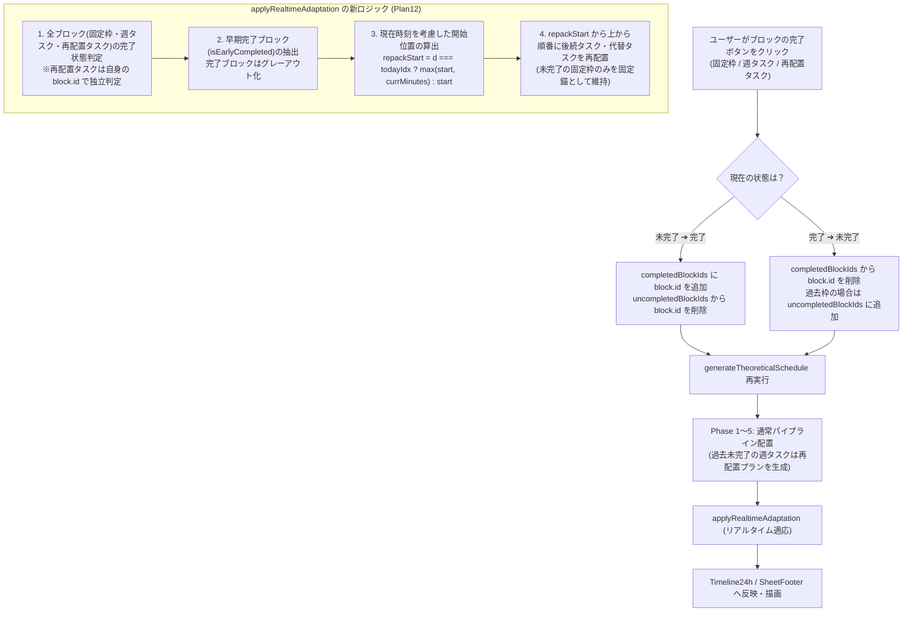

# 実装計画書（Plan12）：固定枠・週タスク・再配置タスクの完了状態と現在時刻基準の再配置仕様

## 1. 背景と目的

現在の完了状態管理（Plan11仕様）には、実際の利用シーンにおいて以下の2つの課題が存在します。

1. **課題や授業が予定より早く終わった際の動的再配置ニーズ**:
   - 現行仕様では「週タスク」のみに完了トグルが設けられており、「固定枠（授業・講義・予定など）」には完了状態が存在しない。
   - また、授業や課題が予定時刻より早く終わった際、そのブロックをグレーアウトさせた上で、**現在時刻（`currMinutes`）を考慮して空いた時間枠の上から後続タスクを前倒しで再配置する**一貫した仕組みが必要である。
2. **再配置タスク（`isRescheduled`）の完了操作の制限**:
   - 現行の [`realtimeAdaptor.ts`](file:///c:/Users/kousu/OneDrive/Desktop/creation_1/src/lib/scheduler/realtimeAdaptor.ts#L60-L64) では、`if (block.isRescheduled) { block.isCompleted = false; continue; }` により再配置ブロックが強制的に未完了固定となっている。
   - そのため、過去の週タスクを「未完了」にして未来へ再配置した際、「過去の元タスクを完了に戻す（＝再配置自体を消す）」以外に再配置タスクを完了にする手段がない。
   - 過去の元タスクは「その時点では未完了だった」状態を維持したまま、**再配置されたタスク自身を独立して完了状態に切り替えられるようにし、かつ1つ目の仕様（グレーアウト＆現在時刻基準の上からの再配置）も同様に適用する**必要がある。

本計画（`Plan12`）では、これら2つの仕様変更を設計・実装し、直感的で柔軟なリアルタイム・リスケジューリングを実現します。

---

## 2. 要件定義とコア仕様

### 要件①：固定タスク（固定枠）および週タスクへの完了状態の付与と、現在時刻を考慮した上からの再配置

1. **完了状態の対象拡大**:
   - **週タスク（`isWeeklyTask === true`）** に加え、**固定枠（`isFixed === true`：授業・講義・勤務・予定など ※休憩ブロック `isBreak` を除く）** にも完了状態（`isCompleted` / `isEarlyCompleted`）および完了トグルボタンを設ける。
2. **早期完了時のグレーアウト表示**:
   - 進行中または未来の固定枠・週タスクを完了状態（早期完了）にした場合、該当ブロックをグレーアウト（`COMPLETED_PALETTE` ＋ 半透明・破線枠スタイル）して元の時間帯に視覚的履歴として残す。
3. **現在時刻（`currMinutes`）を考慮した上からの再配置アルゴリズム**:
   - あるブロック `earlyBlock`（固定枠・週タスク・再配置タスク）が早期完了された際、再配置に利用できる開始基準時刻（`repackStartMinutes`）を以下のように算出する：
     - **当日の場合 (`d === todayIdx`)**: `Math.max(earlyBlock.startMinutes, currMinutes)`
       - 例：9:00〜10:30の授業が 9:40 に早く終わった場合、9:00〜9:40 は既に経過しているため、**現在時刻の 9:40 から** 空き時間として解放し、上から順番にタスクを再配置する。
       - 例：13:00〜14:30の課題を午前中（11:00）に前倒しで完了チェックした場合、`Math.max(13:00, 11:00) = 13:00` から空き時間として解放する。
     - **翌日以降の場合 (`d > todayIdx`)**: `earlyBlock.startMinutes`
   - **上からの再配置（前倒し詰め & 代替タスク割り当て）**:
     - `repackStartMinutes` から `earlyBlock.endMinutes`（およびそれ以降の時間帯）に向けて、同日の後続にある未完了タスク（日課タスク・週タスク・再配置タスク）や未消化プランを、**まだ完了していない他の固定枠（固定錨）を避けながら上から順番に隙間なく再配置（前倒し詰め）** する。
     - 固定枠に付随していた休憩時間（`breakMinutes`）も、固定枠が早期完了した場合は拘束を解除し、再配置用の空き時間として活用可能にする。

---

### 要件②：再配置タスク（`isRescheduled`）への独立した完了状態の付与と要件①の適用

1. **元タスクの未完了維持と再配置タスクの独立完了**:
   - 過去の週タスク（例：`block-task-0-xxx`）を「未完了」にしたことで生成された再配置ブロック（`block-rescheduled-2-xxx`）に対し、独立して完了判定・手動トグルを行えるようにする。
   - 再配置ブロックを完了にしても、元の過去ブロックは「その日時では未完了だった（やり残してリスケジュールされた）」状態を維持し、再配置ブロック側が完了（グレーアウト）となる。
2. **再配置タスクにおける完了状態判定ルール**:
   - [`realtimeAdaptor.ts`](file:///c:/Users/kousu/OneDrive/Desktop/creation_1/src/lib/scheduler/realtimeAdaptor.ts) において、`block.isRescheduled` を特別扱いしてスキップしていた処理を削除し、通常の週タスクと同様に扱う。
   - **重要（IDマッチングの分離）**:
     - 元の過去ブロックが `userUncompletedIds` に登録されていても、再配置ブロック（`block.isRescheduled === true`）の完了判定時には元ブロックのIDや共通 `taskId` による未完了フラグを引き継がず、**再配置ブロック自身の `block.id`（`block-rescheduled-...`）単位** で `userCompletedIds` / `userUncompletedIds` を判定する。
     - これにより、「元タスクは未完了（`userUncompletedIds` に存在）だが、再配置されたタスクは完了（`userCompletedIds` に存在、または時刻経過で自動完了）」という状態が正しく成立する。
3. **再配置タスクが早期完了された場合の再配置（要件①の適用）**:
   - 再配置タスクを予定より早く完了トグルした場合も、要件①と同様に**再配置タスクをグレーアウトし、現在時刻（`currMinutes`）を考慮したうえで上から後続・代替タスクを再配置**する。

---

## 3. アーキテクチャと処理フロー

---

## 4. 変更対象ファイルと実装詳細

### Step 1: スケジューラ・リアルタイム適応ロジックの改修（[`src/lib/scheduler/realtimeAdaptor.ts`](file:///c:/Users/kousu/OneDrive/Desktop/creation_1/src/lib/scheduler/realtimeAdaptor.ts)）

1. **完了トグル対象判定の拡張**:
   - `isToggleableBlock(block)` を定義し、`!block.isBreak && !block.isSubstitute && (block.isFixed || isWeeklyTaskBlock(block) || block.isRescheduled)` を対象とする。
2. **再配置ブロック（`isRescheduled`）の独立完了判定**:
   - 従来の `if (block.isRescheduled) { block.isCompleted = false; continue; }` を撤廃。
   - `block.isRescheduled` の場合は、`block.taskId` での一括一致ではなく **`block.id` 完全一致** で `userCompletedIds` / `userUncompletedIds` を評価する（元の過去ブロックの未完了状態と干渉させないため）。
   - ユーザーが `block.id` を完了にした場合は `block.isCompleted = true`（未来または現在進行中なら `block.isEarlyCompleted = true` で `earlyCompletedBlocks` に追加）とする。
3. **現在時刻を考慮した上からの再配置処理**:
   - `earlyCompletedBlocks`（早期完了された固定枠・週タスク・再配置タスク）について：
     - 当日（`d === todayIdx`）かつ `earlyBlock.endMinutes > currMinutes` の場合、利用可能な開始時刻を `effectiveStart = Math.max(earlyBlock.startMinutes, currMinutes)` とする（翌日以降は `earlyBlock.startMinutes`）。
     - 早期完了されたブロック（固定枠含む）は「固定錨（`fixedAnchors`）」の障害物判定から除外し、背後の土台（グレーアウト表示用）として保持する。
     - `effectiveStart` から順に、後続の未完了タスクおよび代替タスク候補を上から隙間なく再配置（前倒し詰め）する。

### Step 2: 状態管理・トグルハンドラの拡張（[`src/app/page.tsx`](file:///c:/Users/kousu/OneDrive/Desktop/creation_1/src/app/page.tsx)）

1. **[`handleToggleBlockComplete`](file:///c:/Users/kousu/OneDrive/Desktop/creation_1/src/app/page.tsx#L382-L445) のガード条件緩和**:
   - 従来の `if (!block.isWeeklyTask) return;` を変更し、**固定枠（`block.isFixed`）、週タスク（`block.isWeeklyTask`）、再配置タスク（`block.isRescheduled`）** のすべてで完了トグルを受け付けるようにする（休憩 `block.isBreak` は除外）。
   - 固定枠を過去の時間帯に「未完了」へ戻した場合は、週タスクのような未来への複製（リスケジュール）は行わず、その場の完了/未完了表示のみを切り替えるよう [`planGenerator.ts`](file:///c:/Users/kousu/OneDrive/Desktop/creation_1/src/lib/scheduler/planGenerator.ts#L223) の既存の `if (!isWeeklyTaskItem(matchedTask)) continue;` ガードと連携させる。
2. **週タスク一覧（`weeklyBlocks`）の集計調整（[`src/app/page.tsx`](file:///c:/Users/kousu/OneDrive/Desktop/creation_1/src/app/page.tsx#L484-L494) / [`SheetFooter.tsx`](file:///c:/Users/kousu/OneDrive/Desktop/creation_1/src/components/SheetFooter.tsx)）**:
   - タスク管理ドロワーにおいて、再配置タスク（`isRescheduled`）も完了トグル操作ができるよう表示・進捗集計を整える。

### Step 3: タイムラインUIの完了トグル・グレーアウト表示対応（[`src/components/Timeline24h.tsx`](file:///c:/Users/kousu/OneDrive/Desktop/creation_1/src/components/Timeline24h.tsx)）

1. **トグルボタンの表示条件拡張**:
   - [`Timeline24h.tsx`](file:///c:/Users/kousu/OneDrive/Desktop/creation_1/src/components/Timeline24h.tsx#L931-L935) および `L1144` の完了ボタン表示条件を、週タスクだけでなく **固定枠（`block.isFixed`）** および **再配置タスク（`block.isRescheduled`）** にも拡大する。
2. **早期完了時のグレーアウト＆レイヤー描画**:
   - 固定枠や再配置タスクが早期完了（`isEarlyCompleted`）となった場合も、グレーアウト（`COMPLETED_PALETTE` / 取り消し線 / 半透明表示）を適用し、その時間帯に前倒し・再配置された新タスクと視認性よく共存表示させる。

---

## 5. テスト・品質検証計画

[RULES.md](file:///c:/Users/kousu/OneDrive/Desktop/creation_1/RULES.md) に準拠し、以下の単体テスト追加および品質ハーネス検証を実施します。

1. **単体テスト（[`src/lib/scheduler.test.ts`](file:///c:/Users/kousu/OneDrive/Desktop/creation_1/src/lib/scheduler.test.ts)）の追加・更新**:
   - **テストケース1（固定枠の早期完了と現在時刻基準の再配置）**: 授業などの固定枠（例: 9:00〜10:30）を現在時刻 9:30 で早期完了にした際、固定枠がグレーアウト（`isCompleted: true`, `isEarlyCompleted: true`）になり、9:30 以降に後続タスクが上から前倒し再配置されることを検証。
   - **テストケース2（週タスクの早期完了と現在時刻基準の再配置）**: 課題などの週タスクが予定より早く終わった際、現在時刻以降の上から後続タスクが再配置されることを検証。
   - **テストケース3（再配置タスク単体の完了状態切り替え）**: 過去の週タスクを未完了にして生成された `block-rescheduled-...` に対し、元のタスクを完了に戻さなくても、再配置タスク単体で完了状態（`isCompleted: true`）にでき、かつ早期完了時には上から再配置が行われることを検証。
2. **品質保証コマンドの実行**:
   - `npm run typecheck`
   - `npm run test`
   - `npm run lint`
   - `npm run format`
   - `npm run build`
