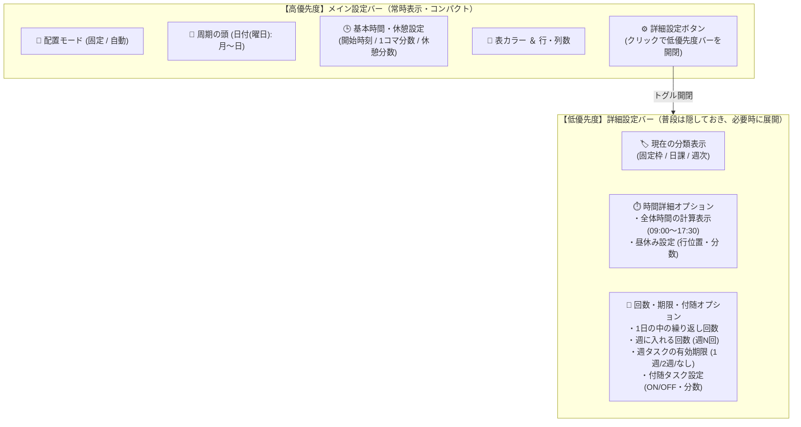

# 実装計画書（Plan13）：データ管理タブの整理（タスク管理のON/OFF特化・表データの一律周期管理化・設定項目の優先度階層化）

## 1. 背景と目的

現在の「データ管理」タブ（[`ImportedTablesManager.tsx`](file:///c:/Users/kousu/OneDrive/Desktop/creation_1/src/components/ImportedTablesManager.tsx) および [`TaskManager.tsx`](file:///c:/Users/kousu/OneDrive/Desktop/creation_1/src/components/TaskManager.tsx)）には、機能追加に伴って以下の3つの課題が生じています。

1. **「計画表インスペクター」の名称と役割の曖昧さ**:
   - 左サイドバーの第2セクションが「計画表インスペクター」という直感的でない名称になっている。
   - また、その中のタスク一覧画面（[`TaskManager.tsx`](file:///c:/Users/kousu/OneDrive/Desktop/creation_1/src/components/TaskManager.tsx)）に「完了状態のチェック（`task.completed`）」や「プリセット追加」「複雑な個別作成フォーム」などが混在しており、計画表タイムラインやフッターの週タスクバーで行うべき「完了状態の管理」と役割が重複している。
   - データ管理タブ内の「タスク管理」は、**「各タスク（および固定枠）を計画表に組み込むかどうかの ON / OFF 管理の場」** に役割を純化する必要がある。
2. **表データの「曜日管理」と「周期管理」の二重構造**:
   - 現在、表データの列管理には「📅 曜日で管理」と「🔄 周期で管理」の切り替えが存在するが、1週間の時間割も「7日周期（頭＝月曜）」という周期の一種であり、2つのモードに分かれていることでUIと内部処理が複雑化している。
   - 表データを**一律で「周期管理」に統一**し、新たに **「周期の頭の位置（開始日付・曜日：`M/D (月)`〜`M/D (日)`）」** を設定できるようにすることで、3日周期・5日周期・7日周期（曜日時間割）のすべてを単一のシンプルな仕組みで柔軟に扱えるようにしたい。
3. **表データの設定ツールバーの情報過多**:
   - 表データ上部のツールバーに10個以上の設定項目が常時横並びで露出しており、画面を圧迫して主要な設定が埋もれている。
   - 設定項目に**優先度（高／低）**を設け、**優先度の低い設定項目は普段は折りたたみバー（詳細設定バー）の中に隠しておき、必要なときだけユーザーが開いて調整する**形に整理したい。

---

## 2. 要件定義とコア仕様

### 要件①：「計画表インスペクター」を「タスク管理」へ変更し、各タスクのON/OFF管理のみに役割を絞る

1. **名称の変更**:
   - [`ImportedTablesManager.tsx`](file:///c:/Users/kousu/OneDrive/Desktop/creation_1/src/components/ImportedTablesManager.tsx#L1057-L1068) の左サイドバー第2セクション名を `🔍 計画表インスペクター`（折りたたみ時 `確認`）から **`📋 タスク管理`**（折りたたみ時 `タスク`）に変更する。
   - 右ペイン上部のパンくず表示も `基本設定 / ...` から `タスク管理 / ...` に統一する。
2. **完了状態管理の廃止と個別 ON / OFF 管理への特化**:
   - [`TaskManager.tsx`](file:///c:/Users/kousu/OneDrive/Desktop/creation_1/src/components/TaskManager.tsx) から、各タスクの完了チェックボタン（`handleToggleComplete`、チェックアイコン、完了時の取り消し線スタイル）を撤廃する（完了状態の管理は計画表シートおよびフッターのタスクバーに一元化）。
   - また、役割を「各タスクのON/OFF管理」に集中させるため、上部プリセット追加バーや新規作成・詳細編集モーダル等の過剰な操作要素を整理・簡素化する。
   - [`TaskItem`](file:///c:/Users/kousu/OneDrive/Desktop/creation_1/src/types/index.ts#L32) および [`FixedSlot`](file:///c:/Users/kousu/OneDrive/Desktop/creation_1/src/types/index.ts#L3) に `enabled?: boolean`（デフォルト `true`）を導入し、タスク管理画面の各行・各カードに **個別の `ON / OFF` トグルスイッチ** を配置する。
   - ユーザーは「タスク管理」セクション（`固定枠` / `今日のタスク` / `今週のタスク`）において：
     - セクション全体の反映 `ON / OFF`（右上スイッチ）
     - 各タスク・各固定枠ごとの個別 `ON / OFF`（各アイテムのスイッチ）
     - 一括 `すべてON` / `すべてOFF` や絞り込み確認
       のみをシンプルに行えるようにする。
3. **スケジューラへの反映**:
   - [`src/app/page.tsx`](file:///c:/Users/kousu/OneDrive/Desktop/creation_1/src/app/page.tsx#L491-L505) の `effectiveFixedSlots` および `effectiveTasks` のフィルタリングにおいて、`slot.enabled !== false` および `task.enabled !== false` のアイテムのみを計画表生成エンジン（`generateTheoreticalSchedule`）に渡す。

---

### 要件②：表データの設定を一律「周期管理」に統一し、「周期の頭の位置」を「日付（曜日）」形式で月〜日まで設定可能にする

1. **一律「周期管理」への統一**:
   - 表データ（[`ImportedTableData`](file:///c:/Users/kousu/OneDrive/Desktop/creation_1/src/types/index.ts#L191)）の列管理をすべて **周期管理（`Day 1`, `Day 2`, ..., `Day N`）** に統一し、従来の「📅 曜日 ⇄ 🔄 周期」の切り替えスイッチを廃止する。
   - 各列ヘッダーは `Day 1`, `Day 2`, ..., `Day N`（および `オフ (何もしない日)` / `除外`）として管理し、列数がそのまま周期の長さ（`cycleCount`、除外列を除く）となる。
   - 空の列（タスクが1つも入っていない列）は自動的に「💤 オフ日（周期内で何もしない日）」として扱う。
2. **「周期の頭の位置」を「日付（曜日）」形式（月〜日）で指定**:
   - [`ImportedTableData`](file:///c:/Users/kousu/OneDrive/Desktop/creation_1/src/types/index.ts#L191) に以下を追加する：
     - `cycleStartDay?: number`（`0: 月` 〜 `6: 日`、デフォルトは `0: 月`）
     - `cycleStartDate?: string`（基準となる開始日付 `"YYYY-MM-DD"`）
   - 今週の月曜日〜日曜日の日付を算出し、セレクタの選択肢を **`M/D (月)` 〜 `M/D (日)` の「日付（曜日）」形式**（例：`11/2 (月)`, `11/3 (火)`, `11/4 (水)`, `11/5 (木)`, `11/6 (金)`, `11/7 (土)`, `11/8 (日)`）として表示し、月〜日まで直感的に指定できるようにする。
   - 表の左上交差セル（従来の「列の管理」スイッチがあった場所）およびメイン設定バーにて、この `日付（曜日）` セレクタから周期の頭（`Day 1` の開始日）を選択できるようにする。
   - 各列ヘッダーには、選択された開始日付（`cycleStartDate` / `cycleStartDay`）から順に算出した対応日付・曜日バッジ（例：`11/4 (水)` を周期の頭にした場合、1列目に `Day 1 · 11/4(水)`、2列目に `Day 2 · 11/5(木)` ...）を併記し、各列がどの日付（曜日）にあたるかを一目で分かるようにする。
3. **周期の頭を考慮したスケジュール生成・配置アルゴリズム**:
   - [`tableUtils.ts`](file:///c:/Users/kousu/OneDrive/Desktop/creation_1/src/lib/tableUtils.ts) の [`generateScheduleItemsForTable`](file:///c:/Users/kousu/OneDrive/Desktop/creation_1/src/lib/tableUtils.ts#L376) および [`planGenerator.ts`](file:///c:/Users/kousu/OneDrive/Desktop/creation_1/src/lib/scheduler/planGenerator.ts) において、計画表の各曜日 `d`（`0:月` 〜 `6:日`）に対する周期オフセットを以下のように計算する：
     $$\text{offsetDay} = (d - \text{cycleStartDay} + 7) \bmod 7$$
     $$\text{activeCycleIndex} = \text{offsetDay} \bmod \text{cycleCount}$$
   - **固定枠（`classification === 'fixed_slot'`）の場合**:
     - 列の周期インデックス `cycleIdx`（`0` = Day 1, `1` = Day 2, ...）に該当する曜日 `daysOfWeek` を、`((d - cycleStartDay + 7) % 7) % cycleCount === cycleIdx % cycleCount` で算出する。
     - ※既存のサンプル時間割など、元の列ヘッダーが `月曜`〜`金曜`（5列）だった表データを読み込んだ場合も、`cycleStartDay` を基準に各列の予定が正しく配置されるよう互換性を維持する。
   - **日課・週次タスク（`daily_task` / `weekly_task`）の場合**:
     - [`TaskItem`](file:///c:/Users/kousu/OneDrive/Desktop/creation_1/src/types/index.ts#L32) に `cycleStartDay?: number`（および `cycleStartDate?: string`）を伝播し、[`planGenerator.ts`](file:///c:/Users/kousu/OneDrive/Desktop/creation_1/src/lib/scheduler/planGenerator.ts) での候補曜日（`candidateDays`）算出時に `((d - (task.cycleStartDay ?? 0) + 7) % 7) % cycleCount === cIdx % cycleCount` で判定する。

---

### 要件③：表データの設定項目に優先度を設け、低優先度項目を折りたたみバーに格納する

表データの設定項目を **「高優先度（常時表示バー）」** と **「低優先度（折りたたみ詳細設定バー）」** の2階層に整理します。ご指定の通り、**「休憩」を高優先度（常時表示）**、**「分類表示」を低優先度（詳細設定バー内）** に配置します。

#### 1. 高優先度設定項目（メインバーに常時表示）

ユーザーが表を作成・編集する際にもっとも頻繁に触れるコア設定を常時表示します。

- **配置モード**: `📌 固定` / `⚡ 自動`
- **時間（開始〜終了）**: `時間: [開始 09:00] 〜 [終了 自動 (最大値)]`（開始時刻と終了上限時刻を1つの枠に統合）
- **周期の頭**: `頭: M/D (月) 〜 M/D (日)`（表の左上交差見出しとも連動）
- **1コマ分数**: `1コマ: 90分`（タスクの所要時間基準）
- **休憩分数**: `休憩: 10分`（コマ間休憩 / タスク後余白）
- **表カラー & 行・列ステッパー**: 表の色変更（丸型ボタン・丸型パレットスウォッチ）および行数・列数の増減
- **詳細設定トグルボタン (`⚙️ 詳細設定`)**:
  - 低優先度の設定項目が格納されたバーを開閉するボタン。
  - デフォルト値から変更されている低優先度項目がある場合は、ボタン上に件数バッジやドットを表示して設定中であることが分かるようにする。

#### 2. 低優先度設定項目（普段はバーの中に隠し、展開時のみ表示）

`⚙️ 詳細設定` ボタンをクリックしたときのみ、メインバーの直下にスライド展開される「詳細設定バー」の中に以下の項目を整理して格納します。

- **分類表示**:
  - **現在の分類バッジ** (`分類: 📌 固定枠 / 🏃 日課 / 🎯 週次` の自動判定結果表示)
- **表の全体時間（サマリー表示）**:
  - **表全体の開始〜終了時刻** (`全体時間: 09:00 〜 17:30 (5行)`)
- **時間・昼休みの詳細設定グループ**:
  - **昼休み設定** (`昼休: 丸型トグルスイッチ ON/OFF・N行後・40〜70分` ※開始時刻設定時)
  - ※ **行ごとの時間微調整**はツールバー内ではなく、**表の左端（各行ヘッダー）の時刻欄で直接変更・リセット**できるように配置。
- **反復回数・期限・付随タスク設定グループ**:
  - **1日の中の繰り返し回数** (`1日: 指定なし / 1〜10回`)
  - **週に入れる回数** (`週: 指定なし / 週1〜7回`)
  - **週タスクの有効期限** (`有効期限: 1週間 / 2週間 / 期限なし`)
  - **付随タスク設定** (`付随タスク: 丸型トグルスイッチ ON/OFF・10〜90分`)

---

## 3. 変更対象ファイルと実装ステップ

### Step 1: 型定義の拡張（[`src/types/index.ts`](file:///c:/Users/kousu/OneDrive/Desktop/creation_1/src/types/index.ts)）

1. [`FixedSlot`](file:///c:/Users/kousu/OneDrive/Desktop/creation_1/src/types/index.ts#L3) に `enabled?: boolean` を追加。
2. [`TaskItem`](file:///c:/Users/kousu/OneDrive/Desktop/creation_1/src/types/index.ts#L32) に `enabled?: boolean`、`cycleStartDay?: number`（0:月〜6:日）、`cycleStartDate?: string`（`"YYYY-MM-DD"`）を追加。
3. [`ImportedTableData`](file:///c:/Users/kousu/OneDrive/Desktop/creation_1/src/types/index.ts#L191) に `cycleStartDay?: number`（0:月〜6:日、デフォルト `0`）および `cycleStartDate?: string` を追加。

### Step 2: 表データの周期管理統一と「周期の頭」計算ロジックの実装（[`src/lib/tableUtils.ts`](file:///c:/Users/kousu/OneDrive/Desktop/creation_1/src/lib/tableUtils.ts) / [`src/lib/scheduler/planGenerator.ts`](file:///c:/Users/kousu/OneDrive/Desktop/creation_1/src/lib/scheduler/planGenerator.ts)）

1. [`tableUtils.ts`](file:///c:/Users/kousu/OneDrive/Desktop/creation_1/src/lib/tableUtils.ts) において：
   - 表データの列管理を一律周期ベース（`Day 1`, `Day 2`, ...）として扱うように整理。
   - `table.cycleStartDay ?? 0` を用いて、各列 `c`（または `cycleIdx`）が計画表のどの曜日 `d` に割り当たるかを `((d - cycleStartDay + 7) % 7) % cycleCount === cycleIdx % cycleCount`（または曜日指定列からのシフト）で算出するよう [`generateScheduleItemsForTable`](file:///c:/Users/kousu/OneDrive/Desktop/creation_1/src/lib/tableUtils.ts#L376) を更新。
2. [`planGenerator.ts`](file:///c:/Users/kousu/OneDrive/Desktop/creation_1/src/lib/scheduler/planGenerator.ts) において：
   - `task.cycleDays` から `candidateDays` を算出する際、`task.cycleStartDay ?? 0` を起点として曜日をマッピングするよう更新。

### Step 3: データ管理タブのUI改修（[`src/components/ImportedTablesManager.tsx`](file:///c:/Users/kousu/OneDrive/Desktop/creation_1/src/components/ImportedTablesManager.tsx)）

1. **サイドバー＆パンくずの「タスク管理」化**:
   - 左サイドバー第2セクションを `📋 タスク管理` に変更。
2. **表データの左上交差セル＆列ヘッダーの周期管理統一**:
   - 今週の月曜〜日曜の日付リストを生成し、左上交差セルおよびメインバーで **「周期の頭：`M/D (月)` 〜 `M/D (日)`」** を選択可能にする。
   - 列ヘッダーを `Day 1`, `Day 2`, ...（＋ `オフ (何もしない日)` / `除外`）に統一し、周期の頭の日付から算出した `M/D (曜)` ラベルを各列ヘッダーに表示。
3. **設定ツールバーの優先度階層化**:
   - **高優先度（常時表示メインバー）**: 配置モード、周期の頭（日付(曜日)）、開始時刻、1コマ分数、**休憩分数**、表カラー、行列数、`⚙️ 詳細設定` トグルボタン。
   - **低優先度（折りたたみ詳細設定バー）**: **分類表示**、終了時刻、昼休み、時間微調整、1日回数、週回数、有効期限、付随タスク。

### Step 4: タスク管理画面のON/OFF管理特化（[`src/components/TaskManager.tsx`](file:///c:/Users/kousu/OneDrive/Desktop/creation_1/src/components/TaskManager.tsx) / [`src/app/page.tsx`](file:///c:/Users/kousu/OneDrive/Desktop/creation_1/src/app/page.tsx)）

1. [`TaskManager.tsx`](file:///c:/Users/kousu/OneDrive/Desktop/creation_1/src/components/TaskManager.tsx) から完了チェックボタン（`task.completed` トグル）やプリセット追加バー等を撤廃。
2. 各タスクカード・各固定枠カードに **計画表への反映 `ON / OFF` トグルスイッチ** を配置し、一括ON/OFFボタンと絞り込み・並び替えで各タスクの有効/無効を直感的に切り替えられるUIに刷新。
3. [`src/app/page.tsx`](file:///c:/Users/kousu/OneDrive/Desktop/creation_1/src/app/page.tsx) の `effectiveFixedSlots` / `effectiveTasks` で `enabled !== false` のみを抽出してスケジューラへ渡す。

---

## 4. テスト・品質検証計画

1. **単体テスト（[`src/lib/tableUtils.test.ts`](file:///c:/Users/kousu/OneDrive/Desktop/creation_1/src/lib/tableUtils.test.ts) / [`src/lib/scheduler.test.ts`](file:///c:/Users/kousu/OneDrive/Desktop/creation_1/src/lib/scheduler.test.ts)）**:
   - 表データにおいて `cycleStartDay` / `cycleStartDate`（周期の頭の位置：例 `2 = 水曜`）を変更した際、`Day 1` の予定が水曜から順に配置されることを検証。
   - タスクや固定枠の個別 `enabled: false`（OFF状態）がスケジューリング結果から除外され、`enabled: true`（ON状態）で再び組み込まれることを検証。
2. **品質保証コマンドの実行**:
   - `npm run typecheck`
   - `npm run test`
   - `npm run lint`
   - `npm run format`
   - `npm run build`
