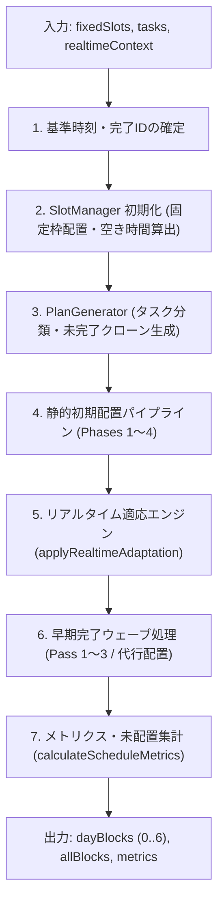
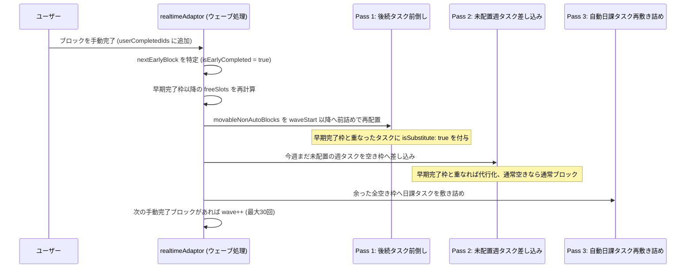
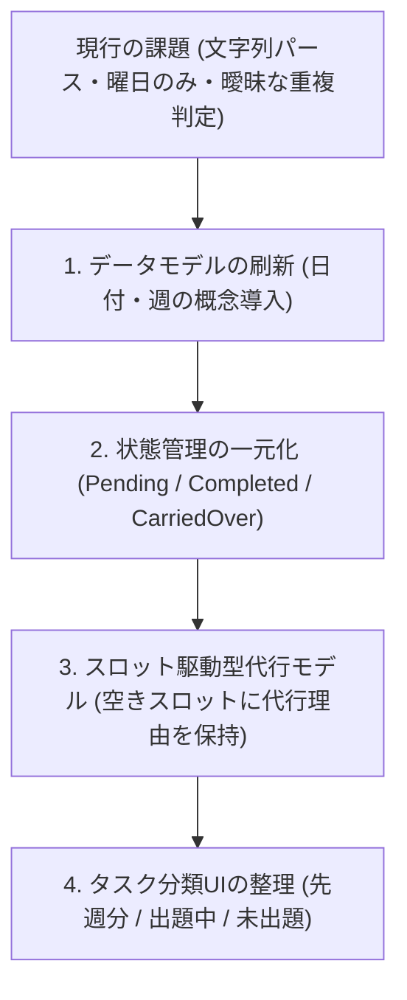
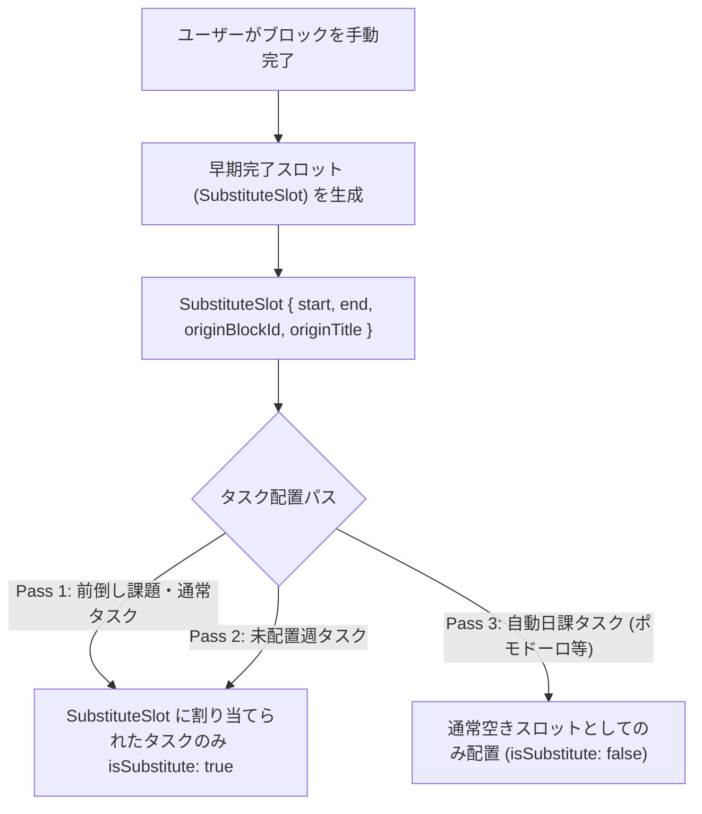

# 仕様書・分析書（Plan14）：計画表の配置ロジック・状態管理の仕様整理と課題の洗い出し

## 1. はじめに・策定の目的

本作「理論値スケジュール（creation_1）」は、固定枠（授業・睡眠・食事等）と多様なタスク（週タスク、課題、日課ルーティン、付随タスク、自動敷き詰めタスク等）を統合し、1週間24時間の理論値タイムラインを自律編成する高度なスケジューリングエンジンを備えています。

しかしながら、機能の継続的拡張（早期完了に伴う前倒し代行タスク、未完了タスクの翌日以降への再配置、連鎖完了、表データ連携など）に伴い、**「内部の配置ロジックの複雑化」**や**「完了・未完了状態の判定およびID管理の二重性・曖昧さ」**が蓄積し、一部で意図しない代行タスクの発生や状態不整合の原因となっていました。

本書（`Plan14.md`）は、**現在時点（2026年11月現在）における計画表の配置ロジック、完了・未完了のライフサイクル、およびデータ構造を完全な仕様書として体系化**するとともに、**コードベース全体に潜む「不明瞭な点」「不可解なロジック」「設計上の歪み」を徹底的に洗い出してピックアップ**し、今後の抜本的リファクタリングとロジックの健全化に向けた基盤とすることを目的とします。

---

## 2. 全体アーキテクチャと実行パイプライン

計画表の生成は、[`src/lib/scheduler/index.ts`](file:///c:/Users/kousu/OneDrive/Desktop/creation_1/src/lib/scheduler/index.ts) の `generateTheoreticalSchedule` 関数を起点として、以下の7段階のパイプラインで実行されます。



### パイプラインの主要ステップ
1. **基準日時の確定**:
   - `todayIdx`（0:月曜 〜 6:日曜）および `currMinutes`（0〜1440分、デフォルトは現在時刻）を確定。
   - ユーザー操作による手動完了ID集合（`userCompletedIds`）および手動未完了ID集合（`userUncompletedIds`）を受け取る。
2. **SlotManager による初期化**:
   - 固定枠（`FixedSlot`）を該当曜日の `dayBlocks[d]` に `block-fixed-${d}-${slot.id}` として配置。
   - 0:00〜24:00 の中で固定枠が占有していない時間帯を `freeSlots`（空きインターバル）として算出。
3. **PlanGenerator によるタスク計画（TaskPlacementPlan）の策定**:
   - 各タスクの属性を解析し、課題タスク、付随タスク、回数指定日タスク、週タスク、自動敷き詰めタスクに分類。
   - `userUncompletedIds` に過去の週タスクが存在する場合、未来の曜日に配置するための「未完了再配置プラン（クローン）」を動的生成。
4. **静的初期配置パイプライン（4つのフェーズ）**:
   - **Phase 1: 週タスク配置**: 締切日や曜日希望を考慮し、空き時間の多い曜日に優先配置。
   - **Phase 2: 日課公平巡回配置**: 回数指定タスク等を曜日間で偏りなく配置。
   - **Phase 3: 付随タスク別日フォールバック**: 講義直後に空きがなかった場合の別日救済。
   - **Phase 4: 最終レスキュー**: 未配置タスクの隙間詰め。
5. **リアルタイム適応エンジン（applyRealtimeAdaptation）**:
   - 過去時刻の自動完了判定（`isAutoCompleted`）。
   - 手動完了されたブロック（`userCompletedIds`）を起点とする「早期完了ウェーブ処理」を実行。
   - 早期完了によって開放された空き時間へ、後続タスクの前倒し（代行タスク化）、未配置週タスクの差し込み、自動日課タスクの再敷き詰めを行う。
6. **集計とサマリー出力**:
   - カテゴリ別時間、未配置タスク、理論値スコア等のメトリクスを算出。

---

## 3. 詳細仕様：計画表の配置ロジック

### 3.1 タスク分類と配置プラン（`TaskPlacementPlan`）

各タスクは以下の5種類の配置計画（`kind`）に分類されます：

| 計画種別 (`kind`) | 該当するタスク条件 | 配置挙動・制約 |
| :--- | :--- | :--- |
| **`assignment`** (課題) | `taskType === 'assignment'` または `deadlineDay` あり | 出題曜日（`startDay`）〜締切曜日（`deadlineDay`）の範囲内のみに配置。週1回。 |
| **`attached`** (付随) | `isAttachedTask === true` | 親となる固定講義の終了時刻直後（休憩含む）に最優先配置。満杯時は別日へフォールバック。 |
| **`daily_fixed`** (回数日課) | `period === 'day'` かつ `dailyCount >= 1`（カスタム回数） | 指定された曜日（`targetDays` / `cycleDays`）に日ごとの指定回数を配置。 |
| **`weekly_flexible`** (週タスク) | `period === 'week'` または `frequency` 指定 | 指定曜日（`targetDays`）を第一希望としつつ、空きがなければ週の全曜日（0..6）へ柔軟に越境配置。 |
| **`daily_auto`** (自動敷き詰め) | `dailyRepeatMode === 'auto'`（ポモドーロ等） | 固定枠・週タスク・回数日課タスクを配置し終わった後の**残余空き時間全体に隙間なく反復配置**。 |

---

### 3.2 リアルタイム適応エンジンのウェーブ処理（`applyRealtimeAdaptation`）

ユーザーがブロックを完了にした際、当日のスケジュールを時系列で再編成する仕組みです。



#### 3段階の再配置パス（Pass 1 〜 Pass 3）
1. **Pass 1: 当日の非自動タスク前倒し（`movableNonAutoBlocks`）**:
   - `waveStart`（早期完了枠の開始時刻、当日かつ現在時刻以降）以降に元々配置されていた通常タスクを、本来の所要時間を保ったまま手前の空き枠へ前倒しで再配置。
   - 早期完了枠（`dayEarlyBlocks`）と時間帯が重複した場合、そのタスクに `isSubstitute: true`、`substitutedForTitle`、`substitutedForBlockId` を付与。
2. **Pass 2: 未配置週タスクの差し込み（`eligibleIncompleteWeeklyPlans`）**:
   - 今週まだ目標回数に達していない週タスク（または未来の曜日に予定されている未完了週タスク）を、開放された空きスロットに配置。
   - 早期完了枠と重複していれば代行タスク（`block-substitute-...`）とし、重なっていない通常の空き枠であれば通常タスク（`block-task-...`）として配置。
3. **Pass 3: 自動敷き詰めタスクの再敷き詰め（`autoPlans`）**:
   - 上記の配置後に残ったすべての隙間（15分以上のスロット）に対し、自動日課タスク（読書、復習など）をバランスよく反復配置。

---

### 3.3 代行タスク（`isSubstitute`）のライフサイクルと仕様

- **代行タスクとは**:
  - 本来の予定（固定講義や通常タスク）が予定終了時刻よりも早く完了（早期完了）したことで空いた時間枠に対し、後続のタスクや未配置の週タスクが前倒しで身代わり配置されたブロック。
- **代行タスクの属性**:
  - `isSubstitute: true`: 代行バッジ（`[代行]` / `✨代行`）の表示トリガー。
  - `substitutedForTitle`: 代行元のタスク名（例: `"線形代数学"`）。
  - `substitutedForBlockId`: 代行元のブロックID。
- **UIでの表示と「戻す」ボタン**:
  - タイムライン上では青いリング（`ring-blue-400`）とハイライトで表示される。
  - 代行タスクの右端には、大元の早期完了を取り消して本来のスケジュールに戻すための**「↩ 戻す」ボタン**が提供される。

---

## 4. 詳細仕様：完了状態・未完了状態のライフサイクル

### 4.1 状態の分類（4つの状態）

| 状態名 | 内部フラグ | 判定基準 | タイムライン表示 |
| :--- | :--- | :--- | :--- |
| **未完了** | `isCompleted: false` | 未来または進行中の予定で、手動完了されていないもの。 | 通常カラー、未完了トグルボタン（紫色/琥珀色） |
| **手動完了** | `isCompleted: true`, `isUserToggled: true` | ユーザーが完了トグルを押したブロック（過去枠・未来枠問わず）。 | 半透明グレーアウト、取り消し線、緑色チェックボタン |
| **自動完了** | `isCompleted: true`, `isAutoCompleted: true` | 終了時刻が現在時刻を過ぎた（`isPast === true`）ブロックで、手動未完了にされていないもの。 | 半透明グレーアウト、取り消し線、緑色チェックボタン |
| **早期完了** | `isCompleted: true`, `isEarlyCompleted: true` | 未来または進行中の枠で、ユーザーが手動完了を押して枠を開放したもの。 | 背面に保持（代行タスクと重複時は代行タスク優先描画） |

---

### 4.2 状態の永続化と競合解決ガード

- **ローカルストレージキー**:
  - `app_completed_block_ids`: 手動完了されたブロックIDの配列（JSON）。
  - `app_uncompleted_block_ids`: 手動で未完了に戻されたブロックIDの配列（JSON）。
- **競合解決ガード（優先ルール）**:
  - 同一IDが `completedBlockIds` と `uncompletedBlockIds` の両方に存在する場合、**完了側（completed）を最優先**とし、未完了側から即座に削除する（高速トグル連打時の膠着・デッドロックを防止）。

---

### 4.3 過去未完了タスクの「持ち越し再配置（クローン生成）」

1. **トリガー**:
   - 過去の枠（自動完了になった枠）に対し、ユーザーがトグルを押して「まだ終わっていない（未完了）」にした場合。
   - 当該ブロックIDが `uncompletedBlockIds` に登録される。
2. **クローン生成（PlanGenerator）**:
   - `planGenerator.ts` が過去の未完了IDを検出し、今日以降の未来の曜日（`todayIdx..6`）を配置対象とする新しい `TaskItem`（`id: "${origId}-rescheduled"`）と計画を動的に作成。
   - 計画表上には `block-rescheduled-${d}-${taskId}` として再配置タスク（琥珀色の「再配置」バッジ付き）が配置される。
3. **大元タスク完了時の連動と再配置先消去**:
   - ユーザーが大元のタスクを完了にした場合、不要になった未来の再配置ブロックは自動的にスケジュールから消去（除外）される。
   - 逆に、再配置先ブロックを完了にした場合、大元ブロックも連動して完了状態となる。

---

## 5. 不明瞭な点・不可解なロジックの洗い出し（徹底ピックアップ）

現在のコードベースを精査した結果、以下の**7つの構造的課題・不可解なロジック**が浮き彫りになりました。

### 【課題1】`taskId` と `block.id` の二重管理と、脆弱な文字列ハイフン結合パース

- **現状の不可解な実装**:
  - ブロックIDは `` `block-task-${d}-${taskId}-${count}` `` や `` `block-rescheduled-${d}-${taskId}` ``、`` `block-fixed-${d}-${slot.id}` ``、`` `block-substitute-${d}-${taskId}-${earlyId}-${start}` `` など、文字列をハイフン（`-`）で連結して作成されています。
  - しかし、タスク自体の ID にもハイフンが含まれる（例: `task-table-classes-1-2`, `task-daily-reading`）ため、ID から情報を取り出す際に以下のような脆弱な正規表現や文字列操作を行っています：
    ```ts
    // realtimeAdaptor.ts line 68
    const match = cid.match(/^block-task-\d+-(.+?)(?:-\d+)?$/);
    
    // planGenerator.ts line 280
    const match = id.match(/^block-(?:task|rescheduled|substitute)-(\d+)-(.+?)(?:-.*)?$/);
    
    // realtimeAdaptor.ts line 102
    const parts = cid.split('-');
    const rescheduledTaskId = parts.slice(3).join('-');
    ```
- **問題点**:
  - タスクIDにハイフンや数字が含まれると、どの部分が曜日番号（`d`）でどの部分がタスクIDなのか誤判定を起こす潜在リスクを常に孕んでいます。
  - `cid.includes(block.taskId)` のような部分一致チェックに頼らざるを得なくなり、これが前回の「完了していないタスクへの代行誤爆」の直接の原因となっていました。

---

### 【課題2】「カレンダー日付（YYYY-MM-DD）」と「週（先週/今週/翌週）」の概念の欠如

- **現状の不可解な実装**:
  - システム全体が `0`（月曜）〜 `6`（日曜）の **7つの数字インデックスのみ** で時間を表現しています。
  - そのため、「先週から持ち越された未完了タスク」と「今週の課題」の区別を、以下のように `startDay > deadlineDay`（例: 金曜出題・火曜締切などの数値の大小比較）というハック的なロジックで判定しています：
    ```ts
    // planGenerator.ts line 327
    const isFromLast =
      matchedTask.startDay !== undefined &&
      matchedTask.deadlineDay !== undefined &&
      matchedTask.startDay > matchedTask.deadlineDay &&
      todayIdx <= matchedTask.deadlineDay;
    ```
- **問題点**:
  - 日曜日から月曜日に日付が変わった（週跨ぎ）瞬間に、先週の未完了タスクが「今週の過去曜日のタスク」と混同され、スケジュールが破綻しやすい構造になっています。
  - ユーザーの提案（Plan14構想）にある「先週タスク・出題中タスク・未出題タスク」の厳密な管理を行うには、純粋な曜日数値（0..6）だけでなく、基準日からの日付や週の概念（`originWeek: 'last' | 'current'` 等）をモデルに持たせる必要があります。

---

### 【課題3】「未完了」の定義の二面性と、初期状態との区別不能

- **現状の不可解な実装**:
  - 「未完了」という言葉の中に、以下の2つの全く異なる状態が混在しています：
    1. **「これからやる未来のタスク（デフォルト未着手）」**: 単にまだ時間が来ていないだけの正常な状態。再配置してはいけない。
    2. **「過去の時間枠だったが、終わらなかったのでやり残したタスク（未達成・繰越対象）」**: 過去枠を手動で未完了にして未来へ再配置すべき状態。
- **問題点**:
  - `uncompletedBlockIds` は後者（過去のやり残し）を記録するためのものですが、UI上では未来枠の完了を取り消したときにも `uncompletedBlockIds` を操作するコードが存在し、責務が曖昧になっています。
  - 「未着手（Pending）」と「やり残し持ち越し（Overdue / CarryOver）」を別々の状態として明確に型定義すべきです。

---

### 【課題4】代行タスク（isSubstitute）の空間的（時間重複）判定の曖昧さ

- **現状の実装**:
  - `findOverlappedEarlyBlock` は、再配置されたブロックの `[placedStart, placedEnd]` が早期完了ブロック `[eb.startMinutes, eb.endMinutes]` と少しでも重なっていれば代行タスクとみなします：
    ```ts
    const findOverlappedEarlyBlock = (startMin, endMin) => {
      for (let i = dayEarlyBlocks.length - 1; i >= 0; i--) {
        const eb = dayEarlyBlocks[i];
        if (Math.max(startMin, eb.startMinutes) < Math.min(endMin, eb.endMinutes + eb.breakMinutes)) {
          return eb;
        }
      }
    };
    ```
- **問題点**:
  - 1日に複数の早期完了枠がある場合、後ろの早期完了枠（配列の末尾）が常に優先してマッチします。
  - 60分の早期完了枠に対して、30分のタスクAと30分のタスクBが2つ入った場合、両方とも同じ `eb` の代行タスクになりますが、片方を「戻す」したときにどちらのタスクが押し出されるべきかが一意に定まりません。
  - そもそも「空いた時間枠（スロット）自体」に代行スロットとしての実体を与えるのではなく、配置された結果の「時間重複」から後付けで判定しているため、ロジックが不安定になりやすいです。

---

### 【課題5】自動敷き詰め日課タスク（Pass 3）が代行タスク化してしまう不自然さ

- **現状の実装**:
  - Pass 3（自動日課タスク敷き詰め）でも `overlappedEarly` の重複判定を行っており、早期完了枠の隙間に敷き詰められたポモドーロや読書タスクに `isSubstitute: true` が付与されるようになっています。
- **問題点**:
  - ユーザーから見ると、自動で隙間を埋める日課タスクにまで「[代行] → 線形代数学」と表示され、「なぜいつもの日課に代行バッジがついているのか？」「この日課を戻すとはどういうことか？」と混乱を招きます。
  - **「代行タスク」になり得るのは、今週やるべき未配置の週タスクや前倒しされた課題タスク（Pass 1 & Pass 2）に限定すべき**であり、余白を埋める自動日課タスク（Pass 3）は代行枠として扱うべきではありません。

---

### 【課題6】UI層とスケジューラ層での完了状態管理の責務分散

- **現状の実装**:
  - 完了トグルを押したときの処理（`handleToggleBlockComplete`）が [`src/app/page.tsx`](file:///c:/Users/kousu/OneDrive/Desktop/creation_1/src/app/page.tsx) に **約160行にわたってハードコード** されています。
  - 大元ブロックの特定、関連ID（`relatedBlockIds`）の抽出、過去枠判定（`isPast`）、再配置ブロック連動、`localStorage` への保存をすべて React コンポーネントのコールバック内で行っています。
- **問題点**:
  - スケジューラーエンジン内部のロジック（`realtimeAdaptor.ts`）と `page.tsx` のトグルロジックで、同じような判定（「大元ブロックはどれか」「再配置ブロックはどれか」）が二重に実装されており、片方を修正した際にもう片方と整合性が取れなくなるリスクがあります。
  - 状態遷移（`toggleComplete(blockId)`）は専用のサービスクラスまたは純粋関数モジュールに集約すべきです。

---

### 【課題7】テーブルON/OFFトグル時の過去完了ID残留問題

- **現状の実装**:
  - テーブルをOFF（反映解除）にした際、[`ImportedTablesManager.tsx`](file:///c:/Users/kousu/OneDrive/Desktop/creation_1/src/components/ImportedTablesManager.tsx) で `table.id` を含むブロックIDを `localStorage` からフィルタリングして削除する処理を追加しました。
- **問題点**:
  - 固定枠のIDは `block-fixed-${d}-${slot.id}` であり、`slot.id` は `slot-table-${table.id}-${r}-${c}` となっています。
  - しかし、ユーザー自身が直接追加したタスクや、テーブル外の固定枠IDとの関連付けが文字列 `includes(table.id)` という部分一致文字列検索に依存しているため、ID体系の変更に弱い構造になっています。

---

## 6. まとめと今後の再設計指針（Plan14以降のロードマップ）

今回洗い出した課題を解決し、ユーザーが提案された「シンプルでバグの出ない美しい設計」を実現するための今後のロードマップを提示します。



1. **データモデルの刷新（日付・週概念の付与）**:
   - 各ブロックおよびタスクに、曜日の数字（0..6）だけでなく `date: "YYYY-MM-DD"` と `originWeek: 'last' | 'current' | 'next'` を明示的に持たせる。
   - これにより、週跨ぎの未完了タスクや前日分のタスクが迷子にならず、自然かつ堅牢に分類・再配置できるようになります。
2. **ブロックIDのオブジェクト構造化**:
   - ハイフン結合文字列のパースに頼るのをやめ、ブロックIDを構造化するか、メタデータ（`block.originTaskId`, `block.originDay`, `block.isRescheduled` 等）を第一級のプロパティとして厳格に管理する。
3. **代行タスクのスロット駆動化**:
   - 早期完了によって生じた開放枠を「代行可能スロット（`SubstituteSlot`）」として明確に実体化し、そこにタスクを当てはめる方式に改めることで、重複判定の曖昧さを完全に排除する。
4. **自動日課タスクの代行除外**:
   - 余白敷き詰め日課タスクは純粋なルーティンとして配置し、代行バッジや「戻す」ボタンの対象外とする。

---

## 7. 課題に対する具体的な修正案（Detailed Technical Proposals）

前章の指針に基づき、各課題を根本から解決するための具体的なアーキテクチャおよび実装修正案を以下に詳述します。

### 修正案①：日付（Date）と週（Week）の概念を導入したタスク・ブロックの分類モデル

現行の「0〜6の曜日数値のみ」による判定を廃止し、**「週（先週/今週/来週）」** および **「基準日からの相対日付（前日/当日/翌日以降）」** を型安全に定義します。

#### 1. 型定義の拡張 ([`src/types/index.ts`](file:///c:/Users/kousu/OneDrive/Desktop/creation_1/src/types/index.ts))
```typescript
// 週タスクの3分類
export type WeeklyTaskClassification =
  | 'last_week'  // 先週タスク: 先週の課題でまだ有効期限内のもの、または先週の未完了持ち越し
  | 'in_session' // 出題中タスク: 今週の課題で、付随元タスクの終了時刻（または出題日時）を超えたもの
  | 'upcoming';   // 未出題タスク: 今週の課題で、まだ出題時刻を迎えていないもの

// 日タスクの2分類
export type DailyTaskClassification =
  | 'yesterday' // 前日分タスク: 前日以前から日付を跨いで持ち越された再配置タスク
  | 'today';    // 今日分タスク: 本日の通常予定タスク

export interface TaskItem {
  // ... 既存プロパティ
  taskOriginWeek?: 'last' | 'current' | 'next'; // タスクの所属週
  weeklyClassification?: WeeklyTaskClassification; // 週タスクの現在状態
  issueDateTime?: string; // ISO形式の出題日時 (例: "2026-11-09T10:20:00")
  dueDateTime?: string;   // ISO形式の締切日時 (例: "2026-11-13T23:59:59")
}

export interface TheoreticalBlock {
  // ... 既存プロパティ
  taskOriginWeek?: 'last' | 'current' | 'next';
  dailyClassification?: DailyTaskClassification; // 日タスクとしての分類（前日分 / 今日分）
  targetDate?: string; // 実際のカレンダー日付 "YYYY-MM-DD"
}
```

#### 2. 分類ロジックの実装方針 ([`src/lib/scheduler/taskClassifier.ts`](file:///c:/Users/kousu/OneDrive/Desktop/creation_1/src/lib/scheduler/taskClassifier.ts))
- **出題中（`in_session`）の定義**:
  - 親講義（付随元）があるタスクの場合：`当日 d === 親の講義曜日 && 現在時刻 >= 親講義の終了時刻`、または `当日 d > 親講義の曜日` であれば「出題中」。
  - 出題曜日（`startDay`）がある場合：`当日 d > startDay`、または `当日 d === startDay && 現在時刻 >= (出題時刻 || 0)` であれば「出題中」。
- **未出題（`upcoming`）の定義**:
  - まだ上記「出題中」の条件を満たしていない今週のタスク。
  - **配置ルール**: 出題曜日より前の曜日には**絶対に配置しない**（`candidateDays = candidateDays.filter(d => d >= startDay)`）。
- **先週タスク（`last_week`）の定義**:
  - `taskOriginWeek === 'last'`、または先週の未完了リストから持ち越されたタスク。
  - **配置ルール**: 最優先で今週の前半〜締切日までに配置。
- **前日分タスク（`yesterday`）の定義**:
  - `isRescheduled === true` かつ `rescheduledFromDay < todayIdx` であるブロック。フッターやメニューで「前日分のやり残し」として明確に独立表示。

---

### 修正案②：ブロックIDの構造化・メタデータ直参照化（文字列パースの全廃）

正規表現（`match`）や `split('-')`、`includes()` による文字列パースを完全に撤廃し、**ブロックオブジェクト自身が持つプロパティから直接情報を取得する設計**へ移行します。

#### 1. メタデータの第一級プロパティ化
```typescript
export interface TheoreticalBlock {
  id: string; // 一意なID (UUID または block_${Date.now()}_${random})
  taskId?: string; // 大元タスクID（完全一致で使用）
  sourceSlotId?: string; // 固定枠の元スロットID
  originDayIndex?: number; // 本来配置されていた曜日 (0..6)
  dayIndex: number; // 現在配置されている曜日 (0..6)
  
  // 再配置関連メタデータ
  isRescheduled?: boolean; // 再配置ブロックか
  rescheduledFromDay?: number; // どこから再配置されたか
  originalBlockId?: string; // 再配置元の大元ブロックID
  
  // 代行関連メタデータ
  isSubstitute?: boolean; // 代行タスクか
  substitutedForBlockId?: string; // 代行元の早期完了ブロックID
  substitutedForTitle?: string; // 代行元のタイトル
}
```

#### 2. 判定コードの刷新
- **大元タスクの完了連動**:
  ```typescript
  // 【Before】脆弱な文字列パース
  for (const cid of userCompletedIds) {
    if (cid.startsWith('block-rescheduled-') && cid.includes(block.taskId)) ...
  }

  // 【After】安全なプロパティ直接参照
  const isRescheduledCompleted = (b: TheoreticalBlock): boolean => {
    if (b.isRescheduled) return userCompletedIds.has(b.id);
    // 過去の元ブロックの場合、自身の再配置先ブロックIDが完了しているかをチェック
    return Array.from(userCompletedIds).some(cid => {
      const targetBlock = blockMap.get(cid);
      return targetBlock?.isRescheduled && targetBlock.originalBlockId === b.id;
    });
  };
  ```

---

### 修正案③：スロット駆動型（Slot-Driven）代行タスクモデルへの転換

事後的な「時間重複判定（`findOverlappedEarlyBlock`）」をやめ、**「早期完了によって生まれた空きスロット（SubstituteSlot）」にタスクを充当するモデル**に刷新します。



#### 1. 代行可能スロットの明示的実体化
```typescript
interface SubstituteSlot {
  startMinutes: number;
  endMinutes: number;
  originBlockId: string;
  originTitle: string;
}
```
1. 早期完了が発生した際、その時間区間を `substituteSlots` リストに登録。
2. Pass 1（前倒しタスク）および Pass 2（未配置週タスク）の配置時：
   - 割り当て先スロットが `substituteSlots` に含まれる場合のみ、`isSubstitute: true`、`substitutedForBlockId`、`substitutedForTitle` を付与。
3. **Pass 3（自動敷き詰め日課タスク）の代行除外**:
   - 自動敷き詰めタスクは「日常のルーティン」であるため、早期完了枠に入った場合でも `isSubstitute` は付与せず、通常ブロックとして配置（「戻す」ボタンや代行バッジを表示させない）。

---

### 修正案④：状態管理の純粋関数モジュール化（`page.tsx` の肥大化解消）

[`src/app/page.tsx`](file:///c:/Users/kousu/OneDrive/Desktop/creation_1/src/app/page.tsx) に書かれている約160行の完了トグルロジックを、独立したサービスクラス・関数モジュール [`src/lib/scheduler/completionManager.ts`](file:///c:/Users/kousu/OneDrive/Desktop/creation_1/src/lib/scheduler/completionManager.ts) に切り出します。

#### 1. 新設モジュール `completionManager.ts` の設計
```typescript
export interface CompletionToggleResult {
  nextCompletedIds: Set<string>;
  nextUncompletedIds: Set<string>;
}

export function toggleBlockCompletion(params: {
  targetBlock: TheoreticalBlock;
  allBlocks: TheoreticalBlock[];
  completedBlockIds: Set<string>;
  uncompletedBlockIds: Set<string>;
  todayIdx: number;
  currMinutes: number;
}): CompletionToggleResult {
  const { targetBlock, allBlocks, completedBlockIds, uncompletedBlockIds, todayIdx, currMinutes } = params;
  
  const nextCompleted = new Set(completedBlockIds);
  const nextUncompleted = new Set(uncompletedBlockIds);

  const isCurrentlyCompleted = targetBlock.isCompleted;

  if (isCurrentlyCompleted) {
    // 完了 -> 未完了に戻す
    nextCompleted.delete(targetBlock.id);
    if (targetBlock.originalBlockId) nextCompleted.delete(targetBlock.originalBlockId);

    // 過去枠の場合は「やり残し（持ち越し）」として未完了セットへ登録
    const isPast = targetBlock.dayIndex < todayIdx || (targetBlock.dayIndex === todayIdx && targetBlock.endMinutes <= currMinutes);
    if (isPast) {
      nextUncompleted.add(targetBlock.originalBlockId || targetBlock.id);
    }
  } else {
    // 未完了 -> 完了にする
    nextUncompleted.delete(targetBlock.id);
    if (targetBlock.originalBlockId) nextUncompleted.delete(targetBlock.originalBlockId);
    
    nextCompleted.add(targetBlock.id);
    if (targetBlock.isRescheduled && targetBlock.originalBlockId) {
      // 再配置先が完了したら大元も完了にする
      nextCompleted.add(targetBlock.originalBlockId);
    }
  }

  // 競合防止ガード: 完了にあるものは未完了から確実に抹消
  for (const cid of nextCompleted) {
    nextUncompleted.delete(cid);
  }

  return { nextCompletedIds: nextCompleted, nextUncompletedIds: nextUncompleted };
}
```

#### 2. `page.tsx` のハンドラ簡素化
```typescript
const handleToggleBlockComplete = (block: TheoreticalBlock) => {
  if (block.isBreak) return;

  const { nextCompletedIds, nextUncompletedIds } = toggleBlockCompletion({
    targetBlock: block,
    allBlocks: schedulingResult.allBlocks || [],
    completedBlockIds,
    uncompletedBlockIds,
    todayIdx: effectiveTodayIndex,
    currMinutes: effectiveCurrentMinutes,
  });

  setCompletedBlockIds(nextCompletedIds);
  setUncompletedBlockIds(nextUncompletedIds);
  saveCompletionStates(nextCompletedIds, nextUncompletedIds);
};
```
これにより、`page.tsx` から150行以上の複雑なロジックが排除され、テスト容易性と保守性が劇的に向上します。

---

### 修正案⑤：段階的マイグレーション計画（移行ステップ）

| フェーズ | 実装内容 | 期待される効果 | リスク |
| :--- | :--- | :--- | :--- |
| **Phase 1** | **状態管理の切り出しと正規表現パースの排除**<br>・`completionManager.ts` の新設<br>・`originalBlockId` などのメタデータプロパティ直参照化 | `page.tsx` のスリム化、大元タスク連動時の部分一致誤爆の完全撲滅 | 極小（既存の動作を変えずに内部整理） |
| **Phase 2** | **代行モデルの適正化**<br>・Pass 3（自動日課タスク）の代行除外<br>・スロット駆動型代行割り当てへの移行 | 日課タスクに代行バッジが付く違和感の解消、代行判定の安定化 | 小 |
| **Phase 3** | **日付・週概念とタスク分類の導入**<br>・`WeeklyTaskClassification`（先週/出題中/未出題）の導入<br>・`DailyTaskClassification`（前日分/今日分）の導入<br>・UI（タイムライン・フッター）でのカテゴリ別表示 | 週跨ぎ課題の破綻防止、ユーザーが状況を一目で把握できる直感的なUI | 中（UI表示とスケジューラの連動） |

---

## 8. 結論

本修正案を実施することにより、これまでアドホックなパッチ対応で複雑化していたスケジュールエンジンが、**「明確な日付・週モデル」「型安全なメタデータ参照」「スロット駆動の代行判定」**という堅牢なアーキテクチャへと生まれ変わります。

ユーザーの構想通り、バグの発生しづらいシンプルで保守性の高いシステムを実現するため、Phase 1 より順次リファクタリングを適用することを強く推奨します。


