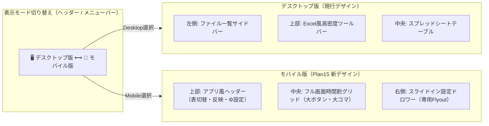
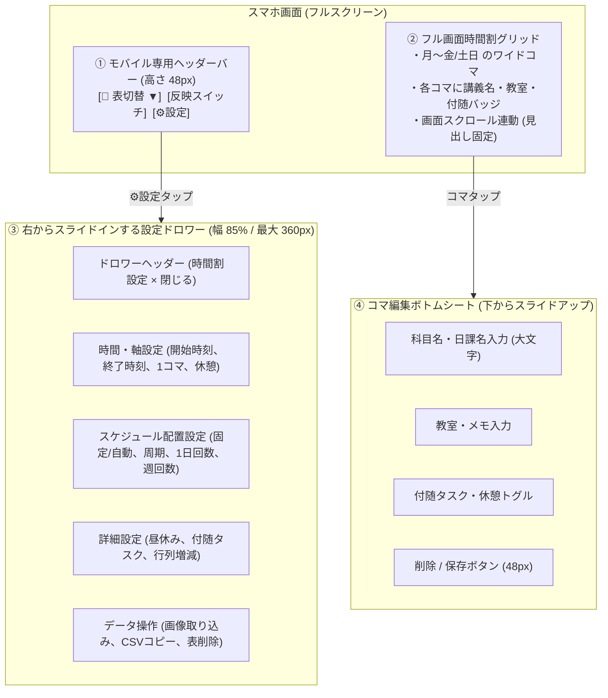
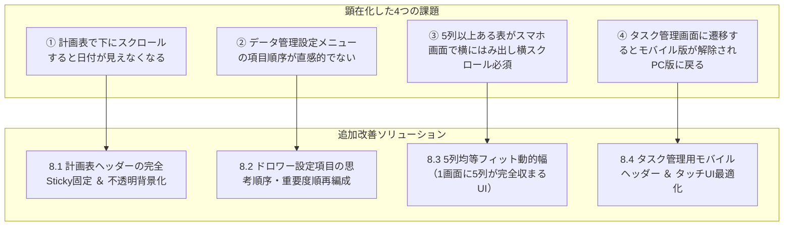

# 仕様書・設計計画書（Plan15）：データ管理タブのスマホ版デザイン最適化

## 1. 背景と目的

本作「理論値スケジュール（creation_1）」のデータ管理タブ（`ImportedTablesManager`）は、時間割・日課・習慣表の管理、軸定義（開始時刻・1コマ分数・休憩・周期・昼休み）、付随タスク設定、および計画表への反映を一括制御する極めて重要な入力装置です。

現在のデータ管理画面は、PC（大画面ディスプレイ）での一覧性や多機能編集を最優先とした**「Excel風デスクトップUI」**として設計されています。しかしながら、スマートフォン等の画面幅が狭いモバイル端末で閲覧・操作した場合、以下の課題が顕在化していました：

1. **画面占有と圧迫感**:
   - 上部に常時表示されるコンパクトツールバーや折りたたみ詳細設定バー、左側のエクスプローラーサイドバーが画面縦幅の大部分を占有し、肝心の**時間割表（メイングリッド）を表示・編集できる領域が極めて狭い**。
2. **タッチ操作性（タップ領域）の不足**:
   - ボタンやセレクトボックス、数値入力欄がPC向けの高密度レイアウト（高さ24〜28px、文字サイズ10〜11px）で作られており、指先でのタップミスが起きやすい（Apple HIG / Google Material Designが推奨する最小タップ領域 44〜48px に満たない）。
3. **時間割アプリとしてのUXの乖離**:
   - 大学生向け等の一般的なスマートフォン時間割アプリ（Penmark、すごい時間割等）では、**「画面全体に時間割がフル画面で広がり、一目で全曜日のコマを把握・編集できること」**が標準体験です。設定項目は通常画面には出さず、右上の「⚙️設定」等からスライドインするドロワーに集約するのが自然です。
4. **デスクトップ体験との両立（手動切り替えの需要）**:
   - PCで作業しているユーザーや、スマホでも高密度なExcel風表示を好むユーザーがいるため、単なるCSSメディアクエリによる一律の強制レスポンシブではなく、**「デスクトップ版（PC版）」と「モバイル版（スマホ版）」をメニューバー等から明示的にワンタップで切り替えられる仕組み**が求められます。

本書（`Plan15.md`）は、これらの課題を抜本的に解決し、**「スマートフォンで時間割アプリのように快適に使えるフル画面時間割UI」**と**「右から飛び出す専用設定ドロワー」**、および**「デスクトップ版／モバイル版のシームレスな手動切り替え」**を実現するための完全な仕様と設計を策定します。

---

## 2. コアコンセプトと全体アーキテクチャ

### 2.1 2つの表示モード（Desktop Mode vs Mobile Mode）

データ管理タブにおいて、ユーザーは作業環境や好みに応じて表示モードを自由に選択できます。



| 比較項目 | 🖥️ デスクトップ版（現行） | 📱 モバイル版（Plan15） |
| :--- | :--- | :--- |
| **主な想定環境** | PC、タブレット横画面、マウス・キーボード操作 | スマートフォン、タブレット縦画面、指先タッチ操作 |
| **画面構成** | 左サイドバー ＋ 上部高密度ツールバー ＋ 表 | **画面全体が時間割表（フルスクリーン）** |
| **設定項目の配置** | 表の直上に横並び（詳細設定はアコーディオン展開） | **「⚙️ 設定」ボタンで右から飛び出す専用ドロワー** |
| **表の切り替え** | 左側サイドバーの一覧からクリック選択 | ヘッダー中央の表タイトルタップでボトムシート展開 |
| **ボタン・入力の大きさ** | 高さ 24〜28px（高密度・コンパクト重視） | **高さ 44〜48px以上（親指で快適に押せる大サイズ）** |
| **コマのタップ体験** | モーダルダイアログ展開 | **下からスライドアップするボトムシート編集** |

### 2.2 モード切替の動作仕様
1. **初期値の自動判定**:
   - 初回読み込み時、画面幅が 768px（Tailwindの `md` ブレークポイント）未満の場合は自動的に `mobile` を初期選択、768px以上の場合は `desktop` を選択。
2. **手動切り替えの優先・永続化**:
   - 画面上部のアクションバー（またはヘッダー）に、`[ 🖥️ PC版 | 📱 スマホ版 ]` のトグルスイッチを常時配置。
   - ユーザーが手動で切り替えた選択は `localStorage.getItem('app_table_view_mode')` に保存され、次回以降のリロードや端末サイズに関わらずユーザーの意思を最優先で維持。

---

## 3. モバイル版（スマホ版）の詳細UIデザイン仕様

モバイル版は、スマートフォンネイティブの時間割アプリに匹敵する直感的で洗練されたUXを提供します。



---

### 3.1 ① モバイル専用ヘッダーバー（App-like Top Bar）
画面最上部に常時固定される薄型・高機能なアプリ風ヘッダーです（高さ 48〜52px）。

- **左側: 表切り替えドロップダウンボタン（Table Switcher Pill）**:
  - 現在表示中の時間割名（例: `3年後期時間割 ▼`）が大きなピル型ボタンで表示されます。
  - タップすると下から**「時間割一覧ボトムシート」**が展開し、別テーブルへの切り替えや「＋新しい表を追加」を片手親指で素早く行えます。
- **中央右: 計画表への反映トグル（Apply Switch）**:
  - `計画表に反映` の大きなスイッチ（タッチしやすいサイズ）。オン時はエメラルドグリーンに点灯し、即座に計画表（タイムライン）と同期。
- **右端: モード切替 ＆ ⚙️設定ボタン**:
  - `[🖥️]` アイコンボタン（PC版レイアウトに戻すトグルボタン）。
  - `[⚙️ 設定]` ボタン: タップすると画面右側から「設定ドロワー」がスムーズにスライドイン。

---

### 3.2 ② フル画面時間割グリッド（Full-Screen Timetable Grid）
設定バーを全てドロワーへ退避させたことで、スマートフォンの画面全体（100%の縦横）を時間割表示に利用できます。

1. **見出しの追従固定（Sticky Headers）**:
   - 曜日ヘッダー（月・火・水・木・金...）は画面上部に固定。
   - 時限ヘッダー（1限 09:00〜、2限 10:40〜...）は画面左端に固定。
2. **タッチに最適化されたコマ（Cell）のサイズと視認性**:
   - 各コマの最小高さを **80px〜100px** 確保。
   - 科目名・日課名は `text-xs sm:text-sm font-bold` で太字・高コントラスト表示。
   - 教室名やメモは `text-[10px]` のサブテキストとして下部に配置。
   - コマ内に付随タスクがある場合は「📌」バッジ、休憩がある場合は「☕」バッジを右上に分かりやすく表示。
3. **直感的なタップ操作**:
   - 空のコマをタップ: 新規入力シートが即座に立ち上がる。
   - 入力済みコマをタップ: 編集・削除シートが立ち上がる。
   - 長押し（Long Press）: クイック消去または完了チェックのコンテキストメニュー。

---

### 3.3 ③ 右から飛び出す専用設定ドロワー（Flyout Settings Drawer）
「⚙️ 設定」ボタンをタップすると、画面右側から滑らかにスライドインする専用パネルです（幅 85%〜最大 380px、背景ブラーオーバーレイ付き）。

設定項目を用途別にグルーピングし、大きな入力欄とスイッチで整理します：

```
┌───────────────────────────────────────┐
│ ⚙️ 時間割の詳細設定               [×] │
├───────────────────────────────────────┤
│ ▼ 基本時間・軸定義                    │
│   ・時間帯: [ 08:50 ] 〜 [ 18:00 ]   │
│   ・1コマ : [  90  ] 分              │
│   ・休　憩: [  10  ] 分              │
├───────────────────────────────────────┤
│ ▼ 計画表への配置ルール                │
│   ・配置方式: (●) 固定枠  ( ) 自動配分│
│   ・周期開始: [ 月曜日 (Day 1)  ▼ ]  │
│   ・1日回数 : [  指定なし (自動)   ] │
│   ・週回数  : [  週5日             ] │
│   ・有効期限: [ 1週間 (基本)    ▼ ]  │
├───────────────────────────────────────┤
│ ▼ 昼休み・付随タスク                  │
│   ・昼休み: [ ON / OFF ]             │
│       └ [ 2 ] 行後  [ 50 ] 分         │
│   ・付随タスク連動: [ ON / OFF ]      │
│       └ 所要時間: [ 15 ] 分           │
├───────────────────────────────────────┤
│ ▼ 表の行・列サイズ調整                │
│   ・行数: [ - ]  5行  [ + ]           │
│   ・列数: [ - ]  5列  [ + ]           │
├───────────────────────────────────────┤
│ ▼ データ取り込み・操作                │
│   [ 📷 画像から時間割を取り込む     ] │
│   [ 📋 CSV形式でコピー             ] │
│   [ 🗑️ この時間割を削除             ] │
└───────────────────────────────────────┘
```

#### 設定ドロワーの特徴
- **親指で届く快適な操作性**:
  - すべての `<input type="time">` や `<input type="number">`、セレクトボックスの高さが **44px以上**。
  - スイッチ類も指先で確実に切り替えられる大型トグルを採用。
- **即時反映（リアクティブ）**:
  - ドロワー内で数値を変更すると、背景の表に即座に反映。
- **安心の操作感**:
  - 背景の薄暗いオーバーレイをタップするか、右上の「×」ボタンを押すだけでいつでも時間割画面に戻れる。

---

### 3.4 ④ コマ編集ボトムシート（Cell Edit Bottom Sheet）
コマをタップした際、PCのような小さなインライン編集ではなく、画面下部からハーフモーダル（ボトムシート）としてせり上がります。

- スマートフォンのソフトウェアキーボードが表示されても入力欄が隠れない自動スクロール追従。
- **1行目（科目名/タイトル）**: 大きなフォントの太字入力欄。
- **2行目（教室/場所/メモ）**: 複数行テキストエリア。
- **下部アクションバー**:
  - `[ 🗑️ コマを空にする ]`（左側・赤いアイコン）
  - `[ 完了・保存 ]`（右側・大きなブルーの確定ボタン / 高さ 48px）

---

## 4. モード切り替え機能の実装仕様

### 4.1 状態管理
`ImportedTablesManager` の内部（またはグローバル状態）に表示モードを保持します：

```typescript
export type TableViewMode = 'desktop' | 'mobile';

// 初期化ロジック
const [viewMode, setViewMode] = useState<TableViewMode>(() => {
  if (typeof window !== 'undefined') {
    const saved = localStorage.getItem('app_table_view_mode') as TableViewMode | null;
    if (saved === 'desktop' || saved === 'mobile') return saved;
    // デバイス判定（画面幅 768px 未満なら mobile）
    return window.innerWidth < 768 ? 'mobile' : 'desktop';
  }
  return 'desktop';
});

// モード切り替えハンドラ
const handleToggleViewMode = (mode: TableViewMode) => {
  setViewMode(mode);
  try {
    localStorage.setItem('app_table_view_mode', mode);
  } catch {
    // ignore
  }
};
```

### 4.2 メニューバーでの切り替えUI
画面ヘッダーや操作バーの目立つ位置に、モード切り替えトグルを配置します：

```tsx
<div className="flex items-center rounded-lg border border-slate-200 bg-slate-100 p-0.5">
  <button
    type="button"
    onClick={() => handleToggleViewMode('desktop')}
    className={`flex items-center gap-1 rounded-md px-2.5 py-1 text-xs font-bold transition ${
      viewMode === 'desktop'
        ? 'bg-white text-blue-600 shadow-2xs'
        : 'text-slate-500 hover:text-slate-800'
    }`}
  >
    <Monitor className="h-3.5 w-3.5" />
    <span>デスクトップ</span>
  </button>
  <button
    type="button"
    onClick={() => handleToggleViewMode('mobile')}
    className={`flex items-center gap-1 rounded-md px-2.5 py-1 text-xs font-bold transition ${
      viewMode === 'mobile'
        ? 'bg-white text-blue-600 shadow-2xs'
        : 'text-slate-500 hover:text-slate-800'
    }`}
  >
    <Smartphone className="h-3.5 w-3.5" />
    <span>モバイル</span>
  </button>
</div>
```

---

## 5. コンポーネント設計とファイル構造

肥大化を防ぎ、保守性を高めるため、UI層をきれいに分離します：

```
src/components/
├── ImportedTablesManager.tsx          # メインコンテナ（状態管理・モード分岐・データ操作）
├── table-manager/
│   ├── TableViewModeToggle.tsx       # デスクトップ / モバイル切り替えボタン
│   ├── desktop/
│   │   ├── DesktopToolbar.tsx        # 現行のExcel風コンパクトツールバー
│   │   ├── DesktopSidebar.tsx        # 左側ファイルツリーサイドバー
│   │   └── DesktopGridView.tsx       # PC向け大画面スプレッドシート
│   └── mobile/
│       ├── MobileHeader.tsx          # アプリ風ヘッダー（表切替・反映・設定ボタン）
│       ├── MobileTimetableGrid.tsx   # フル画面時間割グリッド（大コマ・見出し固定）
│       ├── MobileSettingsDrawer.tsx  # 右からスライドインする専用設定ドロワー
│       ├── MobileTableSwitcherSheet.tsx # 下から出る時間割一覧切り替えシート
│       └── MobileCellEditSheet.tsx   # コマ編集ボトムシート
```

> [!NOTE]
> 既存の計算・反映ロジック（`calculatePeriodTimes`、`generateScheduleItemsForTable`、`handleAxisConfigChange`、`handleCustomRowTimeChange` 等）は共通フック・純粋関数として完全に再利用し、表示モードの違いによってロジックが分岐・二重管理されない堅牢な構造とします。

---

## 6. 実装ステップとスケジュール

- [ ] **Step 1: 表示モード切り替え基盤の実装**
  - `viewMode`（`'desktop' | 'mobile'`）の状態管理と `localStorage` 永続化。
  - ヘッダーへの切り替えスイッチ配置。
- [ ] **Step 2: モバイル版フル画面グリッド（`MobileTimetableGrid`）の実装**
  - 余分なバーを排除し、画面いっぱいに広がる時間割レイアウト。
  - 曜日・時限のスクロール連動固定（Sticky）。
  - コマ内の文字サイズ・余白・バッジ表示の最適化。
- [ ] **Step 3: 右スライドイン設定ドロワー（`MobileSettingsDrawer`）の実装**
  - アニメーション付きのスライドインパネル（Tailwind / CSS Transitions）。
  - 軸設定、配置ルール、昼休み、付随タスク、行列増減をタッチ向け大型コントロールで集約。
- [ ] **Step 4: モバイル専用ヘッダー＆テーブル切り替えボトムシートの実装**
  - 画面上部のコンパクトな操作バー。
  - テーブル切り替え・新規作成用ボトムシート。
- [ ] **Step 5: コマ編集ボトムシート（`MobileCellEditSheet`）の実装**
  - コマタップ時に親指で快適に編集・削除できるUI。
- [ ] **Step 6: 実機・各種画面サイズでの検証**
  - iPhone (iOS Safari)、Android (Chrome)、iPad等の実機検証。
  - デスクトップ版とモバイル版の相互切り替えが正常に機能することを確認。

---

## 7. まとめ

本計画（Plan15）により、データ管理タブは**「PCでの緻密な大量データ編集に優れたデスクトップ版」**と**「スマートフォンで時間割アプリのように直感的かつ大きく操作できるモバイル版」**という2つの強力なUIを自在に行き来できるハイブリッドなシステムへと進化します。

これにより、外出先でのスマートフォンの片手操作による時間割確認・修正から、自宅PCでの緻密なスケジュール設計まで、あらゆるデバイス環境で最高峰のユーザー体験を提供します。

---

## 8. 追加改善要件（Plan15 追補・最適化アップデート）

初期実装の検証およびユーザーフィードバックに基づき、以下の4つの重要課題に対する追加改善を策定します。



---

### 8.1 計画表（タイムライン）でのスクロール時・日付見出し完全固定（Sticky Header）

#### 課題分析
- 計画表（タイムラインシート `Timeline24h`）で下方向（垂直方向）にスクロールした際、画面上部にある日付・曜日ヘッダー（月火水木金土日、および「3/15 (月)」などの日付表示）が上に流れて画面外へ消えてしまう、または下層のタスクブロックと文字が重なって見えなくなる。
- **原因**:
  1. スクロールコンテナ（`scrollContainerRef`）内部で `overflow-x-auto` と `overflow-y-auto` が共存しており、子要素の Flexbox レイアウトによって `sticky top-0` の吸着位置がブラウザ側で正しく計算されない場合がある。
  2. 週間表示のヘッダー各セルに背景色が指定されておらず（透明）、親の薄い背景色のみであるため、下からスクロールしてきたタスクブロックの文字や罫線が透けて文字化け・判読不能になる。
  3. フォーカスモード（1日表示）において、狭い画面幅で曜日セレクターが横幅を圧迫し、右端の日付ラベル（`3/15 (月)`）が見切れる・押し出される。

#### 具体的修正案
1. **Sticky Header の吸着確実化**:
   - `Sticky Weekday Header Row` に対して `sticky top-0 z-40` を確実に機能させるため、直近のスクロールコンテナ境界と干渉する Flexbox プロパティを整理し、`transform` 等の新しいスタッキングコンテキストが生成されていないことを保証。
2. **不透明背景色の適用（下層要素の透過防止）**:
   - ヘッダー全体および各曜日セルに、下層のグリッド・ブロックが一切透けない不透明な背景色（Planner モード: `bg-[#f8f6f0]` / Modern モード: `bg-slate-50`）を明確に設定。境界線に `shadow-xs` を付加してタイムラインとの境界を明瞭化。
3. **日付・曜日表示の常時視認性保証**:
   - フォーカスモード（1日表示）では、日付バッジ（`3/15 (月)`）と曜日ピル（月〜日）をフレキシブルに折り返しまたはコンパクト化し、画面幅 360px でも日付が画面外へ見切れないレスポンシブ配置を採用。
   - 週間表示（7列）では、各列上端に「曜日」と「月/日」を縦並びで常時固定。

---

### 8.2 データ管理タブ・設定メニュー（ドロワー）の項目順序の再整理

#### 課題分析
- 設定ドロワー内の項目がユーザーの作業思考フローと乖離していると、設定時に上へ下へと視線やスクロールが往復してしまいます。
- ユーザーが時間割を新規作成・カスタマイズする際、**「上から下へと順番に入力・設定していくだけで、自然と時間割が完成する」** 理想的な設定ステップ順への最適化が求められます。

#### 具体的修正案（上から下へ設定していく完全最適化フロー）
1. **📐 セクション 1: 表のマス目サイズ ＆ 取り込み（骨組み・インポート）**
   - **画像やCSVから読み取り** ボタン（既存データからの素早いインポート）
   - **行数（時限数）**: `[-]` `N行` `[+]`
   - **列数（曜日数）**: `[-]` `N列` `[+]`
2. **⏰ セクション 2: 時間帯とコマ割り（時間の定義）**
   - **開始時刻** 〜 **終了時刻 (上限)**
   - **1コマの長さ（分）**
   - **コマ間休憩（分）**
3. **🍱 セクション 3: 昼休み設定（1日の休憩ポイント）**
   - **昼休みを挿入トグル**: オン / オフ スイッチ
   - **挿入位置（行後）** ＆ **昼休みの長さ（分）**
4. **🎯 セクション 4: 計画表への配置方式 ＆ 周期（計画表との接続）**
   - **周期の頭 (Day 1の曜日)**: 月〜日 セレクトボックス
   - **配置方式**: `[ 📌 固定枠 ]` ⟷ `[ ⚡ 自動配分 ]` の大ボタン切り替え
5. **🔄 セクション 5: 繰り返し回数 ＆ 有効期限（自動配分時の詳細設定）**
   - **1日の回数**: 自動 / 回数指定
   - **週の回数**: 自動 / 日数指定
   - **週タスク有効期限**: 1週間 / 2週間 / 期限なし
6. **📌 セクション 6: 付随タスク設定（オプション）**
   - **付随タスク連動生成トグル**: オン / オフ スイッチ
   - **所要時間（分）**
7. **📥 セクション 7: データの管理 ＆ 操作（後処理・メンテナンス）**
   - **CSV形式でクリップボードへコピー** ボタン
   - **この時間割データを削除** ボタン（赤色警告表示）

---

### 8.3 表データの5列以上表示時における1画面フィット最適化

#### 課題分析
- データ管理タブの時間割テーブルにおいて、各列ヘッダーに `min-w-[140px] sm:min-w-[160px]`、行ヘッダーに `min-w-[96px]` が固定指定されています。
- このため、平日の5コマ（月・火・水・木・金、または Day 1〜Day 5）を表示した場合、全体の必要幅が最低でも `96px + 140px × 5 = 796px` となり、スマートフォンの一般的な画面幅（360px〜400px）では **2列〜2.5列程度しか画面に収まらず、大幅な横スクロールを強いられる** 状態でした。

#### 具体的修正案
モバイル版（`viewMode === 'mobile'`）において、**「列が5つ以上ある場合は、1画面の中にピッタリ5列が収まる」** レイアウトを導入します：

```
┌──────┬────────┬────────┬────────┬────────┬────────┐
│時限/時│ 月 (Day1)│ 火 (Day2)│ 水 (Day3)│ 木 (Day4)│ 金 (Day5)│
├──────┼────────┼────────┼────────┼────────┼────────┤
│1 (90m)│ 英語   │ 数学   │ 国語   │ 物理   │ 化学   │
│2 (90m)│ 情報   │ 体育   │ 歴史   │ 地理   │ 空き   │
└──────┴────────┴────────┴────────┴────────┴────────┘
  44px     66px     66px     66px     66px     66px   = 合計 374px (スマホ1画面に完全収まる)
```

1. **左端（行ヘッダー・時限番号）のスリム化**:
   - モバイル版では幅を `w-11 min-w-[44px]`（時限番号 `1`, `2`... と時間表示を縦並びまたはアイコン化）に圧縮。
2. **列幅の動的5分割計算**:
   - テーブル全体のレイアウトを `table-fixed` または Flex/Grid 対応とし、列数が5つ以上ある場合、1列あたりの幅を `w-[calc((100vw-44px)/5)]`（iPhone 13/14等の幅390pxの場合、約 68px/列）に設定。
   - 画面幅全体を使ってちょうど5列が画面横幅いっぱいにピッタリ収まるようにします。
   - 列数が6列や7列（土・日を含む）ある場合でも、1列あたりの幅基準（1画面に5列収まる幅）を維持し、横スワイプすることで残りの列へ直感的にアクセス可能とします。
3. **セル内コンテンツの最適化**:
   - 幅 65〜70px のコンパクトな列幅でも文字が綺麗に読めるよう、科目名の文字サイズを `text-xs font-bold`（複数行折り返し）、パディングを `p-1` に最適化。
   - 付随タスク（📌）や休憩（☕）のバッジはセル右上に極小ピルアイコンとしてすっきり配置。
   - 列ヘッダーのセレクトボックスも文字サイズ `text-[11px]`・パディング極小化により見切れを防止。

---

### 8.4 タスク管理画面（固定枠・今日/今週タスク）のモバイル版最適化

#### 課題分析
- モバイル版のテーブル切り替えボトムシート（`MobileTableSwitcherSheet`）から「固定枠管理（`sys-slots`）」や「今日/今週のタスク（`sys-daily` / `sys-weekly`）」をタップして遷移した際、`isSystemFile === true` と判定されるため、**モバイル専用ヘッダーが解除されてデスクトップ版のパンくずヘッダーが表示されてしまう**。
- 加えて、モバイル版では左サイドバーが非表示になっているため、一度タスク管理画面に入ると**時間割表に戻るためのボトムシートを開くトリガーが消失し、閉じ込められる**状態が発生。
- さらに `TaskManager` コンポーネント自体がPC向けの高密度レイアウト（小さなボタン、小さなフォント、高密度な3列グリッド）のままで、モバイルでのタップ操作や視認性が不十分。

#### 具体的修正案
1. **タスク管理画面用のモバイル専用ヘッダーの提供**:
   - `isSystemFile === true` かつ `viewMode === 'mobile'` の場合でも、モバイル専用ヘッダーを維持。
   - ヘッダー左のピルボタンに現在のビュー名を表示：
     - `📌 固定枠 (生活リズム) ▼`
     - `📅 今日のタスク ▼`
     - `🗓️ 今週のタスク ▼`
   - このピルボタンをタップすることで、いつでもテーブル切り替えボトムシートが開き、他の時間割表やタスク一覧へ片手で自在に切り替え可能。
   - `[🖥️ PC版]` ボタンも常時配置し、デスクトップ表示との行き来を保証。
2. **`TaskManager` のモバイルレスポンシブ最適化**:
   - **縦スタック表示**: 画面幅が狭い場合、3列グリッドではなく単一カラムのスクロールビューに自動切り替え。
   - **タッチターゲットの拡大**: タスクカードの完了チェック、有効/無効トグル、編集タップ領域を最小 44px に拡大。
   - **追加ボタンの大型化**: 「＋ 新しいタスクを追加」「＋ 新しい固定枠を追加」のボタンを画面上部またはフローティングバーとして大きく目立つ位置に配置。
   - **編集モーダルのモバイル最適化**: タスクや固定枠の追加・編集ダイアログを、スマホ画面に最適化されたボトムシート（またはフルスクリーンダイアログ）として表示し、キーボード表示時にも入力欄が隠れないようにスクロール対応。

---

## 9. 追加実装ステップ

- [ ] **Step 7: 計画表の日付見出し完全固定（Sticky Header）の修正**
  - `Timeline24h.tsx` におけるスクロールコンテナとヘッダーのスタイル改修。
  - 不透明背景色とシャドウの適用、フォーカスモード日付表示のレスポンシブ化。
- [ ] **Step 8: モバイル設定ドロワーの項目順序の再編**
  - `ImportedTablesManager.tsx` 内の `MobileSettingsDrawer` のセクション順序を「配置方式・周期 → 時間帯・コマ → 昼休み → 付随タスク → 回数・期限 → 行列サイズ → データ操作」に並び替え。
- [ ] **Step 9: 時間割表の5列均等フィットレイアウトの実装**
  - 列ヘッダーのハードコードされた `min-w-[140px]` をモバイル時に `w-[calc((100vw-44px)/5)]` へ動的切り替え。
  - 行ヘッダーのスリム化（`w-11 min-w-[44px]`）とセル内フォント・バッジの最適化。
- [ ] **Step 10: タスク管理画面のモバイルヘッダー ＆ タッチUI最適化**
  - `ImportedTablesManager.tsx` において `isSystemFile` 時もモバイル専用ヘッダーを表示し、ボトムシート呼び出しを可能に。
  - `TaskManager.tsx` のモバイル表示時のタッチターゲット拡大とボトムシート・モーダル調整。
- [ ] **Step 11: 総合動作検証（型チェック・ユニットテスト・実機ブラウザ確認）**
  - `npm run typecheck`, `npm run test`, `npm run lint` の完全パス確認。


