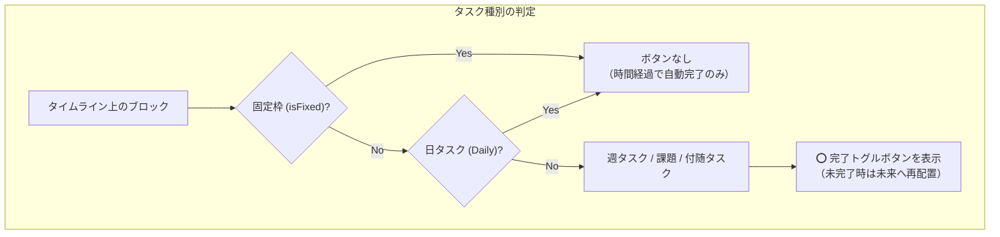
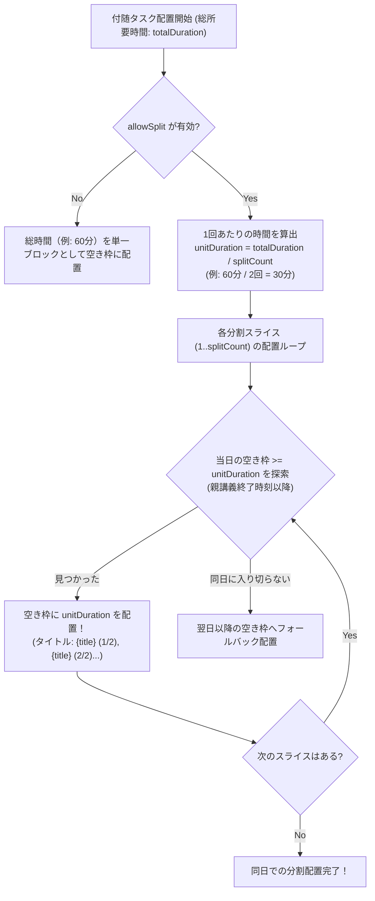

# 計画表ロジック適正化 ＆ 付随タスク分割配置エンジン仕様書（Plan16）

---

## 1. 背景と目的

これまでの計画表（Plan11〜Plan15）では、リアルタイム適応型タイムラインとして過去タスクの自動完了や、週タスクの未完了リスケジュール、固定枠の早期完了による代行配置などを導入してきました。
しかし、実際の運用とUIの視認性・操作性を検証した結果、以下の2つの大きな改善点が明らかになりました。

### 1.1. 課題1: 日タスク・固定タスクにおける未完了ボタンの過剰性
- **現状**:
  - 現在の計画表（`Timeline24h.tsx`）では、休憩を除くすべてのブロック（固定枠・日タスク・週タスク）に完了トグルボタン（`[✓] / [ ]` または `済 / 未`）が表示されています。
- **問題点**:
  - 固定タスク（大学の講義や固定の予定）や日課タスク（毎日のルーティン）は、その日その時間帯に実施するものであり、時間が過ぎれば自動的に消化（完了）される性質を持ちます。
  - 週タスク（課題・レポート・TODO）とは異なり、日タスクや固定タスクを「未完了にして未来へ逃がす（翌日以降へリスケジュールする）」というユースケースは基本的に存在しません。
  - それにもかかわらず、すべてのブロックに未完了・完了ボタンが並んでいるため、画面がノイズ過多になり、「このボタンは何のためにあるのか」「押したらどうなるのか」というユーザーの認知負荷・誤操作の原因になっていました。
- **改善方針**:
  - **日タスクや固定タスクの未完了状態・ボタンを無くす**。
  - 完了トグルボタンは、進捗管理・未完了リスケジュールが必要な **「週タスク（課題タスク・再配置タスクを含む）」のみに限定** し、固定枠や日タスクからはボタンを完全撤廃してスッキリとした美しい表示にします。

---

### 1.2. 課題2: 付随タスク（連動タスク）の配置柔軟性と分割配置の必要性
- **現状**:
  - コマ（講義等）に連動して生成される付随タスク（例: 講義後の復習や演習）は、表データで設定された所要時間（例: 60分や90分）の「1つの連続したブロック」として空き枠に配置されます。
- **問題点**:
  - 講義の直後や同日中に「まとまった60分の空きコマ」が存在しない場合、付随タスクが同日に収まらず、週末や別日へフォールバックされてしまいます。
  - しかし実際の学習・作業においては、「60分の復習を一気にやる」だけでなく、「講義直後の30分空き枠で前半、夜の30分空き枠で後半をやる」というように、**分割して隙間時間に配置する** 方が現実的で実践しやすいケースが多くあります。
- **改善方針**:
  - 付随タスクの設定項目として、**「分割して配置する機能（スプリット・アロケーション）」** を新設。
  - 空きコマのサイズや設定された分割単位（例: 30分ずつ、15分単位など）に合わせて、自動的に付随タスクを分割して柔軟にねじ込むロジックを導入します。

---

## 2. タスク種別とステータス・ボタン仕様の整理

### 2.1. タスク種別の3分類とライフサイクル

| タスク種別 | 主な例 | ライフサイクル・消化ルール | 完了ボタン（手動トグル）の要否 |
| :--- | :--- | :--- | :--- |
| **📌 固定枠 (Fixed)** | 大学の講義、固定バイト、会議 | 指定された曜日の指定時刻に固定配置。現在時刻を通過すると自動的に完了（薄いグレー表示）。 | **❌ 不要（ボタン非表示）**<br>※未完了状態は存在しない |
| **📅 日タスク (Daily)** | 毎朝の読書、毎日の筋トレ、単語学習 | 毎日または特定曜日の空き枠に自動敷き詰め。現在時刻を通過すると自動的に完了。 | **❌ 不要（ボタン非表示）**<br>※その日限りのため翌日繰り越しはしない |
| **⚡ 週タスク (Weekly) / 課題** | 課題レポート、演習、付随タスク、目標 | 締め切りや週の空き枠に配置。時間が過ぎても未完了なら**未来の空き枠へ自動再スケジュール**。 | **⭕ 必須（トグルボタン表示）**<br>`[✓]` 完了 / `[ ]` 未完了 |



### 2.2. 計画表（タイムライン）での表示仕様変更
- **固定枠・日タスク**:
  - 右上の `[✓] / [ ]`（モダン表示の `済 / 未`）ボタンを非表示化。
  - タイトルと時間帯のみを広々と表示（文字の折り返し・可読性が大幅に向上）。
  - 時間経過による自動完了（過去時間のグレートーン化・打ち消し線）は維持し、「すでに終わった時間」としての視覚的実績フィードバックは担保。
- **週タスク（課題・再配置・付随タスク）**:
  - 従来通り、右上に完了トグルボタンを配置。
  - 未完了（`[ ]` / `未`）をクリック ➔ 早期完了（`[✓]` / `済`）になり、予定枠を解放。
  - 完了（`[✓]` / `済`）をクリック ➔ 未完了に戻り、現在時刻以降の空き枠へ自動再スケジュール。

---

## 3. 付随タスクの「時間を指定の回数で割って配置する」分割配置仕様設計

### 3.1. 機能概要（時間を指定回数で均等分割して配置）
講義や予定に連動して発生する付随タスク（復習・準備等）について、設定した総所要時間を **ユーザーが指定した回数（例: 2回、3回など）で均等に割り**、それぞれの分割スライス（例: 30分×2回）を親タスク直後の空きコマへ順番に配置します。

```
【例1】講義の復習 60分 を「2回に分割」に設定
  ➔ 60分 ÷ 2回 ＝ 1回あたり 30分
  ➔ 計画表の空き枠に以下の2ブロックを順番に配置：
     ・枠1: プログラミング演習 (復習 1/2) [30分]
     ・枠2: プログラミング演習 (復習 2/2) [30分]

【例2】講義の復習 90分 を「3回に分割」に設定
  ➔ 90分 ÷ 3回 ＝ 1回あたり 30分
  ➔ 計画表の空き枠に 30分 × 3回（1/3, 2/3, 3/3）を配置！

【例3】講義の復習 45分 を「3回に分割」に設定
  ➔ 45分 ÷ 3回 ＝ 1回あたり 15分 × 3回を隙間時間に配置！
```

### 3.2. データモデルの拡張 (`src/types/index.ts`)

```typescript
export interface AttachedTaskConfig {
  enabled: boolean;
  titleTemplate: string;     // デフォルト: '{title} のタスク'
  durationMinutes: number;   // 総所要時間（例: 60分）
  
  // ★ Plan16: 時間を指定回数で割って配置する設定
  allowSplit?: boolean;      // 分割配置を有効にするか（デフォルト: false）
  splitCount?: number;       // 分割回数（例: 2回, 3回, 4回。デフォルト: 2）
}

export interface AttachedTaskCellConfig {
  enabled: boolean;
  title?: string;
  durationMinutes?: number;
  
  // ★ セル個別オーバーライド
  allowSplit?: boolean;
  splitCount?: number;       // このセル個別の分割回数
}
```

### 3.3. UI設定項目の設計
1. **データ管理タブ・ツールバー ＆ モバイル設定ドロワー（セクション 6: 付随タスク設定）**:
   - `付随タスクの連動生成`: [トグルスイッチ]
   - `総所要時間`: [数値ステッパー（分）]（例: 60分）
   - **`時間を分割して配置`**: [トグルスイッチ]（オンにすると以下が表示）
     - `分割回数`: `[ 2回に分割 (推奨) ▼ ]`, `3回に分割`, `4回に分割`
     - **計算サマリー表示**: `1回あたり 30分 × 2回`（総時間と分割回数から自動計算して親切に案内）
2. **マス目（セル）の詳細モーダル / ボトムシート（`MobileCellEditSheet`）**:
   - セル個別に「この講義の復習は2分割にする / 3分割にする」を微調整可能。

### 3.4. スケジューラ配置アルゴリズム（等分割アロケーション）



#### スライス時間の計算ルール（端数処理）:
- 総所要時間 `T`、分割回数 `N` の場合：
  - 基本スライス時間: `base = Math.floor(T / N)`
  - 余り: `remainder = T % N`
  - 各スライスの時間:
    - 最初の `remainder` 個のスライス: `base + 1` 分
    - 残りのスライス: `base` 分
    - （例: 50分を3分割 ➔ 17分, 17分, 16分。合計ちょうど50分）
  - これにより、どのような総時間・分割回数であっても合計時間が1分も狂わず完全に一致します。

#### 配置の手順:
1. 親タスク（講義等）の直後から当日末尾までの空き枠を走査。
2. スライス（例: 30分）が収まる空き枠を見つけたら配置し、スロットを消費。
3. 同日内に収まり切らなかった残りのスライスは、翌日以降のフォールバック候補日（`candidateDays`）の空き枠へ配置。

## 4. 実装フェーズとステップ（全実装完了）

### フェーズ 1: 計画表のボタン整理（完了）
- [x] `src/components/Timeline24h.tsx` を修正:
  - 完了トグルボタンの表示条件を `isWeeklyTask`（週タスク・課題タスク・再配置タスク）のみに限定。
  - 固定枠（`isFixed`）および日タスクには完了トグルボタンを表示しないよう改修完了。
- [x] 既存のテスト（`scheduler.test.ts`、`Timeline24h` 等）の整合性を検証・パス確認。

### フェーズ 2: 付随タスクの分割配置（完了）
- [x] `src/types/index.ts`: `AttachedTaskConfig`, `GridCell.attachedTask`, `TaskItem`, `TheoreticalBlock` に `allowSplit`, `splitCount`, `minSplitMinutes`, `maxSplits`, `isSplitBlock`, `splitIndex`, `totalSplits` を追加。
- [x] `src/components/ImportedTablesManager.tsx`:
  - ツールバー、モバイル設定ドロワー、コマ編集ボトムシート（`MobileCellEditSheet`）、セル編集ダイアログに「時間を分割して配置」トグルおよび「分割回数（2回/3回/4回）」選択項目を追加。リアルタイムの「1回あたり N分 × M回」サマリー計算表示を実装完了。
- [x] `src/lib/tableUtils.ts`:
  - 表全体の付随タスク設定およびセル個別の付随タスク設定から、`allowSplit`, `splitCount` を生成される `TaskItem` に正しく伝播。
- [x] `src/lib/scheduler/phases/splitPlacementHelper.ts` ＆ `weeklyPlacementPhase.ts` ＆ `attachedFallbackPhase.ts`:
  - 設定された総所要時間を「指定の回数（splitCount）」で均等に割り（例: 60分を2分割なら30分×2回、90分を3分割なら30分×3回）、親タスク直後の空きコマへスライスタスクとして順番に配置する均等分割アロケーションエンジンを実装。
- [x] 単体テスト・結合テストの作成と動作確認（`scheduler.test.ts` ＆ `tableUtils.test.ts` で177件すべてパス）。

---

## 5. 期待される効果
1. **視認性・美しさの劇的向上**:
   - 画面の大半を占める固定枠・日課タスクから余計なボタンが消え、文字がすっきり見やすくなる。
   - 手帳風テーマ（Plan10）およびモダンテーマの両方で、洗練されたスケジュール表示が実現。
2. **思考負荷のゼロ化**:
   - ボタンがあるのは「実際にユーザーがトグルすべき週タスク」だけになるため、迷わず直感的に操作できる。
3. **時間割・復習スケジュールの高密度化・現実化**:
   - 隙間時間に付随タスクが自動分割配置されるため、まとまった空き時間がない過密なスケジュールでも、講義直後に復習を分散して配置できるようになる。

