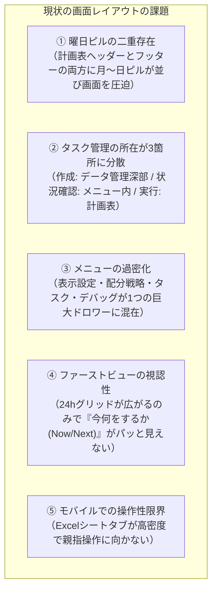
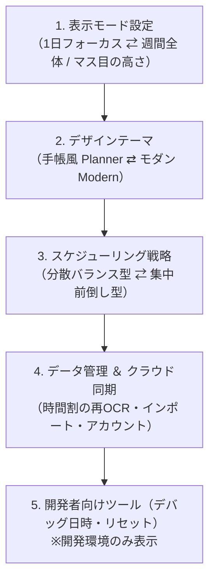
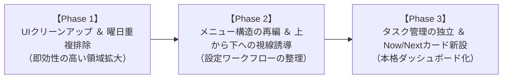

# 画面レイアウト再設計 ＆ ユーザー体験（UX）最適化仕様書（Plan17）

---

## 1. 背景と目的

これまでの Plan1〜Plan16 を通じて、時間割の画像・CSV読み取り、24時間適応型タイムライン、週タスクの未完了自動リスケジュール、付随タスクの等分割配置など、バックエンドおよびスケジューリングロジックの強力なコア機能が完成しました。

一方で、画面レイアウトは開発初期の「Excel風シートフッター＋2シート切り替え（計画表 / データ管理）」をベースに順次機能を追加してきたため、以下の構造的な課題が生じています：
1. **情報の重複配置**: 上部ヘッダーと下部フッターで「曜日切り替えボタン」が二重に存在し、有効画面を圧迫している。
2. **タスク管理のアクセス性の低さ**: 日常的に使う「タスクの追加・確認」が、「データ管理 > 左サイドバー > システム基本ファイル」の奥深くに埋もれている。
3. **メニューの肥大化と視線誘導の乱れ**: フッターのメニュー内に表示設定、配分戦略、タスク一覧、デバッグ操作が縦長に詰め込まれており、「上から下へ設定していく」自然な流れになっていない。
4. **モバイル操作時の窮屈さ**: モバイル端末において、親指の届く下部領域にExcel風シートタブ、曜日ピル、各種アクションボタンが密集し、誤タップを招きやすい。

Plan17 では、これまでの機能資産を損なうことなく、**「迷わない情報階層」「上から下への直感的なワークフロー（視線誘導）」「モバイル・デスクトップそれぞれの画面特性を活かしたモダンなレイアウト」** を実現するための再設計を行います。

---

## 2. 現状レイアウトの課題分析（Pain Points）



### 2.1. 課題①: 曜日切り替えUIの二重化と画面占有
- **現状**:
  - `Timeline24h` の上部ヘッダーに「月〜日の曜日ピル」と日付が表示されている。
  - 同時に、画面最下部の `SheetFooter` にも「月〜日の曜日ピル」が常時配置されている。
- **弊害**:
  - 画面の上下両端にまったく同じ「曜日を選ぶボタン」が並んでおり、画面縦領域（特にスマホでの表示領域）が無駄に削られている。
  - 「どっちの曜日ボタンを押せばいいのか」の認知負荷を与えている。

### 2.2. 課題②: 「タスク管理」の階層が深すぎる（日常利用の阻害）
- **現状**:
  - 課題や読書などのタスクを追加・編集したい場合、「データ管理」タブに移動し、左サイドバーの「日課タスク」または「週次タスク」を選択して初めてフォームが現れる。
  - 進捗確認や完了トグルは「フッターのメニュー > セクション3（タスク管理）」に格納されている。
- **弊害**:
  - 時間割の初期登録（セットアップ）と、日々のタスク登録（日常運用）の境界が曖昧。
  - 「新しい課題が出たからすぐ登録したい」という日常の最重要アクションがワンタップで行えない。

### 2.3. 課題③: メニューの過密化と操作順序の不統一
- **現状**:
  - フッター右端の「メニュー」ボタンを押すと、下から巨大なドロワーが開き、4つのセクションが縦に長く並ぶ。
- **弊害**:
  - ユーザーから要望された「上から下に設定していくワークフロー」に対して、設定項目（テーマ・マス高さ）と運用項目（タスク確認）が混ざり合っている。

### 2.4. 課題④: 「今まさにやること（Now / Next）」のサマリー不足
- **現状**:
  - 計画表を開くと、現在時刻の赤い横線はあるものの、24時間グリッド全体をスクロールして現在のブロックを探す必要がある。
- **弊害**:
  - 「アプリを開いた瞬間に、今取り組むべきタスクと残り時間がひと目でわかる」ダッシュボード性が欠けている。

---

## 3. Plan17 レイアウト改善アーキテクチャ

### 3.1. 画面構成の刷新コンセプト（3大コア画面）

これまでの「計画表」と「データ管理」の2画面構成から、日常利用の頻度に基づいた**3大画面構成**へと再編します：

| 画面名 | 役割 | 想定利用頻度 | 主なコンテンツ |
| :--- | :--- | :--- | :--- |
| **① 📅 計画表 (Timeline)** | **日々の実行・確認** | 最も高い（毎時） | 24時間適応型タイムライン、Now/Nextサマリー、日付ナビゲーション |
| **② 📝 タスク (Tasks)** | **日常のタスク管理** | 高い（毎日） | 週タスク・日タスクの追加・一覧・期限管理・出題状況 |
| **③ ⚙️ データ・設定 (Data & Settings)** | **初期設定・環境管理** | 低い（学期初め・適宜） | 時間割インポート/編集、固定枠（生活リズム）、配分ポリシー、テーマ |

---

### 3.2. デスクトップ版レイアウト（2ペイン・ダッシュボード）

デスクトップの大画面（幅1024px以上）では、画面の広さを活かして「タスク一覧」と「計画表タイムライン」を横並びで同時視認できる2ペイン構成を実現します。

```
+---------------------------------------------------------------------------------------+
|  [Logo] 理論値スケジュール   [月 火 水 木 金 土 日]  2026/11/15(日)   [テーマ] [アカウント] |  <- 上部グローバルバー
+------------------------------------+--------------------------------------------------+
|  【左ペイン: 今日のタスク・サマリー】 |  【右ペイン: 24時間計画表（タイムライン）】       |
|                                    |                                                  |
|  ■ NOW: 統計学 復習 (残り 25分)    |  08:00 +--------------------------------------+ |
|  ■ NEXT: 昼食 (12:00〜)            |  09:00 | [固定] 基礎物理学 (90分)             | |
|  --------------------------------  |  10:00 +--------------------------------------+ |
|  [+ 新しいタスクを追加]            |  11:00 | [付随] 統計学 復習 (1/2) [✓]         | |
|                                    |  12:00 +--------------------------------------+ |
|  ▼ 出題中タスク (3件)              |  13:00 | [生活] 昼食                          | |
|    [✓] レポート課題 (45分)         |  14:00 +--------------------------------------+ |
|    [ ] プログラミング演習 (60分)   |  15:00                                         | |
|                                    |  16:00                                         | |
|  ▼ 今週の予定タスク (2件)          |  17:00                                         | |
+------------------------------------+--------------------------------------------------+
|  [📅 計画表]   [📊 時間割データ管理]                           (Excel風フッターまたは消去) |
+---------------------------------------------------------------------------------------+
```

---

### 3.3. モバイル版レイアウト（親指操作ファースト）

モバイル端末（幅768px未満）では、縦スクロール領域を最大化し、親指の届きやすい下部に統一されたボトムナビゲーションを配置します。

```
+-----------------------------------------+
| [11/15 (日)]   < 1日表示 >   [設定 ⚙️]  | <- 上部: 日付ナビ＆設定アイコンのみ
+-----------------------------------------+
| [NOW] 統計学 復習 (11:30まで 残り15分)  | <- クイックNowカード（タップで該当枠へ）
+-----------------------------------------+
| 時間 | 計画表タイムライン               |
| 09:00| [講義] 基礎物理学                |
| 10:30| [復習] 統計学 復習 (1/2) [✓]     | <- 画面の大部分が計画表になり広々！
| 12:00| [食事] 昼食                      |
| 13:00| [空きコマ] 散歩・自由時間        |
| 14:00| [課題] プログラミング演習 [ ]    |
|      |                                  |
+-----------------------------------------+
|   [📅 計画表]    [📝 タスク]    [⚙️ 設定]  | <- 下部: 直感的な3タブ・ボトムバー
+-----------------------------------------+
```

---

## 4. 改善点一覧と設計詳細

### 4.1. 改善点①: 曜日切り替えUIの統合・重複排除
- **改善前**:
  - `Timeline24h` 上部ヘッダー（月〜日ピル）と `SheetFooter`（月〜日ピル）で二重表示。
- **改善後**:
  - **曜日切り替えUIを上部ヘッダーに一本化**。
  - 下部フッターからは曜日ピルを完全撤去し、高さを 44px ➔ **36px〜40px** にスリム化。
  - これにより、計画表の有効縦表示領域が約 20% 拡大し、スクロールなしで見通せる時間枠が増加。

---

### 4.2. 改善点②: 「タスク管理」の独立とクイック追加
- **改善前**:
  - 「データ管理」タブの奥深くに埋もれており、追加に複数ステップが必要。
- **改善後**:
  - **独立した「タスク」タブ / サイドバーパネル** として昇格。
  - ワンタップで開く「タスク追加フォーム（タイトル・所要時間・週/日・優先度）」を常時手の届く位置に配置。
  - 時間割データは「時間割・固定枠設定」として純粋に分離。

---

### 4.3. 改善点③: 「上から下へ流れる」設定メニューの再編
ユーザーが上から順番に無理なく設定・調整できるように、メニュー構造を目的別に論理的再配置します：



- **効果**:
  - 画面の見え方（表示・テーマ）を決めた後、アルゴリズム方針（分散・集中）を決め、最後に必要に応じてデータ管理やアカウント操作を行うという、**認知の負荷が最も低い直線的なワークフロー**になります。

---

### 4.4. 改善点④: 「Now / Next」ステータスカードの新設
- **仕様**:
  - 計画表の上部に、現在取り組んでいるブロックと次に来る予定を要約表示するコンパクトなバー（またはカード）を新設。
  - **表示内容**:
    - **現在**: `【実行中】統計学 復習 (残り 20分 / 11:30まで)`
    - **次**: `【11:30〜】基礎物理学`
  - カードをタップすると、タイムラインの該当ブロックへ自動スクロール。
  - 「今何をすればいいか」の迷いをゼロにします。

---

### 4.5. 改善点⑤: 枠不足アラート（警告）のインライン化・スマート化
- **改善前**:
  - 枠不足タスクがある場合、上部に大きな黄色い警告ボックスが固定展開され、タイムラインを大きく圧迫。
- **改善後**:
  - ヘッダー内のコンパクトなバッジ（例: `⚠️ 枠不足 2件`）として表示。
  - タップしたときのみスライドダウンで詳細を展開し、普段は計画表の邪魔をしない設計にします。

---

## 5. 段階的実装ロードマップ（Plan17 フェーズ構成）

無理のない安全なリファクタリング・実装を行うため、以下の3段階で進めることを提案します：



### Phase 1: UIクリーンアップ ＆ 曜日切り替えの統合（即効性重視）
1. `SheetFooter.tsx` から重複している曜日ピルを撤廃し、フッターの高さをスリム化。
2. `Timeline24h.tsx` の上部ヘッダーを整理し、日付表示・曜日ピルの視認性を向上。
3. 枠不足警告バーをコンパクトな開閉式バッジにリファクタリング。

### Phase 2: メニュー構造の再編（上から下へ流れる設定フロー）
1. `SheetFooter` 内のスライドアップメニューを「設定専用ドロワー」として整理。
2. 項目順序を「①表示 ➔ ②テーマ ➔ ③配分方針 ➔ ④同期・アカウント ➔ ⑤デバッグ」に最適化。
3. モバイル設定ドロワーと統一感のあるデザインに仕上げる。

### Phase 3: タスク管理のアクセス性改善 ＆ Now/Nextサマリー導入
1. タスクの追加・一覧を1タップで呼び出せる「タスクパネル（または第3のタブ）」の新設。
2. 計画表上部に「Now / Next」ステータスバーを設置し、現在タスクへのクイックジャンプを実装。
3. デスクトップでの2ペイン表示（左: タスク / 右: 計画表）のレスポンシブ対応。

---

## 6. まとめと検証指標

Plan17 のレイアウト見直しにより、以下の効果が期待されます：
- **画面占有率の改善**: 計画表の可視領域が約 20%〜25% 増加。
- **タップミスの低減**: モバイル下部バーの要素過密が解消され、親指操作性が劇的に向上。
- **タスク着手スピード**: タスクの追加や現在タスクの確認にかかる手数が半減。
