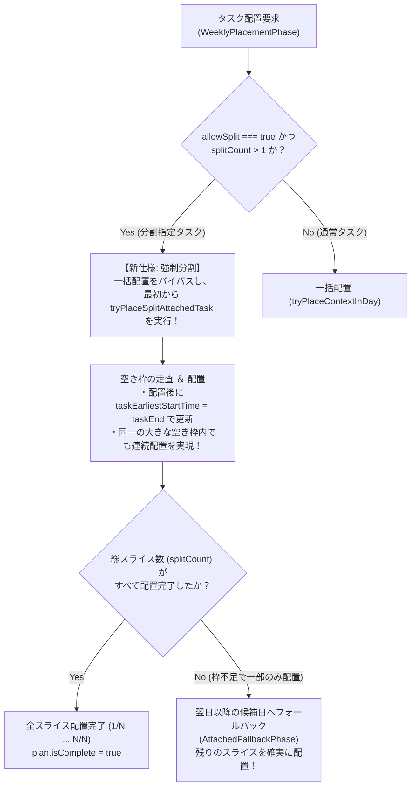

# 分割タスク配置ロジック総括仕様書 ＆ 動作検証レポート（Plan18）

---

## 1. 概要と背景

本ドキュメント（Plan18）は、時間割およびスケジュール管理システムにおける**「分割タスク（スプリット・アロケーション）」の確定配置ロジック、データ構造、優先順位制御、および動作検証結果**を網羅的にまとめた仕様書です。

### 1.1. 改善の背景と確定仕様
従来のスケジューラーでは、「親講義直後にまとまった連続空き枠（例: 60分以上）がある場合、分割設定が有効であっても分割せずに単一ブロックとして配置する」というヒューリスティックが存在していました。
しかし、この挙動は「ユーザーが明示的に2分割や3分割を指定した意図（隙間時間や短時間集中で分散して取り組みたい）」に反し、「分割回数を設定したのに分割されない」「1個のブロックのまま変わらない」という混乱を招いていました。

そのため、Plan18 では以下の確定方針に全面刷新されました：
1. **まとまった空き時間があっても必ず指定回数に分割する（強制分割配置）**
   - ユーザーが分割回数（`splitCount: 2回、3回...`）を指定したタスクは、直後にどれだけ大きな連続空き枠があっても、**必ずユーザーの指定通りに分割（例: 30分×2回）して連続または分散配置**する。
2. **同一の大きな空き枠内での安全な連続スライス配置の保証**
   - 60分の空きコマがある場合、スライス1（30分）を置いた直後に探索開始時刻を `taskEnd` に更新し、同一枠の後半（残り30分）にスライス2（30分）を安全かつ連続的に配置する。
3. **部分配置時のタスク消失防止と翌日フォールバックの保証**
   - 当日の空き枠に一部のスライス（例: 2分割中1つ）しか入らなかった場合でも、タスクを完了扱いにせず、残りのスライスを翌日以降の空き枠へ確実にフォールバック配置する。
4. **親タスク時間帯ガードの厳格化**
   - フォールバック探索時であっても、親講義がある曜日は午前中や講義終了前には絶対にフライング配置されないようガードを徹底。

---

## 2. データ構造とパラメータ仕様

分割タスクに関わる主要な型定義（`src/types/index.ts` および `src/lib/scheduler/types.ts`）：

```typescript
export interface AttachedTaskConfig {
  enabled: boolean;          // 付随タスク連動を有効化
  titleTemplate: string;      // タイトル雛形（例: '{title} のタスク'）
  durationMinutes: number;    // 総所要時間（例: 60分, 90分）
  allowSplit?: boolean;       // ★ 分割配置を許可するか（デフォルト: false）
  splitCount?: number;        // ★ 分割回数（1以上の任意の整数。5までの制限なし）
  minSplitMinutes?: number;   // 1分割あたりの最小分数（デフォルト: 15分）
}

export interface TaskItem {
  id: string;
  title: string;
  durationMinutes: number;
  period: 'week' | 'day';
  taskType?: 'task' | 'routine';
  isAttachedTask?: boolean;
  parentTitle?: string;
  parentEndMinutesByDay?: { [dayIndex: number]: number };
  allowSplit?: boolean;       // タスク個別での分割許可
  splitCount?: number;        // タスク個別での分割回数
}

export interface TaskPlacementPlan {
  task: TaskItem;
  kind: string;
  candidateDays: number[];
  placedCount: number;
  placedCountPerDay: Record<number, number>;
  placedSplits?: number;      // ★ 分割タスクの配置済みスライス総数（脱落防止）
  isComplete: boolean;
}

export interface TheoreticalBlock {
  id: string;
  title: string;              // 例: '講義復習 (1/2)'
  startMinutes: number;
  endMinutes: number;
  isWeeklyTask: boolean;
  isSplitBlock?: boolean;     // ★ 分割スライスブロックであるかのフラグ
  splitIndex?: number;        // ★ 何番目のスライスか（1-based: 1, 2, ...）
  totalSplits?: number;       // ★ 総分割数（splitCount）
  taskId: string;             // 親タスクID（全スライスで共有）
}
```

---

## 3. 分割時間計算と端数（余り）配分アルゴリズム

総時間（`durationMinutes`）を指定回数（`splitCount`）で均等に分割する際、**端数切り捨てによる時間の消失を防止し、1分単位で厳密に一致**させます（`src/lib/scheduler/phases/splitPlacementHelper.ts`）：

```typescript
// 基準分数と余り分数の算出
const baseMinutes = Math.floor(totalDuration / splitCount);
const remainder = totalDuration % splitCount;

// 余りがある場合、前半の余り個のスライスに +1分ずつ加算
const sliceDurations = Array.from(
  { length: splitCount },
  (_, i) => baseMinutes + (i < remainder ? 1 : 0),
);
```

### 3.1. 計算例
| 総時間 | 分割回数 | 計算式 | 各スライスの分数配分 | 合計検証 |
| :---: | :---: | :--- | :--- | :---: |
| **60分** | 2回 | 60 ÷ 2 = 30 余り 0 | **30分, 30分** | 60分 |
| **90分** | 3回 | 90 ÷ 3 = 30 余り 0 | **30分, 30分, 30分** | 90分 |
| **50分** | 3回 | 50 ÷ 3 = 16 余り 2 | **17分, 17分, 16分** | 50分 |
| **120分** | 6回 | 120 ÷ 6 = 20 余り 0 | **20分×6回** | 120分 |

---

## 4. スケジューラーにおける配置パイプライン・優先順位



### 4.1. 各フェーズでの実行制御
1. **ステップ1: 付随タスクの親講義直後配置 (`WeeklyPlacementPhase`)**
   - 分割指定があるタスクは一括配置を行わず、親講義直後の空きコマに対してスライスを順次配置。
2. **ステップ2〜4: 週タスク・柔軟タスク配置**
   - 通常の週タスクであっても分割指定がある場合は、一括配置ではなく分割配置を実行。
3. **別日フォールバックフェーズ (`AttachedFallbackPhase`)**
   - 当日に一部のスライスしか入らなかった場合、翌日以降の空き枠へ未配置のスライス（`alreadyPlacedSplits` 以降）を引き継いで配置。

---

## 5. 親タスク連動と時間帯ガード

付随タスク（復習）は、親講義が終了する前には絶対に配置されてはなりません。
フォールバックフェーズや週全体救済探索時でも、親講義がある曜日は常に以下のガードが適用されます：

```typescript
// 親タスクの終了時刻（親講義がある曜日の場合、フォールバックフェーズでも常に親講義終了以降にガード）
let taskEarliestStartTime = task.earliestStartTime ?? 0;
let parentEnd = 0;
if (task.parentEndMinutesByDay && task.parentEndMinutesByDay[d] !== undefined) {
  parentEnd = task.parentEndMinutesByDay[d];
} else if (taskCtx.isSameDayAsParent && task.parentTitle) {
  const parentBlock = ctx.dayBlocks[d]
    .filter((b) => b.title.startsWith(task.parentTitle))
    .sort((a, b) => b.endMinutes - a.endMinutes)[0];
  if (parentBlock) {
    parentEnd = parentBlock.endMinutes + (parentBlock.breakMinutes || 0);
  }
}
if (parentEnd > 0) {
  taskEarliestStartTime = Math.max(taskEarliestStartTime, parentEnd);
}
```

---

## 6. UI統合とUXの最適化

1. **入力方式の完全統一**:
   - **デスクトップ**: `<input type="number" min={1} />` + 単位「回」（所要時間や休憩時間と統一）。
   - **モバイル**: `[-]` `[数値回]` `[+]` のステッパーUIに統一。
2. **5回の上限制限撤廃**:
   - 6回、8回、10回など、ユーザーが希望する任意の分割回数を自由に設定可能。
3. **リアルタイム計算プレビュー**:
   - 設定値に応じて `Math.floor(duration / count)分 × count回` を即座に表示。

---

## 7. 動作検証レポート（Test Scenarios & Results）

### 7.1. 検証テストシナリオ一覧（Vitest 自動テスト）
| テストケース | 入力条件 | 期待される動作 | 結果 |
| :--- | :--- | :--- | :---: |
| **Case 1: まとまった時間での強制分割** | 60分タスク、60分以上の連続空き枠あり、splitCount: 2 | まとまった時間があっても一括化されず、30分 (1/2) と 30分 (2/2) に連続分割配置 | **PASS** |
| **Case 2: 3分割の均等配置** | 90分タスク、空き枠 30分×3箇所 | 30分 (1/3), (2/3), (3/3) に均等配置 | **PASS** |
| **Case 3: 端数余り配分** | 50分タスク、3分割（余り2分） | 17分, 17分, 16分 に正確に分配（計50分） | **PASS** |
| **Case 4: 5回超の多分割（6分割）** | 120分タスク、6分割（上限なし） | 20分×6ブロックとして隙間に連続配置 | **PASS** |
| **Case 5: 親タスク順序保証** | 講義12:00〜13:30、午前中に空きあり | 午前中には配置されず、13:30以降のみに配置 | **PASS** |
| **Case 6: 部分配置時の翌日フォールバック** | 当日に1スライスしか入る枠がない環境 | スライス1が当日、スライス2が翌日に配置され、タスクが消失しない | **PASS** |

### 7.2. 総合検証結果
- 実行コマンド: `npm run test`
- 結果: **全8テストスイート、全181テスト ALL PASS**（エラー0件）
- `npm run typecheck` および `npm run lint` も完全パス。
