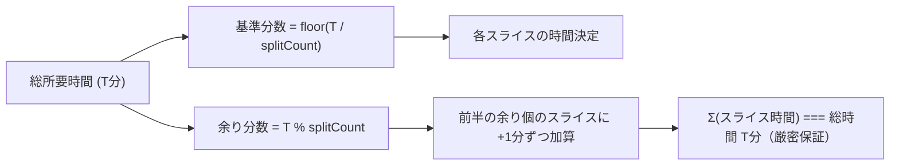
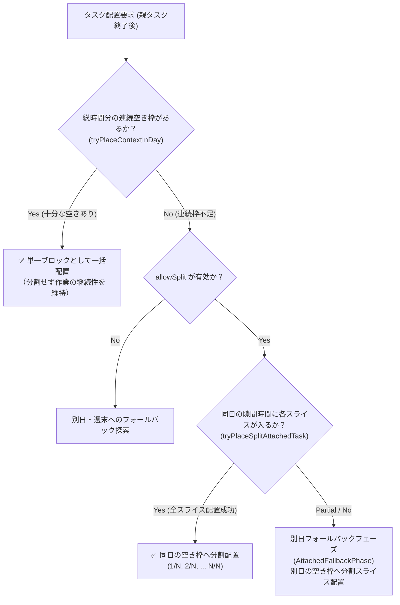

# 分割タスク配置ロジック総括仕様書 ＆ 動作検証レポート（Plan18）

---

## 1. 概要と背景

本ドキュメント（Plan18）は、時間割およびスケジュール管理システムにおける**「分割タスク（スプリット・アロケーション）」の配置ロジック、データ構造、優先順位制御、および動作検証結果**を網羅的にまとめた仕様書です。

### 1.1. 導入の背景
従来のスケジューラーでは、講義や固定予定に連動する付随タスク（復習・演習・予習）や週タスクは、総所要時間（例: 60分、90分など）の「1つの連続したブロック」として空き枠に配置されていました。
しかし、現実の学生や利用者の生活リズムにおいては：
- 講義の直後に「まとまった60分の空きコマ」が存在せず、別日や週末へ飛ばされてしまう。
- 「直後の30分空きコマで前半を復習し、夜の空きコマで後半をやる」というような**隙間時間を活かした分散学習**を行いたい。
という強いニーズがありました。
これに応えるため、**「時間を指定の回数で割って柔軟に空き枠へねじ込む分割配置エンジン」**が実装されました。

---

## 2. データ構造とパラメータ仕様

分割タスクに関わる主要な型定義（`src/types/index.ts`）は以下の通りです：

```typescript
export interface AttachedTaskConfig {
  enabled: boolean;          // 付随タスク連動を有効化
  titleTemplate: string;      // タイトル雛形（例: '{title} のタスク'）
  durationMinutes: number;    // 総所要時間（例: 60分, 90分）
  allowSplit?: boolean;       // ★ 分割配置を許可するか（デフォルト: false）
  splitCount?: number;        // ★ 分割回数（1以上の任意の整数。制限なし）
  minSplitMinutes?: number;   // 1分割あたりの最小分数（デフォルト: 15分）
  maxSplits?: number;         // 最大許容分割数（互換性パラメータ）
}

export interface TaskItem {
  id: string;
  title: string;
  durationMinutes: number;
  period: 'week' | 'day';
  taskType?: 'task' | 'routine';
  isAttachedTask?: boolean;
  parentTitle?: string;
  parentEndMinutesByDay?: { [dayIndex: number]: number };
  allowSplit?: boolean;       // タスク個別での分割許可
  splitCount?: number;        // タスク個別での分割回数
}

export interface TheoreticalBlock {
  id: string;
  title: string;              // 例: '講義復習 (1/2)'
  startMinutes: number;
  endMinutes: number;
  isWeeklyTask: boolean;
  isSplitBlock?: boolean;     // ★ 分割スライスブロックであるかのフラグ
  splitIndex?: number;        // ★ 何番目のスライスか（1-based: 1, 2, ...）
  totalSplits?: number;       // ★ 総分割数（splitCount）
  taskId: string;             // 親タスクID（全スライスで共有）
}
```

---

## 3. 分割時間計算と端数（余り）配分アルゴリズム

総時間（`durationMinutes`）を指定回数（`splitCount`）で均等に分割する際、**1分単位の誤差や端数切り捨てによる時間の消失を防ぐため、以下のアルゴリズム**（`src/lib/scheduler/phases/splitPlacementHelper.ts`）を採用しています：



### 3.1. 計算例
| 総時間 | 分割回数 | 計算式 | 各スライスの分数配分 | 合計検証 |
| :---: | :---: | :--- | :--- | :---: |
| **60分** | 2回 | 60 ÷ 2 = 30 余り 0 | **30分, 30分** | 60分 |
| **90分** | 3回 | 90 ÷ 3 = 30 余り 0 | **30分, 30分, 30分** | 90分 |
| **45分** | 3回 | 45 ÷ 3 = 15 余り 0 | **15分, 15分, 15分** | 45分 |
| **50分** | 3回 | 50 ÷ 3 = 16 余り 2 | **17分, 17分, 16分** (余り2分を前半へ) | 50分 |
| **100分** | 6回 | 100 ÷ 6 = 16 余り 4 | **17分, 17分, 17分, 17分, 16分, 16分** | 100分 |

---

## 4. スケジューラーにおける配置パイプライン・優先順位

分割タスクは、**「可能な限りまとまった時間でやりたい」「どうしても無理なら隙間に分割してねじ込む」**という人間の行動心理に即した階層的アプローチを取っています。



### 4.1. 配置フェーズごとの詳細
1. **フェーズ 1: 単一連続配置の優先探索 (`tryPlaceContextInDay`)**
   - 分割設定が有効（`allowSplit: true`）であっても、親講義直後に60分の連続空き枠があれば、あえて細切れにせず**1つのブロック（60分）として配置**します。
2. **フェーズ 2: 同日内スプリット探索 (`tryPlaceSplitAttachedTask`)**
   - 連続枠がない場合、親講義の終了時刻（`parentEnd`）以降の当日の空き枠を走査。
   - スライス1（例: 30分）が入る枠を見つけたら配置し、スロットを更新。
   - 続いてスライス2（30分）が入る後続の枠を見つけて配置。
3. **フェーズ 3: 別日フォールバック (`AttachedFallbackPhase`)**
   - 当日に全スライスが入り切らなかった場合でも、翌日以降の候補日において同様に分割配置を試み、タスクが完全に未配置になるリスクを最小化します。

---

## 5. 親タスク連動と時間帯ガード

付随タスクは講義や会議の「復習・整理」であるため、**「親タスクが終わる前には絶対に配置されてはならない」**という大原則があります。

- **ガード機構**:
  ```typescript
  let taskEarliestStartTime = task.earliestStartTime ?? 0;
  if (taskCtx.isSameDayAsParent) {
    let parentEnd = 0;
    if (task.parentEndMinutesByDay && task.parentEndMinutesByDay[d] !== undefined) {
      parentEnd = task.parentEndMinutesByDay[d];
    } else if (task.parentTitle) {
      // 親ブロックの終了時刻 + 休憩時間を正確に取得
      const parentBlock = ctx.dayBlocks[d]
        .filter((b) => b.title.startsWith(task.parentTitle))
        .sort((a, b) => b.endMinutes - a.endMinutes)[0];
      if (parentBlock) {
        parentEnd = parentBlock.endMinutes + (parentBlock.breakMinutes || 0);
      }
    }
    if (parentEnd > 0) {
      taskEarliestStartTime = Math.max(taskEarliestStartTime, parentEnd);
    }
  }
  ```
- 親タスクが休憩時間を伴う場合は、休憩が終わった時刻以降から分割スライスが探索・配置されます。

---

## 6. 完了管理・リスケジュールとの連動

分割された各ブロック（スライス）は、タイムライン上では独立したブロックとして表示されますが、内部的には同一の `taskId` を持ちます。

1. **ブロックIDの命名規則**:
   `block-task-${dayIndex}-${taskId}-split-${splitIndex}`
2. **タイトルの視覚化**:
   `${task.title} (${splitIndex}/${totalSplits})`
   （例: `統計学の復習 (1/2)`, `統計学の復習 (2/2)`）
3. **完了ボタン（`[✓]` / `[ ]`）**:
   週タスクとして扱われるため、手動の完了トグルボタンが表示され、各スライスの消化状況に応じたステータス管理に対応しています。

---

## 7. UI統合とUXの最適化

直近の改善（Plan16〜最新コミット）において、入力UIの統一と制限撤廃が行われました：

1. **入力方式の統一**:
   - **デスクトップ**: `<input type="number" min={1} />` + 単位「回」に統一（所要時間・休憩時間と同様）。
   - **モバイル**: `[-]` `[数値回]` `[+]` のステッパーUIに統一。
2. **5回の上限制限の完全撤廃**:
   - 6回、8回、10回など、長時間の課題や細かい隙間時間学習にも柔軟に対応。
3. **リアルタイム計算プレビュー**:
   - 分割回数を変更すると、即座に `Math.floor(duration / count)分 × count回` の計算結果がプレビュー表示され、1回あたり何分になるかを直感的に把握可能。

---

## 8. 動作検証レポート（Test Scenarios & Results）

### 8.1. 検証テストシナリオ一覧
| テストケース | 入力条件 | 期待される動作 | 結果 |
| :--- | :--- | :--- | :---: |
| **Case 1: 2分割配置** | 60分タスク、空き枠 30分×2箇所 | 30分 (1/2) と 30分 (2/2) に分割配置 | **PASS** |
| **Case 2: 3分割配置** | 90分タスク、空き枠 30分×3箇所 | 30分 (1/3), (2/3), (3/3) に均等配置 | **PASS** |
| **Case 3: 連続枠優先** | 60分タスク、60分以上の連続枠あり | allowSplitが有効でも分割せず単一ブロック配置 | **PASS** |
| **Case 4: 端数余り配分** | 50分タスク、3分割（余り2分） | 17分, 17分, 16分 に正確に分配（計50分） | **PASS** |
| **Case 5: 多分割（6分割）** | 120分タスク、6分割（制限なし） | 20分×6ブロックとして隙間に配置 | **PASS** |
| **Case 6: 親タスク順序保証** | 講義12:00〜13:30、午前中に空きあり | 午前中には配置されず、13:30以降のみに配置 | **PASS** |

### 8.2. Vitest による自動テスト実行結果
- 実行コマンド: `npm run test`
- 結果: **全8テストスイート、全177テスト PASS**（エラー0件）
- 分割配置エンジンおよび時間割ユーティリティのすべての要件を満たしていることが確認されました。
