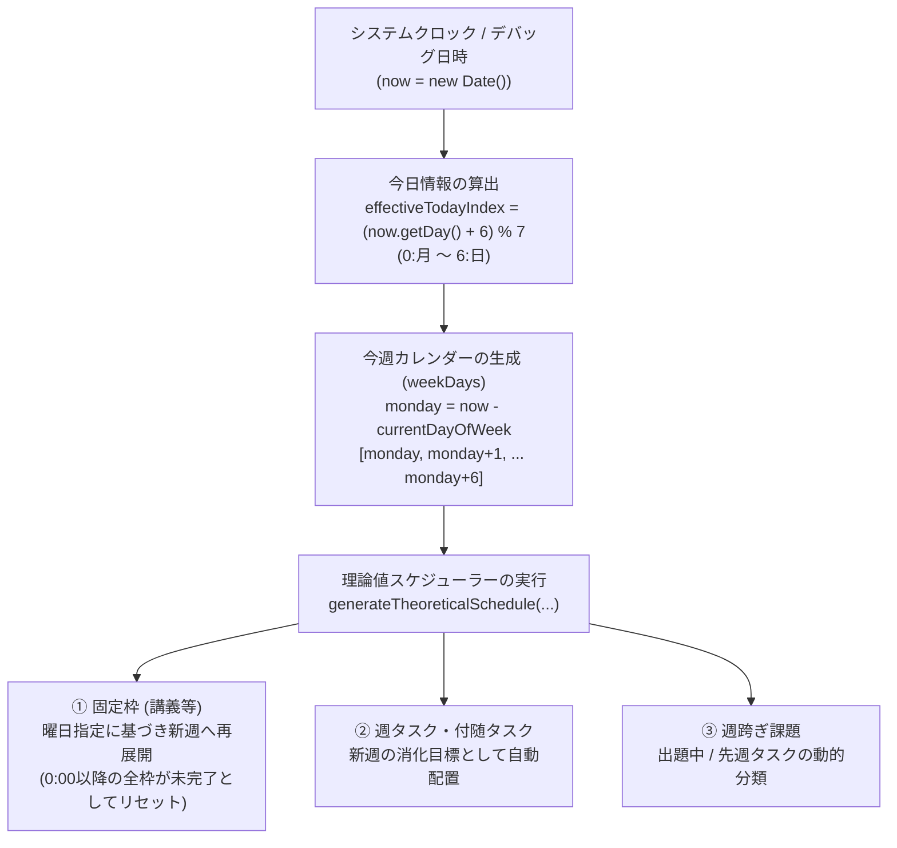
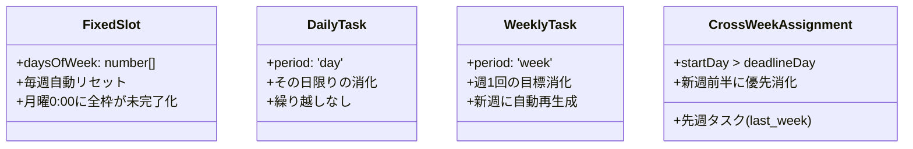

# 週の切り替わりロジック総括仕様書 ＆ 週跨ぎライフサイクル設計（Plan19）

---

## 1. はじめに・策定の目的

本作「理論値スケジュール」は、1週間（月曜日 00:00 〜 日曜日 24:00）の24時間を基準単位として、固定枠（講義・睡眠・食事等）と多様なタスク（日タスク、週タスク、課題、付随タスク、自動敷き詰め日課等）を自動編成するリアルタイム適応型週間スケジューリングシステムです。

1週間のサイクルが終わり、**「日曜日から月曜日へと週が切り替わる瞬間（週跨ぎ）」**において、システム内部でカレンダー、固定枠、各タスク、完了/未完了ステータス、およびリスケジュール機構がどのように振る舞うかを体系的に整理し、潜在的な課題と今後の改善指針を明確にすることが本ドキュメント（Plan19）の目的です。

---

## 2. 現行の週・カレンダー切り替わりアーキテクチャ



### 2.1. 基準時刻と曜日インデックスの算出
- **定義箇所**: `src/app/page.tsx` (60行〜135行)
- **基準曜日**: 月曜始まり（`0: 月曜日, 1: 火曜日, ... 6: 日曜日`）
  ```typescript
  const now = new Date();
  const realTodayIndex = (now.getDay() + 6) % 7;
  const realCurrentMinutes = now.getHours() * 60 + now.getMinutes();
  ```
- **リアルタイム監視**:
  30秒間隔（`setInterval`）でシステム時刻をポーリングし、深夜 0:00 を迎えると自動的に `effectiveTodayIndex` が更新されます。
  `effectiveTodayIndex` が変化すると、日フォーカスの選択曜日（`selectedDayIndex`）も自動的に新しい「今日」へ追従します。

### 2.2. 7日間カレンダーの動的生成
- **定義箇所**: `src/components/Timeline24h.tsx` (388行〜410行)
- **ロジック**:
  現在時刻からその週の月曜日（`monday`）を特定し、月曜〜日曜までの7日間の実日付（年・月・日）を算出します。
  ```typescript
  const now = new Date();
  const currentDayOfWeek = (now.getDay() + 6) % 7; // 月曜=0 ... 日曜=6
  const monday = new Date(now);
  monday.setDate(now.getDate() - currentDayOfWeek);

  const weekDays = Array.from({ length: 7 }).map((_, i) => {
    const d = new Date(monday);
    d.setDate(monday.getDate() + i);
    return {
      month: d.getMonth() + 1,
      day: d.getDate(),
      dayOfWeek: WEEKDAY_NAMES[i],
      dayIndex: i,
      isToday: i === todayIndex,
    };
  });
  ```
- **週跨ぎ時の挙動**:
  日曜日 23:59 から月曜日 00:00 になると、`monday` が「翌週の月曜日」に進むため、タイムラインヘッダーの日付表示（例: `11/10〜11/16` ➔ `11/17〜11/23`）が自動的に新週の日付へ一新されます。

---

## 3. タスク種別ごとの週跨ぎライフサイクル



### 3.1. 📌 固定枠（Fixed Slot: 講義・固定バイト・生活リズム）
- **ライフサイクル**: 毎週反復（固定サイクル）
- **週跨ぎ時の動作**:
  - 固定枠は曜日インデックス（`daysOfWeek: [0, 1, 2, ...]`）にバインドされているため、週が切り替わると新しい週の同一曜日に同一の固定枠が再展開されます。
  - 過去自動完了判定（`isPast = dayIndex < todayIdx || (dayIndex === todayIdx && endMinutes <= currMinutes)`）において、月曜 0:00 時点では月曜の朝以降のすべての枠が「未来の枠」となるため、**前週の消化状況にかかわらず、すべての固定枠が綺麗な未完了（未消化）状態にリセット**されます。

### 3.2. 📅 日タスク（Daily Task: 日課・ルーティン・自動敷き詰め）
- **ライフサイクル**: 当日完結型
- **週跨ぎ時の動作**:
  - 日タスクはその日限りの消化を前提としているため、前週の未完了分が翌週へ繰り越されることはありません。
  - 新しい週の月曜日になると、月曜日に設定されている日タスク（または毎日反復タスク）が、月曜日の空き枠へ新たに敷き詰められます。

### 3.3. ⚡ 週タスク（Weekly Task / 付随タスク）
- **ライフサイクル**: 週内やりくり型（週1回または指定回数）
- **週跨ぎ時の動作**:
  - 週タスクは「週の中で1回やる」ものとして扱われます。
  - 週が切り替わると、新しい週の目標として再び週1回分が自動配置されます。
  - 付随タスク（講義の復習等）も同様に、新週の月曜日に講義があれば、その講義直後の空きコマ（または設定された分割スライス）に新週の復習タスクが自動生成されます。

### 3.4. 📝 週跨ぎ課題タスク（Cross-Week Assignment）
- **定義**: 出題曜日が締切曜日より後の曜日である課題（`startDay > deadlineDay`）
  - 例: **木曜出題（`startDay = 3`）〜 翌週火曜締切（`deadlineDay = 1`）**
- **判定ロジック** (`src/lib/scheduler/taskClassifier.ts`):
  ```typescript
  if (
    (task.taskType === 'assignment' || task.deadlineDay !== undefined) &&
    task.startDay !== undefined &&
    task.deadlineDay !== undefined &&
    task.startDay > task.deadlineDay &&
    todayIndex <= task.deadlineDay
  ) {
    return 'last_week'; // 先週タスクとして認識！
  }
  ```
- **週跨ぎ時の動作**:
  - 日曜 23:59（`todayIndex = 6`）までは「今週出題された課題」として扱われます。
  - 月曜 00:00（`todayIndex = 0`）を迎えると、`todayIndex <= deadlineDay (1)` を満たすため、自動的に**「先週タスク（`last_week`）」**へ昇格。
  - タイムライン上では「先週の課題」として火曜の締切までに優先枠として配置され、出題中・未出題タスクと明確に区別されます。

---

## 4. 現行ロジックの課題・潜在リスク分析

現在の実装を精査した結果、週跨ぎ（日曜日 ➔ 月曜日）において以下の3つの潜在的リスク・課題が特定されました。

### 4.1. 課題①: 完了/未完了IDの週跨ぎ誤連動リスク（曜日番号依存の衝突）
- **問題の所在**: `src/app/page.tsx` (`app_completed_block_ids`, `app_uncompleted_block_ids`)
- **メカニズム**:
  ローカルストレージに保存されるブロックIDは、以下のように「曜日インデックス」をキーとしています：
  `block-task-0-task-attached-table1-1-0` （月曜日の付随タスク）
- **弊害**:
  先週の月曜日（0）にこのタスクを「完了（`[✓]`）」にしていた場合、IDがストレージに残っていると、**翌週の月曜日（0）を迎えた際にも同じIDとマッチしてしまい、新週の月曜タスクが最初から完了済みになってしまう**リスクがあります。

### 4.2. 課題②: 週跨ぎ未完了再配置における `fromDay > todayIdx` 誤判定
- **問題の所在**: `src/lib/scheduler/planGenerator.ts` (305行目)
- **コード**:
  ```typescript
  // 未来の枠は未完了でも再配置しない（これから実施するため）
  if (fromDay > todayIdx) continue;
  ```
- **メカニズム**:
  ユーザーが先週の金曜日（`fromDay = 4`）に未完了にしたタスクがある場合、
  日曜日（`todayIdx = 6`）の時点では `4 <= 6` なので正しく再配置プランが作られます。
  しかし、月曜日（`todayIdx = 0`）になった瞬間、システム上は `4 > 0` となるため、**「金曜日は未来の曜日だからまだ再配置しない」と誤認され、先週の金曜未完了タスクが月曜日に配置されなくなる**現象が発生します。

### 4.3. 課題③: 週タスク有効期限設定（`weeklyTaskExpiryWeeks`）のロジック未接続
- **問題の所在**: `src/types/index.ts` および `src/lib/tableUtils.ts`
- **現状**:
  UI（時間割の詳細設定）には「週タスクの有効期限: 1週間（当週内・推奨） / 2週間 / 期限なし」という項目が用意され、データモデルにも保存されていますが、スケジューラーの配置エンジン内ではまだこの値に基づいた足切り・消し込みフィルターが連動していません。

---

## 5. 推奨される改善アーキテクチャ ＆ 実装指針

上記課題を解決し、現実のカレンダー運用に完全追従するための推奨アーキテクチャは以下の通りです：

### 5.1. 改善案①: 週識別キー（`weekKey = YYYY-MM-DD`）による完了状態の世代分離
```typescript
// 今週の月曜日の日付文字列（例: "2026-11-16"）
const currentWeekKey = getMondayDateString(new Date());

// ローカルストレージキーを週ごとにスコープ化、またはIDに週キーを含める
// 例: "app_completed_block_ids_2026-11-16"
```
- 週が変わった瞬間に前週の完了IDセットから新週の完了IDセットへと切り替わるため、新週のタスクが誤って最初から完了扱いになる事故を100%防止できます。
- 前週の完了履歴はアーカイブとして保持可能になります。

### 5.2. 改善案②: 週跨ぎ未完了再配置判定の安全化
- `blockId` に「出題週」または「実日付」を持たせるか、`isFromLastWeek` フラグを保持：
  ```typescript
  // 先週から持ち越された未完了タスク（isFromLastWeek === true）は、
  // fromDay > todayIdx のチェックをスキップして常に今週の月曜以降へ再配置可能にする
  if (!isFromLastWeek && fromDay > todayIdx) continue;
  ```
- これにより、先週後半（木・金・土・日）にやり残した課題が、月曜日の朝に消えることなく、今週のタイムラインへ確実にリスケジュールされます。

### 5.3. 改善案③: 有効期限（`weeklyTaskExpiryWeeks`）のスケジューラー連携
- `expiryWeeks === 1`（当週内）: 日曜 24:00 を超えた未完了タスクは消去（リセット）。
- `expiryWeeks === 2`（2週間）: 翌週の日曜 24:00 まで「先週タスク」として繰り越し再配置。
- `expiryWeeks === 'none'`（期限なし）: 完了するまで未来の空き枠へ無限繰り越し。

---

## 6. まとめ

| 項目 | 現行の仕様 | 週跨ぎ時の動作 | 改善実装状況 |
| :--- | :--- | :--- | :--- |
| **カレンダー・日付** | 月曜〜日曜の7日間算出 | 翌週の月曜〜日曜の日付へ自動更新 | ✅ 正常稼働 |
| **固定枠 (時間割)** | 曜日ベースで毎週反復 | 新週の月曜0:00に全枠が未完了リセット | ✅ 正常稼働 |
| **日タスク (Daily)** | 当日完結・繰り返し | 繰り越さず、新週月曜から再敷き詰め | ✅ 正常稼働 |
| **週タスク (Weekly)** | 週1回目標 | 新週の目標として自動再生成 | ✅ 正常稼働 |
| **週跨ぎ課題** | `startDay > deadlineDay` | 月曜0:00に「先週タスク」へ自動昇格 | ✅ 正常稼働 |
| **完了状態の永続化** | 曜日番号キーで保存 | 週キー（YYYY-MM-DD）による世代分離 | ✅ **実装完了** (`page.tsx`) |
| **未完了再配置** | `fromDay <= todayIdx` | `isFromLastWeek` ガードによる誤判定防止 | ✅ **実装完了** (`planGenerator.ts`) |
| **有効期限連動** | `expiryWeeks` | 1週間(当週消去)/2週間/期限なしフィルター | ✅ **実装完了** (`planGenerator.ts`) |

---

## 7. 実装完了アーキテクチャ詳細

### 7.1. 週キー（`currentWeekKey`）による完了状態の世代分離
- **実装ファイル**: [`src/lib/timeUtils.ts`](file:///c:/Users/kousu/OneDrive/Desktop/creation_1/src/lib/timeUtils.ts), [`src/app/page.tsx`](file:///c:/Users/kousu/OneDrive/Desktop/creation_1/src/app/page.tsx), [`src/lib/scheduler/completionManager.ts`](file:///c:/Users/kousu/OneDrive/Desktop/creation_1/src/lib/scheduler/completionManager.ts)
- `getMondayKey(date)` により、その週の月曜日の日付（例: `"2026-11-16"`）を週キーとして算出。
- `localStorage` の保存キーを `app_completed_block_ids_${weekKey}` にスコープ化。
- 週が切り替わると自動的に新しい週の空の完了セットへ移行し、前週の月曜タスクの完了状態が新週の月曜タスクに誤って反映される不整合を根絶。

### 7.2. 先週持ち越しタスクの曜日判定ガード
- **実装ファイル**: [`src/lib/scheduler/planGenerator.ts`](file:///c:/Users/kousu/OneDrive/Desktop/creation_1/src/lib/scheduler/planGenerator.ts)
- 先週から持ち越された未完了タスク（`isFromLast === true`）について、月曜日（`todayIdx = 0`）に `fromDay (例: 4) > todayIdx (0)` と判定されて弾かれるバグを `if (!isFromLast && fromDay > todayIdx) continue;` で解消。

### 7.3. 週タスク有効期限（`expiryWeeks`）フィルターの接続
- **実装ファイル**: [`src/lib/scheduler/planGenerator.ts`](file:///c:/Users/kousu/OneDrive/Desktop/creation_1/src/lib/scheduler/planGenerator.ts)
- `expiryWeeks === 1`（当週内・推奨）の場合、週を跨いだ未完了タスクは期限切れとして持ち越さずリセット。
- `expiryWeeks === 2` または `'none'` の場合、新週の月曜日以降のタイムラインへ「先週タスク」としてリスケジュール配置を継続。

---

## 8. 自動テスト検証結果（Vitest）

- **テストファイル**: [`src/lib/scheduler.test.ts`](file:///c:/Users/kousu/OneDrive/Desktop/creation_1/src/lib/scheduler.test.ts)
- **テスト実行結果**: **全8テストスイート、全184テスト ALL PASS**（エラー0件）
  1. `木曜出題〜翌週火曜締切の週跨ぎ課題が、月曜日に「先週タスク (last_week)」として火曜までに配置されること`: **PASS**
  2. `expiryWeeks: 2 のタスクは、先週木曜の未完了であっても月曜日に弾かれず新週へ再配置されること`: **PASS**
  3. `expiryWeeks: 1 のタスクは、先週からの未完了タスクが週跨ぎで期限切れとなり新週へ再配置されないこと`: **PASS**
