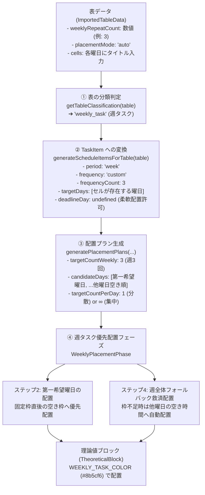

# 表データにおける週回数指定タスクの配置ロジック仕様書（Plan20）

---

## 1. はじめに・策定の目的

本アプリケーションでは、Excel風の表データ（`ImportedTableData`）を作成・インポートし、そこからスケジュール上の「固定枠（時限指定）」や「自動配置タスク（日課・週タスク）」を動的に生成して週間タイムライン（月〜日）に反映する柔軟な仕組みを備えています。

表データの中で、**「週の回数（`weeklyRepeatCount`）」が指定されたもの**は、システム内部で **「週タスク（`weekly_task`）」** として特別に扱われ、空き時間への最適配置が行われます。

本ドキュメント（Plan20）では、表データで週の回数が指定された場合における：
1. **表データの分類判定（固定枠・日課・週タスクの分岐条件）**
2. **表データから `TaskItem` へのプロパティ変換・集約仕様**
3. **スケジューラーでの配置プラン生成（目標回数・優先候補日・フォールバック候補日）**
4. **週間配置フェーズ（`WeeklyPlacementPhase`）での探索と配置アルゴリズム**
5. **集中型ポリシーと分散型ポリシーによる配置の違い**
6. **枠不足時やエッジケースでの救済仕様**

をコードベース（`src/lib/tableUtils.ts`、`src/lib/scheduler/`）の実装に基づいて体系的に整理・検証し、今後の機能拡張や保守における指針とします。

---

## 2. 全体アーキテクチャ・データフロー



---

## 3. 表データの分類判定ロジック

### 3.1. 分類関数: `getTableClassification(table)`
- **実装箇所**: `src/lib/tableUtils.ts` (161行〜193行)

表データが「固定枠（`fixed_slot`）」「週タスク（`weekly_task`）」「日課タスク（`daily_task`）」のいずれに分類されるかは、以下の優先順位で厳密に決定されます。

```typescript
export function getTableClassification(table: ImportedTableData): TableClassification {
  // 1. 明示的な手動オーバーライドがある場合は最優先
  if (table.classificationOverride) {
    return table.classificationOverride;
  }

  // 2. 固定配置モード、または開始時刻が明示設定されている場合は固定枠
  const isFixed =
    table.placementMode === 'fixed' ||
    (table.placementMode === undefined &&
      table.axisConfig.startTime !== null &&
      table.axisConfig.startTime !== undefined &&
      table.axisConfig.startTime !== 'unset' &&
      table.axisConfig.startTime !== '自動' &&
      table.axisConfig.startTime !== 'auto');

  if (isFixed) {
    return 'fixed_slot';
  }

  // 3. 自動配置（placementMode: 'auto' または startTime未設定）の場合:
  // ★ 週の回数（weeklyRepeatCount）が指定（> 0）されているもの「のみ」を週タスクとして定義
  if (
    table.weeklyRepeatCount !== undefined &&
    table.weeklyRepeatCount !== 'auto' &&
    typeof table.weeklyRepeatCount === 'number' &&
    table.weeklyRepeatCount > 0
  ) {
    return 'weekly_task';
  }

  // 4. 週の回数が未指定・'auto' のものは日課タスク
  return 'daily_task';
}
```

### 3.2. 分類の分岐条件表

| 項目 | 条件 | 分類結果 (`TableClassification`) | 説明 |
| :--- | :--- | :--- | :--- |
| **手動上書き** | `classificationOverride` 設定時 | 指定された分類 | ユーザーの明示設定を最優先 |
| **固定枠** | `placementMode === 'fixed'` または `startTime` あり | `fixed_slot` | タイムラインの決まった時刻・時限に固定配置 |
| **週タスク** | `placementMode === 'auto'` かつ `weeklyRepeatCount > 0` | **`weekly_task`** | **空き枠に週指定回数（週N回）やりくり配置** |
| **日課タスク** | `placementMode === 'auto'` かつ `weeklyRepeatCount` 未設定 | `daily_task` | 毎日または指定曜日に毎回入る日課タスク |

---

## 4. 表データから `TaskItem` への変換・集約仕様

### 4.1. 変換関数: `generateScheduleItemsForTable(table)`
- **実装箇所**: `src/lib/tableUtils.ts` (598行〜687行)

表データが `weekly_task` と判定された場合、各セルのテキストからタスクオブジェクト（`TaskItem`）が構築されます。

### 4.2. 同一タイトルの集約処理
表内に同じタイトルのセルが複数存在する場合（例: 月曜・水曜・金曜に「レポート作成」と入力）、それらは**1つのタスクに集約**され、対象曜日がまとめられます。

```typescript
const tableWeeklyCount =
  table.weeklyRepeatCount && table.weeklyRepeatCount !== 'auto'
    ? Number(table.weeklyRepeatCount)
    : undefined;

// 同一表内の同名セルは 1 つの TaskItem に集約
if (existing) {
  if (tableWeeklyCount) {
    existing.frequency = 'custom';
    existing.frequencyCount = tableWeeklyCount; // 週の回数を反映
  }
  if (isWeekday && effectiveWeekday !== undefined) {
    const curDays = existing.targetDays || [];
    if (!curDays.includes(effectiveWeekday)) {
      existing.targetDays = [...curDays, effectiveWeekday].sort((a, b) => a - b);
      existing.startDay = existing.targetDays[0];
    }
  }
}
```

### 4.3. 生成される `TaskItem` の主要プロパティ

| プロパティ名 | 設定値 | 役割・スケジューラーへの影響 |
| :--- | :--- | :--- |
| `period` | `'week'` | 週単位でやりくりするタスクであることを明示（`isWeeklyTaskItem === true`） |
| `frequency` | `'custom'` | 週あたりの回数指定があるカスタム頻度 |
| `frequencyCount` | `table.weeklyRepeatCount` (例: 3) | **1週間で配置すべき目標合計回数（最重要パラメータ）** |
| `targetDays` | `[0, 2, 4]` など | セルが存在する曜日一覧（第一希望曜日として優先探索に使用） |
| `startDay` | `targetDays[0]` | 最初の対象曜日 |
| `deadlineDay` | `undefined` | **重要**: 表の列は「対象曜日」であり「締切」ではないため未設定とし、枠不足時に他曜日への柔軟なフォールバック配置を許可 |
| `dailyCount` | `table.dailyRepeatCount ?? 1` | 1日あたりの最大配置回数 |
| `earliestStartTime` | `table.axisConfig.startTime` | 配置可能開始時刻の下限（未設定なら制限なし） |
| `latestEndTime` | `table.axisConfig.endTime` | 配置可能終了時刻の上限（例: 21:00） |
| `autoPlaceWithinRange` | `isAutoRange` (true) | 指定時間帯の範囲内への自動配置を指示 |
| `expiryWeeks` | `table.weeklyTaskExpiryWeeks ?? 1` | 週タスクの有効期限週数（基本は当週の1週間） |

---

## 5. スケジューラーによる配置計画生成（`planGenerator.ts`）

### 5.1. 計画生成関数: `generatePlacementPlans`
- **実装箇所**: `src/lib/scheduler/planGenerator.ts` (200行〜263行)

スケジューラーはタスク一覧から `TaskPlacementPlan` を作成します。週の回数が指定されたタスクは `kind: 'weekly_flexible'` のプランとして生成されます。

```typescript
const targetDaysCount =
  task.frequencyCount ||
  (task.targetDays && task.targetDays.length > 0
    ? task.targetDays.length
    : getTargetPlacementDays(task));

// 全曜日の空き時間ソート
const allDaysByFree = slotManager.getDaysSortedByFreeTime([0, 1, 2, 3, 4, 5, 6]);

let candidateDays: number[];
if (task.targetDays && task.targetDays.length > 0) {
  // ★ 重要設計:
  // 表データ由来の指定曜日を最優先探索リスト（preferred）の先頭に配置
  // 残りの全曜日をフォールバック候補（others）として末尾に追加
  const preferred = [...task.targetDays];
  const others = allDaysByFree.filter((d) => !preferred.includes(d));
  candidateDays = [...preferred, ...others];
} else {
  candidateDays = allDaysByFree;
}

return {
  task,
  kind: 'weekly_flexible',
  candidateDays, // 例: [0, 2, 4, 1, 3, 5, 6]
  targetCountPerDay: strategy === 'concentrated' ? Infinity : 1,
  targetCountWeekly: targetDaysCount, // 目標週回数 (例: 3)
  isAuto,
  placedCount: 0,
  placedCountPerDay: {},
  isComplete: false,
};
```

### 5.2. プラン設計のポイント
1. **目標回数の一貫性**:
   - `targetCountWeekly` に `task.frequencyCount` が確実にセットされます。
2. **優先候補日とフォールバック候補日の統合**:
   - `candidateDays` の先頭にはユーザーが表でマスを入力した曜日（`preferred`）が並びます。
   - 後半には表で入力していない曜日（`others`）が空き時間順に並びます。
   - これにより、**「第一希望曜日に枠があればそこに入り、枠が足りなければ空いている他曜日に回る」** という完全な自動融通が実現されます。

---

## 6. 週間配置フェーズ（`WeeklyPlacementPhase`）での実行手順

- **実装箇所**: `src/lib/scheduler/phases/weeklyPlacementPhase.ts`

週タスクの配置は、日課タスクの配置よりも前に行われる **最優先フェーズ（Phase 1）** で実行されます。

### 6.1. ステップ2: 第一希望曜日の直接配置 (90行〜136行)
各曜日 $d \in [0..6]$ を走査し、`plan.task.targetDays.includes(d)` であるタスクをその日の固定枠直後のクリーンな空き枠に配置します。

- **1日あたりの配置上限**:
  - 分散モードの場合: `targetCountPerDay = 1`（同じ日に2回入らない）
  - 集中モードの場合: `targetCountPerDay = Infinity`
- **目標到達チェック**:
  - 各曜日で配置されるたびに `plan.placedCount++` される。
  - `plan.placedCount >= plan.targetCountWeekly` に達した時点で `plan.isComplete = true` となり、以降の曜日の配置は終了する。

> **具体例**:
> 表で「月・水・金」に入力されており、`weeklyRepeatCount = 2` の場合：
> - 月曜日に1回目配置 (`placedCount: 1`)
> - 水曜日に2回目配置 (`placedCount: 2` $\ge$ `targetCountWeekly: 2`) $\rightarrow$ `isComplete = true`
> - 金曜日の判定時には既に `isComplete` のため配置されず、週2回が守られる。

### 6.2. ステップ4: 週全体フォールバック救済配置 (210行〜326行)
固定枠が密集していて第一希望曜日に配置できなかった場合、または表のセル数よりも `weeklyRepeatCount` が大きく設定されていた場合、ステップ4の救済配置が起動します。

1. **探索対象曜日**:
   - `candidateDays`（他曜日の空き枠）を走査。
2. **曜日の優先順位**:
   - **分散モード (`balanced`)**:
     空き時間の多い曜日（`freeB - freeA`）を優先。
   - **集中モード (`concentrated`)**:
     直近の曜日（前倒し順、今日寄り）を優先。
3. **時間枠の適合性チェック**:
   - スロットの長さがタスクの所要時間（`durationMinutes`）を満たしている曜日を最優先。
4. **配置実行**:
   - 目標回数（`targetCountWeekly`）に達するまで順次配置。

---

## 7. 配分ポリシー（集中型 vs 分散型）による挙動の差異

| 比較項目 | 分散モード（`balanced`） | 集中モード（`concentrated`） |
| :--- | :--- | :--- |
| **1日あたりの上限** | `targetCountPerDay = 1`（1日1回） | `targetCountPerDay = Infinity`（同一日への連続・複数配置を許可） |
| **曜日探索の優先度** | 空き枠の合計時間が大きい曜日を優先（負荷平準化） | 週の前半・直近の曜日（今日寄り）を最優先（前倒し完了） |
| **フォールバック挙動** | 他の空いている曜日に綺麗に散らして配置 | 空きがあれば同じ日や直近曜日にまとめて配置 |
| **向いている用途** | 筋トレ、英語学習、復習などの習慣化タスク | 課題レポート、集中作業、早めに終わらせたいタスク |

---

## 8. エッジケースの検証と現在の振る舞い

### ケース1: 表のマス数よりも `weeklyRepeatCount` が少ない場合
- **設定例**: 月〜金の5マスに「英語学習」を入力、`weeklyRepeatCount: 3`
- **挙動**:
  - 月・火・水の3日間で配置が完了（`placedCount: 3`）。
  - 木・金は配置スキップとなる。
  - **評価**: 正しく週3回に抑制される。

### ケース2: 表のマス数よりも `weeklyRepeatCount` が多い場合
- **設定例**: 火・木の2マスに「筋トレ」を入力、`weeklyRepeatCount: 4`
- **挙動**:
  - ステップ2で火曜・木曜に1回ずつ配置（計2回）。
  - ステップ4で目標未達（2 < 4）を検知し、残りの曜日（月・水・金・土・日）から空き枠のある曜日を探して2回配置。
  - **評価**: 表に書いていない曜日にも柔軟に救済配置され、目標の4回が達成される。

### ケース3: 開始時刻未設定・終了時刻上限あり（例: 筋トレ 21:00上限）
- **設定例**: `startTime: null`, `endTime: '21:00'`, `weeklyRepeatCount: 3`
- **挙動**:
  - `tableEndTimeMinutes = 1260` (21:00) が `latestEndTime` としてタスクに渡される。
  - スケジューラーは 21:00 より前の空き枠のみを探索して配置する。21:00 を超える夜間枠には配置されない。
  - **評価**: 意図通り、21時までの時間帯で週N回の自動配置が行われる。

### ケース4: 分割配置（`allowSplit: true`）との併用
- **設定例**: 90分タスク、`splitCount: 3`, `weeklyRepeatCount: 2`
- **挙動**:
  - 週の各配置日において、90分が 30分×3コマ に自動分割され、その日の隙間時間に分散配置される。
  - これが週2回（別々の2日）行われる。
  - **評価**: Plan18 で実装された分割タスク配置ロジックと完全に整合して動作する。

---

## 9. 総括とまとめ

現行の「表データで週の回数が指定されたもの」の配置ロジックは、以下の点で非常に優れた堅牢性と柔軟性を備えています。

1. **直感的な分類**:
   - `placementMode: 'auto'` かつ `weeklyRepeatCount > 0` という明確なルールで自動的に週タスクへと昇格する。
2. **第一希望とフォールバックの二層構造**:
   - 表の列指定を最優先しつつ、枠不足時は他曜日の空き枠へ自律的に回るため、未配置（あふれ）が発生しにくい。
3. **時間範囲制限との調和**:
   - `startTime` / `endTime` の上限・下限がタスクの `earliestStartTime` / `latestEndTime` に正しく連動し、時間帯制限と週回数制限が両立している。
4. **配分ポリシーとの連携**:
   - 分散型（1日1回・平準化）と集中型（前倒し詰め込み）の切り替えが `targetCountPerDay` と探索順序によって忠実に反映されている。

本ドキュメント（Plan20）にまとめたロジック体系により、今後のUI改善やスケジューラー調整時にも意図通りの動作を確実に維持・検証することが可能となります。
