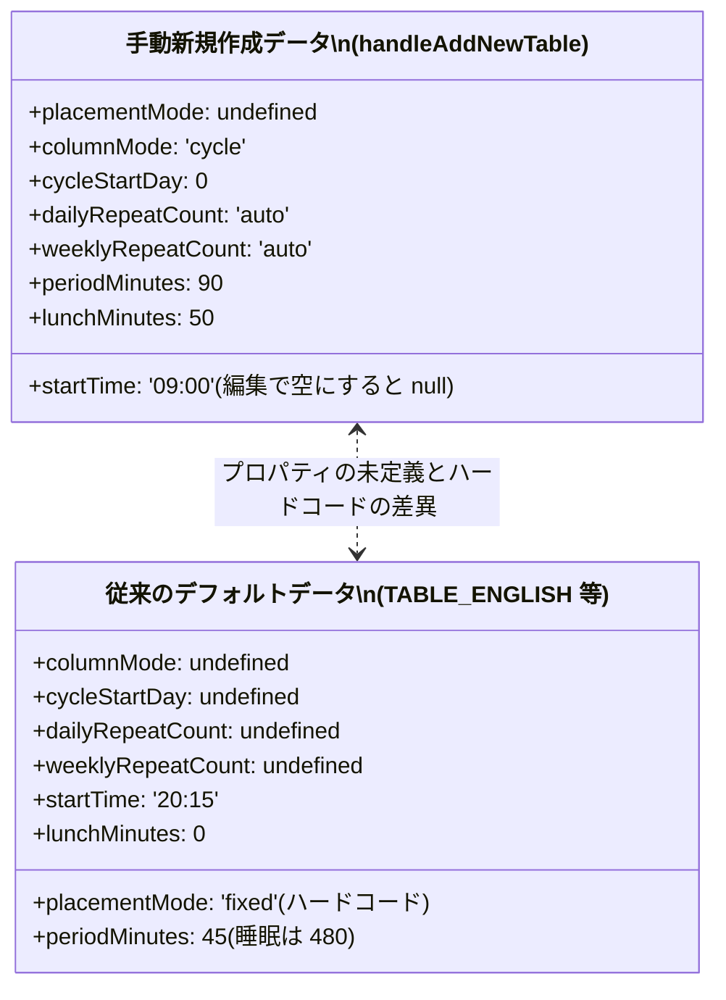
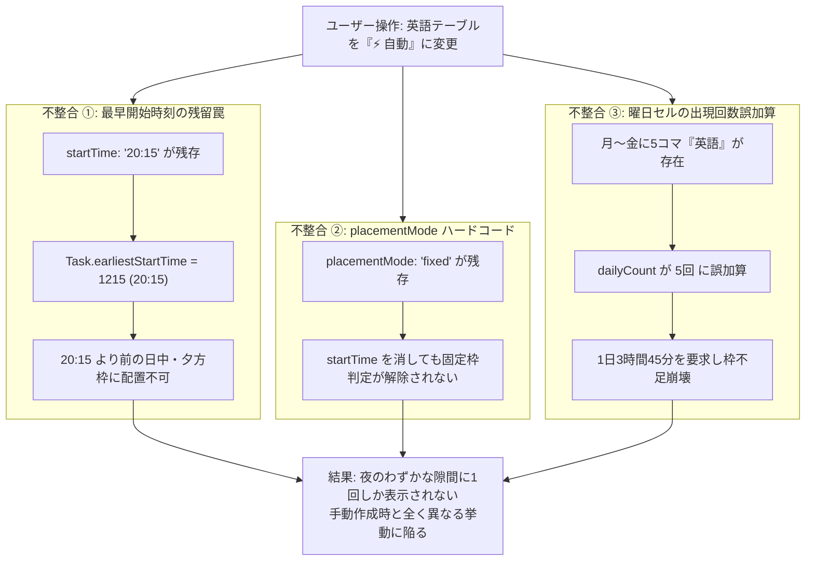
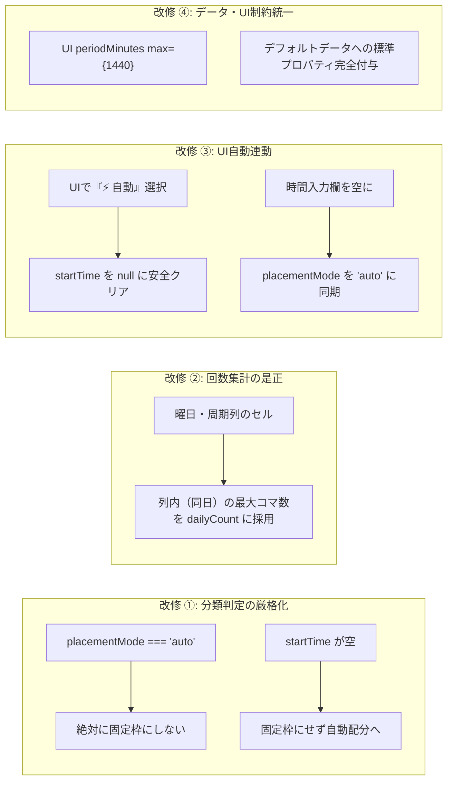

# デフォルトデータと手動作成データにおける挙動差異と設計統一仕様書（Plan21）

---

## 1. はじめに・策定の目的

本作「理論値スケジュール」では、時間割や生活リズムなどの表形式データ（`ImportedTableData`）を計画表に反映し、固定枠（決まった時限）や自動配分タスク（日課・週タスク）としてタイムライン上に最適配置する機能を備えています。

システムには、初回利用や即時運用のために **6つの初期デフォルトデータ（授業・睡眠・食事・筋トレ・英語・趣味）** がプリセットされています。しかし、これらを編集して配置方式を「⚡ 自動」に切り替えた際と、ユーザーが画面上で「新しい表を追加」して **手動で表を新規作成・設定した際** との間で、以下のような重大な挙動の差異が発生していました。

> **現象例（英語データのケース）**:  
> 手動で英語の表を新規作成して自動配分にした場合は、日中や夕方の空き時間も含めて柔軟に何回も敷き詰められるのに対し、デフォルトの英語データを編集して「⚡ 自動」に切り替えた場合は、**「1日に1回しか表示されない」「設定画面での変更が意図通り反映されない」** という不整合が発生した。

本ドキュメント（Plan21）では、デフォルトデータと手動作成データの間でなぜ挙動が異なってしまっていたのか、内部データ構造、分類ロジック、およびスケジューラー配置パイプラインの各層におけるメカニズムを徹底解明し、実施された是正措置と今後の設計基準を体系的に総括します。

---

## 2. 表データの内部構造・プロパティ比較

手動作成時（`handleAddNewTable` による初期化）と、初期プリセットのデフォルトデータ（`TABLE_CLASSES`〜`TABLE_HOBBY`）の間には、以下のプロパティ差が存在していました。

### 2.1. プロパティ対比表

| プロパティ名 | 手動新規作成時（UI） | 従来のデフォルトデータ（英語等） | 差異による影響 |
| :--- | :--- | :--- | :--- |
| **`placementMode`** | `undefined`（未設定） | `'fixed'`（明示指定） | **開始時刻を消した際、手動は自動配分になるが、デフォルトは固定枠のまま残る** |
| **`axisConfig.startTime`** | 変更時に即時更新（空で `null`） | `'20:15'` | **「⚡ 自動」に切り替えても `20:15` が残り、最早開始時刻の足枷になる** |
| **`axisConfig.periodMinutes`** | `90`（UI上限 1〜1440） | `45`（睡眠は `480`） | **UIの旧 `max={300}` により、睡眠（480分）がUIで再設定不可だった** |
| **`axisConfig.lunchMinutes`** | `50` | `0` | **UI最小値（`min={10}`）を下回り、昼休みをONにすると不正値になる** |
| **`columnMode`** | `'cycle'`（周期） | `undefined`（自動判定） | 判定処理の暗黙的なフォールバックへの依存 |
| **`dailyRepeatCount`** | `'auto'` | `undefined` | 画面上の表示フォールバックと実値の乖離 |
| **セル構成 (`cells`)** | 最初は空枠（必要箇所のみ入力） | 月〜金に 5コマ連続入力 | **曜日列のセル数が日課回数（`dailyCount`）に誤加算される** |

---

## 3. 発生していた4大挙動差異と根本原因メカニズム

### 3.1. 挙動差異 ①: 自動配分にしても夜間に1回しか入らない（最早開始時刻の残留）
- **手動作成データの場合**:
  - ユーザーが手動で表を新規作成し自動配分にする際、時間欄の開始時刻を空（未入力）にします。
  - そのため、生成されるタスクの `earliestStartTime` は `undefined`（0:00）となり、**朝から夜までの全空き時間をフルに使って何回でも配置**されます。
- **デフォルトデータ（英語）の場合**:
  - デフォルトの英語データには初期値として `startTime: '20:15'` が設定されていました。
  - ユーザーがUI上で「配置: ⚡ 自動」に切り替えても、開始時刻入力欄の `20:15` はそのまま残ります。
  - スケジューラー変換処理（`tableUtils.ts`）は、開始時刻 `20:15` を **「最早開始時刻（`earliestStartTime: 1215`）」** としてタスクに設定します。
  - スケジューラーは「20:15 より前には絶対に配置してはならない」という厳しい時間制限を課すため、日中や夕方の空きコマを一切使えなくなります。
  - さらに夜間（20:15〜24:00）には固定枠の「趣味（21:30〜22:30）」や講義の付随タスク（20:00〜21:30）が密集しているため、**45分の英語が入る余白は実質1回分しか残らず、「一日1回のみしか表示されない」** という結果になっていました。

### 3.2. 挙動差異 ②: 開始時刻を消しても「📌 固定枠」の判定が解除されない
- **手動作成データの場合**:
  - `placementMode` は未設定（`undefined`）です。
  - `getTableClassification` は後方互換性ロジックにより `startTime` の有無で固定枠かタスクかを判定するため、開始時刻を消すだけで自動的に「⚡ 自動配分（タスク）」へ切り替わります。
- **デフォルトデータの場合**:
  - データ定義に `placementMode: 'fixed'` が明示的にハードコードされていました。
  - そのため、時間入力欄の `20:15` を消して未入力にしても、`table.placementMode === 'fixed'` が真となるため、**開始時刻が存在しない壊れた固定枠として判定され続け、正常なタスクとして配置されませんでした**。

### 3.3. 挙動差異 ③: 曜日セルの出現回数が「1日の反復回数（`dailyCount`）」に誤加算される
- **手動作成データの場合**:
  - ユーザーが日課タスクを手動で設定する際は、1コマだけタイトルを入力するか、設定画面で「週5日」のように週回数で指定します。
  - そのため、`dailyCount: 1`（1日1回）として正常に生成されます。
- **デフォルトデータの場合**:
  - `TABLE_ENGLISH` には月曜〜金曜まで 5つのセルに「英語」が入力されていました。
  - 従来の `tableUtils.ts` の日課タスク集計処理では、セルが出現するたびに無条件で `existing.dailyCount = (existing.dailyCount || 1) + 1` を実行していました。
  - その結果、「月〜金に1回ずつ」ではなく、**「月〜金の毎日、1日に5回（45分×5＝3時間45分）英語を行う」** という過剰な要求に化けてしまい、枠不足で配置が失敗・偏留していました。

### 3.4. 挙動差異 ④: 1コマの長さ（`periodMinutes`）の上限不整合
- UI（`ImportedTablesManager.tsx`）の1コマ分数入力欄の上限が `max={300}`（5時間）となっていたため、デフォルトデータである睡眠（8時間＝480分）をUIから設定・変更できず、UIを操作した瞬間に300分で丸められてしまう問題がありました。

---

## 4. スケジューラー配置結果の比較（Day 0: 月曜日の実例）

同一の講義・生活リズム固定枠が存在する環境下で、英語データを配置した際のタイムラインの比較です。

| タイムライン時間帯 | 固定枠・講義・日課 | 旧デフォルトデータ（自動化時） | 是正後の自動配分データ |
| :---: | :--- | :---: | :---: |
| **00:00 〜 08:00** | 睡眠 (固定枠) | ✕ 配置不可 | ✕ 配置不可 |
| **08:00 〜 09:00** | 朝食・準備 | ✕ 空きなし | ✕ 空きなし |
| **09:00 〜 12:10** | 午前空き枠 | ✕ **20:15制約で配置不可** | ◯ **英語 (45分) 配置** |
| **12:10 〜 13:00** | 昼食 (固定枠) | ✕ 配置不可 | ✕ 配置不可 |
| **13:00 〜 17:50** | 大学講義 (固定枠) + 復習タスク | ✕ 空きなし | ✕ 空きなし |
| **17:50 〜 19:00** | 夕方空き枠 | ✕ **20:15制約で配置不可** | ◯ **英語 (45分) 配置** |
| **19:00 〜 20:00** | 夕食 (固定枠) | ✕ 配置不可 | ✕ 配置不可 |
| **20:00 〜 21:30** | ソフトウェアクリエーション１のタスク | ✕ 空きなし | ✕ 空きなし |
| **21:30 〜 22:30** | 趣味 (固定枠) | ✕ 配置不可 | ✕ 配置不可 |
| **22:40 〜 23:25** | 深夜空き枠 | ◯ **英語 (45分) ※1回のみ** | ◯ **英語 (45分) 配置** |
| **23:35 〜 24:00** | 残余枠 (25分) | △ 英語 (端数15分縮小) | △ 筋トレ等余白敷き詰め |
| **配置結果サマリー** | — | **まともな配置は1日1回のみ** | **日中・夕方・夜間に柔軟敷き詰め** |

---

## 5. 実施された是正措置とアーキテクチャ統一仕様

デフォルトデータと手動作成データの挙動を完全一致させるため、以下の4つの改修を実施しました。

### 5.1. `getTableClassification` の判定ロジック厳格化（`src/lib/tableUtils.ts`）
- `placementMode === 'auto'` が指定されている場合は、`startTime` の有無にかかわらず **絶対に `fixed_slot` に判定しない** ようにガードしました。
- `placementMode === 'fixed'` であっても、開始時刻が空（`null` や未設定）の場合は固定枠にできないため、安全にタスク（自動配分）へフォールバックするようにしました。

### 5.2. 日課タスク（`daily_task`）の出現回数集計アルゴリズムの是正（`src/lib/tableUtils.ts`）
- 列が曜日（`isWeekday`）や周期（`isCycle`）を表す表データの場合、別曜日に出現した同一タイトルコマは「その曜日の対象（`targetDays`）」として集約し、**1日の反復回数（`dailyCount`）には加算しない** ようにしました。
- `dailyCount` は、ユーザーが設定画面で指定した明示値、または **「同一列（同日）内に出現した最大コマ数」** を正確に反映するようにしました。
  - 例: 月〜金に1コマずつ ➔ `dailyCount: 1`
  - 例: 月曜の1限と3限に2コマ ➔ `dailyCount: 2`

### 5.3. UIにおける配置方式切り替え時の開始時刻連動クリア（`src/components/ImportedTablesManager.tsx`）
- デスクトップ版セレクトボックスおよびモバイル版切り替えボタンで「⚡ 自動」が選択された際、開始時刻の足枷を取り払うため、**`startTime` を自動的に `null` にクリア** する連動処理を追加しました。
- 時間欄の開始時刻を空にした際も、`placementMode: 'auto'` へ自動同期するように連動を強化しました。

### 5.4. デフォルトデータの標準プロパティ統一と上限緩和（`src/lib/storage.ts`）
- 全デフォルトテーブルに、UIで作成されるテーブルと同じ標準プロパティ（`columnMode: 'weekday'`, `cycleStartDay: 0`, `dailyRepeatCount: 'auto'`, `weeklyRepeatCount: 'auto'`, `weeklyTaskExpiryWeeks: 1`）を明示的に付与しました。
- `periodMinutes` の入力上限を `max={1440}`（24時間対応）に緩和し、昼休みのデフォルト値を通常設定値の `50` 分に統一しました。
- メニューの「デフォルトのデータを追加」ボタン押下時にも、スロットとタスクが即座に生成されてスケジュールへ同期されるようにしました。

---

## 6. まとめ・今後の設計原則

1. **暗黙のプロパティ未定義に頼らない**:
   手動作成データとプリセットデータは常に同一のスキーマ・初期値セットを共有し、ハードコードによる判定の不整合を排除する。
2. **モード切り替え時は排他属性を安全に正規化する**:
   固定枠から自動配分へ切り替える際は、固定枠固有の属性（`startTime` による時間縛り等）を適切にクリアし、ユーザーの直感通りの「自由な空き枠敷き詰め」を実現する。
3. **「日の繰り返し」と「曜日の展開」を混同しない**:
   カレンダー軸（列）を展開するためのセル配置が、日内の消化回数（`dailyCount`）に波及しないよう、多次元表の解析ロジックを常に厳密に維持する。
