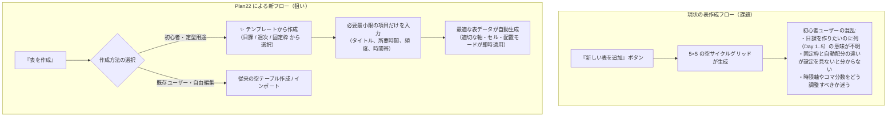
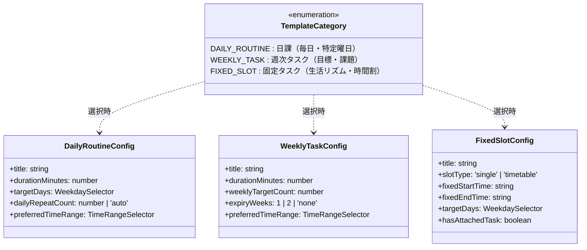
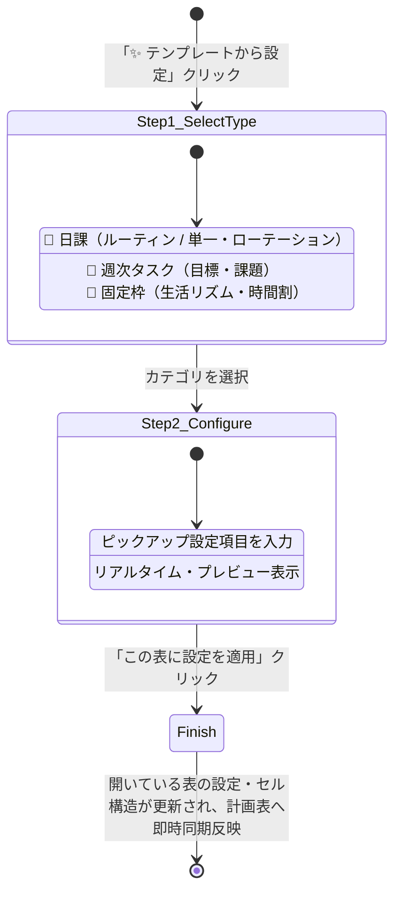
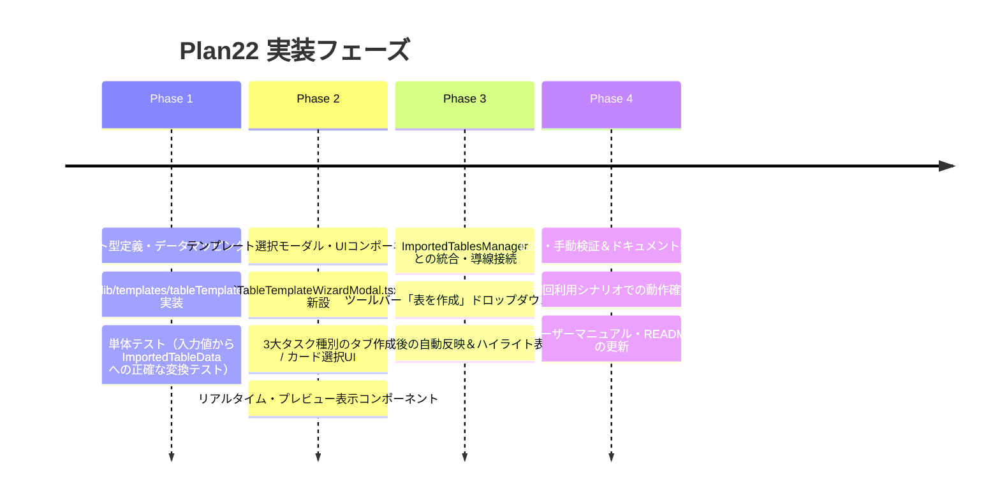

# 表データ作成UI刷新とテンプレート導入計画（Plan22）

---

## 1. はじめに・策定の目的

本作「理論値スケジュール」において、表形式データ（`ImportedTableData`）は時間割、生活リズム（睡眠・食事）、習慣ルーティン（日課）、課題・目標（週次タスク）を定義し、アルゴリズムがタイムラインへ最適配置するための**中核データソース**です。

しかし、従来の表データ作成・編集UI（`ImportedTablesManager`）はグリッド操作（行・列・時限軸）を中心とした設計になっており、**「初めて利用するユーザーにとって何を設定すれば目的のスケジュールが組めるのか分かりづらい」** という課題を抱えていました。

本計画（Plan22）では、既存の高度なグリッド操作パネルを維持しつつ、初心者でも迷わず直感的にスケジュールを構築できるよう、**各表データの設定項目の先頭に「✨ テンプレートから設定」を導入する**UI/UX刷新方針を策定・体系化します。これにより、新規表作成時だけでなく、開いている表に対してもテンプレートを一発で適用・変更できるようになります。

---

## 2. 背景と現状の課題分析



### 2.1. 初心者が直面する3大ハードル
1. **表の二次元構造（行×列）への落とし込みが難しい**:
   - 「毎日20分読書したい」「週に3回筋トレしたい」という単純な要求に対して、「何行何列の表を作ればよいのか」をユーザー自身が設計しなければならない。
2. **設定項目が多岐にわたり、何が必須か判断できない**:
   - `placementMode`（固定/自動）、`columnMode`（曜日/周期）、`cycleStartDay`、`startTime` / `endTime`、`periodMinutes`、`intervalMinutes`、`hasLunch`、`dailyRepeatCount`、`weeklyRepeatCount` など、高度な制御パラメータが並んでいるため、初見ではどの項目を触るべきか圧倒されてしまう。
3. **固定枠（生活リズム）と自動タスク（習慣・課題）の切り替えが分かりにくい**:
   - 開始時刻を入れると固定枠になり、空にすると自動配分になるなど、内部仕様を理解していないと意図通りのタイムライン配置にならない。

---

## 3. アップデートの全体構想

### 3.1. コンセプト:「目的から選ぶ、シンプル設定ウィザード」
表の構造（行・列・セル）から考えるのではなく、**「どのようなスケジュールを登録したいか（目的）」** から逆算して入力させるアプローチへ転換します。

ユーザーが作成時に選ぶ **3大タスク種別テンプレート**:
1. **🏃 日課（デイリータスク / ルーティン）**: 毎日または決まった曜日に継続してこなしたい習慣・学習
2. **📅 週次タスク（ウィークリータスク / 課題・目標）**: 週の空き時間に消化したいレポート・プロジェクト
3. **📌 固定タスク（固定枠 / 生活リズム・時間割）**: 授業、勤務、睡眠、食事など、時間が確定している枠



---

## 4. テンプレート種別とピックアップ設定項目

各タスク種別ごとに、ユーザーに提示する設定項目を**必要最小限（ピックアップ項目）**に絞り込みます。
高度な軸設定（昼休み、休憩分数、行ヘッダー等）は裏側で最適なデフォルト値が自動構成されます。

### 4.1. 🏃 日課テンプレート（ルーティン・習慣タスク）
- **対象例**: 筋トレ、英会話、読書、ストレッチ、散歩、瞑想
- **内部配置方式**: `placementMode: 'auto'`
- **構成モード**:
  - **モードA. 単一メニュー（決まったタスクをこなす）**: 例「読書」「瞑想」「ストレッチ」
  - **モードB. ローテーション（日替わり・サイクル巡回）**: 例「筋トレ（胸/背中/脚/休）」「学習（単語/文法/長文）」

#### ピックアップ設定項目（ユーザー入力とUI仕様）
> [!NOTE] **設計原則（Day 1 のみ＝毎日 / 項目未入力＝オフ）**
> - 表のサイクル巡回機能において、**「Day 1 のみ（1日周期）」の設定はプログラム上そのまま「毎日」を意味します**。そのため、「毎日」という独立した設定項目や特殊な列ヘッダーを設ける必要はなく、Day 1 の1列表として自然に扱います。
> - 同様に、**「項目（タスク名）が入っていなければオフ（何もしない日）」** となるため、「オフ」や「休養日」という専用項目を設ける必要はなく、未入力（空欄）の Day がそのままオフとして機能します。

1. **メニュー構成**: `[ ● 単一メニュー | ○ ローテーション（日替わり） ]`
2. **【単一メニューの場合】**:
   - **タスク名**: テキスト自由入力（例:「読書」「ストレッチ」）
   - **所要時間（ロール式ドラムピッカー）**:
     - **選択ボタンを完全撤廃**し、上下に回転スクロールする「ドラムロール（ホイールピッカー）」を採用。
     - 1分〜180分をロール回転して直感的に選択可能。
   - **配置スケジュール（Day 1 のみ＝毎日）**:
     - 基本（デフォルト）: **Day 1 のみの1列表**を生成。サイクル巡回によって自動的に毎日全曜日に配置されます。
     - 曜日を限定したい場合のみ: 「特定の曜日のみに限定する」を有効化し、対象曜日を選択（非対象曜日は未入力＝オフ）。
3. **【ローテーションの場合】**:
   - **ローテーション方式**: `[ N日サイクル（Day 1, Day 2... 周期） | 曜日別（月〜日の7日固定） ]`
   - **メニューリスト（各日のタイトルと所要時間）**:
     - N日サイクルの場合: 「Day 1: [胸トレ] 30分」「Day 2: [背中トレ] 30分」「Day 3: [脚トレ] 30分」「Day 4: [（未入力）] 0分」のようにリスト管理（日数の追加・削除自由）。**タスク名が未入力の日は自動的にオフ（休息）になります**。Day 1 のみであれば毎日巡回になります。
     - 曜日別の場合: 月曜〜日曜の各曜日にタスク名を入力（未入力の曜日は自動的にオフ）。
   - **サイクルの開始曜日（N日サイクルの場合）**: `[ 月曜日〜日曜日 ]`（周期の起算曜日）
4. **1日の実施回数（ロール式ドラムピッカー）**:
   - **選択ボタンを完全撤廃**し、上下スクロールで回転する「ドラムロールピッカー」を採用。
   - `[ 自動 (推奨), 1回, 2回, 3回 ... 12回 ]` を上下ロールで回転選択。
5. **時間帯の希望（任意）**:
   - `終日自由 (指定なし)`
   - `午前中 (06:00〜12:00)` / `午後 (12:00〜18:00)` / `夜 (18:00〜23:00)`
   - `カスタム指定 (開始時刻 〜 終了時刻)`

#### 【日課】ピックアップ項目と実際に設定される項目の対応
| ピックアップ設定項目（UI） | 実際に設定される内部プロパティ（ImportedTableData） | 設定される値・挙動 |
| :--- | :--- | :--- |
| **タスク名 / メニューリスト** | `table.name`, 各セルの `title`, `text` | 単一なら該当セルに同名、ローテーションなら日替わりタイトルを展開。**空欄セルは `null` となり自動的にオフ日となる** |
| **所要時間（ロール式ドラムピッカー）** | `axisConfig.periodMinutes`, 各セルの所要時間 | ドラムロールで回転選択された分数（1〜180分）をコマ分数・タスクの所要時間（分）に設定 |
| **基本配置（毎日）** | `columnMode: 'cycle'`, **`numCols: 1`**, `colHeaders: ['Day 1']` | **Day 1 のみの1列表を生成し、プログラムのサイクル巡回で自然に毎日配置** |
| **曜日限定指定** | `columnMode: 'weekday'`, `numCols: 7`, `colHeaders` | 選択曜日列のみセルに文字を入れ、非対象曜日は `null` セル（未入力＝オフ）化 |
| **N日サイクル** | `columnMode: 'cycle'`, `numCols: N`, `colHeaders` | N列（Day 1〜N）の表を生成しサイクル巡回。未入力Dayは自動的にオフ |
| **サイクルの開始曜日** | `table.cycleStartDay` | N日サイクルの場合、起算曜日（0:月〜6:日）をセット |
| **1日の実施回数（ロール式ドラムピッカー）**| `table.dailyRepeatCount` | ドラムロールで回転選択された回数（1〜12）または `'auto'` として設定 |
| **時間帯の希望** | `axisConfig.startTime`, `axisConfig.endTime` | 最早開始時刻・最新終了時刻（指定区間）に反映（未指定時は `null`） |
| *(自動補完・隠蔽項目)* | `placementMode: 'auto'` | 固定枠にせず、空き枠へ自動配分するモードに固定 |
| *(自動補完・隠蔽項目)* | `weeklyRepeatCount: 'auto'` | 曜日の指定通りに配置するため週回数は自動 |
| *(自動補完・隠蔽項目)* | `weeklyTaskExpiryWeeks: 1` | 当週有効（1週間）に設定 |
| *(自動補完・隠蔽項目)* | `axisConfig.intervalMinutes: 0`, `hasLunch: false` | 休憩・昼休みなしでシンプル化 |

---

### 4.2. 📅 週次タスクテンプレート（課題・目標・プロジェクト）
- **対象例**: レポート作成、資格試験の勉強、部屋の掃除、買い出し、講義後の課題
- **内部配置方式**: `placementMode: 'auto'`

#### ピックアップ設定項目（ユーザー入力とUI仕様）
> [!NOTE] **週次タスクの設計原則（開始日時の有無による分岐）**
> 週次タスクには「週初めからいつでも着手できる自由タスク」と、「特定の講義や会議の後でないと着手できない課題タスク」の2つの利用シーンが存在します。
> これらを混在させず、**「いつでも着手可能」** と **「特定の日時以降に着手」** のトグル切替によって入力項目を分岐させ、認知的負荷を最小化します。

1. **着手可能日時の指定**:
   - `[ ● いつでも着手可能（開始日時指定なし・推奨） | ○ 特定の日時以降に着手（出題日・開始日を指定） ]`

2. **【A. いつでも着手可能の場合（自由タスク・通常目標）】**:
   - **タスク名**: 例「部屋の掃除」「資格試験の勉強」「ランニング」
   - **1回の所要時間（ロール式ドラムピッカー）**:
     - 1分〜180分を上下ドラムロールで直感的に選択。
   - **週の目標回数（ロール式ドラムピッカー）**:
     - `[ 週1回, 週2回, 週3回, 週4回, 週5回, 週6回, 週7回 ]` を上下ロールで選択。
   - **配置希望日**:
     - `[ ● 空き枠におまかせ（全曜日から自動探索） ]`: 最も空いている曜日へ自動分散配置
     - `[ ○ 希望曜日を選ぶ ]`: `[ 月 | 火 | 水 | 木 | 金 | 土 | 日 ]`（平日優先、週末優先などのプリセットあり）
   - **時間帯の希望（任意）**: `[ 終日自由 | 朝 (6〜12) | 昼 (12〜18) | 夜 (18〜23) | カスタム ]`
   - **有効期限**: `[ 今週中 (1週間・推奨) | 2週間 | 期限なし ]`

3. **【B. 特定の日時以降に着手の場合（講義課題・会議後アクション）】**:
   - **タスク名**: 例「プログラミング課題レポート」「定例会議の議事録作成」
   - **★ 着手可能になる日時（出題日時・開始日時）**:
     - **開始曜日**: `[ 月 | 火 | 水 | 木 | 金 | 土 | 日 ]`（例: 水曜日）
     - **開始時刻**: 例 `14:30` 以降に着手可能
     - *※指定日時より前の時間帯（水曜午前や月・火曜）への誤配置をプログラムが完全ブロックします*
   - **1回の所要時間（ロール式ドラムピッカー）**: 例 60分
   - **週の目標回数（ロール式ドラムピッカー）**: 例 週1回〜週3回
   - **締切・有効期限**:
     - `[ 今週中（日曜まで・推奨） | 次回講義前まで（翌週の開始曜日まで） | 2週間以内 ]`
   - **時間帯の希望（任意）**: 特定の時間帯（夜など）に限定したい場合のみ指定可能

#### 【週次タスク】ピックアップ項目と実際に設定される項目の対応
| ピックアップ設定項目（UI） | 実際に設定される内部プロパティ（ImportedTableData / TaskItem） | 設定される値・挙動 |
| :--- | :--- | :--- |
| **タスク名** | `table.name`, `cells[0][c].title`, `cells[0][c].text` | 表名およびセルのタイトルに設定 |
| **1回の所要時間（ロール式）** | `axisConfig.periodMinutes`, 各セルの所要時間 | ドラムロールで選択されたコマ分数（分）に設定 |
| **週の目標回数（ロール式）** | `table.weeklyRepeatCount`, `table.numCols` | `weeklyRepeatCount` に数値を設定（週タスクとして識別される必須条件） |
| **着手可能日時（指定時）** | `startDay`, `scheduleAfterDay`, `scheduleAfterTime` | 指定曜日・時刻より前への配置を完全禁止し、指定日時以降にのみ配置 |
| **配置希望日（おまかせ時）** | `colHeaders: ['Day 1']`, `columnMode: 'cycle'` | 全曜日を候補日として扱い、最も空いている曜日へ自動やりくり配置 |
| **配置希望日（曜日選択時）** | `targetDays`, `colHeaders` | 選択された希望曜日群を最優先探索日として登録（枠不足時は他曜日へ柔軟配置） |
| **有効期限** | `weeklyTaskExpiryWeeks`, `axisConfig.weeklyTaskExpiryWeeks` | `1`, `2`, または `'none'`（期限切れタスクの自動管理） |
| **時間帯の希望** | `axisConfig.startTime`, `axisConfig.endTime` | 自動配分する時間帯の上限・下限を制限（未指定時は終日） |
| *(自動補完・隠蔽項目)* | `placementMode: 'auto'` | 固定枠にせず、空き枠へ自動配分するモードに固定 |
| *(自動補完・隠蔽項目)* | `dailyRepeatCount: 1` | 原則として1日1回消化（同日に重複配置させず分散） |
| *(自動補完・隠蔽項目)* | `numRows: 1` | 1行のシンプル構造に統一 |

---

### 4.3. 📌 固定タスクテンプレート（生活リズム・時間割枠）
- **対象例**: 大学の講義時間割、アルバイト、部活動、睡眠、食事
- **内部配置方式**: `placementMode: 'fixed'`
- **サブタイプ選択**:
  - **A. 単一固定枠（生活リズム・勤務など）**
  - **B. 時間割（講義・スクール）**

#### A. 単一固定枠（睡眠・食事・アルバイトなど）
- **ピックアップ設定項目（ユーザー入力）**:
  1. **枠名**: 例「睡眠」「朝食」「アルバイト」
  2. **開始時刻 〜 終了時刻**: 例 `00:00 〜 08:00`, `18:00 〜 22:00`
  3. **実施曜日**: `[ 毎日 | 平日のみ | 週末のみ | 個別選択 ]`

| ピックアップ設定項目（UI） | 実際に設定される内部プロパティ（ImportedTableData） | 設定される値・挙動 |
| :--- | :--- | :--- |
| **枠名** | `table.name`, セルの `title`, `text` | タイムラインに固定表示されるブロック名 |
| **開始時刻 〜 終了時刻** | `axisConfig.startTime`, `axisConfig.endTime`, `axisConfig.periodMinutes`, セルの `startMinutes`/`endMinutes` | 絶対に動かない固定時間帯枠として分数を自動算出 |
| **実施曜日** | `columnMode: 'weekday'`, `numCols: 7`, `colHeaders` | 該当曜日のセルに時間帯付きブロックを生成 |
| *(自動補完・隠蔽項目)* | `placementMode: 'fixed'` | 他のタスクが割り込めない最優先枠として保護 |
| *(自動補完・隠蔽項目)* | `dailyRepeatCount: 'auto'`, `weeklyRepeatCount: 'auto'` | 固定枠のため自動 |

#### B. 時間割枠（学校・講義）
- **ピックアップ設定項目（ユーザー入力）**:
  1. **時間割名**: 例「2026年度 前期時間割」
  2. **時限数**: `[ 5限 | 6限 | 7限 ]`
  3. **1限の開始時刻**: 例 `09:00`
  4. **1コマの分数・休憩**: 例 `90分`（休憩 `10分`）
  5. **昼休み設定**: `[ 昼休みあり (2限後・50分) | なし ]`
  6. **付随タスク（課題）の自動生成**: `[ ON (90分・推奨) | OFF ]`

| ピックアップ設定項目（UI） | 実際に設定される内部プロパティ（ImportedTableData） | 設定される値・挙動 |
| :--- | :--- | :--- |
| **時間割名** | `table.name` | 時間割全体の管理名 |
| **時限数** | `numRows`, `rowHeaders` | 行数（`['1限', '2限', ...]`）を自動構築 |
| **1限開始時刻** | `axisConfig.startTime` | 時間割全体の基準開始時刻 |
| **1コマ分数・休憩** | `axisConfig.periodMinutes`, `axisConfig.intervalMinutes` | 時限ごとの時間計算に自動適用 |
| **昼休み設定** | `axisConfig.hasLunch`, `lunchAfterPeriod`, `lunchMinutes` | 指定時限の後に昼休み空白ブロックを自動挿入 |
| **付随タスクの生成** | `attachedTaskConfig: { enabled, titleTemplate, durationMinutes }` | 各授業ごとに課題タスク（復習等）を自動生成する設定 |
| *(自動補完・隠蔽項目)* | `columnMode: 'weekday'`, `numCols: 5`, `colHeaders: ['月曜'..'金曜']` | 平日5日間の標準時間割グリッドを自動構築 |
| *(自動補完・隠蔽項目)* | 各セルの `startMinutes`, `endMinutes` | 時限・休憩・昼休みから各コマの開始/終了分を全自動計算 |

---

## 5. UI/UXフロー設計

### 5.1. 各表データ設定項目の先頭への「✨ テンプレートから設定」配置
新規に表を作るタイミングだけでなく、**「今開いている表」や「既存の表」に対しても直感的にテンプレートを適用・変更できるようにするため、各表データの設定項目の先頭に『✨ テンプレートから設定』ボタンを配置**します。

```
【デスクトップ版 ツールバー（常時表示メインバー）】
[ ✨ テンプレートから設定 ] | [ 配置: 📌固定 / ⚡自動 ] [ 周期の頭: 月〜 ] [ 時間: 〜 ] [ 1コマ: 分 ] ...
  ↑ 各表データ設定項目の「一番先頭」に配置

【詳細設定ドロワー / モーダル】
┌───────────────────────────────────────────────┐
│ [ ✨ テンプレートから設定 ] (最上部に大きく配置) │
├───────────────────────────────────────────────┤
│ セクション 1: 表のマス目 ＆ 取り込み            │
│ セクション 2: 時間帯とコマ割り                  │
│ セクション 3: 昼休み設定                       │
│ セクション 4: 計画表への配置ルール             │
└───────────────────────────────────────────────┘
```

### 5.2. テンプレート設定モーダル（ステップ・ウィザード設計）



#### モーダルの画面レイアウト案
- **左側（入力パネル）**: ピックアップ項目（タイトル、時間、曜日、回数）のすっきりした入力フォーム。
- **右側（ライブプレビュー）**:
  - 設定内容に応じて、生成されるタイムライン上の配置イメージ（「月・水・金 20:00〜21:00 に配置されます」「週3回、空き枠に自動配分されます」等）を分かりやすい要約カードで即時表示。

---

## 6. 生成される表データの内部マッピング仕様

テンプレートから入力された値は、以下のルールで既存の `ImportedTableData` 型へ完全変換されます。

```typescript
// 変換マッピングのシグネチャ例
export interface DailyMenuItem {
  title: string;
  durationMinutes?: number; // 未指定時はデフォルト所要時間を適用
}

export interface DailyRoutineTemplateInput {
  name: string; // 表のタイトル（例:「朝の筋トレ」「英語学習」）
  mode: 'single' | 'weekday_rotation' | 'cycle_rotation';

  // 単一メニューの場合（毎日・特定曜日に同じタスク）
  singleTask?: {
    title: string;
    durationMinutes: number;
    isEveryday?: boolean; // true の場合は1行1列の最小表を生成
    targetDays?: number[]; // 曜日指定時（0:月〜6:日）
  };

  // 曜日別ローテーションの場合（月〜日でメニューを変える）
  weekdayRotation?: {
    days: Record<number, DailyMenuItem | null>; // 0:月〜6:日
    defaultDurationMinutes?: number;
  };

  // N日サイクルローテーションの場合（Day 1..N を巡回する）
  cycleRotation?: {
    cycleLength: number; // 周期日数（例: 3, 4）
    items: (DailyMenuItem | null)[]; // 各Dayのメニュー（Day 1 〜 Day N）
    cycleStartDay?: number; // 周期の開始曜日（0:月〜6:日、デフォルト0）
    defaultDurationMinutes?: number;
  };

  dailyRepeatCount?: number | 'auto';
  timeRange?: { startTime: string | null; endTime: string | null };
}

export interface WeeklyTaskTemplateInput {
  title: string;
  durationMinutes: number;
  weeklyTargetCount: number | 'auto';
  expiryWeeks: 1 | 2 | 'none';
  timeRange?: { startTime: string | null; endTime: string | null };
}

export interface FixedSlotTemplateInput {
  title: string;
  startTime: string;
  endTime: string;
  targetDays: number[]; // 0:月〜6:日
}
```

### 6.1. 日課（`DailyRoutineTemplateInput`）のマッピング仕様
- `id`: `table-daily-${Date.now()}`
- `name`: `input.name`
- `placementMode`: `'auto'`
- `dailyRepeatCount`: `input.dailyRepeatCount ?? 'auto'`
- `weeklyRepeatCount`: `'auto'`
- `weeklyTaskExpiryWeeks`: 1
- `numRows`: 1
- `axisConfig`:
  - `startTime`: `input.timeRange?.startTime ?? null`
  - `endTime`: `input.timeRange?.endTime ?? null`
  - `periodMinutes`: 主要な所要時間（未指定時は 30）
  - `intervalMinutes`: 0, `hasLunch`: false, `weeklyTaskExpiryWeeks`: 1
- **モード別の列とセルの生成**:
  1. **単一メニュー (`mode: 'single'`)**:
     - **毎日実施 (`isEveryday: true` または全曜日)**:
       - `columnMode: 'weekday'`, **`numCols: 1`**, `colHeaders: ['毎日']`
       - セル1つのみ生成（`title: singleTask.title`, `text: singleTask.title`）。
       - スケジューラー側で曜日制限（`targetDays`）なしとして毎日自動配置。
     - **曜日指定時 (`isEveryday: false`)**:
       - `columnMode: 'weekday'`, `numCols: 7`, `colHeaders: ['月曜'..'日曜']`
       - `targetDays` に含まれる列のみ `title: singleTask.title`, `text: singleTask.title` を設定。
  2. **曜日別ローテーション (`mode: 'weekday_rotation'`)**:
     - `columnMode: 'weekday'`, `numCols: 7`, `colHeaders: ['月曜'..'日曜']`
     - 月〜日の各曜日に `days[c]` で指定された日替わりタイトル・所要時間をセット（未指定日は `null`）。
  3. **N日サイクルローテーション (`mode: 'cycle_rotation'`)**:
     - `columnMode: 'cycle'`, `numCols: cycleLength`
     - `colHeaders`: `['Day 1', 'Day 2', ... 'Day N']`
     - `cycleStartDay`: `input.cycleRotation.cycleStartDay ?? 0`
     - 各Dayのセルに `items[c]` のタイトル・所要時間をセット。

### 6.2. 週次タスク（`WeeklyTaskTemplateInput`）のマッピング仕様
- `id`: `table-weekly-${Date.now()}`
- `placementMode`: `'auto'`
- `columnMode`: `'cycle'`
- `cycleStartDay`: 0
- `dailyRepeatCount`: 1
- `weeklyRepeatCount`: `input.weeklyTargetCount`
- `weeklyTaskExpiryWeeks`: `input.expiryWeeks`
- `numRows`: 1, `numCols`: 5 (または指定回数)
- `colHeaders`: `['Day 1', 'Day 2', 'Day 3', ...]`
- `axisConfig`:
  - `startTime`: `input.timeRange?.startTime ?? null`
  - `endTime`: `input.timeRange?.endTime ?? null`
  - `periodMinutes`: `input.durationMinutes`
  - `weeklyTaskExpiryWeeks`: `input.expiryWeeks`

### 6.3. 固定枠（`FixedSlotTemplateInput`）のマッピング仕様
- `id`: `table-fixed-${Date.now()}`
- `placementMode`: `'fixed'`
- `columnMode`: `'weekday'`
- `cycleStartDay`: 0
- `numRows`: 1, `numCols`: 7
- `colHeaders`: `['月曜', '火曜', '水曜', '木曜', '金曜', '土曜', '日曜']`
- `axisConfig`:
  - `startTime`: `input.startTime`
  - `endTime`: `input.endTime`
  - `periodMinutes`: 終了時刻 - 開始時刻
  - `intervalMinutes`: 0
- `cells`: 対象曜日のセルに該当時間帯のコマを配置

---

### 6.4. 入力項目と内部プロパティの総合対比一覧（マッピング総括表）

ユーザーが直感的に入力する**ピックアップ項目**が、表データ（`ImportedTableData`）およびスケジューラーにどのように作用するかを総括した一覧です。

| 分類 | ピックアップ入力項目（UI） | 実際に設定される内部プロパティ（ImportedTableData） | 内部デフォルト値 / 自動補完 | スケジューラー配置への効果 |
| :--- | :--- | :--- | :--- | :--- |
| **全共通** | タスク名 / 枠名 | `name`, `cells[r][c].title`, `text`, `fullText` | — | 計画表・タスク一覧に表示されるタイトル |
| **全共通** | 1回の所要時間 | `axisConfig.periodMinutes`, `cells[r][c].startMinutes/endMinutes` | — | タイムライン上で占有するコマの長さ（分） |
| **全共通** | 時間帯の希望（区間） | `axisConfig.startTime`, `axisConfig.endTime` | 未指定時は `null`（終日配置） | 最早開始時刻 `earliestStartTime` / 最新終了時刻 `latestEndTime` による配置区間制限 |
| **日課** | 実施曜日 (月〜日) | `columnMode: 'weekday'`, `numCols: 7`, セル配置列 | 非対象曜日は `null` セル | 指定曜日の `targetDays` にのみタスクを配置 |
| **日課** | 1日の実施回数 | `dailyRepeatCount` (1, 2, 'auto' 等) | デフォルト `1` | 1日の中で反復消化する目標回数を指定 |
| **週次** | 週の目標日数・回数 | `weeklyRepeatCount`, `numCols: N` | デフォルト `1` (週1回) | 週の消化可能空き枠へ前倒し/バランス配置 |
| **週次** | 有効期限 | `weeklyTaskExpiryWeeks`, `axisConfig.weeklyTaskExpiryWeeks` | 推奨 `1` (当週中) | 期限超過タスクの繰り越し・失効判定 |
| **固定** | 開始・終了時刻 | `axisConfig.startTime`, `endTime`, `periodMinutes` | — | 決まった時刻に他タスクを遮断して固定枠配置 |
| **固定** | 付随タスク（課題） | `attachedTaskConfig: { enabled, titleTemplate, durationMinutes }` | デフォルト OFF (時間割時はON推奨) | コマ終了後や週内の空き時間に課題タスクを自動生成 |
| **自動補完** | 配置方式 | `placementMode` | 日課/週次: `'auto'`<br>固定枠: `'fixed'` | ユーザーが意識せずとも最適な配置モードを確定 |
| **自動補完** | 列管理方式 | `columnMode` | 日課/固定: `'weekday'`<br>週次: `'cycle'` | 曜日別管理と目標回数消化の切り替えを隠蔽 |
| **自動補完** | 周期の頭 | `cycleStartDay` | `0` (月曜日起算) | 週やサイクルの開始起点を統一 |
| **自動補完** | 計画表への反映 | `isApplied` | `true` | 作成と同時にタイムラインへ即時反映 |

---

---

## 7. 実装ロードマップ



---

## 8. まとめ・期待される効果

1. **オンボーディングの劇的な改善**:
   - 初めて利用するユーザーでも、「日課」「週次タスク」「固定枠」の目的を選ぶだけで、1分以内に完璧なスケジュールデータを作成・反映できるようになります。
2. **設定ミス・不整合の防止**:
   - 内部仕様に精通していなくても、テンプレート経由であれば適切な `placementMode` や `startTime` / `endTime` の組み合わせが保証され、Plan21で指摘されたような設定不整合が発生しなくなります。
3. **既存の高度な編集機能との共存**:
   - テンプレートから作った表は、後からいつでも従来のグリッドエディタで詳細に微調整（行の追加、時限ごとの時間変更、付随タスク付与など）が可能です。手軽さと高度な柔軟性を両立したシステムを実現します。

---

## 9. コンパクト左右ステッパー型入力欄への刷新および複数項目（マルチタスク）一括設定仕様

### 9.1. 課題と刷新の背景
当初のテンプレートウィザードでは、iOS風のドラムロールピッカー（`DrumRollPicker`）を採用していました。しかし、ドラムロールは1項目あたり約100〜120pxの縦スペースを占有するため、以下のような実用上の課題が生じました：
1. **縦スペースの過剰占有**: 設定画面が縦に間延びし、全体を把握するために過度なスクロールが必要。
2. **複数項目追加（マルチタスク化）との相性の悪さ**: 「朝の瞑想」「読書」「筋トレ」のように複数の項目をリスト形式で追加していく場合、ドラムロールがタスクごとに並ぶと画面崩壊を招く。

これらを解消するため、**ドラムロールを完全撤廃し、左右に `[-]` `[+]` ボタンを備えた「コンパクト左右ステッパー型入力欄」へ刷新**し、さらに**「1つの表に複数タスクを一括登録するマルチタスク追加機能」** を統合します。

### 9.2. 新UIコンポーネント:「左右ステッパー型入力欄」の仕様
- **外観**: `[-] [ 15 ]分 [+]`（高さ約 32px〜36px / ドラムロール比で縦サイズを約 70% 削減）。
- **操作性**:
  - `[-]` `[+]` ボタンのタップで所要時間（5分刻み）や回数をステップ増減。
  - 中央の数値を直接タップしてテンキー・キーボードによる自由入力も可能。

### 9.3. 複数項目（マルチタスク）入力リストのレイアウト仕様
各タスクを「1タスク = 1行のコンパクトストリップ」としてレイアウトし、画面内にすっきりと収めます。

#### A. デスクトップ版（横1行ストリーム）
```
┌────────────────────────────────────────────────────────────────────────┐
│ 📋 設定する項目一覧                                                    │
│ ┌────────────────────────────────────────────────────────────────────┐ │
│ │ 1. [ 朝の瞑想          ]  [-] [ 10 ]分 [+]  🕒[ 07:00 ]      [🗑] │ │
│ │ 2. [ 読書              ]  [-] [ 20 ]分 [+]  🕒[ 07:15 ]      [🗑] │ │
│ │ 3. [ 筋トレ            ]  [-] [ 45 ]分 [+]  🕒[ 21:00 ]      [🗑] │ │
│ └────────────────────────────────────────────────────────────────────┘ │
│ [ ＋ 項目を追加 ]                                                      │
└────────────────────────────────────────────────────────────────────────┘
```

#### B. モバイル版（省スペース2段カード）
```
┌──────────────────────────────────────────────┐
│ 1. [ 朝の瞑想                          ] [🗑]│ ← 上段: タスク名 ＆ 削除
│    ⏱ [-] [ 10 ]分 [+]    🕒 [ 07:00 ]       │ ← 下段: 所要時間 ＆ 開始時刻
└──────────────────────────────────────────────┘
```

### 9.4. Plan23（時系列自動ソート・個別時間設定）との完全統合
1. **複数行の同時生成**:
   - リストに追加された各項目は、表データ（`ImportedTableData`）の独立した行（またはセル）として一括展開されます。
2. **開始時間順の自動整列（Auto-Sort）**:
   - Plan23 で完成した `sortRowsByTime` が自動適用されるため、ユーザーが入力した順序に関わらず、朝（07:00）→ 昼（12:30）→ 夜（21:00）の順序に自動整列されて表が保存されます。
3. **連続時間帯の自動補完**:
   - 「＋ 項目を追加」を押した際、前項目の終了時刻（例: 7:00 ＋ 10分 ＝ 7:10）が次の項目の初期値として自動設定され、連続したルーティンを極めて軽快に入力できます。

