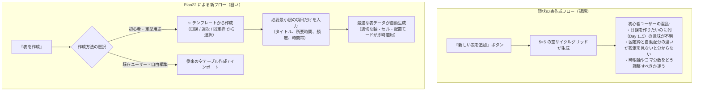
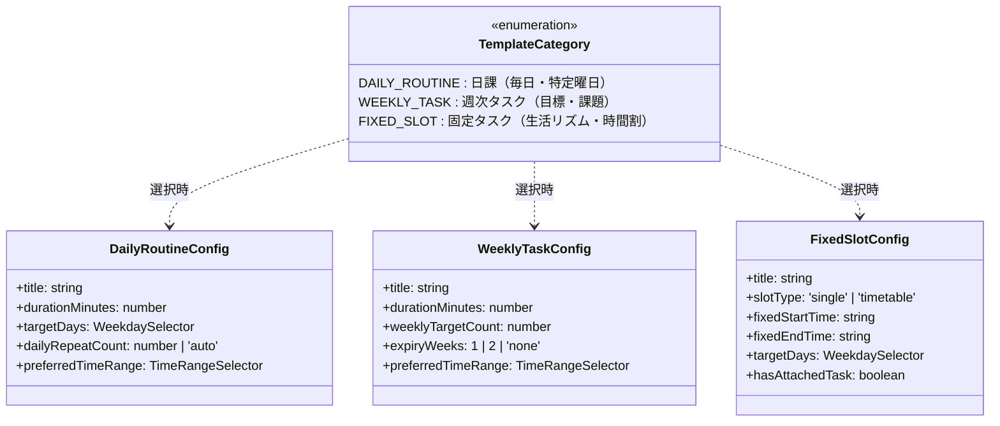
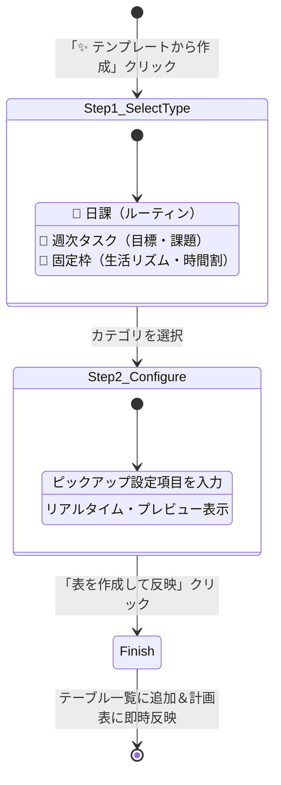
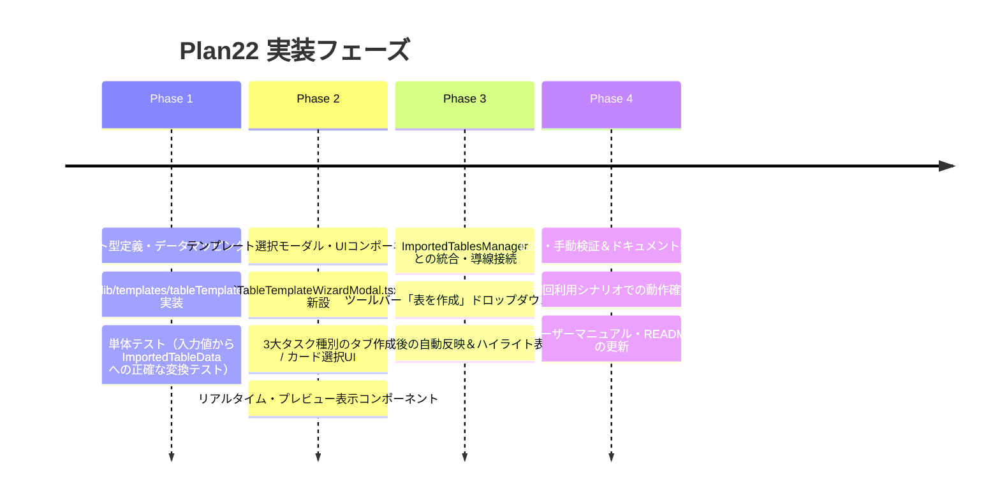

# 表データ作成UI刷新とテンプレート導入計画（Plan22）

---

## 1. はじめに・策定の目的

本作「理論値スケジュール」において、表形式データ（`ImportedTableData`）は時間割、生活リズム（睡眠・食事）、習慣ルーティン（日課）、課題・目標（週次タスク）を定義し、アルゴリズムがタイムラインへ最適配置するための**中核データソース**です。

しかし、従来の表データ作成・編集UI（`ImportedTablesManager`）はグリッド操作（行・列・時限軸）を中心とした設計になっており、**「初めて利用するユーザーにとって何を設定すれば目的のスケジュールが組めるのか分かりづらい」** という課題を抱えていました。

本計画（Plan22）では、既存の高度なグリッド操作パネルを維持しつつ、初心者でも迷わず直感的にスケジュールを構築できるよう、**「テンプレートから作成」機能の導入**を中心としたUI/UX刷新方針を策定・体系化します。

---

## 2. 背景と現状の課題分析



### 2.1. 初心者が直面する3大ハードル
1. **表の二次元構造（行×列）への落とし込みが難しい**:
   - 「毎日20分読書したい」「週に3回筋トレしたい」という単純な要求に対して、「何行何列の表を作ればよいのか」をユーザー自身が設計しなければならない。
2. **設定項目が多岐にわたり、何が必須か判断できない**:
   - `placementMode`（固定/自動）、`columnMode`（曜日/周期）、`cycleStartDay`、`startTime` / `endTime`、`periodMinutes`、`intervalMinutes`、`hasLunch`、`dailyRepeatCount`、`weeklyRepeatCount` など、高度な制御パラメータが並んでいるため、初見ではどの項目を触るべきか圧倒されてしまう。
3. **固定枠（生活リズム）と自動タスク（習慣・課題）の切り替えが分かりにくい**:
   - 開始時刻を入れると固定枠になり、空にすると自動配分になるなど、内部仕様を理解していないと意図通りのタイムライン配置にならない。

---

## 3. アップデートの全体構想

### 3.1. コンセプト:「目的から選ぶ、シンプル設定ウィザード」
表の構造（行・列・セル）から考えるのではなく、**「どのようなスケジュールを登録したいか（目的）」** から逆算して入力させるアプローチへ転換します。

ユーザーが作成時に選ぶ **3大タスク種別テンプレート**:
1. **🏃 日課（デイリータスク / ルーティン）**: 毎日または決まった曜日に継続してこなしたい習慣・学習
2. **📅 週次タスク（ウィークリータスク / 課題・目標）**: 週の空き時間に消化したいレポート・プロジェクト
3. **📌 固定タスク（固定枠 / 生活リズム・時間割）**: 授業、勤務、睡眠、食事など、時間が確定している枠



---

## 4. テンプレート種別とピックアップ設定項目

各タスク種別ごとに、ユーザーに提示する設定項目を**必要最小限（ピックアップ項目）**に絞り込みます。
高度な軸設定（昼休み、休憩分数、行ヘッダー等）は裏側で最適なデフォルト値が自動構成されます。

### 4.1. 🏃 日課テンプレート（ルーティン・習慣タスク）
- **対象例**: 筋トレ、英会話、読書、ストレッチ、散歩、瞑想
- **内部配置方式**: `placementMode: 'auto'`
- **ピックアップ設定項目**:
  1. **タスク名**: 例「英会話」「筋トレ」「読書」
  2. **1回の所要時間**: `[ 5分 | 15分 | 30分 | 45分 | 60分 | カスタム入力 ]`
  3. **実施曜日**: `[ 毎日 | 平日のみ | 週末のみ | 曜日個別選択 (月〜日) ]`
  4. **1日の実施回数**: `[ 1回 (デフォルト) | 2回 | 3回 | 自動 ]`
  5. **時間帯の希望（任意）**:
     - `終日自由 (指定なし)`
     - `午前中 (06:00〜12:00)` / `午後 (12:00〜18:00)` / `夜 (18:00〜23:00)`
     - `カスタム指定 (開始時刻 〜 終了時刻)`
- **自動生成される表構造**:
  - `numRows: 1`, `numCols: 7`（月〜日）
  - 選択された曜日のセルにタイトルを配置
  - `placementMode: 'auto'`, `periodMinutes: 設定分数`
  - 希望時間帯に合わせて `startTime` / `endTime` を自動設定

---

### 4.2. 📅 週次タスクテンプレート（課題・目標・プロジェクト）
- **対象例**: レポート作成、資格試験の勉強、部屋の掃除、買い出し
- **内部配置方式**: `placementMode: 'auto'`
- **ピックアップ設定項目**:
  1. **タスク名**: 例「プログラミング課題」「レポート作成」
  2. **1回の所要時間**: `[ 30分 | 60分 | 90分 | 120分 | カスタム入力 ]`
  3. **週の目標日数・回数**: `[ 週1回 | 週2回 | 週3回 | 週5回 | 自動 ]`
  4. **有効期限**: `[ 今週中 (1週間・推奨) | 2週間 | 期限なし ]`
  5. **時間帯の希望（任意）**: 日課と同様に指定可能
- **自動生成される表構造**:
  - `columnMode: 'cycle'`, `numRows: 1`, `numCols: 週回数` (Day 1〜Day N)
  - `placementMode: 'auto'`, `weeklyRepeatCount: 指定回数`
  - `weeklyTaskExpiryWeeks: 指定期間`
  - 空きコマに前倒し・バランス良く自動分散配置されるタスクを構築

---

### 4.3. 📌 固定タスクテンプレート（生活リズム・時間割枠）
- **対象例**: 大学の講義時間割、アルバイト、部活動、睡眠、食事
- **内部配置方式**: `placementMode: 'fixed'`
- **サブタイプ選択**:
  - **A. 単一固定枠（生活リズム・勤務など）**:
    - 設定項目: 枠名（例:「睡眠」「アルバイト」）、開始時刻・終了時刻、対象曜日
  - **B. 時間割（講義・スクール）**:
    - 設定項目: 時間割名、時限数（例: 5限/6限）、1限開始時刻、1コマ分数、昼休み位置、各曜日（月〜金）の授業名
    - 付随タスク（予習・復習・課題）の自動生成トグル（ON/OFF）
- **自動生成される表構造**:
  - 単一枠の場合: 1行×7列の固定枠テーブル
  - 時間割の場合: N限×5列の本格時間割テーブル（付随タスク設定 `attachedTaskConfig` 完備）

---

## 5. UI/UXフロー設計

### 5.1. 表管理ツールバーの新設ボタン
従来の「新しい表を追加」ボタンの横、またはドロップダウンメニューとして、分かりやすい新規作成導線を設けます。

```
[ + 表を作成 (ドロップダウン) ▼ ]
  ├ ✨ テンプレートから作成（推奨）
  ├ 📄 白紙の表を作成（上級者向け）
  ├ 📥 CSV / Excel からインポート
  └ 📷 画像・OCR からインポート
```

### 5.2. テンプレート作成モーダル（ステップ・ウィザード設計）



#### モーダルの画面レイアウト案
- **左側（入力パネル）**: ピックアップ項目（タイトル、時間、曜日、回数）のすっきりした入力フォーム。
- **右側（ライブプレビュー）**:
  - 設定内容に応じて、生成されるタイムライン上の配置イメージ（「月・水・金 20:00〜21:00 に配置されます」「週3回、空き枠に自動配分されます」等）を分かりやすい要約カードで即時表示。

---

## 6. 生成される表データの内部マッピング仕様

テンプレートから入力された値は、以下のルールで既存の `ImportedTableData` 型へ完全変換されます。

```typescript
// 変換マッピングのシグネチャ例
interface DailyRoutineTemplateInput {
  title: string;
  durationMinutes: number;
  targetDays: number[]; // 0:月〜6:日
  dailyRepeatCount: number | 'auto';
  timeRange?: { startTime: string | null; endTime: string | null };
}

interface WeeklyTaskTemplateInput {
  title: string;
  durationMinutes: number;
  weeklyTargetCount: number | 'auto';
  expiryWeeks: 1 | 2 | 'none';
  timeRange?: { startTime: string | null; endTime: string | null };
}

interface FixedSlotTemplateInput {
  title: string;
  startTime: string;
  endTime: string;
  targetDays: number[];
}
```

### 6.1. 日課（`DailyRoutineTemplateInput`）のマッピング仕様
- `id`: `table-daily-${Date.now()}`
- `placementMode`: `'auto'`
- `columnMode`: `'weekday'`
- `cycleStartDay`: 0
- `dailyRepeatCount`: `input.dailyRepeatCount`
- `weeklyRepeatCount`: `'auto'`
- `weeklyTaskExpiryWeeks`: 1
- `numRows`: 1, `numCols`: 7
- `colHeaders`: `['月曜', '火曜', '水曜', '木曜', '金曜', '土曜', '日曜']`
- `axisConfig`:
  - `startTime`: `input.timeRange?.startTime ?? null`
  - `endTime`: `input.timeRange?.endTime ?? null`
  - `periodMinutes`: `input.durationMinutes`
  - `intervalMinutes`: 0, `hasLunch`: false
- `cells`:
  - `input.targetDays` に含まれる列のみ `title: input.title`, `text: input.title` を設定。

### 6.2. 週次タスク（`WeeklyTaskTemplateInput`）のマッピング仕様
- `id`: `table-weekly-${Date.now()}`
- `placementMode`: `'auto'`
- `columnMode`: `'cycle'`
- `cycleStartDay`: 0
- `dailyRepeatCount`: 1
- `weeklyRepeatCount`: `input.weeklyTargetCount`
- `weeklyTaskExpiryWeeks`: `input.expiryWeeks`
- `numRows`: 1, `numCols`: 5 (または指定回数)
- `colHeaders`: `['Day 1', 'Day 2', 'Day 3', ...]`
- `axisConfig`:
  - `startTime`: `input.timeRange?.startTime ?? null`
  - `endTime`: `input.timeRange?.endTime ?? null`
  - `periodMinutes`: `input.durationMinutes`
  - `weeklyTaskExpiryWeeks`: `input.expiryWeeks`

### 6.3. 固定枠（`FixedSlotTemplateInput`）のマッピング仕様
- `id`: `table-fixed-${Date.now()}`
- `placementMode`: `'fixed'`
- `columnMode`: `'weekday'`
- `cycleStartDay`: 0
- `numRows`: 1, `numCols`: 7
- `colHeaders`: `['月曜', '火曜', '水曜', '木曜', '金曜', '土曜', '日曜']`
- `axisConfig`:
  - `startTime`: `input.startTime`
  - `endTime`: `input.endTime`
  - `periodMinutes`: 終了時刻 - 開始時刻
  - `intervalMinutes`: 0
- `cells`: 対象曜日のセルに該当時間帯のコマを配置

---

## 7. 実装ロードマップ



---

## 8. まとめ・期待される効果

1. **オンボーディングの劇的な改善**:
   - 初めて利用するユーザーでも、「日課」「週次タスク」「固定枠」の目的を選ぶだけで、1分以内に完璧なスケジュールデータを作成・反映できるようになります。
2. **設定ミス・不整合の防止**:
   - 内部仕様に精通していなくても、テンプレート経由であれば適切な `placementMode` や `startTime` / `endTime` の組み合わせが保証され、Plan21で指摘されたような設定不整合が発生しなくなります。
3. **既存の高度な編集機能との共存**:
   - テンプレートから作った表は、後からいつでも従来のグリッドエディタで詳細に微調整（行の追加、時限ごとの時間変更、付随タスク付与など）が可能です。手軽さと高度な柔軟性を両立したシステムを実現します。
