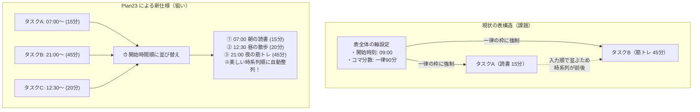
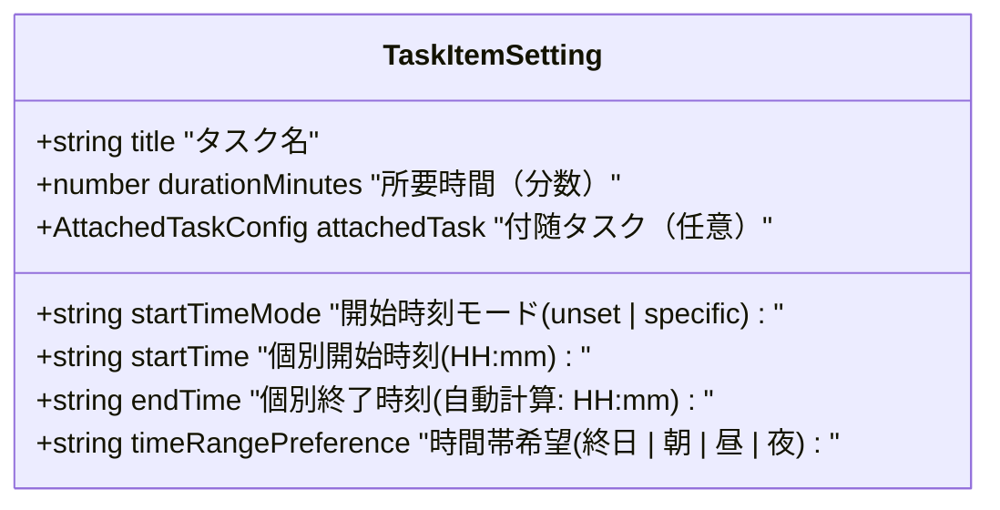
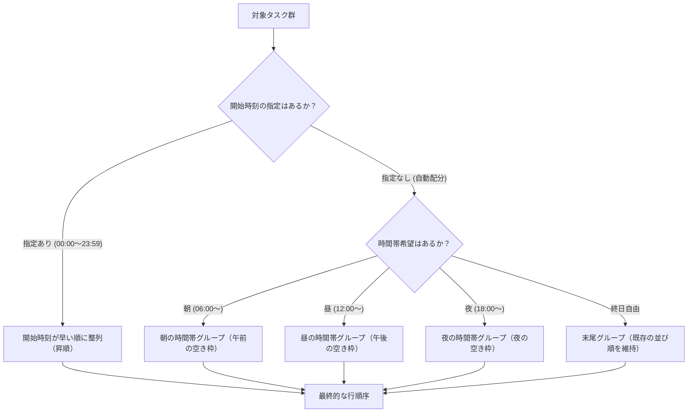
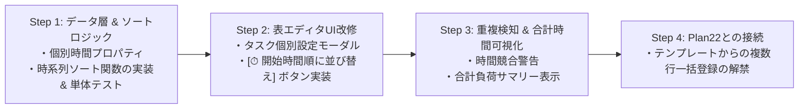

# 表データ内タスク個別設定（開始時間・所要時間）と時系列自動並び替え計画（Plan23）

---

## 1. はじめに・策定の目的

本計画（Plan23）は、表データ（`ImportedTableData`）内の各タスク（セル / 行）に対して、**「開始時間」および「所要時間」の個別設定項目を新設**し、さらに**「開始時間順（時系列昇順）によるタスクの自動並び替え（ソート機能）」**を実現するための要件定義および仕様策定書です。

### 策定の狙い
1. **表全体の一律軸からの解放**:
   - 従来の表は「全コマ90分」「開始時刻09:00」といった表全体の共通軸（`TableAxisConfig`）に縛られていました。
   - タスクごとに「15分の読書」「45分の筋トレ」「10分の瞑想」のように異なる所要時間や個別の開始時刻を柔軟に持てるようにします。
2. **時系列自動ソートによる直感的なスケジュール構築**:
   - 入力順序（思いついた順）に依存せず、開始時間順にワンタップ（または自動）で整列できるようにします。
3. **Plan22（テンプレート機能）における「複数項目の一括設定」の基盤確立**:
   - 単一の表の中に複数のタスク項目をまとめて設定・流し込むための受け皿として、表データ自体の表現力と柔軟性を事前に高めます。

---

## 2. 背景と現状の課題分析



### 現状の3大課題
1. **所要時間のばらつきに対応しづらい**:
   - 習慣・日課は「10分の瞑想」もあれば「60分のランニング」もあります。共通のコマ分数（`periodMinutes`）に頼ると、短いタスクが無駄に長い枠として扱われたり、個別設定がわかりにくくなります。
2. **手動で並び替える手間と認知負荷**:
   - 「夜のストレッチ」を先に入力した後に「朝の読書」を思いついて追加した場合、行の入れ替えを手動で行う必要があり、並びがバラバラのままだと表の見通しが悪化します。
3. **タイムライン（時系列）との乖離**:
   - 表の上から順に見て「朝 → 昼 → 夜」となっていないと、タイムラインに反映された結果と表の見た目が一致せず、ユーザーの混乱を招きます。

---

## 3. タスク個別設定項目の仕様設計

表内のセル・行編集モーダル（またはポップオーバー）において、以下の個別設定項目を整備します。



### 3.1. 個別設定項目の詳細
1. **タスク名（タイトル）**:
   - テキスト入力（例:「朝の瞑想」「英語リスニング」）
2. **個別所要時間（ドラムロール式 / 数値入力）**:
   - **仕様**: 1分〜180分を上下ドラムロール（または直接数値）で選択。
   - **挙動**: 表全体の `periodMinutes` より優先され、セルごとの正確な分数（`duration = endMinutes - startMinutes`）として保持。
3. **開始時刻（個別設定）**:
   - **モードA. 指定なし（自動配分）**:
     - スケジューラーが空きコマを見つけて自動配置。
   - **モードB. 開始時刻を指定（固定・希望開始時刻）**:
     - `[ 07:00 ]` などの時刻ピッカー入力。
     - 終了時刻は `開始時刻 ＋ 所要時間` により**リアルタイム自動算出**。
4. **時間帯の希望（開始時刻未指定時）**:
   - `[ 終日自由 | 朝 (06〜12時) | 昼 (12〜18時) | 夜 (18〜23時) ]`

---

## 4. 開始時間ごとの自動並び替え（Auto-Sort）の仕様

### 4.1. 並び替えのトリガー方式
ユーザーが作業中に意図せず行が動いて入力しづらくなるのを防ぐため、以下の2通りの方式を採用します。

1. **手動ワンタップソート（推奨・標準）**:
   - 表エディタのツールバーに **`[ ⏱ 開始時間順に並び替え ]`** ボタンを常設。
   - ボタンを押すと、アニメーションと共に行が時系列順にスッと整列。
2. **自動ソート（オプション設定）**:
   - 表の設定ドロワー内に `[ 常に開始時間順を保つ（自動ソート） ]` のON/OFFスイッチを設置。
   - ONの場合は、タスクの時刻変更や追加・保存時に自動で時系列整列を実行。

### 4.2. 並び替えアルゴリズムのルール
開始時間（`startMinutes`）を基準として以下の優先順位で昇順ソートします。



- **同一時刻のタスクがある場合**:
  - 所要時間が短いものを先頭にする、または作成順（ID順）を維持。
- **複数列（曜日別）グリッドでの扱い**:
  - **1列表（Day 1 のみ / 日課表）**: 各行を丸ごと時系列順に並び替え。
  - **7列表（月〜日の時間割形式）**: 表の行ヘッダー（1限、2限...）の時刻順と連動し、行単位で昇順ソート。

---

## 5. 考察と追加検討すべき推奨機能

タスクの個別設定と自動並び替えを導入するにあたり、合わせて盛り込むべき有用な機能を考察・提案します。

### 5.1. 時間重複・競合の検知（Overlap Alert & Auto-Offset）
- **課題**: 個別に開始時刻と所要時間を設定できると、「07:00〜07:30 読書」と「07:15〜07:45 筋トレ」のように、時間が重複してしまうミスが発生しやすくなります。
- **推奨機能**:
  1. **重複ハイライト**: 同じ列・同じ曜日内で時間が重なっているセル同士に「⚠️ 時間が重複しています」と警告バッジを表示。
  2. **自動玉突き（Auto-Offset）ボタン**: `[ 重複を解消して詰める ]` ボタンを用意し、重なっているタスクを「前タスクの終了時刻」に自動でずらすスマート補正。

### 5.2. 表内合計所要時間のリアルタイム集計（負荷の可視化）
- **メリット**: タスクごとに自由な分数を設定できるからこそ、
  - **「1日の合計習慣時間: 1時間35分 / 24時間」**
  - **「今週の予定タスク合計: 4時間30分」**
  のように、表の上部に合計時間がリアルタイム表示されると、詰め込みすぎの防止に極めて効果的です。

### 5.3. クイック複製機能（Duplication）
- 朝・昼・夜で似たようなフォーマットのタスクを作りたいとき、「タスクを複製」ボタンで同じ所要時間・設定をコピーし、開始時刻だけ変更できるようにすると作成効率が倍増します。

---

## 6. データモデル拡張設計（TypeScript型定義案）

```typescript
// 1. GridCell の個別タスク時間設定の拡張
export interface GridCell {
  dayIndex: number;
  periodIndex: number;
  text: string | null;
  title?: string;
  roomOrNote?: string;
  rawLines?: string[];
  fullText?: string;

  // Plan23: 個別時間設定
  startMinutes?: number; // 開始時刻（0〜1440分、未指定時は undefined）
  endMinutes?: number;   // 終了時刻（0〜1440分、未指定時は undefined）
  customDurationMinutes?: number; // 個別所要時間（明示設定）
  timeRangePreference?: 'all' | 'morning' | 'afternoon' | 'evening'; // 時間帯希望
  isStartTimeFixed?: boolean; // 開始時刻が固定（fixed）か、希望（preferred）か

  attachedTask?: AttachedTaskConfig;
}

// 2. 表全体のソート状態・設定
export interface ImportedTableData {
  // ... 既存プロパティ ...
  autoSortByTime?: boolean; // 自動時系列ソートの有効/無効
}
```

---

## 7. 実装ステップとロードマップ



1. **Step 1（ロジック層）**:
   - `sortRowsByTime(table: ImportedTableData): ImportedTableData` の作成とテスト。
   - 開始時間未指定タスクの安定ソートアルゴリズム検証。
2. **Step 2（UI層）**:
   - セル編集ポップオーバーにドラムロール所要時間＋開始時刻ピッカーを実装。
   - 表ツールバーに「開始時間順に並び替え」ボタンを追加。
3. **Step 3（UX強化）**:
   - 重複警告表示、合計時間のリアルタイム算出。
4. **Step 4（Plan22への統合）**:
   - テンプレートウィザードで「＋ 項目を追加」により、複数タスクを一度に登録した際、本ソート機能により自動で時系列順に展開されるように統合。

---

## 8. まとめ

タスクごとの開始時間・所要時間の個別設定と時系列自動ソートは、**表データ入力の自由度を飛躍的に向上させ、タイムラインとの整合性を保つための最重要基盤**となります。
本Plan23により基盤を整えた上で、保留とした「テンプレートからの複数項目設定」へと繋げることで、破綻のないスムーズな機能拡張が可能となります。
