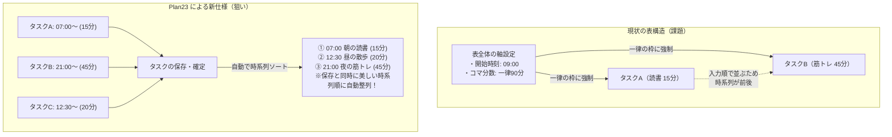
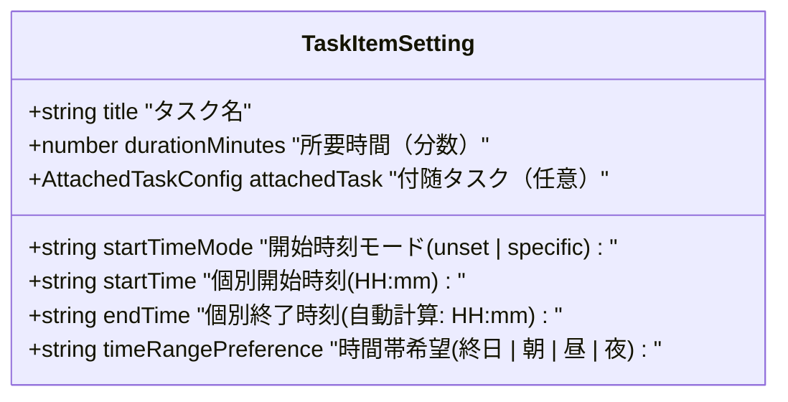
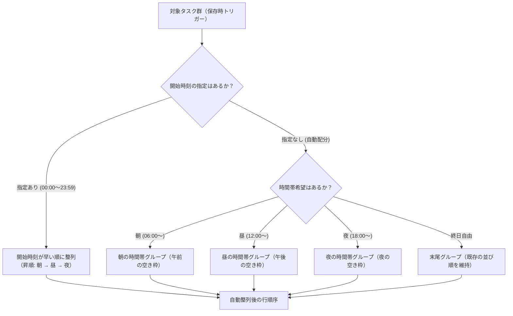
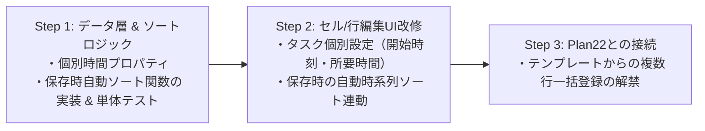

# 表データ内タスク個別設定（開始時間・所要時間）と時系列自動並び替え計画（Plan23）

---

## 1. はじめに・策定の目的

本計画（Plan23）は、表データ（`ImportedTableData`）内の各タスク（セル / 行）に対して、**「開始時間」および「所要時間」の個別設定項目を新設**し、さらに**「開始時間順（時系列昇順）によるタスクの自動並び替え（ソート機能）」**を実現するための要件定義および仕様策定書です。

### 策定の狙い
1. **表全体の一律軸からの解放**:
   - 従来の表は「全コマ90分」「開始時刻09:00」といった表全体の共通軸（`TableAxisConfig`）に縛られていました。
   - タスクごとに「15分の読書」「45分の筋トレ」「10分の瞑想」のように異なる所要時間や個別の開始時刻を柔軟に持てるようにします。
2. **時系列自動ソートによる直感的なスケジュール構築**:
   - 入力順序（思いついた順）に依存せず、タスクの編集・追加を保存した瞬間に自動で時系列整列されるようにします。
3. **Plan22（テンプレート機能）における「複数項目の一括設定」の基盤確立**:
   - 単一の表の中に複数のタスク項目をまとめて設定・流し込むための受け皿として、表データ自体の表現力と柔軟性を事前に高めます。

---

## 2. 背景と現状の課題分析



### 現状の3大課題
1. **所要時間のばらつきに対応しづらい**:
   - 習慣・日課は「10分の瞑想」もあれば「60分のランニング」もあります。共通のコマ分数（`periodMinutes`）に頼ると、短いタスクが無駄に長い枠として扱われたり、個別設定がわかりにくくなります。
2. **手動で並び替える手間と認知負荷**:
   - 「夜のストレッチ」を先に入力した後に「朝の読書」を思いついて追加した場合、行の入れ替えを手動で行う必要があり、並びがバラバラのままだと表の見通しが悪化します。
3. **タイムライン（時系列）との乖離**:
   - 表の上から順に見て「朝 → 昼 → 夜」となっていないと、タイムラインに反映された結果と表の見た目が一致せず、ユーザーの混乱を招きます。

---

## 3. タスク個別設定項目の仕様設計

表内のセル・行編集モーダル（またはポップオーバー）において、以下の個別設定項目を整備します。



### 3.1. 個別設定項目の詳細
1. **タスク名（タイトル）**:
   - テキスト入力（例:「朝の瞑想」「英語リスニング」）
2. **個別所要時間（ドラムロール式 / 数値入力）**:
   - **仕様**: 1分〜180分を上下ドラムロール（または直接数値）で選択。
   - **挙動**: 表全体の `periodMinutes` より優先され、セルごとの正確な分数（`duration = endMinutes - startMinutes`）として保持。
3. **開始時刻（個別設定）**:
   - **モードA. 指定なし（自動配分）**:
     - スケジューラーが空きコマを見つけて自動配置。
   - **モードB. 開始時刻を指定（固定・希望開始時刻）**:
     - `[ 07:00 ]` などの時刻ピッカー入力。
     - 終了時刻は `開始時刻 ＋ 所要時間` により**リアルタイム自動算出**。
4. **時間帯の希望（開始時刻未指定時）**:
   - `[ 終日自由 | 朝 (06〜12時) | 昼 (12〜18時) | 夜 (18〜23時) ]`

---

## 4. 開始時間ごとの自動並び替え（Auto-Sort）の仕様

### 4.1. 並び替えのトリガー方式（保存時自動ソート）
ユーザーにわざわざボタンを押させる手間を省き、**「タスクの編集・追加を保存した時点で、自動的に開始時間順に並び替える」** 仕様とします。

- **挙動**:
  - セル・タスクの編集ポップオーバー/モーダルで「保存」を押した直後、表全体のデータが自動ソート関数を通り、即座に時系列順へ再整列されます。
  - ユーザーは何の手間もかけず、常に表が上から「朝 → 昼 → 夜」の時系列順に整った状態が維持されます。

### 4.2. 並び替えアルゴリズムのルール
開始時間（`startMinutes`）を基準として以下の優先順位で昇順ソートします。



- **同一時刻のタスクがある場合**:
  - 所要時間が短いものを先頭にする、または作成順（ID順）を維持。
- **グリッドでの並び替え対象**:
  - **1列表（Day 1 のみ / 日課表）**: 各行のセルを丸ごと時系列順に並び替え。
  - **7列表（月〜日の時間割形式）**: 表の行ヘッダーの時刻順と連動し、行単位で昇順ソート。

---

## 5. 追加機能提案の扱い（保留方針）

事前の考察で検討した以下の追加機能提案（重複検知、自動玉突き、合計時間集計バー、クイック複製）については、**現フェーズではスコープを広げすぎず、本質的な「個別時間設定」と「保存時自動並び替え」の実現に集中するため、すべて保留**とします。

| 検討機能（保留） | 保留の理由 |
| :--- | :--- |
| **時間重複・競合の検知（Overlap Alert）** | スケジューラー側でも自動配置の重複回避が行われるため、まずは表データの個別設定とソートを優先。必要に応じて将来検討。 |
| **自動玉突き（Auto-Offset）ボタン** | 操作が複雑化するリスクを避け、まずはユーザー自身による明示的な時間設定に集中。 |
| **表内合計所要時間の集計バー** | タイムライン側の既存集計機能と重複するため保留。 |
| **タスクのクイック複製** | 表の直接編集UIの洗練時に合わせて将来検討。 |

---

## 6. データモデル拡張設計（TypeScript型定義案）

```typescript
// 1. GridCell の個別タスク時間設定の拡張
export interface GridCell {
  dayIndex: number;
  periodIndex: number;
  text: string | null;
  title?: string;
  roomOrNote?: string;
  rawLines?: string[];
  fullText?: string;

  // Plan23: 個別時間設定
  startMinutes?: number; // 開始時刻（0〜1440分、未指定時は undefined）
  endMinutes?: number;   // 終了時刻（0〜1440分、未指定時は undefined）
  customDurationMinutes?: number; // 個別所要時間（明示設定）
  timeRangePreference?: 'all' | 'morning' | 'afternoon' | 'evening'; // 時間帯希望

  attachedTask?: AttachedTaskConfig;
}
```

---

## 7. 実装ステップとロードマップ



1. **Step 1（ロジック層）**:
   - `sortRowsByTime(table: ImportedTableData): ImportedTableData` の実装と単体テスト。
   - 保存時にフックして昇順ソートするパイプラインを確立。
2. **Step 2（UI層）**:
   - セル編集ポップオーバーに所要時間＋開始時刻ピッカーを実装。
   - 保存ボタン押下時に `sortRowsByTime` が自動適用され、アニメーション付きで時系列順に整列。
3. **Step 3（Plan22への統合）**:
   - テンプレートウィザードで「＋ 項目を追加」により複数タスクを登録した際、保存時自動ソートによって自動的に時系列順に展開されるように統合。

1. **Step 1（ロジック層）**:
   - `sortRowsByTime(table: ImportedTableData): ImportedTableData` の作成とテスト。
   - 開始時間未指定タスクの安定ソートアルゴリズム検証。
2. **Step 2（UI層）**:
   - セル編集ポップオーバーにドラムロール所要時間＋開始時刻ピッカーを実装。
   - 表ツールバーに「開始時間順に並び替え」ボタンを追加。
3. **Step 3（UX強化）**:
   - 重複警告表示、合計時間のリアルタイム算出。
4. **Step 4（Plan22への統合）**:
   - テンプレートウィザードで「＋ 項目を追加」により、複数タスクを一度に登録した際、本ソート機能により自動で時系列順に展開されるように統合。

---

## 8. まとめ

タスクごとの開始時間・所要時間の個別設定と時系列自動ソートは、**表データ入力の自由度を飛躍的に向上させ、タイムラインとの整合性を保つための最重要基盤**となります。
本Plan23により基盤を整えた上で、保留とした「テンプレートからの複数項目設定」へと繋げることで、破綻のないスムーズな機能拡張が可能となります。
