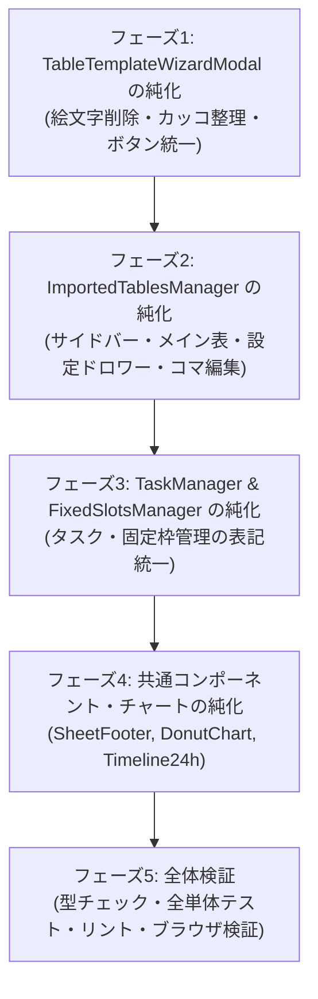

# Plan24: アプリ全体のUI一貫性向上・視覚ノイズ排除（絵文字削除・カッコ整理・表記揺れ統一）計画

## 1. 目的とスコープ
これまで複数のフェーズを経て多くの機能（手動インポート、テンプレートウィザード、日課・週次・固定枠の自動配置、付随タスク、分割タスクなど）が追加されてきました。
その過程で、以下のようなUI・UXの不統一や視覚的ノイズが生じています：
1. **テキスト中の絵文字（Emoji）の混在**: OSやブラウザによって見た目が変わり、デザインの統一感を損ねている。
2. **多重なカッコ表記 `( )` `（ ）` による圧迫感**: ラベルや選択肢の中に補足説明が詰め込まれ、可読性が低下している。
3. **概念・機能名称の表記揺れ**: 同じ概念に対して「日課」「ルーティン」「日のタスク」「日課タスク」など異なる呼称が混在している。
4. **操作方法・UIコンポーネントの不統一**: 数値入力において、ステッパー、テキストボックス、ドロップダウンが混在している。また、削除・閉じるボタンの記法が統一されていない。

本計画（Plan24）では、アプリ全体を横断的に調査・整理し、**「プロフェッショナルで洗練された、ノイズのない直感的なUI」** へと刷新・統一します。

---

## 2. 現状調査結果の詳細

### 2.1 絵文字（Emoji）の利用状況調査
ソースコード全体を走査した結果、UIラベルや選択肢、見出しに **約70箇所の絵文字直接埋め込み** が確認されました。

| 対象コンポーネント | 主な絵文字使用箇所 | 課題 |
|---|---|---|
| `ImportedTablesManager.tsx` | サイドバータブ（`📊 表データ`, `📋 タスク管理`, `📅 今日のタスク`, `🗓️ 今週のタスク`） 種別タグ（`📌 固定枠`, `🏃 日課`, `🎯 週次`） 設定ドロワー見出し（`✨ テンプレートから設定`, `📐 表のマス目サイズ`, `🍱 昼休み設定`, `🎯 配置方式`, `🔄 繰り返し回数`, `📌 付随タスク`, `📥 データ操作`） コマ内バッジ（`🕒`, `🔗`, `☕`, `📌`, `💤`） セレクト選択肢（`📌 固定`, `⚡ 自動`） | Lucideアイコン（SVG）と絵文字が混在。 プラットフォーム依存の表示差やベースラインのズレが発生。 |
| `TableTemplateWizardModal.tsx` | タブ見出し（`🏃 日課（ルーティン）`, `📅 週次タスク（目標）`, `📌 固定枠（生活リズム）`） アコーディオン（`⚙️ スケジュールの詳細オプション（任意）`） | モーダル上部で絵文字が主張しすぎている。 |
| `TaskManager.tsx` | スコープ選択（`🏃 日課`, `🎯 週次`）、休憩表示（`☕ 休憩`） | タスク管理画面内での絵文字混在。 |
| `SheetFooter.tsx` | デバッグスイッチ（`🧪 デバッグ日時固定 ON`, `🕒 実日時（自動）を使用中`） | フッター内での絵文字混在。 |
| `DonutChart.tsx` | 凡例表示（`💤 睡眠・生活`, `💼 仕事・学業`, `🏃 日課・習慣`, `🎯 週目標・タスク`） | チャート凡例での絵文字混在。 |

### 2.2 カッコ表記 `()` `（）` による視認性低下の調査
ラベルや見出しに補足を括弧で詰め込んでいる箇所が多数存在し、画面が文字過多になっています。

| 分類 | 現状の表記例 | 問題点・分析 |
|---|---|---|
| 画面・タブ見出し | `日課（ルーティン）` `週次タスク（目標）` `固定枠（生活リズム）` `表データ (主要入力)` | 主名称だけで十分に意味が通じる。補足が必要な場合はサブテキストとして下部に小さく配置すべき。 |
| フォーム項目ラベル | `行数 (時限)` `列数 (曜日)` `終了時刻 (上限)` `周期の頭 (Day 1の曜日)` `スケジュールの詳細オプション（任意）` | ラベルが長くなり、フォームのグリッドレイアウトが崩れやすい。単位や補足は入力欄内（ステッパー単位やプレースホルダー）で表せる。 |
| 選択肢・ボタン | `朝 (6〜12時)`, `昼 (12〜18時)`, `夜 (18〜23時)` `毎日 (月〜日)` `1週間 (基本)`, `1週間 (当週内・基本)` `全選択(リセット)` | 選択肢テキストが肥大化。時間帯はボタン下部に薄い文字で表記するか、ツールチップ/説明文に委ねるべき。 |
| セクション見出し | `昼休み設定 (1日の休憩ポイント)` `計画表への配置方式 ＆ 周期 (計画表との接続)` `付随タスク設定 (連動タスクオプション)` `データ操作・管理 (後処理・メンテナンス)` | 設定ドロワーの各見出しに「〜設定 (説明)」という冗長なカッコが連続し、流し読みが困難。 |

### 2.3 概念・機能名称の表記揺れの調査
同じ機能やデータを指す言葉が、画面やコンポーネントによって異なっています。

| 概念 | 混在している表記 | 統一する表記（Plan24基準） | 統一理由 |
|---|---|---|---|
| 毎日の反復行動 | 「日課」「ルーティン」「日のタスク」「日常タスク」 | **日課** | 短く直感的で、アプリ内の中心機能として最も定着しているため。 |
| 週単位のノルマ | 「週次タスク」「週のタスク」「週タスク」「週次」「目標」 | **週次タスク** | 「日課」と対比して「週単位のタスク」であることが一目で伝わるため。 |
| 時間指定の予定枠 | 「固定枠」「固定」「固定予定」「生活リズム」「スロット」 | **固定枠** | タイムライン上をブロックする「枠」としての振る舞いを正確に表すため。 |
| 表のデータ | 「表」「表データ」「時間割」「インポート表」「登録テーブル」 | **表データ**（文脈により「表」） | 「時間割」に限定せず日課表やシフト表も扱うため「表データ」に統一。 |
| スケジューリング方式 | 「固定配置」「固定枠」「自動」「自動配分」「自動配置」 | **固定枠** vs **自動配分** | 「決まった時間に固定する」か「空いている時間に自動配分する」かの2択を明快にするため。 |
| 周期の基準点 | 「周期のはじまり」「周期の頭」「周期の開始」「Day 1の曜日」 | **周期の開始（Day 1）** | 「Day 1」というシステム内部の基準日と「周期の開始曜日」を端的に結びつけるため。 |
| マス目・グリッド単位 | 「コマ」「マス」「セル」「時限」 | **コマ** | 時間割・予定表のマス目として最も一般的な「コマ」に統一（設定は行数/列数）。 |
| スケジュール反映 | 「計画表への反映」「スケジュールに反映」「適用」 | **スケジュールに反映** | タイムライン計画表への連動トグルとして意味を統一。 |

### 2.4 操作方法（インタラクション）の不統一調査
1. **数値変更の操作**:
   - `TableTemplateWizardModal` では `NumberStepper`（`[-]` 値 `[+]`）が導入され直感的に操作可能。
   - `ImportedTablesManager` のドロワー内では、ネイティブ `<input type="number">` や、独自のミニボタン、セレクトボックスが混在している。
   - ➔ **時間（分）、回数、行数、列数などの数値入力は `NumberStepper` に統一。**
2. **削除・閉じる操作**:
   - ある箇所では `<Trash2>` アイコンボタン、別の箇所ではテキストの `✕`。
   - ➔ **項目削除は `<Trash2>`（赤ホバー）、ポップアップ/ドロワーを閉じる操作は `<X>` アイコンに統一。**
3. **トグルスイッチのスタイル**:
   - スケジュール反映スイッチはリッチなトグルだが、ドロワー内のチェックボックスは標準チェックボックス。
   - ➔ **セクション全体の有効/無効化は統一されたトグルスイッチUIにする。**

---

## 3. Plan24 UIデザインガイドライン（統一ルール）

### ルール 1: テキスト中の絵文字（Emoji）を全廃し、Lucide SVGアイコンで統一
- 項目名、ボタン、タブ、セレクトボックスのテキストから直接入力の絵文字をすべて削除。
- アイコンが必要な場合は、`lucide-react` の洗練されたベクターアイコンを使用する。
  - 例: `Table2`（表データ）, `CheckSquare` / `ListTodo`（タスク）, `Calendar`（日/週）, `Pin`（固定枠）, `Clock`（時刻）, `Coffee`（休憩）, `Settings`（設定）, `Sparkles`（テンプレート）など。

### ルール 2: ラベル・見出し内のカッコ `()` を排除し、階層構造で表現
- **見出し・ラベル**: 原則としてカッコによる注釈をつけず、簡潔な日本語にする。
  - 改善前: `日課（ルーティン）` ➔ 改善後: `日課`
  - 改善前: `行数 (時限)` ➔ 改善後: `行数`
  - 改善前: `スケジュールの詳細オプション（任意）` ➔ 改善後: `詳細オプション`
  - 改善前: `朝 (6〜12時)` ➔ 改善後: メインラベル `朝` ＋ サブラベル `06:00〜12:00`
- **補足が必要な場合**: ラベルの右横または下部に、薄いテキスト（`text-[11px] text-slate-400`）として配置する。

### ルール 3: 用語の完全統一
- 「日課」「週次タスク」「固定枠」「自動配分」「表データ」「スケジュールに反映」の6大キーワードをアプリ全画面で徹底統一。

### ルール 4: 操作コンポーネントの標準化
- 数値の増減はすべて `NumberStepper` を使用する。
- 削除ボタンは `<Trash2 className="h-4 w-4" />`（ホバー時に赤色 `text-red-500`）に統一。
- モーダル・ドロワー・ポップアップを閉じるボタンは `<X className="h-4 w-4" />` に統一。

---

## 4. 改修フェーズと対象ファイル

### フェーズ 1: `TableTemplateWizardModal.tsx` の改修
- タブ名: `日課`, `週次タスク`, `固定枠`（絵文字・カッコ撤廃、Lucideアイコン付与）
- 詳細設定アコーディオン: `詳細オプション`（絵文字・カッコ撤廃、`SlidersHorizontal` アイコン）
- 時間帯プリセットボタン: `終日`, `朝`, `昼`, `夜`, `カスタム`（カッコ撤廃、下部に小さな時間表示）
- 対象曜日セレクト: `毎日`, `平日のみ`, `週末のみ`, `曜日個別`（カッコ撤廃）

### フェーズ 2: `ImportedTablesManager.tsx` の改修
- サイドバータブ: `表データ`, `タスク管理`, `今日のタスク`, `今週のタスク`（絵文字撤廃、Lucideアイコン統一）
- 設定ドロワー:
  - 見出しの絵文字・カッコ撤廃（`テンプレート設定`, `マス目サイズ`, `昼休み設定`, `配置方式`, `繰り返し回数`, `付随タスク`, `データ管理`）
  - マス目サイズ（行数・列数）、昼休みの長さ、コマ時間などの数値を `NumberStepper` に置き換え
  - コマ編集ポップアップの絵文字バッジ（`🕒`, `🔗`, `☕`, `📌`）を Lucide アイコンに統一
  - コマ編集内の閉じるボタンを `X` アイコンに統一

### フェーズ 3: `TaskManager.tsx` & `FixedSlotsManager.tsx` の改修
- タスク種別の絵文字撤廃（`日課`, `週次タスク`）
- 休憩や状態表示の絵文字撤廃
- 削除・編集操作のUI統一

### フェーズ 4: その他周辺コンポーネントの改修
- `SheetFooter.tsx`: デバッグスイッチ等の絵文字を Lucide アイコン（`Clock`, `Sliders`）に置換
- `DonutChart.tsx`: 凡例の絵文字撤廃、カテゴリ色ドットまたは Lucide アイコンに置換
- `Timeline24h.tsx`: カッコ表記や表記揺れの整理

### フェーズ 5: ビルド・検証
- `npm run typecheck`
- `npm run test`（全201件以上のテストパス）
- `npm run lint`
- ブラウザ実機でのレイアウト・使い心地検証

---

## 5. 期待される効果
1. **ノイズのない洗練されたモダンUI**: 絵文字によるチープ感や環境依存の崩れが解消され、統一されたSVGアイコンによりプロ仕様の清潔なデザインになる。
2. **直感的な視認性（スキャンしやすさ）**: カッコによる注釈だらけの長文ラベルがなくなり、画面を見た瞬間にどこに何があるかが直感的に把握できるようになる。
3. **操作の迷いの解消**: 「ここではステッパー、ここではテキスト入力、ここではドロップダウン」というバラバラな操作が `NumberStepper` に統一され、誰でも迷わず操作できるようになる。
