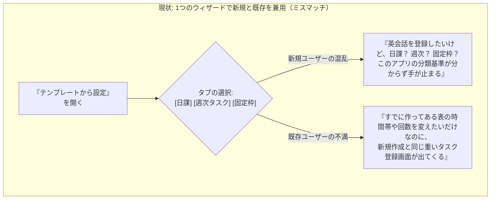
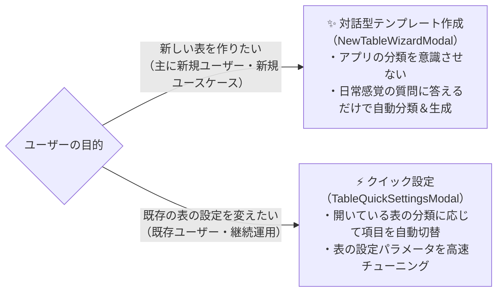
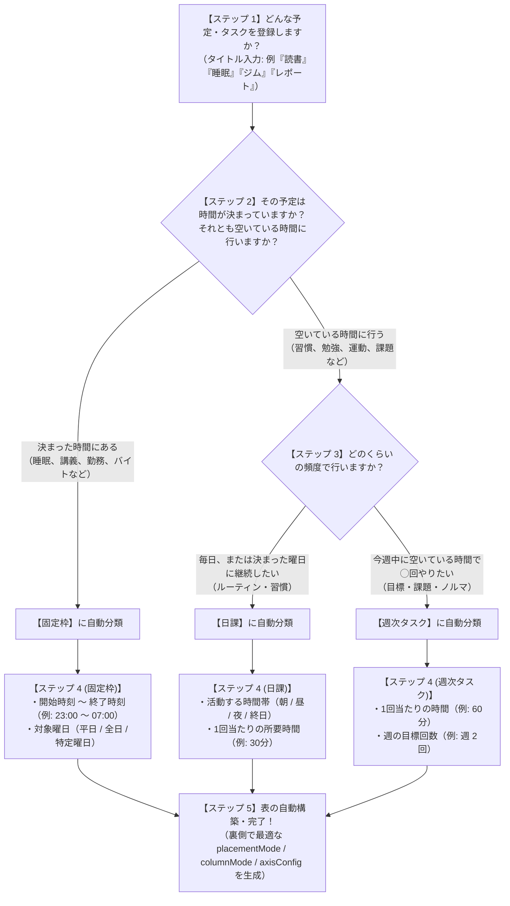
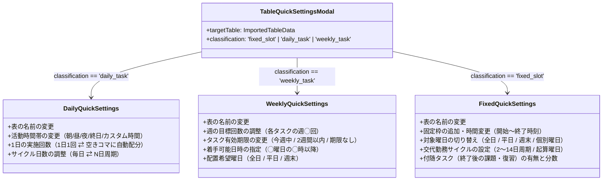
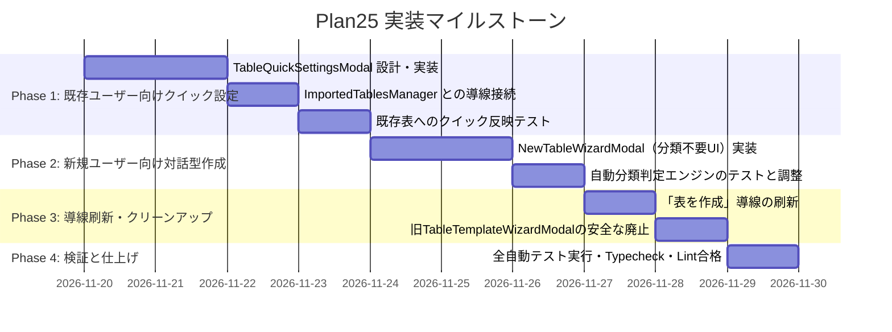

# Plan25: ユーザー層別（新規・既存）「テンプレート作成」＆「クイック設定」刷新計画

---

## 1. はじめに・策定の背景と本質的課題

### 1.1. 現状の「テンプレートから設定」が抱える構造的課題
「理論値スケジュール」において、表形式データ（`ImportedTableData`）はタイムライン自動配置の最重要エンジンです。
直近のアップデート（Plan22〜Plan24）により、テンプレートウィザード（`TableTemplateWizardModal`）の導入や、日課・週次タスク・固定枠における質問フローの整理が進められてきました。

しかし、実際の運用とユーザー行動を分析した結果、現在の「テンプレートから設定」には**「新規ユーザー」と「既存ユーザー」という異なる2つの利用シナリオに対する根本的なミスマッチ**が存在することが明らかになりました。



### 1.2. 課題の二面性

1. **新規ユーザーの課題（分類の壁・認知的負荷）**:
   - 初めてアプリを訪れたユーザーは、このアプリ内部のデータ構造（「固定枠」「日課」「週次タスク」という分類、`placementMode`、`columnMode` など）を知る由もありません。
   - ウィザード冒頭で「日課」「週次タスク」「固定枠」のタブ選択を迫られるため、「自分の登録したいタスクがどこに属するのか」が分からず、作成を断念する大きな要因（オンボーディングの離脱）となっています。
2. **既存ユーザーの課題（チューニング導線の欠如）**:
   - 既存ユーザーはすでに表を作成・運用しており、分類も理解しています。
   - 既存ユーザーが求めているのは「新しい表をゼロから作ること」ではなく、**「現在開いている表の時間帯、回数、有効期限などの設定を、質問形式で手早く自分好みに微調整・変更すること」** です。
   - しかし現状は、表編集ドロワーの「テンプレートから設定」を押しても新規作成用のタスク登録画面がそのまま表示され、表の設定パラメータだけをクイックに調整する手段がありませんでした。

---

## 2. 刷新の基本方針：ペルソナ別の機能分離

本計画（Plan25）では、従来の兼用ウィザードを明確に**2つの独立した機能**へと再編成・分離します。



| 対象ペルソナ | 主な利用シナリオ | 提供する新機能 | 設計のコア思想 |
|:---|:---|:---|:---|
| **新規ユーザー**<br>（および新規作成） | スケジュール帳を使い始めたい、新しい目的の表を追加したい | **対話型テンプレート作成**<br>（`NewTableWizardModal`） | **「分類を意識させない」**<br>予定名や普段の感覚を答えるだけで、裏側で最適な表（固定枠/日課/週次）が全自動判定・構築される。 |
| **既存ユーザー**<br>（既存表の運用） | 既存の表の時間帯を広げたい、週の回数を変えたい、平日のみに絞りたい | **表種別連動クイック設定**<br>（`TableQuickSettingsModal`） | **「表の種別に特化した高速設定」**<br>現在の表の分類（日課/週次/固定枠）を自動識別し、必要な設定項目だけを提示して一発反映。 |

---

## 3. 新規ユーザー向け: 分類を意識させない「対話型テンプレート作成」の設計

### 3.1. コンセプト: 「日常感覚の質問主導型フロー（分類タブの完全撤廃）」
ウィザード上部から「日課」「週次タスク」「固定枠」という**アプリ都合の分類タブを完全に排除**します。
ユーザーには「自分が今どんな予定・タスクを登録したいか」という日常の事実だけを尋ね、その回答に基づいてシステムが最適な表構造を自動決定します。

### 3.2. 対話フロー（自動分類決定木アルゴリズム）



### 3.3. 自然言語質問と自動設定マッピング仕様

| ユーザーへの問いかけ | ユーザーの選択肢 | 判定される分類 | 自動構成される内部パラメータ |
|:---|:---|:---:|:---|
| **時間は決まっていますか？** | **「決まった時間にある」**<br>（授業、勤務、睡眠、食事など） | **固定枠**<br>（`fixed_slot`） | `placementMode: 'fixed'`<br>`columnMode: 'weekday'`（または `cycle`）<br>`axisConfig.startTime` / `endTime` ＝ 入力時間<br>セルに固定時間帯を割り当て |
| | **「空いている時間に行う」**<br>（習慣、課題、運動など） | 次の質問へ | `placementMode: 'auto'` |
| **どのくらいの頻度で行いますか？** | **「毎日・決まった曜日に継続」**<br>（毎朝の瞑想、夜の読書、月水金の筋トレ） | **日課**<br>（`daily_task`） | `dailyRepeatCount: 1`<br>`weeklyRepeatCount: undefined`<br>`periodMinutes` ＝ タスクの所要時間<br>指定した活動時間帯（朝/昼/夜）を `axisConfig` に設定 |
| | **「今週中に何回か消化したい」**<br>（レポート課題、ジム、部屋の掃除） | **週次タスク**<br>（`weekly_task`） | `dailyRepeatCount: 1`<br>`weeklyRepeatCount: 指定回数（週N回）`<br>`weeklyTaskExpiryWeeks: 1`（今週中）<br>セル個別に `targetWeeklyCount` を設定 |

### 3.4. 複数タスク一括登録時のスマート処理
ユーザーが「朝のストレッチ」と「朝の読書」のように複数タスクを並べて登録する場合でも、同じ質問の流れの中で自然に吸収します：
- 空き時間に行うタスク群 ➔ 「日課ルーティン」表として1つの表にまとめられ、朝などの指定時間帯に自動整列して生成。
- 複数の固定予定（睡眠、朝食、バイトなど） ➔ 「生活リズム・固定枠」表として1つの表に時間順で展開。

---

## 4. 既存ユーザー向け: 表種別連動「クイック設定（Quick Settings）」の設計

### 4.1. コンセプト: 「開いている表に最適化された高速チューニング」
すでに存在する表の編集画面（`ImportedTablesManager` のドロワーやツールバー）において、従来の「テンプレートから設定」ボタンを **「⚡ クイック設定」** に改名・再設計します。

「クイック設定」を開いた際、システムは対象の表の分類（`getTableClassification(targetTable)`）を即座に判定し、**その分類にとって本当に必要な調整項目だけを質問形式で展開**します。

### 4.2. 表の分類に応じたクイック設定項目の切り替え仕様



#### A. 日課表（`daily_task`）を開いている時のクイック設定
日課表で調整したいのは「時間帯」と「回数」と「メニュー」です。
1. **表の名前**: 自由変更
2. **活動する時間帯の変更**:
   - `[ 終日 ]` `[ 朝 (06:00-12:00) ]` `[ 昼 (12:00-18:00) ]` `[ 夜 (18:00-23:00) ]` `[ カスタム時刻 ]`
   - ワンタップで表全体の `axisConfig.startTime` / `endTime` を更新。
3. **1日の実施回数**:
   - `[ 1日1回 (推奨) ]` ｜ `[ 空きコマに自動配分 ]` ｜ ステッパー指定
4. **タスク一覧の所要時間微調整**:
   - リスト内の各タスクの所要時間ステッパー（`[-] [ 15 ]分 [+]`）を直接変更可能。

#### B. 週次タスク表（`weekly_task`）を開いている時のクイック設定
週次タスク表で調整したいのは「週あたりの目標回数」と「期限」です。
1. **表の名前**: 自由変更
2. **タスクごとの目標回数**:
   - 各タスク行の「週 `[-] [ 2 ]回 [+]`」を直接変更。
3. **配置希望曜日**:
   - `[ いつでも（全曜日） ]` `[ 平日のみ ]` `[ 週末のみ ]`
4. **タスクの有効期限**:
   - `[ 今週中 ]` `[ 2週間以内 ]` `[ 期限なし ]`
5. **着手可能日時の変更**:
   - 講義の出題曜日や時刻に合わせた開始制限の更新。

#### C. 固定枠表（`fixed_slot`）を開いている時のクイック設定
固定枠表で調整したいのは「予定の時間帯」と「曜日」です。
1. **表の名前**: 自由変更
2. **予定の時間帯の修正**:
   - 開始時刻 〜 終了時刻（日またぎ時の「翌日◯◯まで」明記）。
3. **対象曜日の変更**:
   - 各スロットの `[ 月 ][ 火 ][ 水 ][ 木 ][ 金 ][ 土 ][ 日 ]`（全日/平日/週末クイックリンク付き）。
4. **サイクル日数の変更（交代勤務等）**:
   - 2〜14日周期への切り替え、起算曜日の変更。
5. **付随タスク（課題・復習）**:
   - 終了後の課題タスクON/OFFと所要時間。

---

## 5. 画面UI・ワイヤーフレーム設計

### 5.1. 【新規作成用】対話型テンプレートウィザード（`NewTableWizardModal`）
分類タブをなくし、上から順に質問カードへ答えていくクリーンな構成。

```
┌────────────────────────────────────────────────────────────────────────┐
│ ✨ スケジュールの作成（対話型ウィザード）                           [✕]│
├────────────────────────────────────────────────────────────────────────┤
│                                                                        │
│  Q1. どんな予定やタスクを登録しますか？                                │
│      ┌──────────────────────────────────────────────────────────────┐  │
│      │ 例: 睡眠、朝のストレッチ、ジム、レポート課題...              │  │
│      └──────────────────────────────────────────────────────────────┘  │
│                                                                        │
│  Q2. その予定は時間が決まっていますか？                                │
│      ┌─────────────────────────────┐  ┌─────────────────────────────┐  │
│      │ 📌 決まった時間にある       │  │ ⚡ 空いている時間に行う      │  │
│      │ （勤務・講義・睡眠など）    │  │ （習慣・勉強・課題など）    │  │
│      └─────────────────────────────┘  └─────────────────────────────┘  │
│                                                                        │
│  Q3. ［空いている時間を選んだ場合］どのくらいの頻度で行いますか？      │
│      ┌─────────────────────────────┐  ┌─────────────────────────────┐  │
│      │ 🏃 毎日・決まった曜日に継続 │  │ 🎯 今週中に◯回やりたい      │  │
│      │ （日課ルーティン）          │  │ （週目標・課題・家事）      │  │
│      └─────────────────────────────┘  └─────────────────────────────┘  │
│                                                                        │
│  Q4. ［判定された種別に応じた詳細設定（時間帯・所要時間・回数）］      │
│      （※ 判定結果に合わせて必要なフォームのみがインライン展開）       │
│                                                                        │
├────────────────────────────────────────────────────────────────────────┤
│                                     [ キャンセル ]   [ この内容で表を作成 ] │
└────────────────────────────────────────────────────────────────────────┘
```

### 5.2. 【既存編集用】表種別連動クイック設定（`TableQuickSettingsModal`）
表編集ドロワー内の「⚡ クイック設定」を押したときに開く、現在開いている表の調整に特化したモーダル。

```
┌────────────────────────────────────────────────────────────────────────┐
│ ⚡ クイック設定 - [ 朝ルーティン ]                    [ 🏃 日課表 ] [✕]│
├────────────────────────────────────────────────────────────────────────┤
│ 現在開いている表の設定を、質問に答えるだけで簡単に変更できます。       │
│                                                                        │
│  1. 表の名前                                                           │
│     [ 朝ルーティン                                                  ]  │
│                                                                        │
│  2. どの時間帯に行いますか？                                           │
│     [ 終日 ]  [● 朝 (6〜12時) ]  [ 昼 (12〜18時) ]  [ 夜 ]  [カスタム] │
│                                                                        │
│  3. 1日に何回行いますか？                                              │
│     [● 1日1回 (推奨) ]    [ 空きコマに自動配分 ]    [-] [ 1 ]回 [+]    │
│                                                                        │
│  4. 各タスクの所要時間                                                 │
│     1. ストレッチ    [-] [ 15 ]分 [+]                                  │
│     2. 読書          [-] [ 20 ]分 [+]                                  │
│                                                                        │
├────────────────────────────────────────────────────────────────────────┤
│                                         [ キャンセル ]   [ 変更を適用 ]│
└────────────────────────────────────────────────────────────────────────┘
```

---

## 6. アーキテクチャおよびコンポーネント構成

既存の単一巨大コンポーネント（`TableTemplateWizardModal.tsx`）を役割ごとに責務分離します。

```
src/
├── components/
│   ├── templates/
│   │   ├── NewTableWizardModal.tsx      # 【新規用】分類不要・対話型作成ウィザード
│   │   └── TableQuickSettingsModal.tsx  # 【既存用】表分類連動クイック設定モーダル
│   └── ImportedTablesManager.tsx        # 導線の配置（「＋ 表を作成」と「⚡ クイック設定」）
├── lib/
│   └── templates/
│       ├── tableClassifier.ts           # 対話の回答から分類を判定するルールエンジン
│       └── tableTemplates.ts            # 表データ生成・更新ユーティリティ
```

### 6.1. 分類判定エンジン（`tableClassifier.ts`）の設計
ユーザーの回答オブジェクトを受け取り、適切な分類とパラメータを返す純粋関数：

```typescript
export interface UserIntentInput {
  title: string;
  isFixedTime: boolean;            // 時間が決まっているか
  fixedTimeRange?: { startTime: string; endTime: string };
  targetDays?: number[];
  
  frequencyType?: 'routine' | 'quota'; // 習慣か、ノルマ（週何回）か
  preferredTimeRange?: 'all' | 'morning' | 'afternoon' | 'evening' | 'custom';
  durationMinutes?: number;
  weeklyCount?: number;
}

export function classifyUserIntent(input: UserIntentInput): 'fixed_slot' | 'daily_task' | 'weekly_task' {
  if (input.isFixedTime) {
    return 'fixed_slot';
  }
  if (input.frequencyType === 'quota' || (input.weeklyCount && input.weeklyCount > 0)) {
    return 'weekly_task';
  }
  return 'daily_task';
}
```

### 6.2. クイック設定反映ロジック（`applyQuickSettingsToTable`）
既存の表の `ImportedTableData` に対して、グリッドセルやコマ構造を壊さずにパラメータのみを安全に更新：

```typescript
export function applyQuickSettingsToTable(
  table: ImportedTableData,
  settings: QuickSettingsPayload
): ImportedTableData {
  // 分類に応じた安全なパラメータ更新（axisConfig, dailyRepeatCount, weeklyRepeatCount, セル時間など）
}
```

---

## 7. 実装ロードマップとマイルストーン



### Phase 1: 既存ユーザー向け「クイック設定」の実装
- `TableQuickSettingsModal.tsx` を新規作成。
- 現在の表の分類（`fixed_slot` / `daily_task` / `weekly_task`）に応じた3種の設定フォーム（時間帯、回数、期限、曜日）を実装。
- `ImportedTablesManager` のドロワー先頭ボタンを「⚡ クイック設定」へ変更し、既存ユーザーが即座に設定を変更できる導線を確立。

### Phase 2: 新規ユーザー向け「対話型テンプレートウィザード」の実装
- 分類タブのない `NewTableWizardModal.tsx` を実装。
- 「予定名」➔「時間が決まっているか」➔「頻度（習慣 or 週何回）」の質問ステップを構築。
- 回答から自動的に `createFixedSlotTable` / `createDailyRoutineTable` / `createWeeklyTaskTable` を呼び出して新規テーブルを生成。

### Phase 3: 導線の明確化と旧コンポーネントの整理
- 表管理ヘッダーの「＋ 表を作成」ドロップダウンから「✨ 質問に答えて表を作成（対話型ウィザード）」を呼び出す。
- 各表の編集画面からは「⚡ クイック設定」を呼び出す。
- 従来の兼用ウィザード（`TableTemplateWizardModal`）を安全に置き換え。

### Phase 4: 検証・品質保証
- 新規ユーザーシナリオ（読書、睡眠、ジム、レポート）での全自動分類テスト。
- 既存ユーザーシナリオ（時間帯変更、週回数変更）での設定反映テスト。
- Vitest ユニットテストおよび TypeScript 型チェック、Lint の完全通過。

---

## 8. 期待される成果と提供価値

1. **新規ユーザーの離脱防止（オンボーディング完了率の飛躍的向上）**:
   - アプリの専門用語（固定枠・日課・週次タスク・周期モード等）を知らなくても、日常の問いに答えるだけで誰でも1分で理想のスケジュールデータを作成できるようになります。
2. **既存ユーザーの操作ストレス解消（設定変更の時短化）**:
   - 既存の表の設定変更のために重たい新規作成ウィザードを開く必要がなくなり、「クイック設定」から数タップで時間帯や回数をチューニングできるようになります。
3. **システムの責務分離による保守性の向上**:
   - 「新規作成」と「既存編集」のロジックが明確に分離されるため、今後の機能拡張時にもコードの肥大化や条件分岐の複雑化を防ぐことができます。
