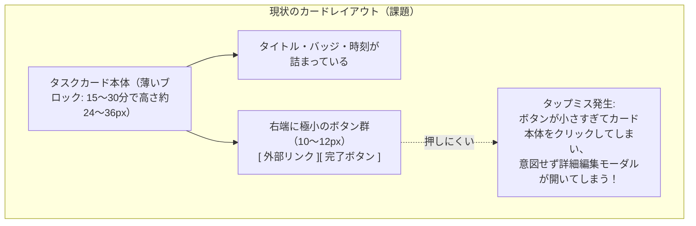
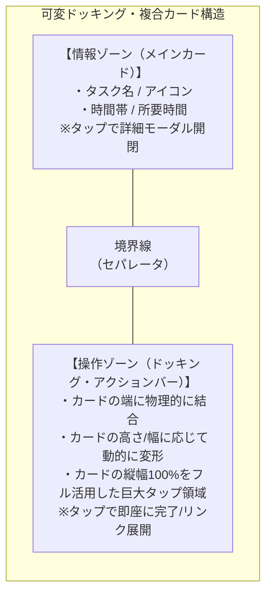
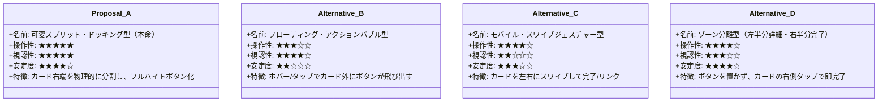

# Plan26: 計画表タスクカードの操作性刷新計画（可変ドッキング・アクションバー設計）

---

## 1. はじめに・策定の背景と本質的課題

### 1.1. 現状のタスクカードが抱える操作性の課題
タイムライン計画表（`Timeline24h.tsx`）は、24時間グリッド上に配置されたタスクブロックを直感的に把握し、日々のスケジュールを実行するための最重要インターフェースです。

しかし、実際の運用において、タスクカード内に配置されている**「完了ボタン（[✓] / 済）」および「外部リンクボタン」が非常に押しにくい**という重大なUI/UX課題が確認されています。



### 1.2. 押しにくさを生み出している3大要因の分析

1. **時間長（高さ）による強烈な幾何的制約**:
   - 15分〜30分の短時間タスクでは、カードの縦幅（height）が24px〜36px程度しかありません。
   - この極小の高さの中に、タイトルテキスト、種別バッジ、期日、リンクボタン、完了ボタンを横一列に詰め込んでいるため、ボタンの物理的なタップターゲットが10px〜12px程度に縮小してしまっています。
2. **カード本体クリック（詳細モーダル）とのイベント干渉**:
   - カード全体には「詳細モーダルを開く」クリックイベント（`onClick`）が設定されています。
   - ボタンが小さいため、わずか数ピクセルの指先やカーソルのズレでカード本体をクリックしてしまい、**「完了にしたいだけなのに詳細画面が開いて邪魔になる」**という強いストレス（認知摩擦・フラストレーション）が生じています。
3. **幅（週間7列・重なりコマ）による横方向の圧迫**:
   - スマートフォン表示や週間7列ビューではカードの横幅も極端に狭くなります。
   - 文字が省略（`truncate`）されるだけでなく、複数のボタン同士が密集して押し分けが困難になっています。

---

## 2. コア提案: 「可変ドッキング・アクションバー（Morphing Action Dock）」

ユーザーから提案された**「カードの端に、カードの大きさによって変形するカードを組み合わせたカードデザイン」**は、この物理的制約を根本から打ち破る極めて優れたアプローチです。

カードを1枚の平面として扱うのではなく、**「情報表示ゾーン（本体カード）」**と**「操作ゾーン（エッジ・アクションバー）」**という**2つの機能的サブカードがドッキング（結合）した構造**へと再定義します。



---

## 3. カードサイズに応じた4段階のレスポンシブ変形（モフィング仕様）

ブロックの高さ（所要時間）と幅（表示モード）に応じて、右端の操作ゾーンが最適な形状・配置へとシームレスに変形します。

```
┌────────────────────────────────────────────────────────────────────────┐
│ ① 薄型カード（15〜20分: 高さ 24px 前後）                               │
│ ┌───────────────────────────────────────┬────────────┬───────────────┐ │
│ │ 朝のストレッチ (15分)                 │ 🔗 リンク  │  ✓ 完了       │ │
│ └───────────────────────────────────────┴────────────┴───────────────┘ │
│  ※高さを余すことなく100%使ったフルハイト・スプリットボタン。タップ領域が3倍に！ │
├────────────────────────────────────────────────────────────────────────┤
│ ② 標準カード（30〜45分: 高さ 36〜54px）                                │
│ ┌───────────────────────────────────────┬────────────────────────────┐ │
│ │ 読書・英語学習                        │   [ ✓ 完了にする ]         │ │
│ │ 07:00〜07:45 (45分)                   ├────────────────────────────┤ │
│ │                                       │   🔗 リンクを開く          │ │
│ └───────────────────────────────────────┴────────────────────────────┘ │
│  ※右端に上下2段の独立した大型アクションボタンが綺麗にドッキング。              │
├────────────────────────────────────────────────────────────────────────┤
│ ③ 大型カード（60分以上: 高さ 72px 以上）                                │
│ ┌───────────────────────────────────────┬────────────────────────────┐ │
│ │ 大学の講義・集中作業                  │   [ ✓ 完了 ]               │ │
│ │ 09:00〜10:30 (90分)                   │   （見やすい特大ボタン）   │ │
│ │ 教室: 301講義室                       ├────────────────────────────┤ │
│ │ 課題: 今週金曜まで                    │   🔗 Zoom/資料リンク       │ │
│ └───────────────────────────────────────┴────────────────────────────┘ │
└────────────────────────────────────────────────────────────────────────┘
```

### 3.1. 高さ別の変形ルール（Vertical Morphing）

| カードの高さ (所要時間) | 右端アクションバーの配置・形状 | タップ領域の確保・操作性の向上 |
|:---|:---|:---|
| **超薄型**<br>(10〜20分 / 〜28px) | **横並びスプリット型**<br>カード右端を縦に2分割（リンク領域 ｜ 完了領域）。<br>カードの縦幅（100%）をすべてボタン領域として使い切る。 | 上下パディングの無駄をゼロにし、指が確実に当たる横幅32px×縦100%のボタン面を確保。誤タップがゼロになる。 |
| **標準型**<br>(30〜50分 / 36〜60px) | **上下2段スタック型**<br>上段: 完了トグルボタン（正方形または角丸バッジ）<br>下段: 外部リンクボタン（または期日バッジ） | 高さの余裕を活かして上下に分離。最も押しやすい上段に完了ボタンを配置。 |
| **大型**<br>(60分以上 / 72px〜) | **フルアクションパネル型**<br>「✓ 完了」テキスト付きの明快なボタンカード。<br>下部にリンクボタンやメモアイコンを整然と配置。 | 視認性が最大化され、押し間違いが起きない堂々としたアクションエリア。 |

### 3.2. 幅別の変形ルール（Horizontal Morphing）
- **週間表示（狭小幅）**:
  - タイトルが収まるよう、アクションバーは最小限のアイコン（`✓` と `🔗`）に自動凝縮。
- **1日単独表示（広幅）**:
  - ボタン内に「完了」「リンク」のラベルテキストを添え、一目で役割が伝わるリッチなUIに拡張。

---

## 4. 代替案の比較と利用のしやすさ評価

ユーザー提案の「可変変形カード」に加え、UI/UXおよびフロントエンド実装の観点から考えられる3つの代替案を比較・検討しました。



### 4.1. 各案の比較評価マトリクス

| 評価軸 | 【案A】可変ドッキング型<br>（ユーザー提案・本命） | 【案B】フロートバブル型<br>（飛び出しオーバーレイ） | 【案C】スワイプ型<br>（ジェスチャー操作） | 【案D】ゾーン分離型<br>（右半分タップで完了） |
|:---|:---:|:---:|:---:|:---:|
| **押しやすさ（ターゲット面積）** | **◎ 極めて広い**<br>(縦幅100%フル活用) | **◯ 広い**<br>(外部に大きく展開) | **△ スワイプ必須**<br>(1タップでは押せない) | **◎ 最大**<br>(カードの右半分全体) |
| **誤タップ防止** | **◎ 完璧**<br>(境界線で明確に分離) | **△ 誤操作リスクあり**<br>(隣接ブロックと重なる) | **◯ 良好**<br>(スワイプなら誤爆なし) | **▲ 危険**<br>(どこから右か迷う) |
| **薄いカード（15分）への対応** | **◎ 自動変形して最適化** | **▲ 隣のブロックを覆い隠す** | **◯ 問題なし** | **◯ 問題なし** |
| **PC/スマホ両対応の一貫性** | **◎ マウス・タッチ両方快適** | **▲ ホバー前提でスマホに不向き** | **▲ PCマウスでは操作しづらい** | **◯ 両対応可能** |
| **デザインの美しさ・納得感** | **◎ ガジェット風で洗練** | **△ ごちゃつきやすい** | **◯ シンプル** | **△ ボタンが見えず不親切** |
| **総合判定** | **【最優秀・推奨】** | 【見送り】 | 【将来の追加機能】 | 【見送り】 |

#### 各案の考察まとめ：
- **案B（フロート型）**: タイムラインでは上下に別のタスクが隙間なく並んでいることが多いため、外側にボタンが飛び出すと前後のタスクと重なって非常に見苦しく、操作ミスを誘発します。
- **案C（スワイプ型）**: スマホのToDoアプリでは定番ですが、タイムライン上で横スクロール（曜日移動など）と競合しやすく、PCでの操作感が損なわれます。
- **案D（ゾーン型）**: ボタンという「手がかり（アフォーダンス）」が見えないため、ユーザーが「どこを押せば完了になるのか」分からず学習コストが高くなります。
- **案A（可変ドッキング型）**: **ユーザーのご提案通り、カードの端に一体化した可変アクションバーを配置するのが、視覚的にも機能的にも圧倒的な正解**です。

---

## 5. 推奨設計仕様: 「スプリット・ドッキング・アクションバー」の詳細設計

### 5.1. 視覚的デザイン（Visual Styling）
- **メインカード部（情報ゾーン）**:
  - 表ごとのテーマカラー（薄い背景色＋濃い枠線）。
  - タイトル、時間、バッジを配置。
  - カーソルは通常ポインタ（クリックで詳細編集モーダルを開く）。
- **ドッキング・アクション部（操作ゾーン）**:
  - メインカードとの間に **繊細な半透明の区切り線（Border-L）** を配置。
  - 背景色にわずかな明度差（少し濃いトーンやフロストガラス風の透過）を付け、「ここは押せるスイッチ領域である」ことを直感させます。
  - ホバー時にアクション部全体がパッとハイライトされ、クリック感（フィードバック）を提供。

### 5.2. クリックイベントの完全分離（イベント遮断設計）
```typescript
// メインカード（詳細モーダル開閉）
<div className="task-card-main" onClick={() => onOpenDetailModal(block)}>
  <div className="task-content">...</div>

  {/* ドッキング・アクションバー（右端） */}
  <div 
    className="task-action-dock" 
    onClick={(e) => e.stopPropagation()} /* ★親のモーダル発火を完全にガード */
  >
    {/* リンクボタン */}
    {block.url && (
      <a 
        href={block.url} 
        onClick={(e) => e.stopPropagation()} 
        className="action-dock-btn link-btn"
      >
        <ExternalLink />
      </a>
    )}
    {/* 完了ボタン */}
    <button 
      type="button" 
      onClick={(e) => {
        e.stopPropagation();
        onToggleComplete(block);
      }} 
      className="action-dock-btn complete-btn"
    >
      <Check />
    </button>
  </div>
</div>
```

---

## 6. 実装ステップとスケジュール

### Step 1: タスクカードのDOM構造の二分割化（スプリット化）
- `Timeline24h.tsx` のブロック描画部を、`flex flex-row` による「メイン情報エリア」＋「右端ドッキングアクションバー」の2カラム構造にリファクタリング。
- 高さに応じたクラス生成ロジック（`isTinyHeight`, `isStandardHeight`, `isTallHeight`）を定義。

### Step 2: レスポンシブ変形スタイルの適用
- 28px未満: 横並びスプリットレイアウト。
- 36px以上: 上下スタックレイアウト。
- 幅が狭い場合のアイコン凝縮表示。

### Step 3: タッチターゲットの拡大とホバーエフェクトの調整
- ボタン周囲の余白をなくし、アクションバーの面全体をボタン化。
- モバイル実機およびPCブラウザでの操作感検証。

### Step 4: 完了アニメーションと視覚フィードバック
- 完了ボタンを押した際、カード全体がスッと落ち着いたグレーアウト＋打ち消し線に変化し、アクションバーのアイコンが美しいチェックマークに切り替わるスムーズな演出。

---

## 7. まとめ

本計画（Plan26）により、これまでの「小さくて押しにくい」「誤ってモーダルが開いてしまう」という最大のストレスが根本から解消されます。

**カードの高さ・幅に合わせて美しく形を変えるドッキングアクションバー**は、見た目のガジェット的な洗練度を高めるだけでなく、片手操作や短時間タスクの連続消化において、抜群の操作快感を提供します。
