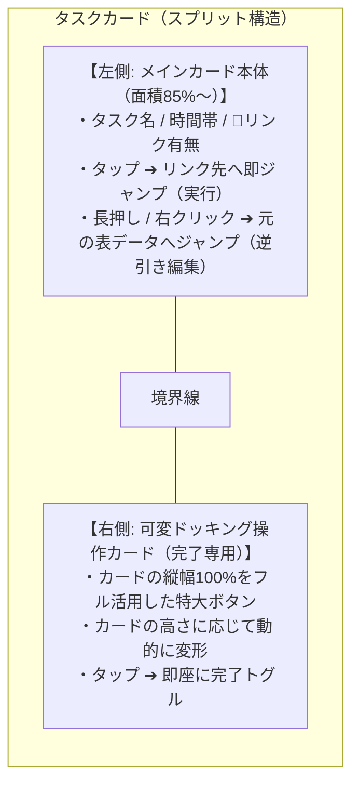

# Plan26: 計画表タスクカードの操作性刷新計画（可変ドッキング・アクションバー ＆ 長押し逆引きジャンプ設計）

---

## 1. はじめに・策定の背景と本質的課題

### 1.1. 現状のタスクカードが抱える操作性の課題
タイムライン計画表（`Timeline24h.tsx`）は、24時間グリッド上に配置されたタスクブロックを直感的に把握し、日々のスケジュールを実行するための最重要インターフェースです。

しかし、実際の運用において、以下の2つの重大なUI/UX課題が確認されていました：
1. **完了ボタンとリンクボタンが極小で押しにくい**:
   - 15分〜30分の薄いタスクカード（高さ約24〜36px）の中に、タイトル・バッジ・時刻・リンクアイコン・完了ボタンが横一列に密集。
   - ボタンの物理的なタップターゲットが10px程度しかなく、タップミスが頻発する。
2. **広大なカード本体面積が「デッドスペース（空振り）」になっている**:
   - 計画表タブでは、タスクカード本体をクリックしても編集画面などは開かず、何も起きない。
   - なのに、わざわざ右端の極小リンクアイコンを針の穴を通すように狙って押さなければならない。
3. **「このタスク、設定を変えたい」と思った時の導線が遠すぎる**:
   - タイムラインから元の表データを修正したい時、「表データタブ切替 ➔ 表を探す ➔ セルを探す」と4〜5ステップ必要で、どの表に所属しているか忘れてしまうと探すのが困難。

---

## 2. コア設計方針: 3大インタラクションへの集約

本計画（Plan26）では、タスクカードを**「メインカード（実行・情報）」**と**「ドッキングカード（完了操作）」**の2分割スプリット構造に再定義し、3大インタラクションに集約します。



| 操作 | 対象エリア | 発火するアクション | 体験価値 |
|:---|:---|:---|:---|
| **タップ** (短押し) | メインカード（左側） | **リンク先へ即ジャンプ**（URL設定時） | 狙い撃ち不要。カードをポンと叩くだけでZoomや課題ページが起動！ |
| **長押し** (約500ms) / **右クリック** | メインカード（左側） | **元の表データへ逆引きジャンプ** | 「表データ」タブの該当テーブルが瞬時に開き、直感的に設定変更できる！ |
| **タップ** | ドッキングカード（右端） | **タスク完了トグル**（オン/オフ） | カード縦幅100%を使った特大チェックボタンで押し間違えゼロ！ |

---

## 3. レスポンシブ可変ドッキング・アクションバー仕様

右端のドッキングカード（完了専用ボタン）は、カードの高さ（所要時間）と幅に応じて美しく変形します。

```
┌─────────────────────────────────────────────────────────────┬──────────────┐
│ ① 薄型カード（15〜20分: 高さ 24px 前後）                     │              │
│ 🔗 朝のストレッチ (15分) 07:00〜                             │   [ ✓ ]      │
│ （タップでリンク / 長押しで表データへジャンプ）               │ (縦幅100%)   │
├─────────────────────────────────────────────────────────────┼──────────────┤
│ ② 標準カード（30〜45分: 高さ 36〜54px）                      │              │
│ 読書・英語学習 (45分)                                       │   [ ✓ 完了 ] │
│ 07:00〜07:45                                                │              │
├─────────────────────────────────────────────────────────────┼──────────────┤
│ ③ 大型カード（60分以上: 高さ 72px 以上）                      │   ┌──────┐   │
│ 🔗 大学の講義・集中作業 (90分)                               │   │  ✓   │   │
│    教室: 301講義室                                          │   │ 完了 │   │
│    Zoom / 講義資料を開く ↗                                  │   └──────┘   │
└─────────────────────────────────────────────────────────────┴──────────────┘
```

1. **超薄型カード (10〜20分 / 〜28px)**:
   - カード右端の縦幅100%をフルに使ったスプリットボタン。アイコン `[ ✓ ]` が中央に配置され、上下余白なしで最大タップ面積を確保。
2. **標準〜大型カード (30分以上 / 36px〜)**:
   - 「✓ 完了」またはアイコンと状態が明快にわかる大きめのボタンバッジ。

---

## 4. 長押し（ロングプレス）逆引きジャンプの設計仕様

### 4.1. インタラクション仕様
- **スマートフォン / タッチ端末**:
  - 指でカードを長押し（約500ms）。
  - 長押し中にカードがわずかに縮小（`scale(0.98)`）するフィードバックアニメーション。
  - 500ms経過でバイブレーション（対応端末）または波紋エフェクトと共に、「表データ」タブへ遷移し、該当テーブルが選択状態で開く。
- **PC / マウス環境**:
  - マウスの長押し（左クリック押し続け約500ms）、または **右クリック（コンテキストメニューの代わり）** で直ジャンプ。

### 4.2. 内部連携ロジック
- 各ブロックは `block.sourceTableId` を保持しています。
- タイムラインコンポーネントに `onJumpToSourceTable?: (tableId: string) => void` を追加。
- 親コンポーネント（`page.tsx`）で `setActiveTab('data')` および該当テーブルの選択状態を設定。

---

## 5. 実装ステップ

1. **`Timeline24h.tsx` の改修**:
   - `onJumpToSourceTable` プロップの受け取り。
   - タスクブロック描画部のスプリット化（左: メインカード ＋ 右: ドッキング完了ボタン）。
   - メインカードのクリック（リンクジャンプ）とロングプレス/右クリックハンドラの実装。
   - リンク有無に応じた視覚スタイル（リンクアイコン、ホバーハイライト、`cursor-pointer`）。
2. **`page.tsx` の配線**:
   - `handleJumpToSourceTable(tableId)` の実装と `Timeline24h` への受け渡し。
   - 該当テーブルを選択した状態で「表データ」タブへ瞬時に遷移。
3. **テスト・型チェック・検証**:
   - ユニットテスト、Lint、ビルドの確認。
