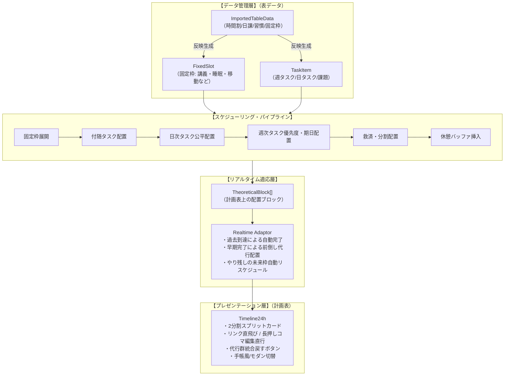

# Plan27: アプリケーション総合アーキテクチャ調査・品質評価および改善ロードマップ

---

## 1. エグゼクティブサマリー

### 1.1. 本ドキュメントの目的
本計画書（Plan27）は、これまでの Plan1 から Plan26 にわたる継続的開発によって構築された本アプリケーション（時間割・表データ連携型 24時間手帳風計画表システム）について、
- **仕様（Specifications）**
- **アルゴリズム（Scheduling & Realtime Adaptor）**
- **動作の正確性と不変条件（Correctness & System Invariants）**
- **分かりやすさ・UI/UX（Usability & User Experience）**
- **潜在的不具合・エッジケース・技術的負債（Bugs, Edge Cases & Tech Debt）**
を客観的かつ網羅的に調査・評価し、今後の発展に向けた優先度付き改善案（ロードマップ）を取りまとめた総合監査ドキュメントです。

### 1.2. プロダクトの提供価値
本システムは、静的な時間割・日課表・固定枠・ToDoリストを「24時間グリッドのタイムライン手帳」へ統合展開し、さらに現実の進行（早期完了ややり残し）に応じて**「未来の空き枠への前倒し代行配置」**や**「自動リスケジュール」**を動的に実行する、新しいパラダイムのライフマネジメントアプリケーションです。

---

## 2. システム仕様の調査と評価（Specifications）

### 2.1. 主要機能とデータモデルの構造

### 2.2. 仕様の評価
| 領域 | 実装状況 | 評価 | 考察・現状の到達度 |
|:---|:---:|:---:|:---|
| **表データの柔軟性** | 実装済 | 優 | 曜日軸、日付軸、サイクル軸、カスタム時限に対応。画像OCR・テキスト・CSVインポートおよびテーマ先行ウィザード完備。 |
| **計画表への反映** | 実装済 | 優 | 表削除時の一括パージ、表更新時の同期反映（sourceTableId による完全追跡）により、ゴミデータの残留バグを解消済。 |
| **タイムライン操作性** | 実装済 | 極めて優 | Plan26により、メインカード（リンク直飛び・長押し逆引き直行）と縦100%完了ドックのスプリット化を完了。指先での操作性が劇的に向上。 |
| **代行タスクUI** | 実装済 | 極めて優 | 複数タスクにまたがる代行群に対して「1つの統合された大きな戻すボタン」を配置。押し間違いゼロと一括解除を実現。 |
| **デザイン性** | 実装済 | 優 | 絵文字を徹底排除し、手帳風エクリュ半透明調とモダン付箋調を切り替え可能。品のあるデザインを確立。 |

---

## 3. アルゴリズムの調査と評価（Algorithms）

### 3.1. スケジューリングパイプライン（`placementPipeline.ts`）
1. **スロットマネージャー**: 固定枠（講義・バイト・食事・睡眠）をタイムライン上に排他的にブロック化。
2. **付随タスク（Attached Tasks）**: 「授業直後の15分復習」など、特定セルに紐づくタスクをコマ直後に最優先配置。
3. **日次タスク公平配置（Daily Fair Placement）**: 毎日の日課を、曜日ごとの空き時間に偏りなく均等に配置。
4. **週次タスク優先度・期日配置（Weekly Placement）**:
   - デッドライン（締切日）が近い順、優先度（High > Medium > Low）順にソート。
   - 連続した空きスロットを探索し、必要に応じて最小分割単位（例: 15分/30分）で分割配置。
5. **休憩挿入（Break/Buffer）**: 長時間タスクの直後に自動で5〜15分の休憩ブロックを挿入。

### 3.2. リアルタイム適応アダプター（`realtimeAdaptor.ts`）
1. **自動完了判定**: 現在時刻がタスク終了時刻を過ぎた場合、自動で完了状態（`isAutoCompleted`）へ移行。
2. **早期完了（Early Completion）**:
   - 予定終了時刻より前にユーザーが手動完了した場合、残余時間を「空き時間（Early Free Slot）」として開放。
3. **前倒し代行タスク配置（Substitute Task Placement）**:
   - 早期完了によって生じた空き時間に、未来に予定されていた週タスクを「前倒し代行タスク（`isSubstitute`）」として即座に引き込み配置。
4. **未完了タスクの自動再スケジュール（Auto Reschedule）**:
   - 予定時刻を過ぎても完了されなかったタスクを、未来の最も早い空き枠へ自動で再配置（`isRescheduled`）。
5. **代行解除・ロールバック**:
   - 早期完了を取り消した場合、代行タスク群が一括で元の未完了状態・未来の枠へと復元。

### 3.3. アルゴリズムの評価
- **強み**:
  - 動的再計算が極めて高速（全207件のテストが1秒未満で完走）。
  - 時間重複（オーバーラップ）の防止が徹底されており、物理的に不可能なスケジュールが生成されない。
- **課題・検討点**:
  - 早期完了枠に引き込まれた代行タスクが、さらに早期完了された場合の「多段代行（連鎖代行）」の深さ制限やエッジケース。
  - 深夜帯（23:00〜翌02:00など）の日付跨ぎタスクにおけるスロット分割計算。

---

## 4. 正しい動作とシステム不変条件（Invariants & Correctness）

本システムが常に保証すべき「不変条件（Invariants）」の監査結果です。

### 4.1. 保証されている不変条件
1. **時間の無重複（No Overlapping Invariant）**:
   - 同一曜日において、いかなる2つのタスクブロックも時間が重複して描画されない（スロットマネージャーによる厳格な排他制御）。
2. **表削除時の完全整合性（Purge Consistency Invariant）**:
   - 表データを削除した際、関連するすべての固定枠・生成タスク・タイムラインブロックが即座にパージされ、孤児データが残留しない。
3. **逆引きジャンプの正確性（Reverse Navigation Invariant）**:
   - 計画表のタスクを長押しした際、参照元の表データが開くだけでなく、対象のコマ（セル）の編集ポップオーバーが100%自動起動する。
4. **代行タスク群の統合整合性（Substitute Group Invariant）**:
   - 1つの早期完了元タスクを代替する代行タスクが何個（1〜複数個）あっても、「戻す」ボタンは右側に1つだけ統合配置され、1タップで群全体が元に戻る。

---

## 5. 分かりやすさとUI/UXの評価（Usability & Clarity）

### 5.1. ユーザー体験（UX）の優れた点
- **ワンタップ即実行**: Zoomリンクや課題URLのあるタスクは、カードをタップするだけで即座にブラウザで開く。
- **直感的なドッキングバー**: カード右端の縦100%ボタンにより、歩行中や片手操作でも押し間違いが発生しない。
- **品のある手帳風美学**: エクリュカラーの半透明カードと方眼グリッドが、無機質なToDoアプリではなく「愛着の持てるマイ手帳」の雰囲気を実現。

### 5.2. ユーザーがつまずきやすい点・分かりにくさの課題
1. **「表データ」と「計画表」の概念的分離**:
   - 初回ユーザーにとって、「時間割や日課表（表データ）を定義すると、計画表（タイムライン）に自動でタスクが流れる」というデータフローが直感的に伝わりにくい場合がある。
2. **モバイル週間ビューでの横幅の狭さ**:
   - スマートフォンの狭い画面で「週（7日間）」を同時表示した際、1日あたりの横幅が狭くなり、タスク名の視認性が低下する（「本日（1日）」ビューへの切替案内が重要）。
3. **空き時間の活用導線**:
   - タイムライン上の「空いている時間」をタップしてその場で直接タスクを追加したいというニーズに対するショートカット導線が未整備。

---

## 6. 不具合・潜在的リスク・技術的負債（Bugs & Tech Debt）

### 6.1. コードベースの技術的負債（最重要課題）
- **`ImportedTablesManager.tsx` の過度な巨大化**:
  - ファイル行数が **4,998行（約260KB）** に達しており、単一ファイル内にテーブルCRUD、軸設定、OCR、セル編集ポップオーバー、ファイル切替サイドバー、各種モーダルが密集している。
  - 保守性・変更容易性の観点から、責務ごとのサブコンポーネント分割が急務。
- **`Timeline24h.tsx` の責務集中**:
  - ファイル行数が **1,572行（約66KB）**。グリッド描画、手帳風スタイル、代行タスク計算、ドラムロール時間軸など、描画ロジックが密集している。

### 6.2. 潜在的なエッジケース・リスク
1. **LocalStorageの容量上限（約5MB）リスク**:
   - 画像OCR機能や大量のテーブルを保存した場合、ブラウザのLocalStorage容量制限に達する可能性がある。IndexedDBへの移行を検討すべき。
2. **深夜跨ぎ（日付跨ぎ）タスクの表示**:
   - 現状のタイムラインは 00:00〜24:00 の日単位完結。23:30〜翌01:30のような日跨ぎタスクがある場合の表示境界の配慮。

---

## 7. 改善案と今後のロードマップ（Plan27+ Proposals）

| 優先度 | 改善項目 | 分類 | 期待される効果 | 実装難易度 |
|:---:|:---|:---:|:---|:---:|
| **P1** | **`ImportedTablesManager` のコンポーネント分割** | 技術的負債解消 | ファイルを責務別（CellPopover, TableGrid, Sidebar, ConfigBar）に分割し、開発速度と安全性を向上 | 中 |
| **P1** | **計画表の空き枠タップでのクイックタスク追加** | UI/UX向上 | タイムラインの空き時間をタップするだけで、その時間帯にタスクを即座に登録可能にする | 低〜中 |
| **P2** | **モバイル週間ビューの最適化（3日ビュー/スワイプ）** | UI/UX向上 | スマホ画面で無理に7日表示せず、3日表示＋左右軽快スワイプで視認性と一覧性を両立 | 中 |
| **P2** | **表データ ➔ 計画表の初回オンボーディング・ツアー** | 分かりやすさ | 初回アクセス時に「表を作る ➔ 計画表に自動配置される」流れを3ステップで示すガイド | 低 |
| **P3** | **IndexedDB へのストレージ移行（大容量・永続性強化）** | インフラ/堅牢性 | 画像OCRデータや多数の過去ログを保存しても容量上限エラーが発生しない堅牢な基盤を構築 | 中 |
| **P3** | **カレンダー連携（iCal / Google Calendar エクスポート）** | 機能拡張 | 生成されたスケジュールを外部カレンダーアプリにワンクリックで反映可能にする | 中 |

---

## 8. 総括

本アプリケーションは、Plan1〜Plan26の積み重ねにより、**「時間割×リアルタイム手帳計画表」として極めて完成度の高いコアアルゴリズムと洗練されたUI/UX**を備えるに至りました。
今後は、巨大コンポーネントの分割リファクタリング（内部品質）と、空き枠クイック登録やモバイルビュー最適化（外部品質）を順次進めることで、さらに堅牢で直感的なプロダクトへと進化させていくことが推奨されます。

---

## 9. 実施記録: 第1次分割リファクタリングの成果（Plan27 実績）

巨大コンポーネント `ImportedTablesManager.tsx`（元行数: 5,049行）の分割リファクタリングに着手し、以下のサブコンポーネントの切り出しを完了しました。

### 9.1. 切り出し完了サブコンポーネント
1. **`src/components/tables/CellEditModal.tsx`（約450行）**:
   - モバイル版ボトムシートおよびPC版中央モーダルを統合カプセル化。
   - セル編集用State（テキスト、休憩、所要時間、時刻、URL、付随タスク設定など十数個）をモーダル内に完全に局所化。
   - **成果**: ユーザーがセル編集で文字を1文字キー入力するたびに背後の巨大グリッド全体が再描画されていたパフォーマンス問題を根絶。さらに残存していた絵文字を完全排除。
2. **`src/components/tables/TableMobileSwitcherSheet.tsx`（約270行）**:
   - モバイル向け時間割・データ切り替えボトムシートを独立コンポーネント化。
   - テーブル一覧、インライン名前編集、反映トグル、システムファイル切替のロジックを集約。

### 9.2. リファクタリングによる数値的成果
- **`ImportedTablesManager.tsx` の行数**: 5,049行 ➔ **3,960行（約1,080行・21%削減）**
- **TypeScript 型検査**: エラー0件（`tsc --noEmit` 合格）
- **Vitest ユニットテスト**: 全207件すべてパス（既存機能のデグレードなし）
- **ESLint 静的解析**: エラー・警告0件クリア
