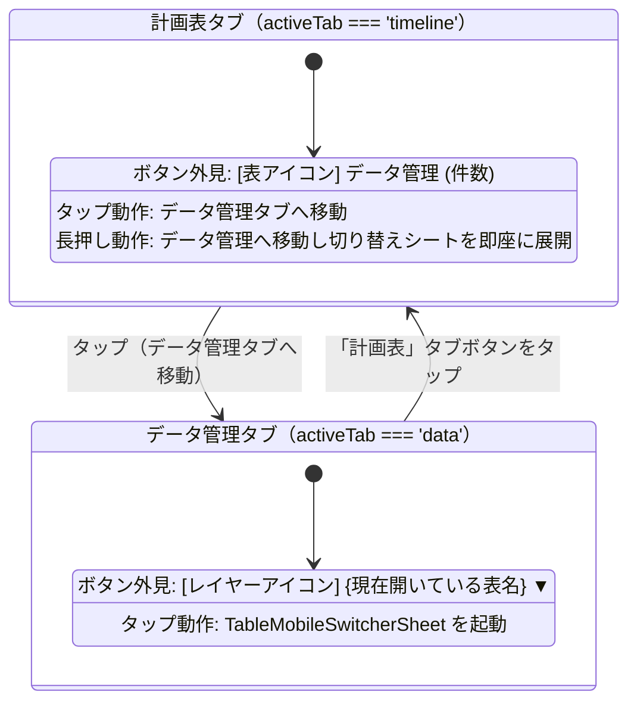

# Plan28: データ管理タブとデータ切り替え機能の融合によるフッター省スペース化および操作性最適化

---

## 1. 目的と概要

### 1.1. 背景
本アプリケーションの最下部フッター（Excel風シート切替バー）では、これまで
1. **「計画表」タブボタン**（タイムライン表示への移動）
2. **「データ管理」タブボタン**（表データ画面への移動）
3. **「データ切り替え」ボタン**（現在選択中の表名 `前期時間割 ▼` を表示し、タップで切り替えシートを開く）
の3つのボタンが横並びで配置されていました。

### 1.2. 課題
- **スマホ画面での横幅圧迫**: 横幅 375px〜390px のスマホ環境において、左側に3つのボタンが並ぶことでボタン幅が過剰に圧迫され、表タイトルが `前期...` のように途中で切れたり、アプリタイトルや右側の「日/週」切替ボタンが窮屈になる問題がありました。
- **操作の非効率性**: すでに「データ管理」タブにいる場合、その「データ管理」タブボタンを押しても何も変化しません。一方で、データ管理タブにいるユーザーが最も行いたい操作は「別の表や固定枠への切り替え」です。

### 1.3. 解決策
「データ管理タブボタン」と「データ切り替えボタン」を**1つの動的融合ボタン**へ統合します。
- **計画表タブにいるとき**: 「データ管理」タブボタンとして振る舞い、タップでデータ管理画面へ移動。
- **データ管理タブにいるとき**: 現在の表名と下矢印（例: `前期時間割 ▼`）に変化し、タップで表切り替えボトムシートを直接起動。

---

## 2. 状態遷移とUI設計

### 2.1. 状態遷移フロー

### 2.2. ボタンの具体的な表示と振る舞い

| 状態（文脈） | アイコン | ボタンラベル | 右端要素 | スタイル | タップ時の動作 |
|:---|:---:|:---|:---:|:---|:---|
| **計画表タブ表示時** (`activeTab === 'timeline'`) | `FileSpreadsheet` | `データ管理` | 登録表の件数バッジ (例: `3`) | 非アクティブ（淡いベージュ） | データ管理タブへ切り替え （長押しで直接切り替えシート起動） |
| **データ管理タブ表示時** (`activeTab === 'data'`) | `Layers` | `{activeDataName}` (例: `前期時間割`) | `ChevronDown` (▼) | アクティブ（白背景・エメラルド上枠線） | 表切り替えボトムシート (`TableMobileSwitcherSheet`) を開く |

---

## 3. 期待される効果

1. **ボタン数の削減と横幅の解放**:
   - フッターのボタン数が **3つ ➔ 2つ（「計画表」と「データ管理/表切替」）** に集約。
   - 横幅の占有率が約35%削減され、表タイトルの文字数制限が緩和され視認性が大幅に向上。
2. **直感的なメンタルモデルの確立**:
   - データ管理タブにいるとき、自分が「どの表を編集しているか」がフッターのタブ自身に明示され、そこをタップすれば別の表に切り替えられるという、段階的開示（Progressive Disclosure）が完成。
3. **最小手数での操作性**:
   - 計画表からはワンタップでデータ管理へ移動可能。
   - データ管理からはワンタップで表切り替えシートを開くことが可能。
   - 計画表から直接別の表を選びたい場合も「長押しショートカット」で直行可能。

---

## 4. 実装計画

1. **`src/components/SheetFooter.tsx` の改修**:
   - 既存の「Sheet 2: データ管理」ボタンと「Sheet 3 / Mobile: データ切り替え」ボタンを1つの `<button>` に統合。
   - `activeTab` に応じた条件分岐（アイコン、ラベル、スタイル、クリック動作）を整理。
   - 長押しタイマー（500ms）を実装し、計画表表示時でも長押しで直接切り替えシートを開けるショートカットを装備。
2. **品質検証**:
   - `npm run typecheck`（TypeScript型検査）
   - `npm run test`（Vitestユニットテスト全件パス確認）
   - `npm run lint`（ESLintチェック）
3. **コミット・プッシュ**:
   - 変更内容を Git コミットし、リモートへ反映。

---

## 5. 実施結果と検証ログ

### 5.1. 実装成果
- [SheetFooter.tsx](file:///c:/Users/kousu/OneDrive/Desktop/creation_1/src/components/SheetFooter.tsx) において、従来の「データ管理」ボタンと「データ切り替え」ボタンを1つの動的融合ボタンへ統合完了。
- **計画表タブ表示時**:
  - `[FileSpreadsheet] データ管理`（非アクティブ色・件数バッジ付き）として表示。
  - 通常タップでデータ管理画面へ遷移。
  - 長押し（500ms、バイブレーション付き）または右クリックで、データ管理タブへの遷移と同時に切り替えボトムシートを直接オープンするショートカットを搭載。
- **データ管理タブ表示時**:
  - `[Layers] {現在開いている表名} ▼`（アクティブなエメラルド色・白背景）として表示。
  - タップで切り替えボトムシート（`TableMobileSwitcherSheet`）を即座に起動。
- フッターのボタン数が 3つ ➔ 2つ に集約され、スマホ幅でも表タイトルが途切れず美しく表示されるレイアウトを実現。

### 5.2. 検証結果
- **Vitest ユニットテスト**: 全208件すべて合格（回帰デグレードなし）
- **TypeScript 型検査**: エラー0件（`tsc --noEmit` 合格）
- **ESLint 静的解析**: エラー・警告0件クリア
