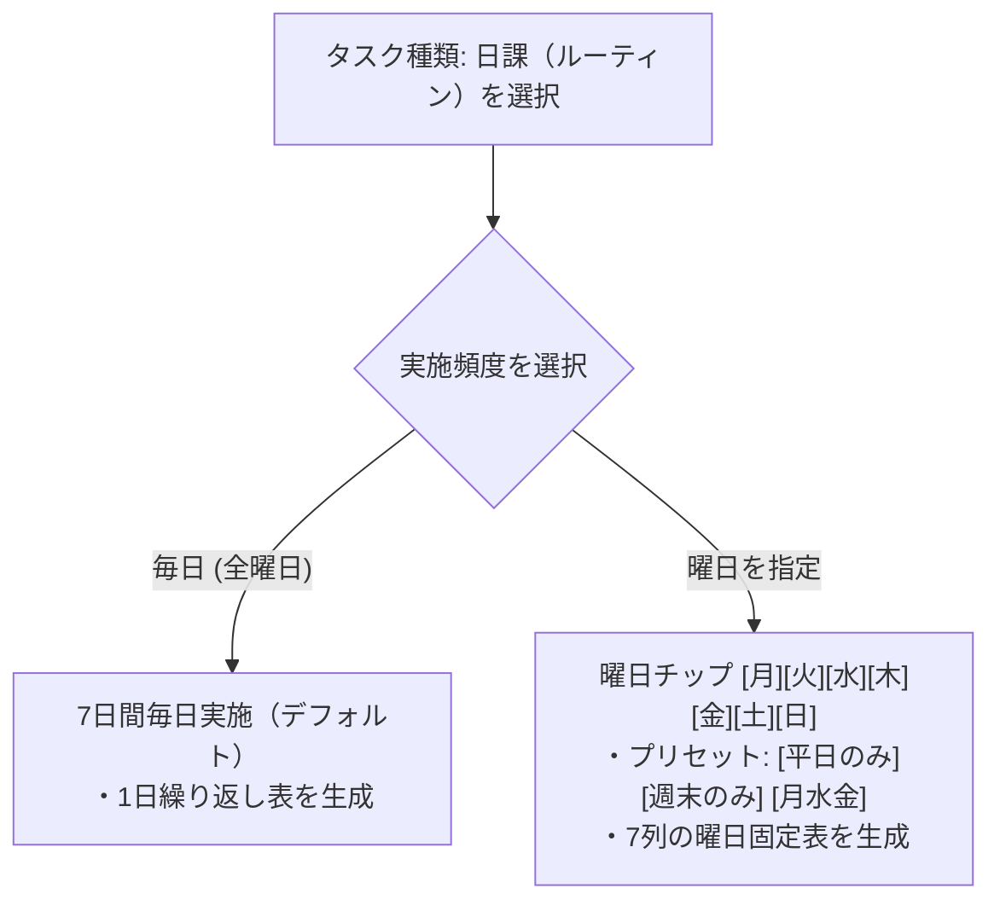
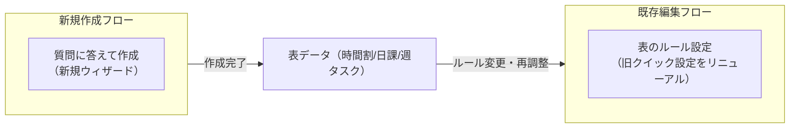

# Plan29: 日課タスクにおける複数日（曜日）選択機能の導入と「クイック設定」の役割再定義

---

## 1. エグゼクティブサマリー

### 1.1. 本ドキュメントの目的
本計画書（Plan29）は、ユーザーから提起された以下の2つの重要な改善論点について、UI/UX・アルゴリズム・データ構造の各観点から包括的に考察し、仕様設計と改善ロードマップを取りまとめたものです。

1. **「質問に答えて予定表を作成」における日課タスクの複数日（曜日）選択機能**:
   - 現状「毎日（1日周期）」固定となっている日課表作成に、固定枠と同様の「実施曜日選択（月〜日）」を導入し、「平日のみの日課」「月水金ルーティン」「週末習慣」などを柔軟に作成可能にする。
2. **「クイック設定」の役割見直しと再定義**:
   - 現状の「クイック設定」という名称や機能境界（新規作成との乖離、設定項目の曖昧さ）を再評価し、「表の基本ルール設定（スケジュールプロパティ編集）」としてメンタルモデルを統合・再構築する。

---

## 2. 論点1: 日課タスクにおける複数日（曜日）選択機能の考察と設計

### 2.1. 現状の制約とユーザーの課題

#### 現状の仕様
- [NewTableWizardModal.tsx](file:///c:/Users/kousu/OneDrive/Desktop/creation_1/src/components/NewTableWizardModal.tsx) では：
  - **固定枠（fixed_slot）**: 曜日選択（月〜日）が可能。
  - **週次タスク（weekly_task）**: 目標回数（週○回）の指定が可能。
  - **日課タスク（daily_task）**: **「毎日（1日周期・毎日繰り返し）」固定**であり、曜日の指定項目が存在しない。

#### 発生している課題
- 「平日の朝だけ読書したい」「月・水・金だけジムに行きたい」「土日だけの副業・学習習慣」といった、**現実世界で最も頻出する曜日限定ルーティン**を「質問から作成」で表現できない。
- 回避策として固定枠を選ぶと、時刻が完全固定（講義のように拘束）されてしまい、空きコマへの柔軟な自動配置という日課タスクの最大のメリットが失われてしまう。

### 2.2. UI設計案: 「毎日」と「曜日選択」の段階的切り替え

日課タスク選択時、活動時間帯の下に「実施日」の設定項目を追加します。

#### UIコンポーネント構成
1. **実施頻度トグル**:
   - `[毎日]`（毎日繰り返し・Day 1）
   - `[曜日を指定]`（特定曜日のみ実施・月〜日）
2. **曜日選択チップ（「曜日を指定」選択時）**:
   - `[月] [火] [水] [木] [金] [土] [日]`（複数選択可能トグル）
   - クイック選択プリセット:
     - `平日のみ（月〜金）`
     - `週末のみ（土・日）`
     - `隔日（月・水・金）`

### 2.3. データ構造およびスケジューラとの整合性

幸いなことに、背後のテーブル生成モジュール [tableTemplates.ts](file:///c:/Users/kousu/OneDrive/Desktop/creation_1/src/lib/templates/tableTemplates.ts) の `createDailyRoutineTable` は、すでに以下の両方のデータ構造を完全サポートしています。

1. **毎日実施の場合**:
   - `columnMode: 'cycle'`, `numCols: 1`, `colHeaders: ['Day 1']`, `cycleStartDay: 0`
   - スケジューラは全曜日（月〜日）に日課タスクとして均等配置。
2. **曜日指定（複数日）の場合**:
   - `columnMode: 'weekday'`, `numCols: 7`, `colHeaders: ['月曜', '火曜', ..., '日曜']`
   - 指定された曜日列のみにセルデータ（タスク）が格納され、非指定曜日のセルは空セル（null）となる。
   - スケジューラは [tableUtils.ts](file:///c:/Users/kousu/OneDrive/Desktop/creation_1/src/lib/tableUtils.ts) により `targetDays: [0, 2, 4]`（月水金）を抽出し、**指定された曜日の空き時間帯にのみタスクを自動配置**する。

したがって、**アルゴリズムやデータ型の変更は一切不要であり、UIの入力フォームと `createDailyRoutineTable` への引数連携のみで完璧に機能**します。

---

## 3. 論点2: 「クイック設定」の役割見直しと再定義

### 3.1. 現状のクイック設定が抱える課題

現在アプリ内には「設定・作成」に関わるモーダルが複数混在しています。

| モーダル | 主な用途 | 課題点 |
|:---|:---|:---|
| **質問から作成** (`NewTableWizardModal`) | 初心者向け新規作成 | 初回作成専用であり、作成済みの表を後から再調整する用途には使えない。 |
| **クイック設定** (`TableQuickSettingsModal`) | 既存表の簡易調整 | 名称が抽象的で「何の設定なのか」が伝わらない。起動導線が狭く存在に気づきにくい。 |
| **テンプレートウィザード** (`TableTemplateWizardModal`) | 雛形からの作成（レガシー） | Plan22の旧遺産であり、「質問から作成」と機能が重複している。 |
| **コマ編集モーダル** (`CellEditModal`) | セル単体の詳細編集 | 局所化が完了し良好に動作しているが、「表全体のルール変更」とは役割が異なる。 |

#### 最大の問題: 「初期作成」と「既存編集」のメンタルモデルの分断
- ユーザーは「質問から作成」で表のルール（時間帯、頻度、分類）を決定して作成します。
- しかし作成後、同じルール（時間帯を夜から朝に変えたい、頻度を週2回から週3回にしたい）を変更しようとすると、「クイック設定」という全く異なるUI・デザインの画面を開かざるを得ず、学習コストと混乱が生じています。

### 3.2. クイック設定の再定義: 「表の基本ルール設定（プロパティ設定）」への昇華

「クイック設定」という曖昧な表現を廃止し、**「表のルール設定（スケジュール設定）」**として再定義します。

#### 再定義される3大責務
1. **スケジュール配置ルールの管理（表全体のプロパティ）**:
   - 表の名前変更
   - 活動時間帯の変更（終日 / 朝 / 昼 / 夜 / カスタム時間帯）
   - 実施曜日の変更（毎日 / 平日のみ / 曜日選択）
   - 目標回数・頻度の変更（週○回 / 1日○回）
2. **「質問から作成」との入力UI・語彙の統一**:
   - 「質問から作成」と同じカード選択式・スライダー式デザインを採用し、直感的な操作感を完全一致させる。
3. **アクセス導線の強化**:
   - 表データ上部のヘッダーに「表のルール設定」ボタンをわかりやすく配置。
   - フッターの融合ボタン（Plan28）の長押しやサブメニューからも即座に呼び出し可能にする。

---

## 4. 実施ロードマップ

### Phase 1: 「質問から作成」における日課タスクの曜日選択UI実装（即時対応）
1. [NewTableWizardModal.tsx](file:///c:/Users/kousu/OneDrive/Desktop/creation_1/src/components/NewTableWizardModal.tsx) に「実施頻度（毎日 / 曜日指定）」トグルと「曜日チップ選択」を追加。
2. プリセットボタン（`平日`、`週末`、`月水金`）を配置。
3. `createDailyRoutineTable` 呼び出し時に `daysCount: 7`, `targetDays: selectedDays` を渡し、曜日指定日課表を自動生成。
4. 単体テストおよび型検査の実施。

### Phase 2: 「クイック設定」のリニューアルと名称・UI統一（次期対応）
1. `TableQuickSettingsModal.tsx` を「表のルール設定」としてリファクタリング。
2. 画面レイアウトを `NewTableWizardModal` の Step 1（基本ルール設定）と同一のデザインコンポーネントへ共通化。
3. 表ヘッダーおよびフッターからの起動導線を整理。

---

## 5. まとめ

- **論点1（日課の曜日選択）**: ユーザーの実生活ルーティン（平日限定、隔日など）に完全適合させるための必須機能であり、既存のスケジューラエンジン資産をそのまま活用して最小工数・高品質で実装可能です。
- **論点2（クイック設定の再定義）**: 新規作成と既存編集のメンタルモデルを1つに統合し、アプリケーション全体の分かりやすさを一段引き上げる重要なUX向上施策です。
