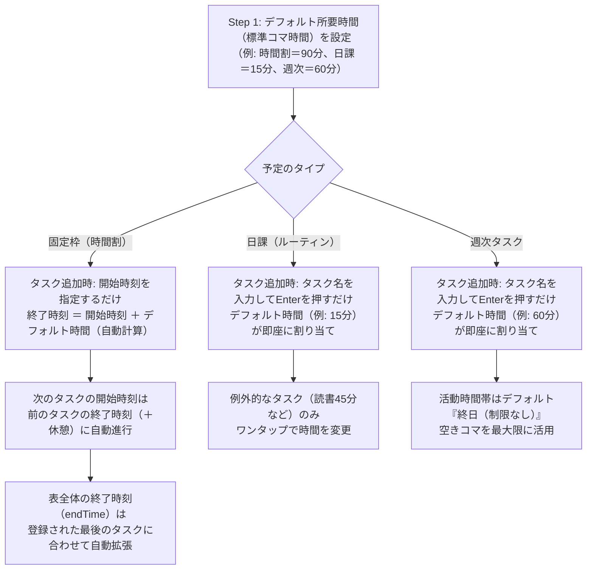

# Plan30: 「質問から作成」と「クイック設定」の完全統合設計書（単一ウィザード化）

---

## 1. エグゼクティブサマリー

### 1.1. 本改修の背景と目的
現在、予定表の作成・設定には以下の2つの独立したモーダルが存在していました。
1. **「質問に答えて予定表を作成」 (`NewTableWizardModal`)**: 新規表を作成するためのステップバイステップ形式の質問ウィザード。
2. **「クイック設定」 (`TableQuickSettingsModal`)**: 既存の表のルール（時間帯、頻度）やタスク所要時間を調整するための設定モーダル（約860行）。

ユーザーからの極めて鋭い指摘（「質問から作成の時現在表に設定されているものも反映できるようにしたら、クイック設定はいらないのでは？」）に基づき、本改修では **「質問から作成」を「新規作成」と「既存編集」の両方に対応する単一の統合ウィザードへ昇華**させます。
これにより、**`TableQuickSettingsModal.tsx` を完全に廃止・統合**し、ユーザー体験の統一とコードベースの大幅なスリム化（約860行の削除）を実現します。

---

## 2. 統合アーキテクチャ設計

### 2.1. メンタルモデルの統一
ユーザーが「新しく表を作る」ときも「既存の表を調整する」ときも、全く同一の入力画面（テーマ/ルール決定 → タスク入力 → 確認・調整）で操作できるようにします。

```
[呼び出し導線]
├─ 「質問から新しく作る」ボタン ───> targetTable: null (新規作成モード)
└─ 「表のルール・タスク設定」   ───> targetTable: activeTable (既存編集モード)
                                           │
                                           ▼
                    ┌─────────────────────────────────────────┐
                    │ NewTableWizardModal (単一統合ウィザード)│
                    │ ・targetTableの有無で初期値・文言を分岐 │
                    │ ・既存表データからのPre-fill（逆算復元）│
                    │ ・Step 3でのタスク所要時間クイック調整  │
                    └─────────────────────────────────────────┘
                                           │
                                           ▼
                    ┌─────────────────────────────────────────┐
                    │ onApplyTable(table)                     │
                    │ ・新規: 新規IDで追加                    │
                    │ ・編集: 既存ID維持で更新                │
                    └─────────────────────────────────────────┘
```

---

## 3. 具体的な実装仕様

### 3.1. `NewTableWizardModal.tsx` のインターフェース拡張
```typescript
interface NewTableWizardModalProps {
  isOpen: boolean;
  onClose: () => void;
  onApplyTable: (newTable: ImportedTableData, isEditMode?: boolean) => void;
  targetTable?: ImportedTableData | null; // ★ 編集対象の既存表（nullなら新規作成）
}
```

### 3.2. 既存表データからの逆算復元（Pre-fill ロジック）
`isOpen` かつ `targetTable` が渡された場合、以下のパラメータを既存表から抽出してステートに流し込みます。

1. **表の名前**: `targetTable.name`
2. **表の分類（`tableType`）**: `getTableClassification(targetTable)`
   - `fixed_slot` → `'fixed'`
   - `daily_task` → `'daily'`
   - `weekly_task` → `'weekly'`
3. **活動時間帯（`timeSlot`）**:
   - `axisConfig.startTime` と `endTime` を照合し、朝（06:00〜12:00）、昼（12:00〜18:00）、夜（18:00〜23:00）、終日（nullまたは00:00〜24:00）を判定。
4. **日課のペース設定（`dailyRepeatPattern`）**:
   - `columnMode === 'cycle'` かつ `numCols === 1`: `'everyday'`（毎日同じ）
   - `columnMode === 'weekday'`: `'weekdays'`（曜日を指定）
     - タスクが存在する列インデックスから `taskTargetDays` を抽出。
   - `columnMode === 'cycle'` かつ `numCols > 1`: `'cycle'`（○日周期で交代）
     - `numCols` を `dailyCycleLength` としてセット。
     - `targetTable.cycleStartDay` を `dailyCycleStartDay` としてセット。
5. **固定枠の設定**:
   - `axisConfig.startTime` / `endTime` を `fixedStartTime` / `fixedEndTime` にセット。
6. **既存タスク一覧（`draftTasks`）の復元**:
   - 表内の全セルからユニークなタスクを抽出。
   - 各タスクのタイトル、所要時間（`customDurationMinutes` または時間差分）、曜日、担当Day（`colIndex`）、週目標回数（`targetWeeklyCount`）を保持した `AddedTaskDraft` の配列を作成し、Step 3 に初期配置。

### 3.3. Step 3（登録タスク一覧）でのクイック所要時間調整
旧クイック設定の利点（所要時間のパパッと調整）を継承するため、Step 3 の各タスクカードに 5分刻みのステッパー（`- 5分` / `+ 5分`）を追加。モーダルを開いたまま一覧で即座に所要時間を調整できるようにします。

### 3.4. 画面タイトル・ボタン文言の切り替え
- **新規作成モード**:
  - タイトル: 「質問に答えて予定表を作成」
  - 完了ボタン: 「表を作成する」
- **既存編集モード**:
  - タイトル: 「表のルール・タスク設定: {表の名前}」
  - 完了ボタン: 「変更を保存して適用」

---

## 4. `ImportedTablesManager.tsx` の改修と旧コード削除

1. **クイック設定ボタンの置き換え**:
   - デスクトップ上部バーおよびモバイル設定ドロワーの「クイック設定」ボタンのラベルを「表のルール設定」に変更。
   - クリック時に `targetTable: activeTable` を渡して `NewTableWizardModal` を開く。
2. **`TableQuickSettingsModal` の完全削除**:
   - `TableQuickSettingsModal.tsx`（約860行）のインポートおよび呼び出しを完全除去。
   - ファイル自体の削除により、二重管理を根絶。

---

## 5. 実施計画

1. **フェーズ 1**: `NewTableWizardModal.tsx` に `targetTable` Pre-fill ロジックと Step 3 所要時間ステッパーを実装。
2. **フェーズ 2**: `ImportedTablesManager.tsx` の呼び出しを統合ウィザードへ切り替え。
3. **フェーズ 3**: `TableQuickSettingsModal.tsx` を安全に廃止・削除。
4. **フェーズ 4**: 型チェック、単体テスト、ビルド検証。

---

## 6. 実施完了レポート

### 6.1. 達成成果のまとめ
- **単一ウィザードへの完全統合**:
  - `NewTableWizardModal.tsx` に `targetTable?: ImportedTableData | null` を追加し、既存表データからの Pre-fill（表名、分類、時間帯、ペース/サイクル、タスク一覧の逆算復元）を実装。
  - 新規作成時（「質問に答えて予定表を作成」）と既存編集時（「表のルール・タスク設定」）でタイトル・説明文・完了ボタンをスマートに切り替え。
  - Step 3（登録タスク一覧）に所要時間クイック調整ステッパー（`-5分` / `+5分`）を新設。モーダルを開いて一覧を見ながらパパッと分数を調整可能に。
- **レガシーコードの完全撤廃**:
  - 不要となった `src/components/TableQuickSettingsModal.tsx`（約864行）を完全に削除。
  - `ImportedTablesManager.tsx` の呼び出しを統合ウィザードへ切り替え、モーダル管理コードをスリム化。
- **品質検証**:
  - `npm run typecheck`: 型エラー 0件。
  - `npm run test`: 全9ファイル 211テスト全件合格。
  - `npm run lint`: ESLint エラー 0件。
  - `npm run build`: Next.js 16 プロダクションビルド正常完了。

### 6.2. 追記: 「新規」と「編集」というモードの完全撤廃（究極の統合）
- **入り口（ボタン）の完全1本化**:
  - デスクトップ上部バーおよびモバイル設定ドロワーに並んでいた2つのボタン（「表のルール設定」と「質問から新規作成」）を廃止し、**「表のルール・タスク設定」**という1つのボタンのみに集約。
- **モーダル内部のシームレス化**:
  - 開いた時点で現在開いている表の内容が展開され、時間帯やペース、タスク分数を直接編集可能。
  - ヘッダーに `[白紙から新しく作る]` ボタンを配置し、ワンタップで白紙状態にクリア可能。
  - Step 1 の分類選択（日課 / 週次 / 固定枠）と「おすすめテーマ雛形から入力」トグルを統合し、新規・編集の区別なく自由に設定を流し込める設計へ統一。
- **出口（保存アクション）での明確な分岐**:
  - `[この表を上書き保存]`（既存IDを維持して更新）
  - `[別名で新しく保存]`（現在の表は残し、新しい予定表として複製追加）
  - 白紙/新規時は `[「{表名}」を作成]`
- **効果**:
  ユーザーが「新規作成か？編集か？」というシステム都合の概念を一切意識することなく、いつでも自然に表を調整・複製・作成できるモダンなドキュメント型UXが完成。

### 6.3. モバイル版ヘッダーの「簡単設定」1本化と呼称統一
- **モバイル上部ヘッダーの統合**:
  - モバイル表示時に「質問から作成」と「設定」の2ボタンが分かれて並んでいた状態を解消し、**「簡単設定」**という単一ボタンへ統合。
- **アプリ全体での呼称統一**:
  - デスクトップ版ツールバー、モバイル上部バー、モバイル設定ドロワー、モーダルタイトルのすべてを「簡単設定」に統一。
  - スマホでもPCでも、迷わず「簡単設定」をタップすれば、現在開いている表のルール調整、タスク分数の変更、白紙からの新規作成、別名保存までが完全に1画面で完結。

---

## 7. Step 1（表の設定）の再構築: テーマ常時選択の復活と活動時間帯の整理統合

### 7.1. 課題の整理
1. **テーマ選択の消失**:
   - 統合過程でテーマ一覧を「おすすめテーマから入力」トグル内に隠してしまい、生活目的（朝ルーティン、夜の習慣、時間割等）からワンタップで予定表を作成・調整する直感性が損なわれていた。
2. **予定タイプの重複表示**:
   - 上部の「スケジュール分類（日課/週次/固定枠）」と、下部の「予定のタイプ（毎日/週◯回/時間固定）」が縦に2回重複して出現し、UIが雑然としていた。
3. **活動時間帯の概念の混同と二重入力**:
   - 日課・週次タスクでは「空きコマを自動配置する範囲（朝/昼/夜/終日）」を設定したいのに対し、固定枠では「タスクそのものが開始・終了時刻を持つ」ため、Step 1 と Step 2 で時刻を2回入力させる二重入力が発生していた。

### 7.2. 再構築仕様
1. **テーマカードの最上部常時表示**:
   - Step 1 の冒頭に 6種類のテーマカード（毎日の習慣、朝のルーティン、夜の生活習慣、授業の時間割、筋トレ分割、試験勉強）を常時配置。
   - タップすると、表名・分類・時間帯・おすすめ予定が一発で連動切り替えされる。
2. **予定タイプの1本化**:
   - 「スケジュール分類（日課 / 週次タスク / 固定枠）」を1箇所に集約し、重複を完全排除。
3. **活動時間帯の役割分担**:
   - **日課・週次タスク**:
     - 空きコマ自動配置の範囲として、「朝 (6-12)」「昼 (12-18)」「夜 (18-23)」「終日」に加え、「指定（カスタム）」チップを配置。
     - 「指定」選択時にはタイムピッカーを表示し、自由な時間範囲（例: 20:00〜23:00、09:30〜17:30）を空きコマ探索枠（`timeRange` / `earliestStartTime`〜`latestEndTime`）として設定可能。
   - **固定枠（時間割）**:
     - 表全体の標準活動時刻枠として開始〜終了時刻を設定。

### 7.3. 週タスクにおける活動時間帯の役割
1. **空きコマ自動配置の探索範囲（配置枠の制約）**:
   - 週タスク（週◯回こなすタスク）は特定の時刻に固定されておらず、スケジューラーが週の予定の中で空いているコマを見つけて自動配置する。
   - 活動時間帯（朝/昼/夜/終日/指定）は、その自動配置を行う**許容時間ウィンドウ（`earliestStartTime` 〜 `latestEndTime`）**を定義する。
   - 例: 「ランニング（週3回）」を【朝】に設定 → 朝の空きコマにのみ自動配置。「ジム（週2回）」を【指定: 19:00〜22:00】に設定 → 夜の指定時間帯の空きコマに自動配置。
2. **タスク作成時の初期入力アシスト**:
   - ウィザードでタスクを追加する際、選択された時間帯に応じた開始時刻がタスク入力欄に初期反映され、入力の手間を省く。

---

## 8. 簡単設定における認知負荷とストレス要因の徹底調査・改善設計

### 8.1. ユーザーからの問題提起（問題の核心）

1. **固定枠における「終了時間」強制設定の不条理**:
   - 本アプリにおける表の「終了時間（`axisConfig.endTime`）」は、「その時刻以降にはタスクを配置しない制限境界（グリッドの最下限）」を意味する。
   - 固定枠（時間割やシフト表、決まった予定）を作成するユーザーは、個別のタスク（授業やコマ）を順次追加していくこと自体が目的であり、表全体の終了時刻は**「登録された最後のタスクの終了時刻」によって自然に決定されるべき**ものである。
   - にもかかわらず、Step 1 で「活動する時間帯: 09:00 〜 10:30」のように開始〜終了の入力を強制されることは、ユーザーのメンタルモデルと激しく乖離し、無意味かつ強い不満・ストレスとなっている。

2. **固定枠タスク（時間割等）入力時の「開始・終了時刻」手動入力の過重負担**:
   - 大学や学校の時間割では、1コマの長さ（例: 90分、100分、50分）は基本的に一定である。
   - にもかかわらず、タスクを1件追加するたびに「開始時刻」と「終了時刻」の2つのタイムピッカーを都度手動で合わせさせられ、暗算で終了時刻を計算・選択させられるのは極めて負担が大きい。
   - さらに、月曜1限と火曜1限のように「同じ時限・同じ時間帯」であっても、毎回時刻ピッカーを操作しなければならず、時間割作成の快適性が著しく損なわれている。

---

### 8.2. 他のタスク分類（日課・週次・サイクル・曜日指定）における同様のストレス要因調査

全分類（日課、週次、サイクル日課、曜日固定日課）における簡単設定ウィザードの挙動を網羅的に点検した結果、以下のストレス要因が判明した。

#### 1. 日課（ルーティン・毎日の習慣）におけるストレス要因
- **(a) 終了時間によるタスク溢れ・切り捨てリスクの不安**:
  - Step 1 で「朝 (6-12)」などを選ぶと、表に `endTime: 12:00` がセットされる。もし朝のルーティンタスクの合計所要時間が枠を超えた場合、カレンダー上でタスクが配置できなくなる・切り捨てられるリスクと不安が生じる。
- **(b) 「所要時間（分）」と「開始時刻指定」の二者択一ジレンマ**:
  - 日課タスクは「所要時間（分）」しか入力できず、完全に空きコマ自動配置任せになる。しかしユーザーによっては「朝7:00から散歩30分」「夜21:00から入浴45分」のように「決まった時刻から始めたいルーティン」が存在する。日課では時刻指定ができず、固定枠に逃げると曜日やコマの管理が煩雑になるという分類の断絶がある。
- **(c) サイクル日課（N日周期）での強制作業日送り**:
  - 3日周期などでタスクを1件追加すると、自動的に次のDay（Day 1 ➔ Day 2）へ進んでしまう（`handleAddTask` 内の挙動）。1つのDayに複数タスク（例: Day 1 に胸トレ30分＋腕トレ20分）を登録したい場合、毎回手動でDay 1ボタンを押し戻さなければならず、連続入力のテンポが削がれる。
- **(d) 曜日指定日課（平日のみ等）での曜日二重選択**:
  - Step 1 で「曜日を指定（例: 平日 月〜金）」と決めたにもかかわらず、Step 2 のタスク入力欄でもまたタスクごとに「月〜日」の曜日ボタンが表示される。表全体の設定とタスク個別の設定が重複しており、ユーザーを迷わせる。

#### 2. 週次タスク（週◯回こなすタスク）におけるストレス要因
- **(a) 「活動する時間帯」の強制による空きコマ配置の阻害**:
  - 週タスクは「週の中で都合の良い空きコマに柔軟にこなす」ためのもの。しかし表全体に「朝 (6-12)」等の時間枠が固定されると、「平日は夜、休日は昼にやりたい」といった柔軟な空きコマ利用が制限され、スケジューラーが空きコマを見つけられなくなる原因となる。
- **(b) タスクごとの「週◯回」のチクチク手動入力**:
  - タスク追加時に毎回 NumberStepper で回数（デフォルト2回）をチクチク調整させられる。よくある回数（週1回、週3回など）のワンタップ選択肢がなく、操作ステップ数が多い。
- **(c) 「所要時間（分）」の毎回手動設定**:
  - 典型的な長さ（30分、60分）のワンタップ選択肢が不足しており、ステッパーでの調整が負担。

#### 3. 共通のUX・認知モデルにおけるストレス要因
- **(a) 内部システム制約（`endTime`）の表層露出**:
  - カレンダー内部の境界値である `endTime` を、ユーザーに「活動時間帯の終了時刻」として必須入力させていること自体が認知の不一致の原因。ユーザーの関心は「いつやるか（タイミング/開始時刻）」と「どれくらいやるか（長さ）」にあり、「何時で打ち切るか」を最初から決めさせられるのは不自然。
- **(b) 登録済みタスクのインライン修正が困難**:
  - リストに追加されたタスクは削除しかできず、時刻や曜日の微調整を行いたい場合に「削除して最初からやり直し」が必要になる（所要時間のクイック増減はあるが、時刻や曜日は編集不可）。

---

### 8.3. 根本的解決に向けた改善アプローチ（設計方針）

| 対象分類 | 現状の課題・ストレス | 改善アプローチ（新設計） |
| :--- | :--- | :--- |
| **固定枠（時間割）** | Step 1 で終了時間の入力を強制される | **Step 1 での終了時刻入力を完全撤廃**。<br>表全体の `endTime` は登録された全固定タスクの `max(endTime)` から自動算出・自動拡張（Auto-Expansion）する。 |
| **固定枠（時間割）** | 各タスクで開始時刻と終了時刻を毎回ピッカー選択させられる | **「終了時刻ピッカー」を廃止**し、**「開始時刻」＋「コマの長さ（90分/60分/50分等）」から終了時刻を自動計算**。<br>さらに**「時限枠（1限、2限、3限...）」プリセット**を用意し、時限を選ぶだけで開始〜終了時刻が自動決定されるモードを導入。 |
| **日課（サイクル）** | 1タスク追加ごとに勝手に次のDayに進んでしまう | **同日への連続追加をデフォルト**とし、ユーザーが明示的に「次のDayへ」進めるか、Dayタブ切り替えで直感的に追加できるようにする。 |
| **日課（曜日指定）** | Step 1 と Step 2 で曜日を二重に選ばされる | **Step 1 で選んだ曜日を表のデフォルトとして自動継承**。<br>個別タスクで例外的に曜日を変えたい場合のみ折りたたみで開く設計に変更。 |
| **週次タスク** | 時間帯の制約による空きコマ制限 | **「終日（時間制限なし）」をデフォルト**とし、特定の時間帯に限定したい場合のみオプトインで時間帯を指定する設計に変更。回数・時間もクイックチップ（週1/2/3回、30/60分）で即決可能にする。 |
| **全分類共通** | 登録済みタスクの修正ができない | 登録済みタスクリスト内のチップ上で、曜日や時刻、回数を**直接クリックしてインライン変更**できる軽量エディタを提供。 |

---

## 9. 「デフォルト所要時間（標準コマ時間）」を基軸とした簡単設定アップデート計画

### 9.1. ユーザーの想定（メンタルモデル）と設定項目の根本的乖離

ユーザーが新しい予定表を作ろうとするとき、頭の中には必ず**「その表全体の基準となる時間リズム」**が存在している。

- **時間割表を作るユーザー**: 「大学の講義だから、基本的に**1コマ90分**のリズムで作る」
- **朝のルーティンを作るユーザー**: 「出勤前の短い行動だから、**1タスク15〜20分**のリズムで作る」
- **週次タスク・自習を作るユーザー**: 「1回のまとまった集中枠だから、**1回60分**のリズムで作る」

しかし現状の簡単設定UIは、この最も本質的な「基本リズム（標準時間）」を聞く項目が存在せず、代わりに以下のような認知のズレを強制している：
1. **全体終了時間の強制**: 「何時に終わるか」という結果にすぎない値を最初に決めさせられる。
2. **都度の二重手動入力**: タスクを1つ入れるたびに、毎回「開始時刻」と「終了時刻」の2つを手動でピッカー選択させられ、暗算で足し算をさせられる。
3. **分数の手動ステッパー操作**: 毎回「20分」「60分」とステッパーをチクチク操作させられる。

**解決の鍵**:
> **Step 1（表の設定）で「デフォルトの所要時間（標準コマ時間）」を1箇所入力させ、それを基準としてすべてのタスク入力・終了時刻・表全体の範囲を完全自動連動させる。**

---

### 9.2. 「デフォルト所要時間」による自動連動メカニズム



---

### 9.3. 各表分類における詳細動作仕様

#### 1. 固定枠（時間割・シフト・決まった予定）
- **Step 1（表の設定）**:
  - **終了時刻入力の撤廃**: 「活動する時間帯（終了）」を完全撤廃。
  - **標準コマ時間（デフォルト所要時間）の入力**:
    - クイックチップ: `[ 50分 (高校) ]` `[ 60分 ]` `[ 90分 (大学) ]` `[ 100分 ]` `[ カスタム ]`
    - デフォルト値: テーマが「授業の時間割」なら `90分`、それ以外なら `60分`。
  - **始業時刻（開始時刻）**: 例 `09:00`（表の最初のタスクの基準時刻）。
- **Step 2（タスク追加）**:
  - **終了時刻ピッカーを完全廃止**: 画面上には「開始時刻」のみ表示。
  - 終了時刻は `開始時刻 + 標準コマ時間` で自動計算され、「09:00 〜 10:30 (90分)」とラベルで自動表示。
  - 1件追加すると、次のタスクの開始時刻は自動的に `10:30`（または設定された休憩時間後）に自動進行するため、**「科目名を入力してEnter」を繰り返すだけで時間割が完成する**。
  - **表全体の終了時刻（`axisConfig.endTime`）の自動拡張**:
    - ユーザーが手動で設定する必要はなく、登録されたタスクの最大終了時刻（例: 5限が18:00終了なら `18:00`）に自動追従する。

#### 2. 日課（毎日のルーティン・習慣）
- **Step 1（表の設定）**:
  - **1習慣の目安時間（デフォルト所要時間）の入力**:
    - クイックチップ: `[ 10分 ]` `[ 15分 ]` `[ 20分 ]` `[ 30分 ]` `[ カスタム ]`
    - デフォルト値: テーマに応じて設定（朝ルーティン＝15分、夜習慣＝20分等）。
- **Step 2（タスク追加）**:
  - タスク入力欄の所要時間フィールドに、Step 1 で設定した目安時間が初期値としてセットされた状態になる。
  - ユーザーは**タスク名を入れてEnterキーを押すだけ**で次々にタスクを追加できる。
  - 読書や長めの運動など、特定のタスクだけ時間を変えたい場合のみ、入力欄のステッパーやチップで変更可能。
  - **サイクル日課のDay送り改善**: タスク追加後に勝手に次のDayへ強制移動させず、同一Day内での連続追加をスムーズに行えるトグル/切り替えUIを提供する。

#### 3. 週次タスク（週◯回の定期タスク）
- **Step 1（表の設定）**:
  - **1回の標準作業時間（デフォルト所要時間）の入力**:
    - クイックチップ: `[ 30分 ]` `[ 45分 ]` `[ 60分 ]` `[ 90分 ]` `[ カスタム ]`
    - デフォルト値: `60分`。
  - **活動時間帯のデフォルトを「終日（制限なし）」に変更**:
    - 「朝」「夜」「指定」は、ユーザーが明確に時間帯を絞り込みたい場合のみ選択するオプトイン方式とする。これにより、空きコマが狭められる事故を根絶する。
- **Step 2（タスク追加）**:
  - 標準所要時間（60分）と標準回数（例: 週2回）が自動セットされているため、タスク名を入力するだけで即追加可能。

---

### 9.4. 段階的実装計画（ロードマップ）

| フェーズ | 実装内容 | ユーザー体験の向上効果 |
| :--- | :--- | :--- |
| **Phase 1: Step 1 へのデフォルト所要時間導入 ＆ 固定枠終了時間の自動追従化** | ・Step 1 に「タスクの標準時間（1コマの長さ）」入力フィールド（ワンタップチップ付き）を新設。<br>・固定枠における Step 1 の「終了時間」手動入力を廃止。<br>・表生成ロジック（`handleBuildTable`）で、固定枠の `endTime` を全タスクの最大終了時刻から自動算出するように改修。 | 固定枠作成時に「何時に終わるか」を強制されるストレスが解消され、表の基本リズムが最初に定義できる。 |
| **Phase 2: Step 2 における終了時刻ピッカー廃止 ＆ コマ時間自動連動** | ・固定枠タスク追加欄から「終了時刻タイムピッカー」を撤廃。<br>・「開始時刻」＋「デフォルト所要時間」による終了時刻の完全自動計算・表示。<br>・追加後のSmart Sequencing（次のタスク開始時刻の自動送り）をコマ時間ベースで正確に連動。 | 暗算や2つのピッカー操作がなくなり、科目名を入れるだけでサクサク時間割が組めるようになる。 |
| **Phase 3: 日課・週次タスクへのデフォルト時間流し込み ＆ サイクル日課の改善** | ・日課・週次タスク追加時に、Step 1 のデフォルト時間を初期値として瞬時セット。<br>・サイクル日課におけるタスク追加時の自動Day送りを廃止し、タブ選択または明示的切り替えへ変更。<br>・週次タスクの活動時間帯デフォルトを「終日（制限なし）」に設定。 | タスク名を入れてEnterを押すだけでリズム良く連続入力でき、サイクル日課の入力ストレスが激減。 |
| **Phase 4: 登録済みタスクのインライン修正エディタ** | ・登録済みタスク一覧の各カード上で、開始時刻や所要時間、曜日をワンクリックで直接変更できるポップアップ/インラインUIを実装。 | 打ち間違いの際に「削除してやり直し」をする必要がなくなる。 |

---

## 10. 分類別詳細設定の拡充（固定枠の休憩時間・付随タスク、週次タスクの目標回数）

### 10.1. 背景と課題認識
簡単設定を「表の設定（枠組み定義）」へスリム化し、アプローチA（代表タスクの初期配置）を採用したことで、ユーザーはモーダルを開いて数十秒で自分の理想的な予定表を立ち上げられるようになった。
その一方で、各分類（固定枠・週次・日課）における「表全体の重要な運用ルール」について、以下の設定漏れ・機能要望が挙げられた:
1. **固定枠におけるコマ間休憩時間（`intervalMinutes`）**:
   - 大学の時間割やシフトでは、1コマ終了後に10分や15分の休憩時間が挟まれるのが一般的である。
   - 従来はハードコード（10分）あるいは設定項目が欠如していたため、表全体の規定休憩時間をユーザーが明示的に設定（0分・5分・10分・15分等）できるようにする必要がある。
2. **固定枠における付随タスク（`attachedTaskConfig`）の連動生成**:
   - 講義や固定予定の後に、復習・レポート課題・準備・移動などの「付随タスク」を連動生成したいというニーズが非常に高い。
   - ツールバーの詳細設定まで行かなくとも、簡単設定モーダル上で「付随タスクを連動生成する（所要時間: 15分/30分/45分/60分等）」をオプトインでワンタップ設定できるようにする。
3. **週次タスクにおける目標回数（`weeklyDefaultCount`）**:
   - ジム、ランニング、レポート課題などの週次タスクは、「週に何回行うか」がスケジューリングにおける最重要パラメータである。
   - 簡単設定モーダル上で「週あたりの目標回数（週1回・週2回・週3回・週4回・週5回等）」を設定できるようにし、代表タスクや今後のタスク生成に反映させる。

### 10.2. UI/UX設計
各分類を選択した際、標準所要時間（コマ時間）の直下に連動して自然に現れるコンテキスト対応UIを導入する。

#### A. 固定枠（`tableType === 'fixed'`）の追加UI
1. **コマ間の休憩時間**:
   - ラベル: `コマ間の休憩時間:`
   - クイック選択チップ: `[ なし(0分) ]` `[ 5分 ]` `[ 10分(標準) ]` `[ 15分 ]` `[ 20分 ]`
   - 連動: `generatedTable.axisConfig.intervalMinutes` に格納。サンプルタスクの開始時刻間隔（`curStartMin = (endMin + intervalMinutes)`）にも反映。
2. **付随タスクの自動連動（オプトイン）**:
   - トグル/チェックボックス: `講義・予定の後に付随タスク（復習・課題等）を連動生成する`
   - ON時の展開フィールド:
     - 付随タスクの所要時間: `[ 15分 ]` `[ 30分 ]` `[ 45分 ]` `[ 60分 ]`
     - 名称テンプレート: `{title} のタスク`（プリセット変更可能: `{title} の課題`, `{title} の復習` など）
   - 連動: `generatedTable.attachedTaskConfig` に格納。

#### B. 週次タスク（`tableType === 'weekly'`）の追加UI
1. **1週間の目標回数（デフォルト回数）**:
   - ラベル: `1週間の目標回数（目安）:`
   - クイック選択チップ: `[ 週1回 ]` `[ 週2回(標準) ]` `[ 週3回 ]` `[ 週4回 ]` `[ 週5回 ]` `[ 毎日(週7回) ]`
   - 連動: 代表サンプルの `weeklyCount` / `targetWeeklyCount` に即座に反映され、スケジューラが週あたりの回数分だけ空きコマに自動配置。

#### C. 日課タスク（`tableType === 'daily'`）
- 既存の「E. 繰り返しのペース（毎日 / 曜日指定 / ○日周期で交代）」を維持。

### 10.3. 実装計画
1. `NewTableWizardModal.tsx` に状態ステートを追加:
   - `fixedIntervalMinutes`: number (初期値: 10)
   - `enableAttachedTask`: boolean (初期値: false, テーマが class_schedule の場合推奨で true またはワンタップでON)
   - `attachedTaskDuration`: number (初期値: 30)
   - `attachedTaskTitleTemplate`: string (初期値: '{title} のタスク')
   - `weeklyTargetCount`: number (初期値: 2)
2. テーマ切り替え時および既存表編集時の初期値同期を実装。
3. 表生成ロジック（`handleBuildTable`）において、`axisConfig.intervalMinutes`、`attachedTaskConfig`、`weeklyCount` を適切に反映。

---

## 11. 表の大きさを決定する「タスク個数（枠数・コマ数）」設定の導入

### 11.1. 背景とユーザー課題
簡単設定において、テーマ選択による代表タスクの自動配置（アプローチA）や、枠組みだけの空の表作成が可能になったが、**「表自体の大きさ（行数、枠の個数、配置するタスクの件数）」をユーザーが事前に決められない**という課題が存在していた。
- 時間割を作成する際、ユーザーの生活によって「1日4コマ」「1日5コマ」「1日6コマ」と枠の大きさが異なる。
- 日課習慣を作成する際も、「まずは3個の習慣から始めたい」「5個のルーティンを登録したい」といった個数の調整が求められる。
- サンプル配置OFF（空の表）の場合でも、最初から指定した枠数（例: 5行分の空きコマ）が存在する表が立ち上がることで、メイン画面で即座にマス目を埋めていく快適な体験が得られる。

### 11.2. 仕様とUI設計
表の分類（固定枠・週次・日課）に応じて、直感的かつ過不足のない「タスク個数・枠数」設定項目を導入する。

#### 1. 固定枠（`tableType === 'fixed'`）: 1日のコマ数（枠の個数）
- **ラベル**: `1日のコマ数（枠の個数）`
- **クイック選択チップ**: `[ 3コマ ]` `[ 4コマ ]` `[ 5コマ(標準) ]` `[ 6コマ ]` `[ 7コマ ]` ＋ `[ NumberStepper ]`
- **連動動作**:
  - `tableTaskCount`（初期値: 4〜5）に応じて、作成される表の行数（時限数）が決定される。
  - 代表サンプル配置時: 指定されたコマ数分だけサンプルを配置し、足りない分は「{N}限」の汎用枠として自動補完される。
  - サンプル配置OFF時: 指定されたコマ数分の空き行が時限順に綺麗に作成される。
  - 表全体の終了時刻（`axisConfig.endTime`）が `開始時刻 + (コマ時間 + 休憩時間) * コマ数 - 休憩時間` で自動計算され、全体スケジュール枠が一目で把握できる。

#### 2. 週次タスク（`tableType === 'weekly'`）: 登録するタスク枠の個数
- **ラベル**: `登録するタスク枠の個数`
- **クイック選択チップ**: `[ 2個 ]` `[ 3個 ]` `[ 4個(標準) ]` `[ 5個 ]` `[ 6個 ]` ＋ `[ NumberStepper ]`
- **連動動作**:
  - 作成される週次タスク表の行数（アイテム枠数）が決定される。
  - サンプル配置時は指定個数分のタスクが初期配置される。

#### 3. 日課（`tableType === 'daily'`）: 登録する習慣・タスク枠の個数
- **ラベル**: `登録する習慣・タスク枠の個数`
- **クイック選択チップ**: `[ 3個 ]` `[ 4個 ]` `[ 5個(標準) ]` `[ 6個 ]` `[ 8個 ]` ＋ `[ NumberStepper ]`
- **連動動作**:
  - 毎日同じ・曜日指定の日課表において、作成される行数が決定される。
  - サイクル日課（cycle）の場合は、サイクル日数（Day数）設定と自然に協調。

### 11.3. 実装手順
1. `NewTableWizardModal.tsx` に `tableTaskCount` ステート（初期値: 4〜5）を追加。
2. テーマ切り替え時（`handleSelectTheme`）にテーマの推奨件数（`theme.suggestions.length` 等）を同期。
3. 既存表編集時（`useEffect`）に既存の `targetTable.numRows` を初期値として読み込み。
4. UIとして「タスクの標準所要時間」の直前または直後に「表の大きさ（コマ数・タスク個数）」選択コンポーネントを配置。
5. `handleBuildTable` において、`tableTaskCount` 件数分のスロット・タスクを正確に生成。

4. 検証（型チェック、ESLint、Vitest、Next.js build）。

---

## 12. 簡単設定の縦一直線レイアウト・日常的問いかけ化・数値完全自由入力設計

### 12.1. 本改修の目的と設計原則
ユーザーからのフィードバックに基づき、簡単設定（`NewTableWizardModal.tsx`）の使い勝手と認知負荷を根本から改善します。

#### 1. 縦一直線（シングルカラム）レイアウトへの統一
- 複雑な2列グリッドや左右に分かれた配置を廃止し、上から下へ自然な視線移動で理解できる「縦一直線のカードスタック構造」に再構築します。

#### 2. 日常的な問いかけへの項目名変更（「課題が出ますか？」など）
- システム都合の硬い名詞（付随タスク、活動時間帯、所要時間、枠数）を全廃し、ユーザーの直感に響く日常的な問いかけに変更します。
  - **付随タスク連動設定** → **「この予定に課題や予習・復習が出ますか？」**
  - **タスクの標準所要時間** → **「1回あたりの作業時間はどのくらいですか？」**
  - **表の大きさ（コマ数 / 枠数）** → **「予定の枠は何個用意しますか？」**
  - **活動する時間帯** → **「どの時間帯に行いますか？」**
  - **コマ間の休憩時間** → **「次の予定までの休み時間は必要ですか？」**
  - **1週間の目標回数** → **「週に何回取り組みますか？」**
  - **繰り返すペース** → **「どんなペースで繰り返しますか？」**

#### 3. 数値入力箇所の完全自由入力化（絶対原則としての学習）
- **学習事項**: 「数値が入る場所は、選択式チップだけに頼るのではなく、ユーザーがキーボードやステッパーで任意の数値を直接入力できるようにする」。
- 以下のすべての数値項目に `NumberStepper`（直接入力＋増減ボタン）をメイン入力として配置し、チップはワンタップ入力補助（サジェスト）とします。
  1. **1回の作業時間**: 直接入力 `[ 30 ] 分` ＋ サジェストチップ
  2. **予定枠の個数**: 直接入力 `[ 4 ] 枠/コマ` ＋ サジェストチップ
  3. **休み時間（休憩）**: 直接入力 `[ 10 ] 分` ＋ サジェストチップ（チップのみだったのを完全自由化）
  4. **課題（付随タスク）の所要時間**: 直接入力 `[ 30 ] 分` ＋ サジェストチップ（チップのみだったのを完全自由化）
  5. **週の目標回数**: 直接入力 `[ 2 ] 回/週` ＋ サジェストチップ（チップのみだったのを完全自由化）


