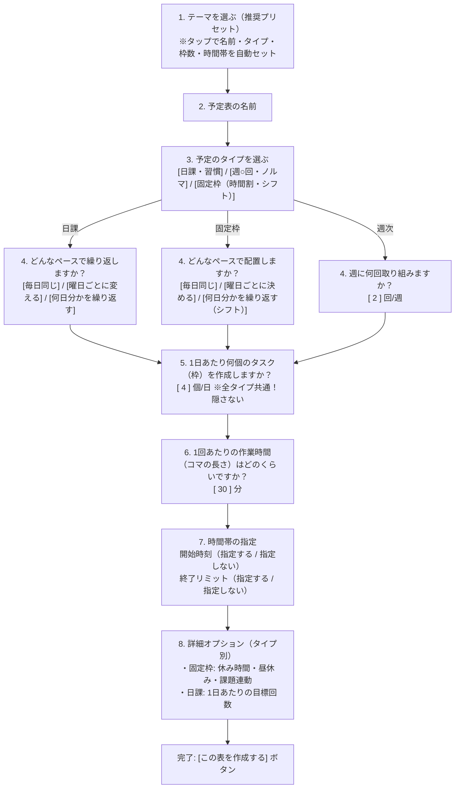

# Plan33: ユーザーニーズに基づく簡単設定の根本的再定義と完全要件定義

## 第1章 改修の背景と「調整が終わらない」根本原因の分析

### 1.1 背景と現状の課題
これまでPlan30、Plan31、Plan32と段階的に機能追加やUIの調整を行ってきましたが、項目を直すたびに「この設定を選ぶと別の設定が隠れてしまう」「複数タスクを登録したいのに1行しか作れない」といった新たな不整合や不便さが表面化し、調整作業が長期化していました。

### 1.2 なぜ調整が終わらなかったのか（根本原因）
1. **設定項目の「場当たり的な結合」**:
   - 本来は「いつ回すか（列・周期）」と「1日に何個やるか（行・タスク数）」は完全に直交した独立のパラメータであるにもかかわらず、「サイクルを選んだら行数入力を隠す」といった実装側の都合（初期テンプレートが1行固定だったこと）をユーザーUIに押し付けていた。
2. **利用シナリオ（ペルソナ・生活実態）の想定不足**:
   - 「3日周期で筋トレをするが、各日には胸トレ・肩トレなど3〜4種目ある」というごく一般的な利用シーンを想定せず、「サイクル＝1日1メニューのローテーション」と思い込んでいた。
   - その結果、ウィザードで作った後にユーザーがメイン画面で何度も「行追加」を押すことを強いられていた。
3. **質問の因果関係と優先度の不整合**:
   - ユーザーが「何を決めたいのか」という自然な思考順序（目的 → 周期 → 1日の枠数 → 時間帯や所要時間）に整理されておらず、質問が細分化・増殖して認知負荷が高まっていた。

---

## 第2章 ユーザーペルソナと具体的ユースケースの徹底定義

ユーザーがこのアプリでスケジュール表を作成するリアルな生活シーンを網羅的に定義します。

### ペルソナA: 部位分割トレーニング・ローテーション日課ユーザー
- **利用例**: 3分割筋トレ（Day 1: 胸・三頭、Day 2: 背中・二頭、Day 3: 脚・腹筋、Day 4: 休養）
- **ユーザーの要求**:
  - 週の曜日（月曜など）に関係なく、起点日（今日から等）から一定の周期で回り続けてほしい。
  - **重要**: 1日の中に**3〜5個の種目（タスク）**を登録したい（例: ベンチプレス20分、ダンベルフライ15分、ディップス15分）。
  - カレンダーの週跨ぎ（日曜から月曜）でDay 1にリセットされては困る。

### ペルソナB: 大学生・専門学校生（時間割＋課題）
- **利用例**: 大学の講義時間割（月〜金の平日5日間、1日4〜5コマ受講）
- **ユーザーの要求**:
  - 土日は大学がないので表に不要（月〜金の5列だけ表示したい）。
  - 1コマ90分、休憩10分、昼休み50分という明確な枠組み。
  - 各講義のあとに「課題・復習」を空き時間に自動配置させたい。

### ペルソナC: 朝・夜の生活ルーティンユーザー
- **利用例**: 朝の支度（朝食、洗顔、ストレッチ、読書）や夜のルーティン（夕食、入浴、手帳、読書）
- **ユーザーの要求**:
  - 毎日同じ内容を実行する（1日分を毎日くり返し）。
  - 1日の中に4〜5個のタスクが順番に並ぶ。
  - 朝なら「07:00〜09:00」、夜なら「19:00〜22:00」といった時間帯の枠内で空き時間に自動配置したい。

### ペルソナD: 資格試験・週次ノルマユーザー
- **利用例**: 資格試験対策、部屋の掃除、週次ジム通い
- **ユーザーの要求**:
  - 特定の曜日に縛られず、「週に2回」「週に3回」空いている時間にこなしたい。
  - 1回あたり45分〜60分。

---

## 第3章 表のデータ構造における「直交性」の再定義

あらゆるスケジュール表は、以下の**2つの独立した軸（直交2軸）**で構成されます。日課だけでなく、**固定枠（時間割・シフト）においても全く同じ3つの横軸パターンが成立**します。

```
                    【横軸: いつ・どんなサイクルで実行するか（列: Columns）】
                    ・毎日同じ（1列くり返し: 睡眠・食事・毎日の習慣・基本シフト）
                    ・曜日指定（月〜金、土日など選んだ曜日の列数: 大学時間割・特定曜日の日課）
                    ・サイクル（3日分、4日分、6日分などの列数 ＋ 起点日: 分割筋トレ・交代制シフト）
                    
       ┌───────────┬───────────┬───────────┬───────────┐
       │ 列 1      │ 列 2      │ 列 3      │ ...       │
┌──────┼───────────┼───────────┼───────────┼───────────┤
│ 行 1 │ タスク 1  │ タスク 1  │ タスク 1  │           │  【縦軸: 1日に何個やるか
├──────┼───────────┼───────────┼───────────┤           │   （行: Rows）】
│ 行 2 │ タスク 2  │ タスク 2  │ タスク 2  │           │  ・1個 〜 12個
├──────┼───────────┼───────────┼───────────┤           │  （日課、時間割、
│ 行 3 │ タスク 3  │ タスク 3  │ タスク 3  │           │   サイクル問わず均等に指定可能）
└──────┴───────────┴───────────┴───────────┴───────────┘
```

### 直交性と固定枠の自由化の原則
1. **固定枠における曜日固定強制の完全撤廃**:
   - 固定枠＝大学の講義時間割（月〜金）という固定観念を排し、固定枠にも**「毎日同じ（1日分）」「曜日指定（任意曜日）」「何日分かを繰り返す（シフト・ローテーション）」**の3つの選択肢を日課と完全に対称に提供する。
   - 例: 4勤2休の工場勤務・交代制シフト（6日サイクル固定枠）、看護師・介護士の日勤・夜勤・明け・休（4日サイクル固定枠）、毎日の睡眠・食事枠（1日分を毎日くり返し）。
2. **横軸（列パターン）の選択によって、縦軸（行数）の選択を隠してはならない**:
   - 毎日日課でも、曜日別日課でも、サイクル日課でも、固定枠時間割でも、**「1日に何個の枠を設けるか」は常に指定可能**である。
3. **サイクル日課・サイクル固定枠の複数行×複数列の完全サポート**:
   - 例: 「3日分」×「1日3個」を指定した場合、**3行×3列**の表が作成される。
   - Day 1列にはタスク枠が3行、Day 2列にも3行、Day 3列にも3行生成される。

---

## 第4章 簡単設定（ウィザード）の洗練された質問フロー設計

ユーザーを迷わせず、最短で希望通りの表を作成するための「一本道・直感型」フローです。



### フローのポイント
1. **「1日あたり何個のタスクを作成しますか？」を全タイプ共通の主要ステップとして固定**:
   - サイクルであっても固定枠であっても日課であっても、常に「1日に何枠作るか」を自然に決められます。
2. **無駄な枝分かれの削減**:
   - 質問の順序を「表の骨格（タイプ・周期・枠数）」→「時間の長さ」→「配置時間帯」→「詳細オプション」と大から小へ流れるように整理します。

---

## 第5章 具体的な機能要件定義

### 要件1: サイクル日課の複数行テーブル生成（`mode === 'cycle_rotation'` の拡張）
- **仕様**:
  - `tableType === 'daily'` かつ `dailyRepeatPattern === 'cycle'` の場合、指定された `dailyCycleLength`（列数 N）と `tableTaskCount`（行数 M）から、**M行 × N列** のテーブルを生成する。
  - 各行 `r (0..M-1)`、各列 `c (0..N-1)` のセル:
    - `dayIndex: c`
    - `periodIndex: r + 1`
    - サンプルタスクがある場合:
      - テーマの `suggestions` を順番に割り当て（`suggestions[r * N + c]` または `suggestions[c]` 等を適切に分散）。
      - サンプルなしの場合は空セルまたは「Day {c+1} タスク {r+1}」。
- **スケジューラー配置**:
  - Day c に該当する日付において、その列のすべての行（M個のタスク）がタイムラインの空き時間に自動配置される。

### 要件2: 固定枠（時間割・シフト）の3パターン（毎日同じ / 曜日指定 / サイクル・シフト）の完全生成とタイムライン配置
- **仕様**:
  - 固定枠においても日課と同様に3つの繰り返しパターンをサポートする。
  - **パターンA（毎日同じ）**:
    - 1日分（Day 1）× Mコマのテーブル（`numCols: 1, colHeaders: ['Day 1'], columnMode: 'cycle', placementMode: 'fixed'`）。
    - タイムラインへの反映: 毎日（全曜日）に該当コマが配置される。
  - **パターンB（曜日ごとに決める）**:
    - 選択された曜日（例: 月〜金の5列）× Mコマのテーブル（`numCols: fixedTargetDays.length, colHeaders: ['月曜', '火曜'...], columnMode: 'weekday', placementMode: 'fixed'`）。
    - タイムラインへの反映: 選択された曜日のみ固定配置され、選択外の曜日は空く。
  - **パターンC（何日分かを繰り返す・シフト）**:
    - N日分（例: 4勤2休なら6日分、看護シフトなら4日分）× Mコマのテーブル（`numCols: N, colHeaders: ['Day 1', 'Day 2'...], columnMode: 'cycle', placementMode: 'fixed', cycleStartDate`）。
    - タイムラインへの反映: 起点日からの実日付差分に基づき、該当日のDay番号に合致するコマがタイムライン上に固定配置される。

### 要件3: 起点日（`cycleStartDate`）の明示と安全なデフォルト
- **仕様**:
  - サイクル日課およびサイクル固定枠の場合、起点日を必ず保持（デフォルトは「当日」）。
  - クイックボタン:「今日から」「明日から」「来週月曜から」。
  - 日付入力ピッカー（`<input type="date" />`）で任意の日付を指定可能。

### 要件4: 設定編集（上書き更新）時の安全なデータ保持
- **仕様**:
  - 既存表を編集する場合、ユーザーが枠数（行数）を増やした場合は不足分の行を追加し、減らした場合は既存タスクを失わないよう確認または適切に保持する。
  - 既存の入力済みタスク名やカスタム時間は絶対に破損させない。

---

## 第6章 既存機能・スケジューラー・テストの後方互換性設計

1. **既存データの保護**:
   - 既に作成されている 1行×N列 のサイクル表や、7列固定のレガシー表は、何も手を加えずそのまま正常に動作し続ける（マイグレーション不要）。
2. **スケジューラーの互換性**:
   - Plan32で実装した `isDayMatchingCycle`（実日付差分判定 ＆ レガシーフォールバック）がすでにM行×N列に対応しているため、スケジューラー本体のロジック変更は不要。
3. **テストスイートの全通過**:
   - 既存の219件の単体テストを1件も壊さず、新仕様（複数行サイクル表の生成）に対するテストを追加する。

---

## 第7章 実装ステップと検証計画

### ステップ 1: テンプレート生成関数の複数行対応
- `src/lib/templates/tableTemplates.ts` の `createDailyRoutineTable` において、`mode === 'cycle_rotation'` の複数行（`numRows > 1`）対応を実装。

### ステップ 2: 簡単設定ウィザード（`NewTableWizardModal.tsx`）のUIと生成ロジック改修
- 「1日あたり何個のタスクを登録しますか？」の非表示ガード（`!(tableType === 'daily' && dailyRepeatPattern === 'cycle')`）を撤廃し、全タイプ共通で表示。
- サイクル日課生成時に `numRows = tableTaskCount` を引き渡し、M行×N列の表を生成。
- 質問の番号とラベルを整理し、自然なステップ順に統一。

### ステップ 3: 単体テストの追加と全体検証
- `createDailyRoutineTable` で M行×N列 のサイクル表が正しく生成されることのテストを追加。
- `npm run typecheck`, `npm test`（全パス確認）, `npm run lint`, `npx next build --webpack`。

### ステップ 4: コミットとプッシュ
- ドキュメントおよび実装コードをコミットし、プッシュを完了する。
