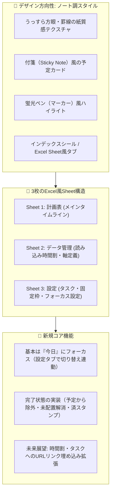
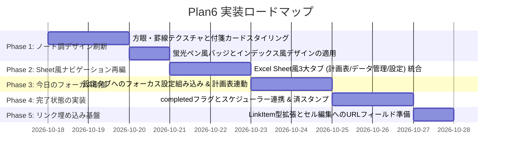

# 「理論値計画表」デザイン刷新＆新機能拡張 実装計画書（Plan6）

ユーザー要望：「デザインの方向性と、追加したい機能をまとめるPlan6.mdを作成したいです」

---

## 1. 概要とコンセプト

本計画（Plan6）は、これまでに構築した強固な時間割解析エンジン・理論値スケジューリング基盤をもとに、**「誰にでも馴染みあるノート調デザイン」**への刷新と、**「Excelシート風ナビゲーション」「今日のフォーカス制御」「タスク完了状態の実装」「未来のリンク埋め込み拡張」**を中心とした機能拡張を体系的に定義するものです。



---

## 2. デザインの方向性：誰にでも馴染みある「ノート調スタイル」

誰にとっても親しみ深く、直感的に使いやすい**「リアル＆実用的なキャンパス/手帳ノート風」**の世界観を採用します。

| デザイン要素       | 実装・ビジュアル仕様                                                                                                                      | ユーザー体験（UX）への効果                                             |
| :----------------- | :---------------------------------------------------------------------------------------------------------------------------------------- | :--------------------------------------------------------------------- |
| **ベース背景**     | アイボリー（`#fdfcf7` 等）の紙質感 ＋ うっすら方眼（5mmグリッド風の薄い水色/グレーの微細罫線）                                            | 無機質なアプリ感が消え、実際のノートを開いたような安心感・集中感を提供 |
| **予定ブロック**   | **付箋（Sticky Note）風カード**<br>・角丸＋かすかな自然なドロップシャドウ<br>・左端のカラーストリップ（固定枠・講義・目標・課題の色分け） | 手帳に付箋をペタペタ貼ってスケジュールを組み立てる直感性               |
| **ハイライト**     | **蛍光ペン（マーカー）風アクセント**<br>・「期日」「今日」「未配置」などに蛍光イエロー/ピンク/シアンのマーカー調下線・バッジ              | 重要な予定や締切が一瞬で目に飛び込む実用性                             |
| **ナビゲーション** | **手帳インデックス ＆ Excel Sheet風タブ**<br>・下部または上部に並ぶ立体感のあるインデックスシール調のタブ                                 | 複数画面の行き来が「ノートのタブをめくる」感覚で迷わない               |
| **タイポグラフィ** | スッキリしたゴシック・丸ゴシック ＋ 数値や時刻に等幅フォント（Mono）                                                                      | 手帳の万年筆やボールペンのような視認性と読みやすさ                     |

---

## 3. ナビゲーション構造：ExcelのSheet風 3大タブ構成

画面遷移をシンプルかつ強力に整理するため、アプリの最上部（または最下部）に**Excelのシート（Sheet）のように並ぶ3枚のタブ**に絞り込みます。

```
┌────────────────────────────────────────────────────────┐
│ [ Sheet 1: 計画表 ]  [ Sheet 2: データ管理 ]  [ Sheet 3: 設定 ] │
└────────────────────────────────────────────────────────┘
```

### Sheet 1: 「計画表」（メインタイムライン）

- 週間 24時間マス目スケジュール（Timeline24h）
- 今日のフォーカス表示（本日カラムの強調・現在時刻インジケーター）
- マスの高さ調整（60px / 84px / 110px）
- 完了した予定の「済」スタンプ・取り消し線表示

### Sheet 2: 「データ管理」（時間割表・軸定義）

- 時間割画像 / ファイル取込モーダルとの連携
- 「読み込みデータ」一覧（複数テーブルの保存・切り替え・名称変更）
- 横軸（列の曜日マッピング）定義
- 縦軸（始業時間・1コマ分数・コマ間インターバル・昼休み）の一括設定 ＋ 個別微調整
- グリッドプレビュー ＆ セル編集
- 「計画表に反映する」実行（講義固定枠の置換/追加 ＋ 課題タスク自動生成）

### Sheet 3: 「設定」（目標・固定枠 ＆ フォーカス設定）

- **日課・週次目標タスクスタック**: Must（やらなければいけないこと）/ Want（やりたいこと）の管理
- **生活固定枠スタック**: 睡眠・勤務・食事・ルーティンの時間設定
- **フォーカス制御パネル**:
  - デフォルト表示モード（「今日フォーカス」推奨 / 「週間全体」）
  - 表示対象の切り替え（「今日」/「明日」/「平日全体」/「週末」/「全7日間」）
- **データ管理・同期**: Supabaseクラウド同期・バックアップ

---

## 4. 追加機能の詳細設計

### 4.1. 「今日へのフォーカス」機能（設定タブと連動）

#### 背景・目的

学生や社会人は日々の生活の中で「まず今日何をすればいいか」を一番に確認したい。全体を毎回俯瞰するよりも、**開いた瞬間は基本「今日」にフォーカスがあたり**、必要に応じて全体を見渡せるのが最もストレスのない運用となる。

#### 仕様

1. **初期フォーカス**:
   - アプリ起動時、当日の曜日（月〜日）が自動判定され、計画表の「今日」カラムが中心にハイライト（フォーカス）される。
   - 現在時刻ラインがリアルタイムで表示され、現在時刻の前後へスムーズにスクロール。
2. **フォーカス設定（Sheet 3: 設定）**:
   - 設定タブ内に「表示フォーカス設定」セクションを新設。
   - 選択肢：
     - `今日にフォーカス`（デフォルト・推奨）
     - `週間全体を均等表示`
     - `平日のみにフォーカス (月〜金)`
     - `特定曜日指定`
3. **計画表（Sheet 1）でのクイック切り替え**:
   - 計画表の上部ツールバーにも、「今日のみ拡大 ⇄ 週間全体」を1タップで行き来できるトグルボタンを設置。

---

### 4.2. 「完了状態（Done）」の実装

#### 背景・目的

「レポートを提出した」「勉強タスクをこなした」際、いつまでも「未配置」や「予定枠」として残り続けるとノイズになり、次の理論値計算の邪魔になる。完了状態にすることで、**予定から除外され、未配置警告も解消し、達成感を視覚的に得る**。

#### 仕様

1. **データモデル拡張 (`src/types/index.ts`)**:
   ```typescript
   export interface TaskItem {
     // ... 既存プロパティ
     completed: boolean; // 完了フラグ
     completedAt?: string; // 完了日時 (ISO)
   }
   ```
2. **スケジューラー連携 (`src/lib/scheduler.ts`)**:
   - `completed === true` のタスクは、**理論値自動配置の対象から自動除外**。
   - これにより、完了したタスクは予定枠を消費せず、未配置タスク（`unassignedTasks`）の警告カウントからも自動で除外される。
3. **ノート調の完了ビジュアル演出**:
   - タスクカードや計画表ブロックにチェックを入れると：
     - 赤ペン風の「済」「CHECKED」手帳スタンプがポンと押される演出。
     - タイトルにうっすら赤ペンの取り消し線（Strikethrough）が入る。
4. **表示切り替え**:
   - 「完了したタスクを表示 / 隠す」フィルター機能。

---

### 4.3. 未来への展望：時間割・タスクへのURLリンク埋め込み拡張

#### 背景・目的

オンライン授業や大学ポータル、学習リソースが日常化している現在、時間割のコマをクリックするだけで講義のZoomやシラバス、課題提出ページに直接飛べるようにしたい。

#### 仕様（先行データ設計）

1. **データモデルへのリンク保持 (`GridCell`, `FixedSlot`, `TaskItem`)**:
   ```typescript
   export interface LinkItem {
     label: string; // 例: "Zoom講義", "シラバス", "課題提出Box"
     url: string;   // 例: "https://zoom.us/j/..."
   }

   // GridCell / FixedSlot / TaskItem に以下を追加
   links?: LinkItem[];
   ```
2. **UI展開（将来のステップ）**:
   - セル編集モーダルに「関連リンク追加（URLと表示名）」フィールドを用意。
   - 計画表ブロックのホバーまたはクリックで「🔗 Zoomを開く」「🔗 シラバス」ボタンがポップアップし、1クリックでアクセス可能に。

---

## 5. 実装ロードマップ



---

## 6. 品質・テスト計画

- **自動テストハーネス (`Vitest`)**:
  - `completed: true` のタスクが理論値スケジューラーの配置対象から除外されることの検証。
  - フォーカス切り替え時の日付・曜日抽出ロジックの検証。
  - リンクデータの永続化・シリアライズ検証。
- **品質チェック**:
  - `npm run typecheck`（型整合性）
  - `npm run lint`（ESLint ルール検証）
  - `npm run format`（Prettier スタイル遵守）
  - `npm run build`（Next.js Turbopack プロダクションビルド検証）
