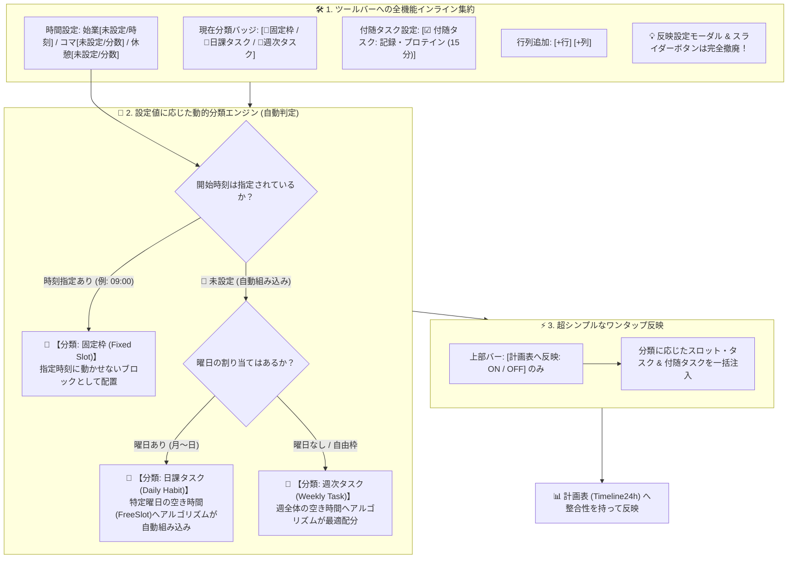
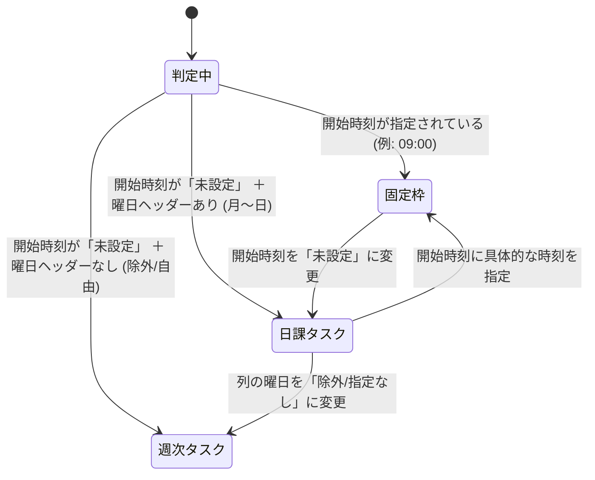
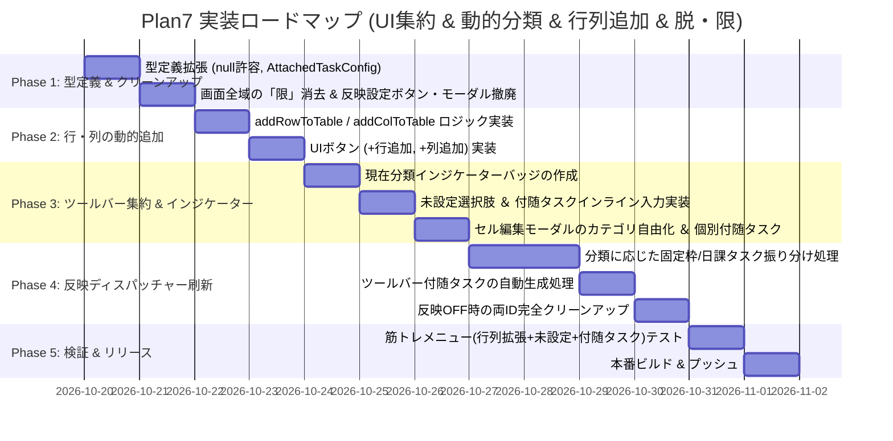

# 表データの柔軟化 ＆ 「未設定」による動的分類システム 実装計画書（Plan7）

ユーザー要望：
> 「アルゴリズム委任モードの追加というより、開始時刻などに未設定という選択肢を設け、それに伴ってより分類が変化する感じです。現在どの分類なのかを表すものも必要になるかと思います。これも踏まえてもう一度更新してください。」
> 「ついでに、行の追加、列の追加も行えるようにしてほしいです。行名は限である必要がなくなるので減（限）の文字は消去してください」
> 「ツールバーの中に、付随タスクの項目を組み込むと思うので、オンオフトグルの右側の反映の設定ボタンはなくしてしまっていいと思います」

---

## 1. 概要とコンセプト

本計画（Plan7）は、表データ（取り込み表や独自マトリクス）を大学講義専用の時間割から解放し、**筋トレメニュー、日課習慣、週次タスク、生活リズムなどあらゆる週間計画を直感的に組み立てる汎用表エンジン（Universal Matrix Engine）**へと進化させるための設計・実装計画書です。

### 4大改善ピラー
1. **設定値に伴う「動的分類システム」**:
   - モード切替を新設するのではなく、開始時刻・コマ長・休憩に「**未設定（自動 / おまかせ）**」の選択肢を導入。
   - 時刻指定ありなら **`📌 固定枠`**、未設定なら **`🏃 日課タスク`** または **`🎯 週次タスク`** へ、計画表上での扱いが自動決定・動的変化。
   - ツールバー上に**現在分類インジケーター（ステータスバッジ）**を常時表示。
2. **表の自由度拡張（行・列の動的追加 ＆ 脱・「限」）**:
   - 表サイズをいつでも増やせる「**➕ 行を追加**」「**➕ 列を追加**」機能。
   - 時間割特有の「限」の文字を全廃し、シンプルな行番号（`1`, `2`, `3`...）や「#」へ刷新。
3. **付随タスク（課題・記録・準備）のカテゴリ自由化**:
   - 授業限定を撤廃し、筋トレ（プロテイン・記録）、バイト（前日準備）、講義（レポート）など全カテゴリで付随タスクを連動。
4. **UIの極限スリム化（反映設定ボタンの廃止 ＆ ツールバーへのインライン統合）**:
   - ツールバー内に付随タスク設定を直接組み込むことで、**トグル右側の「反映設定ボタン（スライダーアイコン）」および複雑な反映モーダルを完全に廃止**。
   - ワンストップでツールバーからすべての設定が完結するExcelライクな操作感を実現。



---

## 2. UIの極限スリム化：反映設定ボタンの廃止 ＆ ツールバー集約

### 2.1. 上部バーから「反映設定ボタン」を撤廃
現在、ブレッドクラムバーの右側に配置されている「反映設定ボタン（`Sliders` アイコン、`setIsApplyModalOpen(true)`）」およびポップアップモーダルを**完全に撤廃**します。

- **従来のUI**:
  - `[計画表へ反映: ON/OFF]` ＋ `[⚙️ 反映設定ボタン]` → モーダルを開いて課題の分数や反映モードを選択
- **新しいUI**:
  - `[計画表へ反映: ON/OFF]` のみ！
  - 課題や付随タスクの生成設定は、すべてメイン画面のツールバーにインラインで常時表示されているため、モーダルを開く無駄なクリック数が「0」になります。

### 2.2. ツールバーへの付随タスク設定の組み込み
ツールバーの中に、表全体のデフォルトとなる**付随タスク設定項目**をスマートに収めます。

```
┌──────────────────────────────────────────────────────────────────────────────────────────────────────────────────────────────────────┐
│ [分類: 🏃 日課タスク ▼] │ 始業: [未設定 ▼] コマ: [未設定 ▼] 休憩: [未設定 ▼] │ ☑ 付随タスク: [{title}の記録 ▼] [15分 ▼] │ [+行] [+列] │ [3×5] │
└──────────────────────────────────────────────────────────────────────────────────────────────────────────────────────────────────────┘
```

- **付随タスクのチェックボックス**:
  - チェックONで、表内の全コマに対して付随タスクが連動生成される。
- **タスク内容テンプレート**:
  - プルダウンで `{title} の記録・確認`, `{title} の課題レポート`, `{title} の準備` などを選べるほか、自由入力も可能。
- **所要時間セレクタ**:
  - `10分`, `15分`, `30分`, `60分` などからワンクリックで選択可能。
- **セルごとの個別微調整**:
  - 特定のセルだけ付随タスクを個別にオフにしたり時間を変えたい場合は、セル編集モーダルから個別に上書き可能。

---

## 3. 表の自由度拡張：行・列の追加 ＆ 脱・「限」の文字

### 3.1. 行の追加・削除（Row Add / Remove）
- **追加ボタンの配置**:
  - テーブルの最下行フッターに「**`+ 行を追加`**」破線ボタンを配置。
  - コンパクトツールバー内にも「**`+ 行`**」クイックボタンを配置。
- **動作仕様**:
  - クリックすると末尾に新しい行（空セルで初期化）が1行追加され、`numRows` が `+1` される。
  - 時刻設定がある場合、前行の終了時刻＋休憩時間をもとに次行の開始時刻・終了時刻が自動算出される。
  - 末尾の空行を削除できる「`- 行を削除`」も提供。

### 3.2. 列の追加・削除（Column Add / Remove）
- **追加ボタンの配置**:
  - テーブルの右端ヘッダーに「**`+ 列を追加`**」破線ヘッダーを配置。
  - コンパクトツールバー内にも「**`+ 列`**」クイックボタンを配置。
- **動作仕様**:
  - クリックすると右端に新しい列が追加され、`numCols` が `+1` される。
  - 列ヘッダーのデフォルトは、既存の列に続いて次の曜日（例: 金曜の次なら土曜、日曜の次なら「指定なし/カスタム」）が自動補完される。
  - 全行に新しい空セルが自動追加される。

### 3.3. 「限」の文字の完全消去と汎用ラベリングへの移行
時間割特有の「限」の文字を画面のすべての箇所から消去し、筋トレや日課メニューでも違和感のない汎用的な表示に改修します。

| 画面箇所 | 従来の表記（時間割前提） | 新しい表記（Plan7 汎用表記） | 備考 |
| :--- | :--- | :--- | :--- |
| **行見出し (Row Header)** | `1限`, `2限`, `3限`... | **`1`**, **`2`**, **`3`**... | 太字のシンプルな行番号 ＋ 時間帯（開始時刻がある場合のみ） |
| **コーナーヘッダー (左上角)** | `時限` | **`#`** または **`No.`** | Excelのようなシンプルなインデックス |
| **ツールバーの始業時間** | `1限始業:` | **`始業:`** | 汎用的な時間設定ラベル |
| **昼休み設定** | `2限後`, `3限後` | **`2行後`** (または **`2コマ後`**) | 任意の表構成にマッチする自然な表現 |
| **時間微調整ボタン** | `時限微調整` | **`時間微調整`** | 行ごとの個別調整であることを直感的に表現 |
| **セル編集モーダル** | `(1限・月曜)` | **`(1・月曜)`** | シンプルで中立的な位置表記 |

---

## 4. コア設計思想：設定値に伴う「動的分類システム」

### 4.1. 「未設定」という自然なパラメータ選択
ユーザーに「固定枠モードにしますか？委任モードにしますか？」といった抽象的な概念を選択させるのではなく、ツールバーの各設定項目に**「未設定」**という直感的な選択肢を用意します。

| 設定項目 | 選択可能な値 | 「未設定」を選んだ時の振る舞い |
| :--- | :--- | :--- |
| **開始時刻 (startTime)** | `09:00`, `08:50`, `13:00`... / **🌟未設定 (自動組み込み)** | 特定の時刻に縛られず、既存の計画表アルゴリズム（`scheduler.ts`）が空きスロット（FreeSlot）を探して自動配置 |
| **1コマの長さ (periodMinutes)** | `90分`, `60分`, `30分`, `25分`... / **🌟未設定 (おまかせ)** | 空き枠の大きさに応じてアルゴリズムが所要時間を柔軟にフィット（小:15〜25分 / 中:30〜60分 / 大:120分） |
| **休憩時間 (intervalMinutes)** | `10分`, `15分`, `なし`... / **🌟未設定 (おまかせ)** | タスク間のインターバルやバッファ時間をアルゴリズムの基準に委任 |

---

### 4.2. 設定値に伴う分類の変化ルール（Dynamic Classification Rules）

表全体、およびセルの設定値から、計画表への反映先が以下のように自動判定されます。



1. **【分類: 📌 固定枠 (Fixed Slot)】**:
   - **条件**: 開始時刻が具体的に指定されている場合（例: `09:00`）。
   - **計画表での動作**: タイムラインの「月曜 09:00 - 10:30」に動かせないスケジュールブロックとして配置。
   - **適した用途**: 大学講義、高校の時間割、確定しているバイトのシフト、決まった睡眠・食事など。

2. **【分類: 🏃 日課タスク (Daily Habit / Task)】**:
   - **条件**: 開始時刻が「未設定」かつ、列ヘッダーに曜日（月曜〜日曜）が割り当てられている場合。
   - **計画表での動作**: その曜日の固定枠の合間にある空き枠（FreeSlot）をアルゴリズムが探し、最適な時間に自動配置。
   - **適した用途**: 筋トレメニュー（月:胸、水:背中、金:脚）、毎日の読書、英語リスニング、朝のストレッチなど。

3. **【分類: 🎯 週次タスク (Weekly Task)】**:
   - **条件**: 開始時刻が「未設定」かつ、列ヘッダーが特定の曜日に縛られていない（または週次目標として設定）場合。
   - **計画表での動作**: 1週間全体の空き枠の中から、優先度と所要時間を考慮してアルゴリズムが柔軟に配置。
   - **適した用途**: 週に1〜2回こなしたい課題、自主制作、プロジェクト作業スロットなど。

---

## 5. 現在の分類を表す「リアルタイム分類インジケーター」のUI設計

ツールバー左端に、表が今どの分類として扱われているかを示すスマートバッジを常時表示します。

```
┌─────────────────────────────────────────────────────────────────────────────────────────────────────────────┐
│ [分類: 🏃 日課タスク (自動組み込み) ▼] │ 始業: [未設定 (自動) ▼] 1コマ: [未設定 ▼] 休憩: [未設定 ▼] │ [+行] [+列] │ [3×5] │
└─────────────────────────────────────────────────────────────────────────────────────────────────────────────┘
```

| 現在の分類 | バッジの見た目 | ツールチップ / 補足説明 |
| :--- | :--- | :--- |
| **📌 固定枠 (Fixed Slot)** | `bg-sky-50 text-sky-700 border-sky-300`<br>📌 固定枠 (時間固定) | 「開始時刻が指定されているため、計画表の決まった時間帯に固定配置されます」 |
| **🏃 日課タスク (Daily Task)** | `bg-emerald-50 text-emerald-700 border-emerald-300`<br>🏃 日課タスク (自動組み込み) | 「開始時刻が未設定のため、指定曜日の空き時間（FreeSlot）へアルゴリズムが自動配置します」 |
| **🎯 週次タスク (Weekly Task)** | `bg-amber-50 text-amber-700 border-amber-300`<br>🎯 週次タスク (空き枠配置) | 「開始時刻・曜日が未設定のため、週の空き時間へアルゴリズムが最適配分します」 |

---

## 6. データ構造（TypeScript型定義）の拡張

```typescript
// 1. 分類種別の定義
export type TableClassification = 'fixed_slot' | 'daily_task' | 'weekly_task';

// 2. 付随タスク設定の定義
export interface AttachedTaskConfig {
  enabled: boolean;
  titleTemplate: string;      // 例: "{title} の記録・プロテイン", "{title} の課題レポート"
  durationMinutes: number;    // 例: 15
}

// 3. TableAxisConfig の拡張 (null = 未設定)
export interface TableAxisConfig {
  startTime: string | null;       // "09:00" または null (未設定: アルゴリズム組み込み)
  periodMinutes: number | null;   // 90 または null (未設定: アルゴリズムおまかせ伸縮)
  intervalMinutes: number | null; // 10 または null (未設定: アルゴリズムおまかせ)
  hasLunch: boolean;              // true / false
  lunchAfterPeriod: number;       // 2 (2行目後)
  lunchMinutes: number;           // 50
  customRowTimes?: Record<number, { startMinutes?: number; endMinutes?: number }>;
}

// 4. GridCell の拡張
export interface GridCell {
  dayIndex: number;
  periodIndex: number;
  text: string | null;
  rawLines: string[];
  fullText: string;
  title: string;
  roomOrNote: string;
  startMinutes: number;
  endMinutes: number;
  category?: string;              // "workout", "routine", "work", "lecture", "hobby" 等の自由設定
  attachedTask?: {                // セル個別の付随タスク上書き
    enabled: boolean;
    title: string;
    durationMinutes: number;
  };
}

// 5. ImportedTableData の拡張
export interface ImportedTableData {
  id: string;
  name: string;
  createdAt: string;
  updatedAt: string;
  numRows: number;
  numCols: number;
  colHeaders: string[];       // 列見出し (月曜, 火曜, ... またはカスタム)
  rowHeaders: string[];       // 行見出し ("1", "2", "3"... ※「限」は消去)
  axisConfig: TableAxisConfig;
  cells: GridCell[][];
  attachedTaskConfig?: AttachedTaskConfig; // ツールバーで設定する表全体の付随タスク設定
  appliedSlotIds?: string[];  // 固定枠として反映した場合のID群
  appliedTaskIds?: string[];  // タスク(日課/週次)として反映した場合のID群
  isApplied?: boolean;
}
```

---

## 7. 実装ロードマップ



### Phase 1: データ構造の拡張と不要UIのクリーンアップ
- `src/types/index.ts` の `TableAxisConfig` で `null` 許容、`AttachedTaskConfig` を定義。
- `ImportedTablesManager.tsx` から「限」の文字を完全消去。
- トグル右側の「反映設定ボタン（スライダーアイコン）」および `isApplyModalOpen` モーダルコードを撤廃。

### Phase 2: 行・列の追加機能の実装
- `addRowToTable`, `addColToTable` ヘルパー関数を実装。
- テーブル右端の `+ 列` ボタン、最下部の `+ 行` ボタン、ツールバー内クイックボタンを配置。

### Phase 3: ツールバー集約とUIインジケーターの実装
- ツールバー左端に「現在分類インジケーター」を新設。
- ドロップダウンの先頭に「🌟 未設定（自動）」の選択肢を追加。
- ツールバー内に「付随タスク」チェックボックスと所要時間セレクタを直接インライン配置。
- セル編集モーダルにカテゴリ自由設定と個別付随タスク設定を追加。

### Phase 4: 反映処理（`handleApplyTable`）の動的ディスパッチ
- 分類に応じて `FixedSlot` または `TaskItem`（日課/週次）を動的に生成して反映。
- ツールバーで有効化された付随タスクを同時に `tasks` へ注入。
- `appliedTaskIds` を管理し、トグルOFF時に確実に戻せるようにする。

### Phase 5: 動作検証
- 筋トレ表（開始時刻: 未設定、付随タスク: プロテイン 15分）を作成し、計画表のトグルをON。
- タイムラインの空き枠に日課タスクと付随タスクが綺麗に組み込まれるかをテスト。
- Next.js 16 (Turbopack) のビルド確認。

---

## 8. まとめ

本アプローチにより、表データ画面は**「迷う余地のない究極のシンプルさ」**と**「万能な柔軟性」**を同時に獲得します。

1. **モーダルゼロの快適操作**: 反映設定ボタンをなくし、すべての設定（時間、付随タスク、行列追加）が1行のツールバーで完結。
2. **直感的なパラメータ選択**: 「時間を決めるなら時刻指定」「アルゴリズムに任せるなら未設定」を選ぶだけで、自動的に適切な分類（固定枠/日課/週次）へ変化。
3. **現在の分類のリアルタイム可視化**: ツールバーのインジケーターで、表が今計画表でどのように扱われているかを常に安心して把握可能。
4. **脱・「限」と行列拡張**: 筋トレメニューでも、毎朝の日課でも、どんなレイアウトでも自由自在に作成可能。
