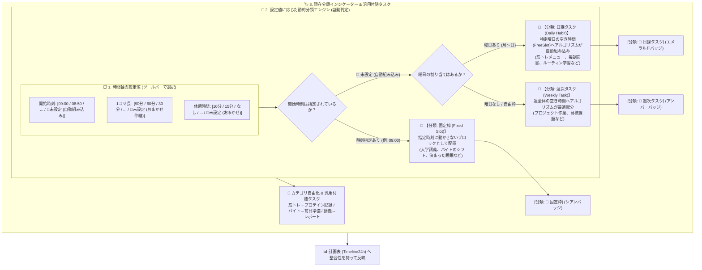
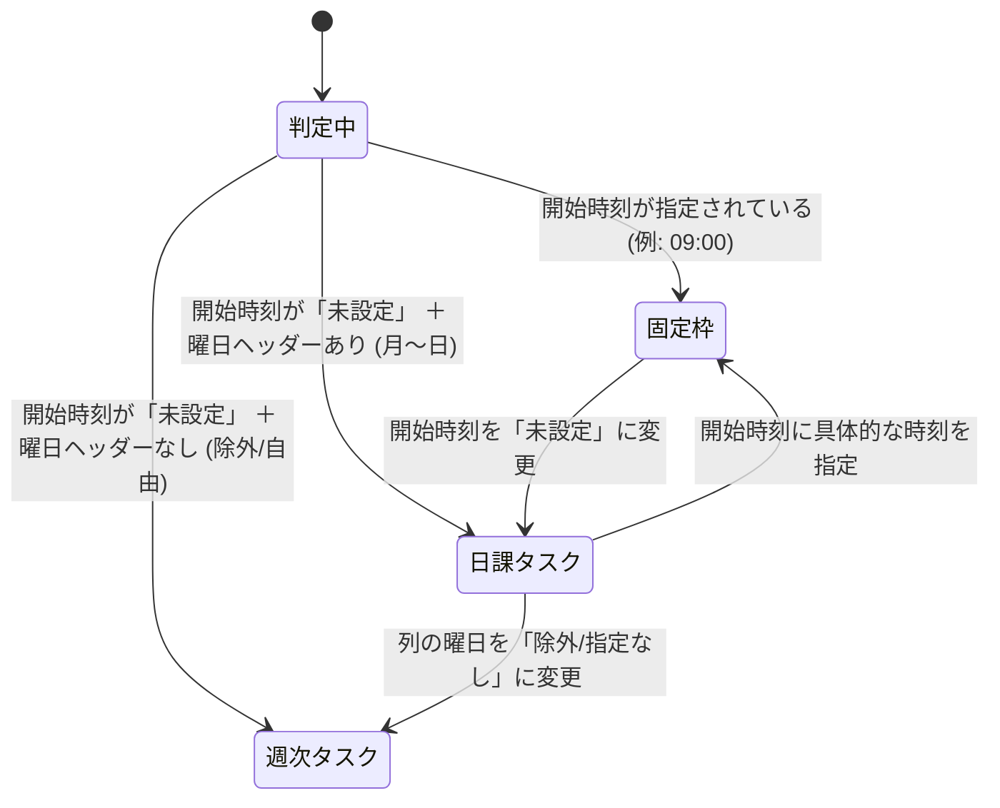
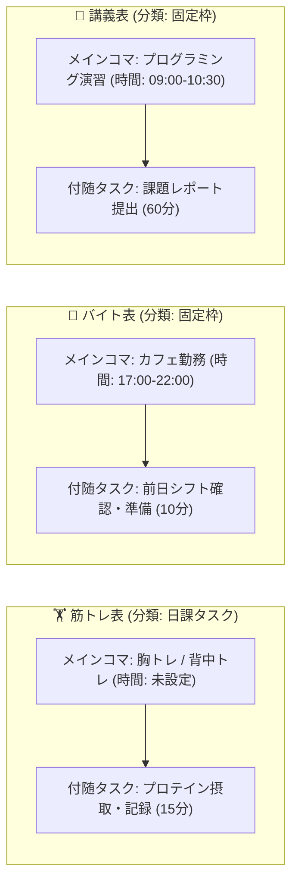
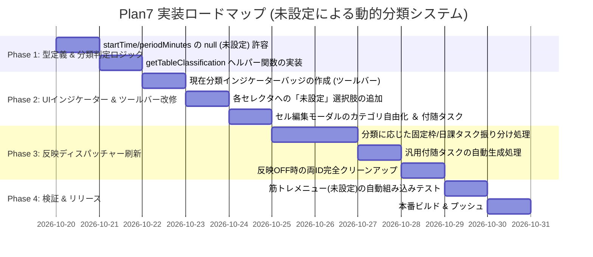

# 表データの柔軟化 ＆ 「未設定」による動的分類システム 実装計画書（Plan7）

ユーザー要望：
> 「アルゴリズム委任モードの追加というより、開始時刻などに未設定という選択肢を設け、それに伴ってより分類が変化する感じです。現在どの分類なのかを表すものも必要になるかと思います。これも踏まえてもう一度更新してください。」

---

## 1. 概要とコンセプト

本計画（Plan7）は、表データ（取り込み表や独自マトリクス）を時間割専用の固定枠から解放し、筋トレや日課メニューなどの多様な用途へ自然に適合させるための設計・実装計画書です。

新たな「別個のモード」を追加するのではなく、**開始時刻や1コマの長さ、休憩時間の設定に「未設定（自動 / おまかせ）」という選択肢を導入します。そして、ユーザーが設定した値（時刻を指定したか、未設定にしたか）に応じて、計画表上でのデータ分類（固定枠 ⇄ 日課タスク ⇄ 週次タスク）が自動的・動的に決定・変化するアーキテクチャ**を構築します。

あわせて、ユーザーが迷わないよう**「現在どの分類として扱われているか」を一目で把握できる分類インジケーター（リアルタイムステータスバッジ）**を配置し、さらに授業カテゴリに限定されていた課題（付随タスク）の制約を完全に撤廃します。



---

## 2. コア設計思想：設定値に伴う「動的分類システム」

### 2.1. 「モード切り替え」ではなく「未設定」という自然なパラメータ選択
ユーザーに「固定枠モードにしますか？委任モードにしますか？」といった抽象的な概念を選択させるのではなく、Excel風ツールバーの各設定項目に**「未設定」**という直感的な選択肢を用意します。

| 設定項目 | 選択可能な値 | 「未設定」を選んだ時の振る舞い |
| :--- | :--- | :--- |
| **開始時刻 (startTime)** | `09:00`, `08:50`, `13:00`... / **🌟未設定 (自動組み込み)** | 特定の時刻に縛られず、既存の計画表アルゴリズム（`scheduler.ts`）が空きスロット（FreeSlot）を探して自動配置 |
| **1コマの長さ (periodMinutes)** | `90分`, `60分`, `30分`, `25分`... / **🌟未設定 (おまかせ)** | 空き枠の大きさに応じてアルゴリズムが所要時間を柔軟にフィット（小:15〜25分 / 中:30〜60分 / 大:120分） |
| **休憩時間 (intervalMinutes)** | `10分`, `15分`, `なし`... / **🌟未設定 (おまかせ)** | タスク間のインターバルやバッファ時間をアルゴリズムの基準に委任 |

---

### 2.2. 設定値に伴う分類の変化ルール（Dynamic Classification Rules）

表全体、およびセルの設定値から、計画表への反映先が以下のように自動判定されます。



1. **【分類: 📌 固定枠 (Fixed Slot)】**:
   - **条件**: 開始時刻が具体的に指定されている場合（例: `09:00`）。
   - **計画表での動作**: タイムラインの「月曜 09:00 - 10:30」に動かせないスケジュールブロックとして配置。
   - **適した用途**: 大学講義、高校の時間割、確定しているバイトのシフト、決まった睡眠・食事など。

2. **【分類: 🏃 日課タスク (Daily Habit / Task)】**:
   - **条件**: 開始時刻が「未設定」かつ、列ヘッダーに曜日（月曜〜日曜）が割り当てられている場合。
   - **計画表での動作**: その曜日の固定枠の合間にある空き枠（FreeSlot）をアルゴリズムが探し、最適な時間に自動配置。
   - **適した用途**: 筋トレメニュー（月:胸、水:背中、金:脚）、毎日の読書、英語リスニング、朝のストレッチなど。

3. **【分類: 🎯 週次タスク (Weekly Task)】**:
   - **条件**: 開始時刻が「未設定」かつ、列ヘッダーが特定の曜日に縛られていない（または週次目標として設定）場合。
   - **計画表での動作**: 1週間全体の空き枠の中から、優先度と所要時間を考慮してアルゴリズムが柔軟に配置。
   - **適した用途**: 週に1〜2回こなしたい課題、自主制作、プロジェクト作業スロットなど。

---

## 3. 現在の分類を表す「リアルタイム分類インジケーター」のUI設計

ユーザーが「今この表は計画表でどう扱われるのか？」を一目で理解できるよう、ツールバーおよびサマリーに**分類インジケーター（ステータスバッジ）**を配置します。

### 3.1. ツールバー上の配置レイアウト

```
┌─────────────────────────────────────────────────────────────────────────────────────────────────────────────┐
│ [分類: 🏃 日課タスク (自動組み込み) ▼] │ 始業: [未設定 (自動) ▼] 1コマ: [未設定 ▼] 休憩: [未設定 ▼] │ [⏱️ 3コマ/週] │
└─────────────────────────────────────────────────────────────────────────────────────────────────────────────┘
```

ユーザーが「始業」ドロップダウンを `09:00` から `未設定 (自動)` に変更した瞬間、左側のバッジが：
- `[分類: 📌 固定枠]`（青系バッジ）
  　　↓ **リアルタイムにアニメーション遷移**
- `[分類: 🏃 日課タスク]`（緑系バッジ）

へと即座に切り替わり、「時刻を未設定にしたことで、日課タスクとして自動組み込みされるようになった」という因果関係が直感的に伝わります。

### 3.2. 分類バッジのビジュアル仕様

| 現在の分類 | バッジの見た目 | ツールチップ / 補足説明 |
| :--- | :--- | :--- |
| **📌 固定枠 (Fixed Slot)** | `bg-sky-50 text-sky-700 border-sky-300`<br>📌 固定枠 (時間固定) | 「開始時刻が指定されているため、計画表の決まった時間帯に固定配置されます」 |
| **🏃 日課タスク (Daily Task)** | `bg-emerald-50 text-emerald-700 border-emerald-300`<br>🏃 日課タスク (自動組み込み) | 「開始時刻が未設定のため、指定曜日の空き時間（FreeSlot）へアルゴリズムが自動配置します」 |
| **🎯 週次タスク (Weekly Task)** | `bg-amber-50 text-amber-700 border-amber-300`<br>🎯 週次タスク (空き枠配置) | 「開始時刻・曜日が未設定のため、週の空き時間へアルゴリズムが最適配分します」 |

---

## 4. 汎用付随タスク（課題・記録・準備）のカテゴリ制約撤廃

分類が「固定枠」であれ「日課タスク」であれ、「授業」カテゴリに限定されていた課題設定の制約を撤廃し、**あらゆるカテゴリのセルに対して付随タスク（記録・準備・課題等）を自由に設定・連動**できるようにします。

### 4.1. ユースケース例



- **筋トレ・フィットネス (`workout`)**:
  - メインコマが「日課タスク」として空き時間に配置された後、付随タスク「プロテイン摂取 ＆ 筋トレ記録（15分）」が自動的に連動配置されます。
- **アルバイト・シフト (`work`)**:
  - メインコマは「固定枠（17:00〜22:00）」として配置され、付随タスク「前日シフト確認・連絡（10分）」が前日の空き枠に配置されます。
- **大学・高校講義 (`lecture`)**:
  - 従来通り、固定枠講義に対して「課題レポート（60分）」が週次Mustタスクとして未配置スタックに投入されます。

---

## 5. データ構造（TypeScript型定義）の拡張

### 5.1. 時間軸設定への `null`（未設定）許容

```typescript
// 1. 分類種別の定義
export type TableClassification = 'fixed_slot' | 'daily_task' | 'weekly_task';

// 2. TableAxisConfig の拡張 (null = 未設定)
export interface TableAxisConfig {
  startTime: string | null;       // "09:00" または null (未設定: アルゴリズム組み込み)
  periodMinutes: number | null;   // 90 または null (未設定: アルゴリズムおまかせ伸縮)
  intervalMinutes: number | null; // 10 または null (未設定: アルゴリズムおまかせ)
  hasLunch: boolean;              // true / false
  lunchAfterPeriod: number;       // 2
  lunchMinutes: number;           // 50
  customRowTimes?: Record<number, { startMinutes?: number; endMinutes?: number }>;
}

// 3. セル固有の付随タスク設定
export interface AttachedTaskConfig {
  enabled: boolean;
  title: string;              // 例: "{title} の記録・プロテイン"
  durationMinutes: number;    // 例: 15
  category?: string;          // 付随タスクのカテゴリ
}

// 4. GridCell の拡張
export interface GridCell {
  dayIndex: number;
  periodIndex: number;
  text: string | null;
  rawLines: string[];
  fullText: string;
  title: string;
  roomOrNote: string;
  startMinutes: number;
  endMinutes: number;
  // --- Plan7 拡張 ---
  category?: string;          // "workout", "routine", "work", "lecture", "hobby" 等の自由設定
  attachedTask?: AttachedTaskConfig; // 汎用付随タスク
}

// 5. ImportedTableData の拡張
export interface ImportedTableData {
  id: string;
  name: string;
  createdAt: string;
  updatedAt: string;
  numRows: number;
  numCols: number;
  colHeaders: string[];
  rowHeaders: string[];
  axisConfig: TableAxisConfig;
  cells: GridCell[][];
  appliedSlotIds?: string[];  // 固定枠として反映した場合のID群
  appliedTaskIds?: string[];  // タスク(日課/週次)として反映した場合のID群
  isApplied?: boolean;
}
```

### 5.2. 分類を判定する純粋ヘルパー関数

```typescript
export function getTableClassification(table: ImportedTableData): TableClassification {
  // 開始時刻が未設定の場合
  if (!table.axisConfig.startTime || table.axisConfig.startTime === 'unset') {
    // 列ヘッダーに曜日（月曜〜日曜）が1つでも有効に含まれているか
    const hasWeekdays = table.colHeaders.some((h) =>
      ['月曜', '火曜', '水曜', '木曜', '金曜', '土曜', '日曜'].includes(h)
    );
    return hasWeekdays ? 'daily_task' : 'weekly_task';
  }
  // 開始時刻が指定されている場合は固定枠
  return 'fixed_slot';
}
```

---

## 6. UI/UX 詳細仕様

### 6.1. コンパクトツールバーの更新
1. **左端: 現在分類インジケーター**:
   - `getTableClassification(activeTable)` の結果に基づき、`📌 固定枠` / `🏃 日課タスク` / `🎯 週次タスク` のバッジをリアルタイム表示。
2. **始業時間セレクタ**:
   - 選択肢: `[🌟 未設定 (自動組み込み)]`, `06:00`, `07:00`, `08:00`, `08:50`, `09:00`, `10:00`, `13:00`, `17:00`...
   - 「未設定」を選択すると、時刻入力がグレーアウトし、アルゴリズムによる自動配置モードであることを視覚的に伝達。
3. **1コマ分数セレクタ**:
   - 選択肢: `[🌟 未設定 (おまかせ)]`, `15分`, `25分`, `30分`, `45分`, `50分`, `60分`, `90分`, `120分`...
4. **休憩時間セレクタ**:
   - 選択肢: `[🌟 未設定 (おまかせ)]`, `なし (0分)`, `5分`, `10分`, `15分`, `20分`...

### 6.2. セル編集モーダル（Cell Edit Modal）
- **カテゴリ選択**:
  - ドロップダウン ＋ 自由入力（講義、筋トレ/運動、日課、仕事、学習、趣味、その他）。
- **付随タスク（課題・記録・準備）トグル**:
  - チェックを入れると、付随タスク名（デフォルト: `{title} の記録・確認`）と所要時間（15分など）を自由に設定可能。

### 6.3. 反映トグル（ON/OFF）時のシームレスな挙動
- 計画表への反映をONにした際：
  - 分類が `fixed_slot` の場合 → `fixedSlots`（固定枠）へ追加。
  - 分類が `daily_task` の場合 → `tasks`（日課タスク）へ追加し、指定曜日にアルゴリズムが自動組み込み。
  - 分類が `weekly_task` の場合 → `tasks`（週次タスク）へ追加。
  - 付随タスクがあれば同時に `tasks` へ投入。
- トグルをOFFにした際：
  - `appliedSlotIds` および `appliedTaskIds` の両方をクリーンアップし、計画表から一括安全削除。

---

## 7. 実装ロードマップ



### Phase 1: データ構造の拡張と判定関数の追加
- `src/types/index.ts` の `TableAxisConfig` で `startTime`, `periodMinutes`, `intervalMinutes` に `null` を許容。
- `getTableClassification` 関数を作成し、分類（固定枠/日課/週次）の判定ロジックを確立。

### Phase 2: UIインジケーターとツールバーの改修
- `ImportedTablesManager.tsx` の1行ツールバー左側に「現在分類インジケーター」を新設。
- ドロップダウンの先頭に「🌟 未設定（自動）」の選択肢を追加。
- セル編集モーダルにカテゴリ自由設定と付随タスク設定を追加。

### Phase 3: 反映処理（`handleApplyTable`）の動的ディスパッチ
- `isCurrentItemApplied` 切替時に、分類に応じて `FixedSlot` または `TaskItem`（日課/週次）を動的に生成して `onSlotsChange` / `onTasksChange` に渡す。
- `appliedTaskIds` を管理し、トグルOFF時に確実に戻せるようにする。

### Phase 4: 動作検証
- 筋トレ表（開始時刻: 未設定、1コマ: 未設定、休憩: 未設定、付随タスク: プロテイン）を作成し、計画表（Timeline24h）の空き枠に自動で綺麗に組み込まれるかをテスト。
- Next.js 16 (Turbopack) のビルド確認。

---

## 8. まとめ

本アプローチにより、以下の3つの大きなメリットがもたらされます。

1. **極めてシンプルで直感的な操作感**:
   - モードの切り替えに悩む必要はなく、「時間を決めるなら指定」「アルゴリズムに任せるなら未設定」を選ぶだけ。
2. **現在の状態がひと目でわかる高い視認性**:
   - 「今この表が何として扱われているか（固定枠なのか、日課タスクなのか）」が分類インジケーターによって常時可視化され、操作に対するフィードバックが即座に得られます。
3. **筋トレ・日課から授業まで、あらゆる表が統合**:
   - 筋トレメニュー、毎朝のルーティン、大学の時間割、バイトのシフトがすべて同じ表機能で扱え、カテゴリに関係なく付随タスクを連動させることが可能になります。
