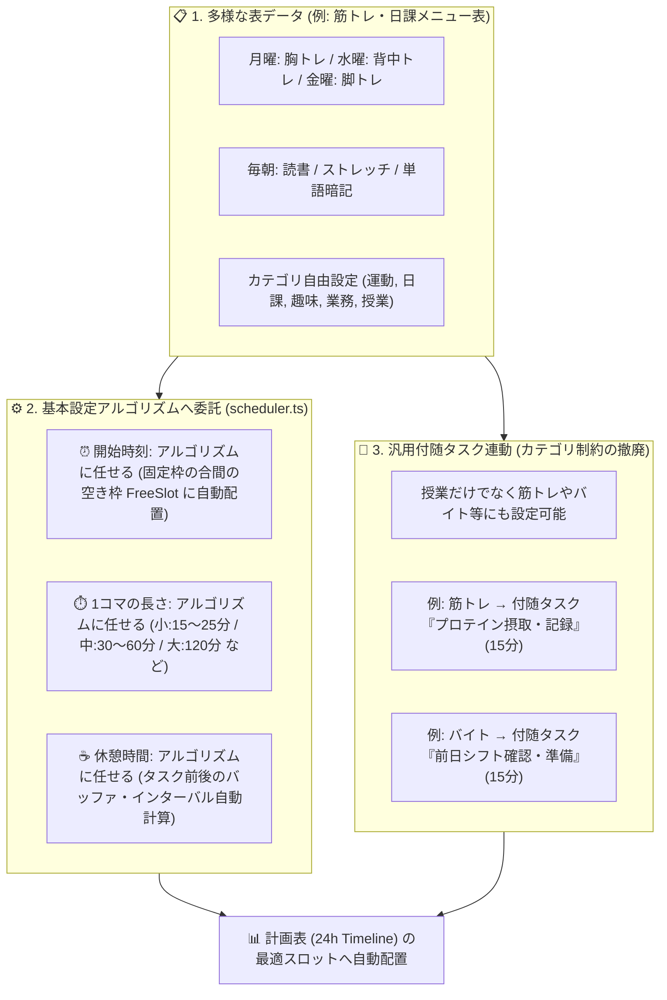
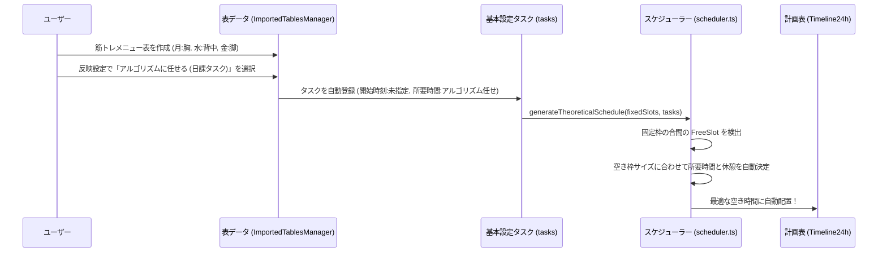
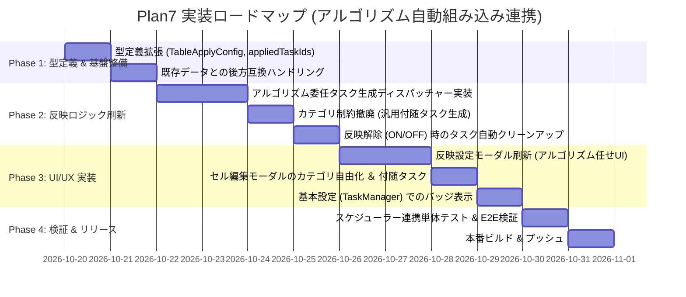

# 表データの柔軟化 ＆ アルゴリズム自動組み込み連携 実装計画書（Plan7）

ユーザー要望：
> 「時間軸のスマート自動推論についてなのですが、そんなことはしなくてよいです。現在基本設定の各種タスクには、計画表に基づき自動で組み込むという風なアルゴリズムがすでにあると認識しています。具体的に実装したい内容は、筋トレなどのメニューでいうと、日課のタスクで、開始時刻は基本設定のアルゴリズムに任せる、1コマの長さも基本設定のアルゴリズムに任せる、休憩時間もアルゴリズムに任せる設定で基本設定に追加したいといった感じです。また、現在授業のカテゴリのみ課題を設定できるようになっていますが、機能として表の設定でカテゴリにこだわらず変更できた方が整合性があると考えています。これを踏まえて再度まとめてください」

---

## 1. 概要とコンセプト

本計画（Plan7）は、表データ（取り込み表や独自に作成したマトリクス）を**時間割の固定枠に限定せず、筋トレや日課などのメニュー表としても柔軟に活用できるようにする**ための設計・実装計画書です。

最大のポイントは、表の各セルを固定の時間（何時何分）に縛り付けるのではなく、**「開始時刻・1コマの長さ・休憩時間をすべて既存の基本設定アルゴリズム（空き枠への自動組み込み）に委ねるタスク」として登録・反映できる仕組み**を構築することです。さらに、現在「授業」カテゴリに限定されている課題（付随タスク）生成の制限を撤廃し、あらゆるカテゴリの表で付随タスクを設定可能にします。



---

## 2. 課題認識と改善方針

### 2.1. 現在の課題
1. **表データが「時間固定の枠（固定枠）」としてしか計画表に反映できない**:
   - 表にデータを入力すると、必ず「何時何分〜何時何分」の固定枠（`FixedSlot`）として扱われてしまう。
   - 「筋トレメニュー」「読書リスト」「日課タスク」のように、**「時間は決めていないが、日課として空いている時間に組み込んでほしい」**というユースケースに対応できない。
2. **基本設定（`scheduler.ts`）の優秀な自律配置アルゴリズムが表データと切り離されている**:
   - アプリ内にはすでに、固定枠以外の「自由時間（FreeSlot）」を探し、タスクの重要度や所要時間（小・中・大）に合わせて自動で隙間に組み込むアルゴリズムが存在している。
   - 表データからこのアルゴリズムに直接タスクを流し込む導線が存在しない。
3. **課題・付随タスクの生成が「授業」カテゴリにハードコードされている**:
   - `handleApplyTable` や反映モーダルで、`category === 'lecture'` の場合のみ課題タスクが生成される仕様になっており、筋トレ後の「プロテイン・ストレッチ」やバイト前の「準備」などを同一の仕組みで扱えない。

### 2.2. 解決の方針
- **表の反映モードに「基本設定アルゴリズム委任モード」を追加**:
  - 表を計画表に反映する際、従来の「固定枠として配置」に加え、**「日課・週次タスクとして基本設定アルゴリズムに自動配置を任せる」**を選択可能にする。
  - **開始時刻**: 指定せずアルゴリズムが空き枠を自動探索。
  - **1コマの長さ**: 「アルゴリズム任せ（空き枠に合わせて小/中/大に自動伸縮）」または「固定分数」。
  - **休憩時間**: アルゴリズムのタスク間インターバル設定に委託。
- **カテゴリの完全自由化**:
  - 表全体および各セルのカテゴリを自由に設定可能とし、どのカテゴリでも「付随タスク（準備・事後記録・課題）」を連動生成できるようにする。

---

## 3. 基本設定アルゴリズム委託（Auto-Scheduled Tasks）の詳細設計

### 3.1. 既存アルゴリズム（`scheduler.ts`）との接続方法

`src/lib/scheduler.ts` はすでに以下の強力な機能を持っています：
- **`calculateFreeSlots`**: 睡眠や授業などの固定枠以外の自由時間を算出。
- **`getAdjustedDuration`**: 空き枠の大きさに応じて所要時間（`durationSize`: `small`=15〜25分, `medium`=30〜60分, `large`=120分）を柔軟にフィット。
- **`generateTheoreticalSchedule`**: 日課タスク（`period: 'day'`）や週次タスク（`period: 'week'`）を優先度順に空き枠へ自律配置。

本機能では、表のセルデータをこのアルゴリズムが解釈できる `TaskItem` 形式に変換して基本設定（`tasks`）に流し込みます。



### 3.2. 表データの反映モード比較

| 項目 | モードA: 固定枠モード (従来) | モードB: アルゴリズム委任モード (新機能・推奨) |
| :--- | :--- | :--- |
| **主な用途** | 大学講義の時間割、バイトの固定シフト、睡眠、定例会議 | **筋トレメニュー、日課ルーティン、読書、自主学習、趣味** |
| **開始時刻** | 表の縦軸（時限定義: 9:00, 10:40等）に厳密に固定 | **アルゴリズムに任せる**（当日の空き枠に合わせて自動配置） |
| **1コマの長さ** | 表の時限定義（90分など固定） | **アルゴリズムに任せる**（小:15-25分 / 中:30-60分 / 大:120分 / 固定分数から選択） |
| **休憩時間** | 表のインターバル設定（10分等）で固定 | **アルゴリズムに任せる**（タスク前後の空き時間や疲労度を考慮） |
| **計画表上の扱い** | 動かせない「壁（FixedSlot）」 | 予定に合わせて柔軟に再配置される「付箋タスク（TheoreticalBlock）」 |
| **基本設定との関係** | 生活リズム固定枠（`fixedSlots`）に追加 | **日課タスク / 週次タスク（`tasks`）に追加** |

---

## 4. 汎用付随タスク（課題・準備・記録）のカテゴリ制約撤廃

### 4.1. 授業限定ハードコードの解除
現在の `handleApplyTable` における `category === 'lecture'` 判定を撤廃し、**あらゆるカテゴリのセルに対して付随タスク（課題・準備・事後記録）を連動**させます。

### 4.2. 代表的なユースケースと自動生成タスク例

| 表の用途 / カテゴリ | メインとなるタスク（セル内容） | 自動生成される付随タスク（例） | タスクの性質 |
| :--- | :--- | :--- | :--- |
| **🏋️ 筋トレ・運動 (`workout`)** | 胸トレ（ダンベル・ベンチ） | **プロテイン摂取 ＆ 筋トレ記録** (15分) | 日課・習慣 (Want) |
| **🏃 朝活・日課 (`routine`)** | 英語リスニング / 読書 | **要約メモ作成 / 単語復習** (15分) | 日課 (Want) |
| **💼 アルバイト (`work`)** | カフェ店員シフト | **前日持ち物確認 / シフト連絡** (10分) | 必須 (Must) |
| **🏫 講義・授業 (`lecture`)** | 経済学概論 / プログラミング演習 | **課題レポート提出 / 復習** (60〜90分) | 週次課題 (Must) |
| **🎨 創作・趣味 (`hobby`)** | イラスト制作 / 動画編集 | **SNS投稿 / 素材整理** (20分) | 週次タスク (Want) |

### 4.3. 設定の自由度
- **表単位のデフォルト設定**:
  - 例：「この表の全コマに対して、実施後に15分の『記録・片付け』タスクを自動生成する」
- **コマ個別のオーバーライド**:
  - セル編集モーダルで、特定のコマだけ付随タスクを個別にオン/オフ・編集可能。

---

## 5. UI/UX 改善設計

### 5.1. 反映設定モーダル（ApplySettingsModal）の刷新
表データ画面の「反映設定（スライダーアイコン）」を押した際のモーダルに、以下の直感的な選択肢を追加します。

```
┌────────────────────────────────────────────────────────┐
│ ⚙️ 計画表への反映設定                                 │
├────────────────────────────────────────────────────────┤
│ 【配置方式を選択】                                     │
│   ○ 固定枠として配置 (時間割・シフトなど時間を固定)    │
│   ● アルゴリズムに任せて自動組み込み (筋トレ・日課など) │
│                                                        │
│ 【タスクの種類】                                       │
│   ● 日課タスク (高頻度・特定曜日に自動配置)            │
│   ○ 週次タスク (目標・空き時間に柔軟配置)              │
│                                                        │
│ 【1コマの長さ】                                        │
│   ● アルゴリズムに任せる (空き枠に応じて15〜60分で調整) │
│   ○ 固定時間を指定 ( [30] 分 )                         │
│                                                        │
│ 【休憩時間】                                           │
│   ● アルゴリズムに任せる (タスク間の最適インターバル)  │
│                                                        │
│ 【付随タスク (課題・記録・準備) の自動生成】           │
│   ☑ メインコマの実施後に付随タスクを連動生成する       │
│     内容: [{title} の記録・振り返り] 所要時間: [15] 分 │
└────────────────────────────────────────────────────────┘
```

### 5.2. セル編集モーダル（Cell Edit Modal）の拡張
1. **カテゴリの自由選択**:
   - プリセット（講義、筋トレ/運動、日課、仕事、学習、趣味、その他）から選択、または直接入力。
2. **付随タスク設定トグル**:
   - 「このコマに付随タスク（記録・準備・課題）を追加する」チェックボックス。
   - タイトル・所要時間（15分/30分/60分等）を直接編集可能。

### 5.3. 基本設定（TaskManager）側での表示
- 表データから「アルゴリズム任せ」で登録された日課・週次タスクには、`[表: ○○]` という参照元バッジを表示。
- 基本設定の一覧からも、表由来のタスクであることが一目で分かり、必要に応じて編集・削除が可能。

---

## 6. データモデル（TypeScript型定義）の拡張

既存の型定義（`src/types/index.ts`）に以下のフィールドを追加し、後方互換性を保ちながら拡張します。

```typescript
// 1. 表データの計画表反映設定
export type TableApplyMode = 'fixed' | 'auto_schedule'; // 固定枠 vs アルゴリズム自動組み込み

export interface TableApplyConfig {
  mode: TableApplyMode; // 'fixed' | 'auto_schedule'
  targetTaskPeriod?: 'day' | 'week'; // 日課タスクか週次タスクか
  durationMode?: 'auto' | 'fixed'; // アルゴリズム任せ(auto) か 固定分数(fixed)
  fixedDurationMinutes?: number; // 固定分数指定時の値 (例: 30)
  autoDurationSize?: 'small' | 'medium' | 'large'; // アルゴリズムへのサイズヒント
  
  // 汎用付随タスク設定 (カテゴリ不問)
  enableAttachedTask?: boolean;
  attachedTaskTitleTemplate?: string; // 例: "{title} の記録・プロテイン"
  attachedTaskDurationMinutes?: number; // 例: 15
  attachedTaskType?: 'prep' | 'assignment' | 'review' | 'custom';
}

// 2. GridCell の拡張
export interface GridCell {
  dayIndex: number;
  periodIndex: number;
  text: string | null;
  rawLines: string[];
  fullText: string;
  title: string;
  roomOrNote: string;
  startMinutes: number;
  endMinutes: number;
  // --- Plan7 拡張 ---
  category?: string; // "workout", "routine", "lecture", "work", "hobby" など自由設定
  attachedTask?: {
    enabled: boolean;
    title: string;
    durationMinutes: number;
  };
}

// 3. ImportedTableData の拡張
export interface ImportedTableData {
  id: string;
  name: string;
  createdAt: string;
  updatedAt: string;
  numRows: number;
  numCols: number;
  colHeaders: string[];
  rowHeaders: string[];
  axisConfig: TableAxisConfig;
  cells: GridCell[][];
  appliedSlotIds?: string[]; // 固定枠反映時のID群
  appliedTaskIds?: string[]; // アルゴリズムタスク反映時のタスクID群
  isApplied?: boolean;
  applyConfig?: TableApplyConfig; // 反映設定
}
```

---

## 7. 実装ロードマップ



### Phase 1: データ構造の拡張
- `src/types/index.ts` に `TableApplyConfig`, `appliedTaskIds` などを追加。
- 既存の `appliedSlotIds` に加え、タスクとして反映された場合の追跡IDを保持できるようにする。

### Phase 2: 反映ロジックの刷新（`handleApplyTable`）
- `applyConfig.mode === 'auto_schedule'` の場合：
  - 各セルを `TaskItem`（`period: 'day'`, `durationSize: 'medium'`, `frequency: 'high'` 等）に変換し、`tasks` ステートに追加。
  - セルに指定された曜日（`dayIndex`）を保持させ、その曜日の空き枠に優先配置。
  - 開始時刻・休憩時間は未指定とし、`scheduler.ts` の `generateTheoreticalSchedule` に完全委任。
- 付随タスク（記録・プロテイン・課題等）もカテゴリ不問で `tasks` に同時投入。
- トグルOFF時には、生成したタスクID群（`appliedTaskIds`）を `tasks` から綺麗に削除。

### Phase 3: UIコンポーネントの改修
- 反映設定モーダル（`ApplySettingsModal`）に「固定枠として配置」と「アルゴリズムに任せて自動組み込み」の切り替えUIを実装。
- 1コマの長さ（「アルゴリズム任せ」「30分」「60分」）や休憩の委託設定を追加。
- セル編集モーダルでカテゴリをプルダウン＋自由入力にし、付随タスクの個別設定を追加。

### Phase 4: 検証・テスト
- 筋トレメニュー表（月・水・金）を作成し、「アルゴリズムに任せる」で反映した際、タイムライン上の空きスロットに自動で配置されるかを Vitest およびブラウザで検証。
- 付随タスク（プロテイン摂取）が正しく連動配置されるかを確認。
- Next.js 16 (Turbopack) のビルド確認。

---

## 8. まとめ

本計画により、表データは単なる「時間割の読み取り」を超えて、**「筋トレや日課、習慣のメニュー表をグリッドで管理し、日々のスケジュールへの配置はすべて理論値スケジューラーのアルゴリズムに任せる」**という理想的な運用が可能になります。

- **ユーザーの手間ゼロ**: 何時何分にやるかを悩む必要はなく、空いている時間へ自動でフィット。
- **カテゴリの自由化**: 講義、筋トレ、バイト、趣味、日課など、あらゆる活動に付随タスク（準備・記録・課題）を自在に連動。
- **既存アルゴリズムの最大活用**: すでに存在する優れた自律スケジューリングエンジンを100%活かした、整合性の高い拡張となります。
