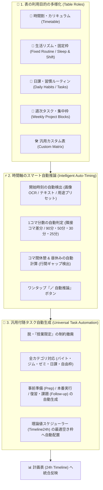
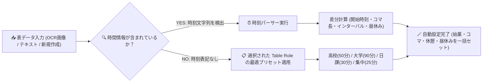
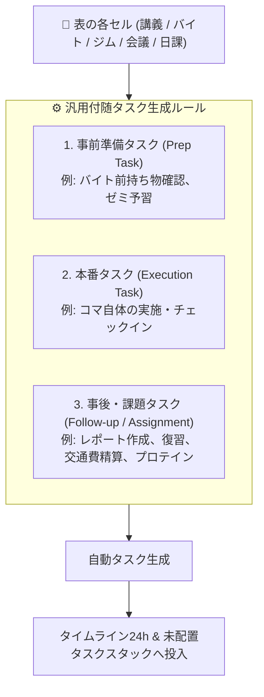
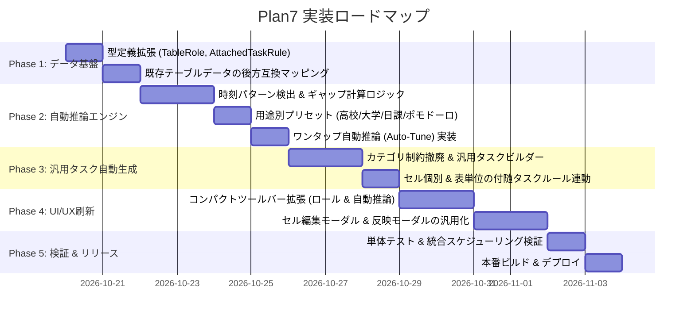

# 多目的表データ基盤（Universal Matrix Engine）刷新 実装計画書（Plan7）

ユーザー要望：
> 「表データをもっと柔軟にしたいです。表の利用が予想されるのは、時間割に限らず、固定枠であったり、日課であったり、週次タスクである可能性があります。また、開始時刻は自動で組み込んでほしい場合や、1コマの時間についても自動、休憩も自動で設定を行ってほしい場合があると思います。また、現在授業のカテゴリのみ課題を設定できるようになっていますが、機能として表の設定でカテゴリにこだわらず変更できた方が整合性があると考えています。改善案をPlan7.mdにまとめてください。」

---

## 1. 概要とコンセプト

本計画（Plan7）は、従来の「大学講義の時間割専用テーブル」という枠組みを根本から拡張し、**「あらゆる生活リズム・日課・習慣・プロジェクト枠をグリッド形式で直感的に組み立てる汎用表エンジン（Universal Matrix Engine）」**へと進化させるための設計・実装計画書です。



---

## 2. 課題認識と改善のアプローチ

### 2.1. 現在の課題
1. **表データの用途が「講義の時間割」に偏重している**:
   - `activeTable` は「授業」を前提としたデータ構造となっており、睡眠・食事・バイト・日課習慣などをグリッドで一覧管理・作成する導線が分断されている。
2. **時間軸（縦軸）設定の手動負荷**:
   - 始業時間（9:00）、1コマ（90分）、休憩（10分）、昼休みを手動で選ぶ必要があり、高校（50分）、朝活・日課（30分）、ポモドーロ（25分）などの多様なリズムに即応できていない。
   - 取り込んだ画像やテキストに時間が記載されていても、ユーザーが再度設定バーをいじる必要があった。
3. **課題自動生成機能が「授業」カテゴリに固定化されている**:
   - 「課題タスク自動生成」が授業コマのみにハードコードされており、「バイトの準備・シフト確認」「日課の振り返り・ストレッチ」「ゼミやプロジェクトの資料作成」などの付随タスクを同一の仕組みで自動生成できない。

### 2.2. 解決のコア・アプローチ
- **テーブル・ロール（Table Role）概念の導入**: 表ごとに役割（時間割／固定枠／日課／週次／カスタム）を指定でき、計画表への反映先が自動で切り替わる。
- **インテリジェント・オートタイミング（Auto-Timing）**: 用途選択やOCR文字解析から、開始時刻・コマ分数・休憩・昼休みを全自動で推論・適用する。
- **ユニバーサル・タスク生成ルール（Universal Task Rule）**: カテゴリに関係なく、セルや表に対して「事前タスク」「事後タスク（課題・復習・精算等）」の生成ルールを自由に設定可能にする。

---

## 3. 多目的表データエンジン（Table Roles）の設計

表ごとに「この表が計画表においてどのような役割を果たすか」を定義する `tableRole` を導入します。

| テーブル種別 (Table Role) | 主な利用用途 | デフォルト時間軸 | 反映先の対象 | 反映時の振る舞い |
| :--- | :--- | :--- | :--- | :--- |
| **🏫 時間割 (timetable)** | 大学・高校・専門学校の講義 | 始業 09:00 / 90分 (または 08:50 / 50分) / 休憩10分 / 昼休み50分 | **固定枠** (`fixedSlots` - category: `lecture`) ＋ **付随課題** | 講義枠をタイムラインに配置し、レポートや予習タスクを未配置スタックへ自動投入 |
| **🛌 生活固定枠 (fixed_routine)** | 睡眠、食事、バイト、移動、部活、定期通院 | 始業 07:00 / 60分 / 休憩0分 / 昼休みなし | **固定枠** (`fixedSlots` - category: 睡眠・食事・勤務等) | 動かせない生活の柱としてタイムラインを保護。必要に応じてバイトの準備タスク等を生成 |
| **🏃 日課・習慣 (daily_habits)** | 朝活、筋トレ、読書、単語暗記、瞑想 | 始業 06:00 / 30分 / 休憩5分 / 昼休みなし | **日課タスク** (`tasks` - period: `day`, frequency: `high`) | 決まった曜日・時間帯に高頻度で実行する習慣タスクとして計画表に流し込み |
| **🎯 週次タスク (weekly_tasks)** | 週1〜2回の重点学習、プロジェクト作業、ゼミ | 始業 13:00 / 60分または90分 / 休憩10分 | **週次タスク** (`tasks` - period: `week`) | 週目標やプロジェクト作業スロットとして、理論値スケジューラーが空き時間に最適配分 |
| **🛠️ 汎用カスタム (custom)** | 自由設計のグリッドマトリクス | 任意設定 | 選択可能（固定枠 / 日課 / 週次） | セルごとに固定枠にするかタスクにするかを柔軟に混在可能 |

---

## 4. 時間軸のスマート自動推論（Intelligent Auto-Timing Engine）

### 4.1. 自動推論のアルゴリズム



#### ① 開始時刻の自動検出
- **OCR/テキスト解析**:
  - 行ヘッダーやセル内、画像周辺テキストから時刻表現（例: `9:00〜`, `08:50 - 10:20`, `1限 (9:00)`）を正規表現で自動スキャン。
  - 最小の開始時刻を自動的に `startTime` として採用。
- **ロール別デフォルト**:
  - 朝活・日課表: `06:00` または `07:00`
  - 学校時間割: `08:50` または `09:00`
  - 午後・夜シフト表: `13:00` または `17:00`

#### ② 1コマ分数の自動計算
- 検出された時刻ペア（例: `09:00` 〜 `10:30`）の差分から分数を自動算出（`10:30 - 09:00 = 90分`）。
- 差分が均一な場合はその分数を全体に採用。
- バラツキがある場合は、行ごとの個別時間オーバーライド（`customRowTimes`）に自動マッピング。

#### ③ コマ間休憩（インターバル）＆ 昼休みの自動判定
- **休憩時間の検出**:
  - 1限の終了時刻（`10:30`）と 2限の開始時刻（`10:40`）のギャップ（`10分`）を検出し、`intervalMinutes` に設定。
- **昼休みの自動検出**:
  - 正午前後（11:30〜13:30の間）で 40分〜70分の空白ギャップが存在する場合、自動的に `hasLunch: true`、`lunchAfterPeriod: 該当限`、`lunchMinutes: ギャップ分数` をセット。

#### ④ ツールバー上の「🪄 自動推論（Auto-Tune）」ボタン
- Excel風ツールバーに「**🪄 自動推論**」ボタンを配置。
- いつでもワンタップで表内のテキストや行数・役割から最適な時間割設定を再計算して一括適用できます。

---

## 5. 汎用付随タスク（Universal Task Automation）の設計

### 5.1. 脱・「授業限定」の制約撤廃
現在の「授業カテゴリのみ課題作成可能」という制限を撤廃し、**あらゆるカテゴリ・あらゆるセルに対して付随タスクを連動生成できる仕組み**に刷新します。



### 5.2. カテゴリごとの代表的タスクルール・プリセット

ユーザーが簡単に選べるプリセットテンプレートを用意し、ワンクリックで設定できるようにします。

| セルの用途・カテゴリ | 自動生成できる付随タスクの例 | タスク種別 | 推奨所要時間 | 期日・スケジュール |
| :--- | :--- | :--- | :--- | :--- |
| **講義・ゼミ (Lecture)** | 課題・レポート提出 / 予習復習 | 週次課題 (Must) | 60分〜120分 | 次回講義日の前日 |
| **アルバイト・勤務 (Shift)** | シフト前準備 / 交通費・日報提出 | 日課・リマインド (Must) | 15分〜30分 | 勤務直前 / 勤務翌日 |
| **ジム・運動 (Workout)** | ワークアウト記録 / プロテイン摂取 / ストレッチ | 日課習慣 (Want) | 15分 | 運動直後 |
| **定期ミーティング (Meeting)** | アジェンダ確認 / 議事録整理・ネクストアクション | 週次タスク (Must) | 30分 | 当日中 |
| **自己投資・読書 (Study)** | 要約メモ作成 / アウトプット投稿 | 週次タスク (Want) | 45分 | 実施後3日以内 |

### 5.3. セル単位 ＆ 表単位の階層的ルール管理
- **表全体のデフォルトルール**:
  - 例：「この表の全コマに対して、実施翌日を期限とする30分の復習タスクを一括生成する」
- **セル個別のオーバーライド**:
  - 特定のセルだけ「このバイトは準備タスク不要」「この講義だけ120分の重いレポートタスクにする」といった自由なカスタマイズが可能。

---

## 6. データモデル（TypeScript型定義）の拡張

既存のデータとの後方互換性を保ちながら、以下の拡張を行います。

```typescript
// 1. テーブルの役割（用途）
export type TableRole =
  | 'timetable'     // 講義・時間割
  | 'fixed_routine' // 生活リズム・固定枠 (睡眠・バイト等)
  | 'daily_habits'  // 日課・習慣ルーティン
  | 'weekly_tasks'  // 週次タスク・集中作業枠
  | 'custom';       // 汎用カスタム

// 2. 付随タスク生成ルールの定義
export interface AttachedTaskRule {
  enabled: boolean;
  taskType: 'prep' | 'assignment' | 'review' | 'custom'; // 準備 / 課題 / 復習 / カスタム
  titleTemplate: string; // 例: "{title} の課題レポート", "{title} の準備"
  durationMinutes: number; // 例: 60
  priority: 'high' | 'medium' | 'low';
  targetPeriod: 'day' | 'week'; // 日課タスクにするか週次タスクにするか
  deadlineOffsetDays: number; // 実施日から何日後を期限とするか (例: 5日後)
  isMust: boolean; // Must (義務) か Want (任意) か
}

// 3. GridCell の拡張
export interface GridCell {
  dayIndex: number;
  periodIndex: number;
  text: string | null;
  rawLines: string[];
  fullText: string;
  title: string;
  roomOrNote: string;
  startMinutes: number;
  endMinutes: number;
  // --- Plan7 拡張フィールド ---
  category?: string; // "lecture", "work", "routine", "exercise", "study", "custom" など自由設定
  color?: string; // セル独自の色指定
  attachedTaskRules?: AttachedTaskRule[]; // セル個別の付随タスクルール
}

// 4. TableAxisConfig の自動推論拡張
export interface TableAxisConfig {
  startTime: string; // "09:00"
  periodMinutes: number; // 90
  intervalMinutes: number; // 10
  hasLunch: boolean; // true
  lunchAfterPeriod: number; // 2
  lunchMinutes: number; // 50
  customRowTimes?: Record<number, { startMinutes: number; endMinutes: number }>;
  // --- Plan7 拡張フィールド ---
  autoTimingMode?: boolean; // 自動推論が有効かどうか
  detectedPreset?: 'university_90' | 'highschool_50' | 'habit_30' | 'pomodoro_25' | 'shift_60' | 'custom';
}

// 5. ImportedTableData の拡張
export interface ImportedTableData {
  id: string;
  name: string;
  createdAt: string;
  updatedAt: string;
  numRows: number;
  numCols: number;
  colHeaders: string[];
  rowHeaders: string[];
  axisConfig: TableAxisConfig;
  cells: GridCell[][];
  appliedSlotIds?: string[];
  isApplied?: boolean;
  // --- Plan7 拡張フィールド ---
  role: TableRole; // 表の目的・役割
  defaultTaskRule?: AttachedTaskRule; // 表全体のデフォルト付随タスクルール
  targetDestination: 'fixed_slots' | 'daily_tasks' | 'weekly_tasks' | 'hybrid'; // 反映先
}
```

---

## 7. UI/UX 改善設計

### 7.1. Excel風コンパクトツールバーの進化
上部リボンツールバーを以下のように強化します。

```
┌────────────────────────────────────────────────────────────────────────────────────────────────────────┐
│ [表役割: 🏫時間割 ▼] [🪄 自動推論] │ 始業: [09:00 ▼] 1コマ: [90分 ▼] 休憩: [10分 ▼] 昼休: [☑ 2限後 50分] │ [微調整 ▼] │ ⏱️ 09:00-18:00 (540分) [5×5] │
└────────────────────────────────────────────────────────────────────────────────────────────────────────┘
```
- **表役割セレクタ（左端）**: 🏫時間割 / 🛌生活固定枠 / 🏃日課習慣 / 🎯週次タスク を即座に切り替え可能。
- **「🪄 自動推論」クイックボタン**: クリック1つで、表の内容にマッチした開始時刻・コマ長・休憩を全自動適用。
- **インラインクイック入力**: 手動で変更したい場合も1クリックでドロップダウン調整可能。

### 7.2. セル編集モーダルの刷新（汎用カテゴリ ＆ 付随タスク設定）
セルをクリックした際のモーダルに以下の設定を追加します。

1. **基本情報**:
   - タイトル（講義名、タスク名、シフト名）
   - カテゴリ選択（プルダウン ＆ 自由入力: 授業 / 勤務 / 日課 / 運動 / 趣味 / 睡眠 等）
   - 場所・メモ
2. **付随タスク（課題・準備・復習）設定**:
   - チェックボックス：「このコマに付随するタスクを自動生成する」
   - タスク種別（準備 / 課題レポート / 復習 / 自由）
   - 所要時間（15分 / 30分 / 60分 / 90分 / 120分）
   - 期限オフセット（翌日 / 3日後 / 次回コマの前日）

### 7.3. 反映設定モーダル（ApplySettingsModal）の汎用化
計画表へ反映する際の設定モーダルを、表の役割に応じて動的に変化させます。

- **反映モードの選択**:
  - 「固定枠としてタイムラインに配置（移動不可のブロック）」
  - 「日課タスクとして配置（毎日の習慣枠）」
  - 「週次タスクとして配置（理論値スケジューラーが空き時間に配置）」
- **付随タスク一括生成トグル**:
  - カテゴリを問わず、「設定されている付随タスク（課題・準備・復習）をすべて計画表に投入する」チェックボックス。

---

## 8. 実装ロードマップ



### Phase 1: データ基盤の拡張（後方互換性の担保）
- `src/types/index.ts` に `TableRole`, `AttachedTaskRule`, `TableAxisConfig` の拡張を追加。
- 既存の保存データがロードされた際、自動的に `role: 'timetable'` やデフォルトルールへフォールバックする移行処理を実装。

### Phase 2: インテリジェント自動推論（Auto-Timing）の実装
- `src/lib/importers/gridDetection.ts` および新規の `timingInference.ts` に、時刻テキスト検出とコマ分数・休憩・昼休みの自動計算ロジックを実装。
- 用途別プリセット（90分/50分/30分/25分/60分）とワンタップ適用処理の結合。

### Phase 3: 汎用タスク自動生成エンジンの刷新
- `ImportedTablesManager.tsx` 内の `handleApplyTable` から、ハードコードされていた `category === 'lecture'` 判定を撤廃。
- `attachedTaskRules` を参照し、任意のカテゴリに対して準備・課題・復習タスクを動的に生成するディスパッチャーを構築。

### Phase 4: UI/UX コンポーネントの改修
- `ImportedTablesManager.tsx` の1行ツールバーに「役割セレクタ」と「🪄 自動推論」ボタンを追加。
- セル編集モーダルおよび計画表反映モーダル（ApplySettingsModal）を汎用カテゴリ・付随タスク対応へ拡張。

### Phase 5: テスト・ビルド・統合検証
- 自動推論ロジックの Vitest ユニットテスト作成。
- スケジューラー（`scheduler.ts`）との連携検証（日課・固定枠・週次タスクが意図通りタイムラインに組み込まれるか）。
- Next.js 16 (Turbopack) ビルド検証。

---

## 9. まとめと期待される効果

本計画（Plan7）が実現されることで、以下のような革新的なユーザー体験がもたらされます。

1. **「何でも入れられる万能マトリクス」への昇華**:
   - 時間割だけでなく、アルバイトのシフト表、1日の生活リズム固定枠、毎朝のルーティン表、週次の重点学習ブロックなどを、すべて同一の直感的な表インターフェースで作成・管理できます。
2. **手動入力ゼロへ向かう「スマート自動推論」**:
   - 表タイプを選ぶか「🪄 自動推論」を押すだけで、開始時刻や1コマ分数、休憩、昼休みが自然に整い、初期設定の手間が劇的に削減されます。
3. **生活全体のタスクを自動連携する「真の理論値計画」**:
   - 「授業だから課題」という枠を超えて、バイトの準備や日課の振り返りなど、あらゆる予定に付随するタスクがタイムラインの空き枠へ自動でスマート配置されるようになり、計画表の実用性が飛躍的に向上します。
