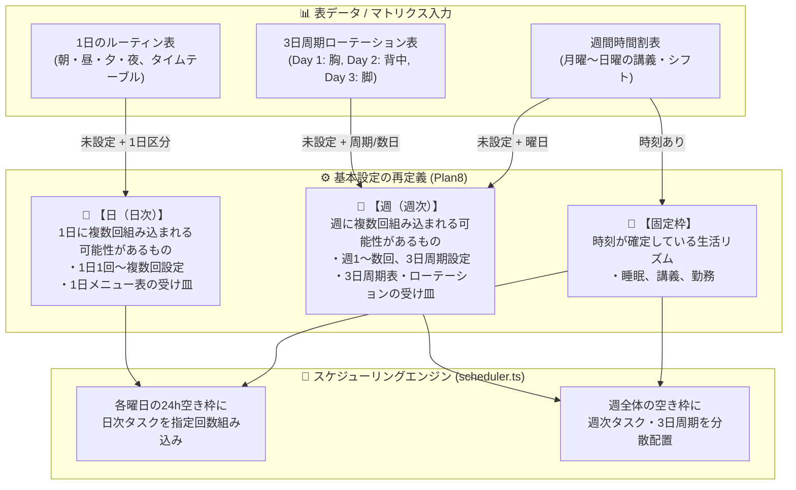

# 基本設定の再定義 ＆ 周期表対応・複数回組み込みシステム 実装計画書（Plan8）

ユーザー要望：
> 「表の更新に基づいて、基本設定の項目についても更新する必要があると考えています。日は1日に複数回組み込まれる可能性があるもの、週は週に複数回組み込まれる可能性があるもの、という風に改めます。こうすることで、表が3日周期の表であれば週の方に入り、表が1日であればといった風に幅を広げることができると考えています」

---

## 1. 概要とコンセプト

本計画（Plan8）は、表データ（取り込み表や独自マトリクス）が時間割だけでなく「**1日のルーティン表**」や「**3日周期のローテーションメニュー（筋トレ3分割等）**」へと拡張されたことに伴い、**アプリ全体の「基本設定（日・週・固定枠）」の概念とスケジューリングロジックを根本からアップデートする計画**です。

### 従来の課題（旧仕様）
- **「日」** ＝ 「毎日（週7回）やるタスク」という固定観念にとどまっており、**1日の中で複数回行う行動（朝・昼・晩、水分補給、ストレッチ、ポモドーロ休憩等）や1日メニュー表**を表現できなかった。
- **「週」** ＝ 「週1〜4回やるタスク・課題」にとどまっており、**3日周期（Day1/Day2/Day3）でローテーションする表**を取り込んだ際に、どこに位置づけるべきか曖昧だった。

### 新しい定義（新仕様）
1. **「日（日次タスク / Daily）」**:
   - **スコープ**: **1日（24時間）の中**
   - **新定義**: **「1日に複数回組み込まれる可能性があるもの」**
   - **対象**: 1日の中で2回以上行う日課・習慣、または1日のメニュー表（朝・昼・夕・夜など）。
   - **パラメータ**: 1日あたりの目標回数（1日1回 / 1日2回 / 1日3回 / 毎空き時間など）。
2. **「週（週次タスク / Weekly）」**:
   - **スコープ**: **1週間（7日間）の中**
   - **新定義**: **「週に複数回組み込まれる可能性があるもの」**
   - **対象**: 週の中で数回行うタスク・目標・課題、または3日周期（Day1, Day2, Day3）などのローテーション表。
   - **パラメータ**: 週あたりの目標回数（週1回 / 週2回 / 週3回（3日周期） / 週4回 / カスタム回数）。
3. **「固定枠（Fixed Slot）」**:
   - **スコープ**: **確定時刻ブロック**
   - **定義**: 開始時刻・終了時刻が確定している生活リズム（睡眠、固定講義、コア勤務など）。



---

## 2. 具体的な改修内容

### 2.1. 基本設定画面（サイドバー ＆ TaskManager）の刷新

#### ① サイドバーの表示変更 (`ImportedTablesManager.tsx`)
- **固定枠**:
  - タイトル: `固定枠 (生活リズム)`
  - サブテキスト: `睡眠・講義・勤務等 (時間確定)`
- **日**:
  - タイトル: `日 (1日に複数回 / 日次)`（旧: `日課タスク (毎日)`）
  - サブテキスト: `1日に複数回組み込む習慣・1日表`
- **週**:
  - タイトル: `週 (週に複数回 / 周期)`（旧: `週次タスク (目標・課題)`）
  - サブテキスト: `週に複数回組み込むタスク・3日周期表`

#### ② タスク作成・編集フォーム (`TaskManager.tsx`)
タスク設定モーダルにおいて、選択された期間（日 / 週）に応じて頻度セレクタを動的に切り替えます。
- **「日」が選択された場合**:
  - 項目名: **「1日あたりの回数」**
  - オプション:
    - `1回 / 日`（1日のうち空き時間に1回）
    - `2回 / 日`（朝と晩、または午前・午後など2回）
    - `3回 / 日`（朝・昼・晩など3回）
    - `空き時間ごと`（可能な限り複数回）
- **「週」が選択された場合**:
  - 項目名: **「週あたりの回数 / 周期」**
  - オプション:
    - `週1〜2回`（低頻度・週末など）
    - `週3回 (3日周期)`（3分割筋トレ、隔日習慣など）
    - `週4〜5回`（平日中心など）
    - `カスタム (週○回)`

### 2.2. 表データの自動分類エンジンの拡張 (`tableUtils.ts`)

表データを取り込んだ際、開始時刻が「未設定」の場合の判定ロジックを以下のように進化させます：

| 表のヘッダー特徴 | 分類結果 | 計画表での扱い |
| :--- | :--- | :--- |
| **開始時刻あり** (`startTime: "09:00"` 等) | **`📌 固定枠`** | 指定時刻のブロックとして配置 |
| **開始時刻未設定** ＋ **列が1日の区分** (`朝`, `昼`, `夕`, `夜` など) | **`🏃 日 (日次)`** | 1日の中で複数回組み込まれるタスク群として配置 |
| **開始時刻未設定** ＋ **列が周期・数字** (`Day1`, `Day2`, `Day3` / `1`, `2`, `3`) | **`🎯 週 (週次)`** | 週の中で3回（3日周期）等として適切に分散配置 |
| **開始時刻未設定** ＋ **列が曜日** (`月曜`〜`日曜`) | **`🎯 週 (週次)`** または **`🏃 日 (日次)`** | 曜日指定のある週次タスク、または各曜日の日課 |

さらに、ツールバー上の分類バッジ（`[📌 固定枠]` / `[🏃 日]` / `[🎯 週]`）をクリックすることで、ユーザーがいつでも手動で「この表は週次（3日周期）」「この表は日次（1日メニュー）」と切り替えられるようにします。

### 2.3. スケジューリングエンジン (`scheduler.ts`) のアルゴリズム更新

- **日次タスク（1日に複数回組み込まれるもの）の配置**:
  - 現在は1日につき1スロット見つかった時点で `break` していた処理を改善。
  - `task.dailyCount`（例: 2回、3回）に応じて、1日のタイムライン上の異なる時間帯（空きスロット）に指定回数配置できるようにします。
  - 最低インターバル（例: 同じタスクが連続しないよう、最低2〜3時間以上空ける）を考慮。
- **週次タスク（週に複数回 / 3日周期）の配置**:
  - 3日周期（Day 1, Day 2, Day 3）の表から生成されたタスクは、週の空き時間の中で曜日が重ならないよう適切にローテーションして配置します。

### 2.4. 型定義の拡張 (`src/types/index.ts`)

```typescript
export interface TaskItem {
  id: string;
  title: string;
  durationMinutes: number;
  durationSize?: TaskDurationSize;
  priority: TaskPriority;
  category: TaskCategory;
  period: 'day' | 'week' | 'month'; // 'day' = 1日の中で複数回, 'week' = 週の中で複数回
  
  // 頻度設定の拡張
  dailyCount?: number; // 1日あたりの目標回数 (1, 2, 3...)
  frequency?: TaskFrequency; // 週次タスク用の頻度 (low, medium, high, custom)
  frequencyCount?: number; // 週次カスタム時の週あたり回数
  cycleIndex?: number; // 3日周期表などのローテーション番号 (Day 1=0, Day 2=1, Day 3=2)
  
  // ... その他既存プロパティ
}
```

---

## 3. 実装ステップ

1. **ステップ1: 設計の合意と型定義拡張 (`src/types/index.ts`)**
   - `dailyCount` や日次・週次の回数パラメータを `TaskItem` に追加。
   - `TableClassification` を `fixed_slot` | `daily_task` | `weekly_task` として、ラベル・定義を刷新。
2. **ステップ2: 分類判定と表データ変換の進化 (`src/lib/tableUtils.ts`)**
   - 1日表（朝・昼・晩など）を「日（日次）」、3日周期表（Day1〜3など）を「週（週次）」と判定するロジックを実装。
   - ツールバーでの手動分類切り替えのサポート。
3. **ステップ3: UIのラベリングと頻度フォームの改修 (`TaskManager.tsx` & `ImportedTablesManager.tsx`)**
   - サイドバーの表記を「日（1日に複数回）」「週（週に複数回）」に更新。
   - タスクモーダルで「日」なら1日の回数、「週」なら週の回数/3日周期を選択できるUIに改善。
4. **ステップ4: スケジューラアルゴリズムの更新 (`src/lib/scheduler.ts`)**
   - 1日に複数回組み込むロジック（朝・昼・晩などの分散配置）。
   - 3日周期・週複数回のローテーション配置。
5. **ステップ5: テスト・ビルド・プッシュ**
   - 単体テスト追加、`tsc --noEmit`、`npm test`、`npm run build` を通過させ、GitHubへ反映。
