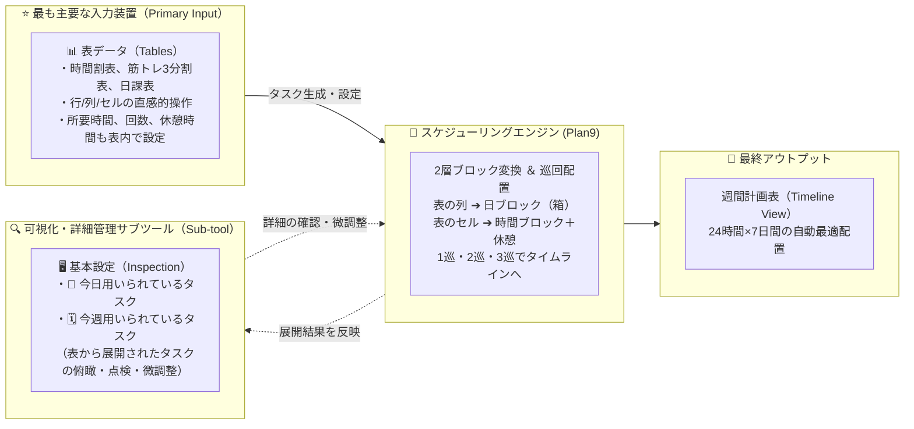
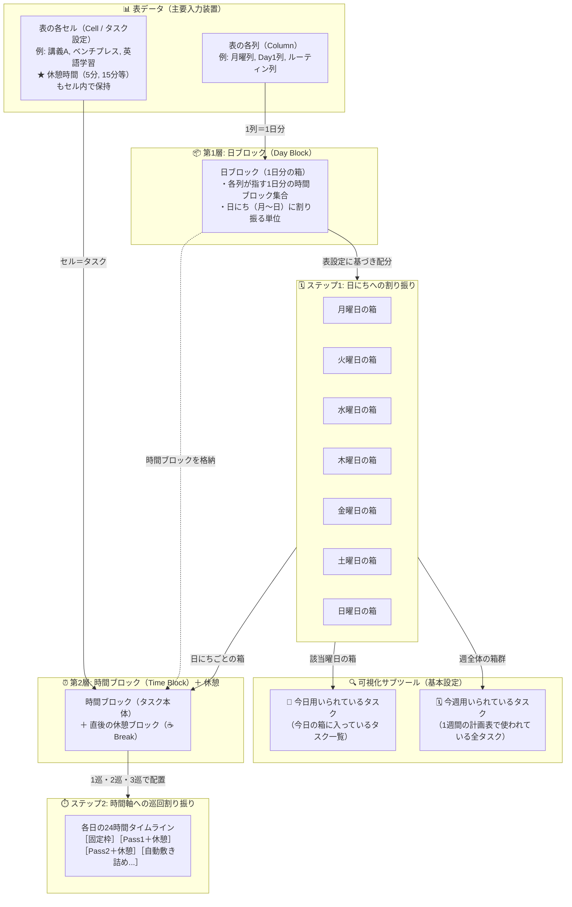
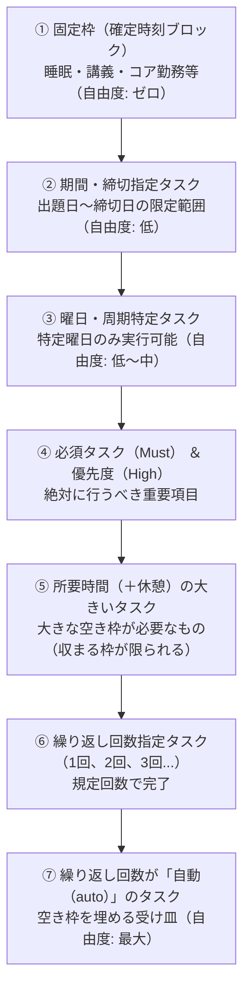

# 表対応・2層ブロック（日ブロック＆時間ブロック）と巡回配置アルゴリズム仕様書（Plan9）

ユーザー要望・ヒアリング合意：

> - タスクにはそれに対応する表が存在することを前提とする。
> - **表を最も主要な入力装置（Primary Input Device）** として位置づけ、タスクの入力・編集・管理の主役とする。
> - **基本設定のタスク表示はあくまでも可視化・詳細管理用のサブツール（Inspection & Detail Sub-tool）** とする。
> - 表の設定を参考に、表の各列と対応する**日ブロック**を各日にちに配置する。
> - 日にちに割り当てられた日ブロックの中にある**時間ブロック**を設定を参考に割り振っていく。
> - **日ブロック**: 表の各列が指す1日分であり、時間ブロックを格納している「箱」。日にちに割り振るもの。
> - **時間ブロック**: タスクそのもの。時間に割り振るもの。
> - **割り振り方法**: すべてに共通して「1巡、2巡、3巡…」という風に割り振っていく。
> - **優先順位原則**: 「細かく設定がされているものが優先順位が高いとみなし、それに基づく」。
> - **敷き詰め原則**: 「入れられるタスクがなくなるまで敷き詰めていく」。
> - **休憩時間の概念**: タスクの後に「このぐらい休む」という意図を反映し、タスク直後に自動で休憩時間を確保・配置する。
> - **基本設定の刷新**: 従来の「1日のタスク」「週のタスク」という静的分類を廃止し、**「今日用いられているタスク」「今週用いられているタスク」**という動的一覧へ変更する。

---

## 1. プロダクト思想: 「表」が主役、「基本設定」は可視化サブツール

本アプリケーションにおける最大の設計指針は、**タスクの登録・編集の主軸を「表」に一本化**し、基本設定は**「計画表に反映された結果を俯瞰・点検するためのサブツール」**と位置づけることです。



### 役割分担の明確化

| 領域                               | 役割・ポジショニング                                                     | 主なユーザー体験（UX）                                                                                                                                                                                                                  |
| :--------------------------------- | :----------------------------------------------------------------------- | :-------------------------------------------------------------------------------------------------------------------------------------------------------------------------------------------------------------------------------------- |
| **📊 表データ<br>(Table Manager)** | **【主役】最も主要な入力装置**<br>(Primary Input Device)                 | ・画像OCRやCSV、または表エディタから一括入力<br>・スプレッドシート感覚でタスク（セル）を行・列に追加<br>・列ごとの曜日・周期設定、セルごとの所要時間・休憩時間・繰り返し回数の編集<br>・**「表さえ作ればタスク入力は完了する」** 世界観 |
| **🖥️ 基本設定<br>(Task Manager)**  | **【補助】可視化・詳細管理サブツール**<br>(Inspection & Detail Sub-tool) | ・表から自動展開されたタスクが「今日」「今週」どう割り当てられているかの点検<br>・「今日やるタスクは何件か」「今週の合計時間は何時間か」のダッシュボード確認<br>・特定タスクの個別微調整、完了トグル、一時的なピン留めなどの補助操作    |

---

## 2. 全体像とメンタルモデル（2層ブロック構造）

タスクと計画表の対応関係を「表」を起点とする**2層ブロックモデル（日ブロック ＆ 時間ブロック）**として形式化します。



---

## 3. アルゴリズム第1段階: 日ブロックの日にちへの割り振り

表の各列（日ブロック）を、表の設定（曜日・周期・毎日など）に基づいてカレンダーの各日にち（0:月曜 〜 6:日曜）へ「箱」として割り振ります。

### 3.1. 表の種類と日ブロックの割り振りルール

| 表の設定 / 分類                            | 表の列（日ブロック）の特徴                             | 日にち（月〜日）への割り振り動作                                                                                                                                                                        |
| :----------------------------------------- | :----------------------------------------------------- | :------------------------------------------------------------------------------------------------------------------------------------------------------------------------------------------------------ |
| **曜日表**<br>(月曜〜日曜の表)             | 列ごとに曜日が指定されている (`targetDays: [d]`)       | 該当する曜日の日にちに、その列の日ブロックを割り振る。<br>例: 「月曜列」→ 月曜日の箱、「水曜列」→ 水曜日の箱                                                                                            |
| **周期表**<br>(Day 1, Day 2, Day 3 等)     | N日周期のローテーション列 (`cycleCount: N, cycleDays`) | 1週間の日にちを進めながら、周期順に日ブロックを割り振る。<br>例: 3日周期表の場合<br>・月曜: Day 1<br>・火曜: Day 2<br>・水曜: Day 3<br>・木曜: Day 1<br>・金曜: Day 2<br>・土曜: Day 3<br>・日曜: Day 1 |
| **単一日 / 日課表**<br>(1列のルーティン表) | 毎日全曜日に適用される日ブロック                       | 月曜〜日曜のすべての日にちに、その日ブロック（箱）を割り振る。                                                                                                                                          |

### 3.2. 複数表の統合（箱のマージ）

同一の日にちに複数の表から日ブロックが割り振られた場合、その日の「箱」の中にすべての表の日ブロックに含まれる時間ブロック（タスク群）が合流します。

```text
【例: 月曜日の箱の中身】
  ├── 表A（大学時間割）の日ブロック
  │     └── [時間ブロック] 09:00〜12:00: プログラミング演習（固定枠）
  ├── 表B（筋トレ3分割表）のDay 1日ブロック
  │     ├── [時間ブロック] ベンチプレス（60分、休憩10分、Must、優先度:高）
  │     └── [時間ブロック] ダンベルフライ（30分、休憩5分、Want、優先度:中）
  └── 表C（日課表）の日ブロック
        ├── [時間ブロック] 水分補給＆ストレッチ（15分、休憩0分、1日3回）
        └── [時間ブロック] 集中学習（45分、休憩15分、1日の繰り返し:自動）
```

---

## 4. タスク後の「休憩時間（Break Time）」概念と組み込みロジック

タスクの後に「必ずこのくらい休む」というユーザーの意図をスケジュールに反映するため、タスクと休憩を1つのペア（ユニット）として扱います。表の各セル編集モーダルからも休憩時間を直感的に設定できます。

### 4.1. データモデルの拡張 (`TaskItem`)

```typescript
export interface TaskItem {
  id: string;
  title: string;
  durationMinutes: number; // 作業の所要時間（例: 45分）
  breakMinutes?: number; // ★ タスク後の休憩時間（例: 15分。デフォルト: 0分/なし）
  // ...その他の既存フィールド
}
```

### 4.2. スケジューリング配置時のロジック

タスク $T$（所要時間 $D$ 分、休憩 $B$ 分）を空きスロットに配置する際：

1. **必要空き枠の判定**:
   - $T$ を配置するために必要な連続空き時間は **$D + B$ 分**。
   - スロットの残り時間が $D + B$ 未満の場合は、そのスロットには配置せず次のスロットを探索。
2. **2つのブロックを連続配置**:
   - **① 作業ブロック（Task Block）**:
     - 開始時刻: $Slot.startMinutes$
     - 終了時刻: $Slot.startMinutes + D$
     - タイトル: $T.title$、通常カテゴリ・カラー
   - **② 休憩ブロック（Break Block）**:
     - 開始時刻: $Slot.startMinutes + D$
     - 終了時刻: $Slot.startMinutes + D + B$
     - カテゴリ: `'routine'` または専用 `'break'`
     - タイトル: `☕ 休憩 (${T.title})`
     - カラー: リラックス系の淡いグリーン/琥珀色
3. **スロットの更新**:
   $$Slot.startMinutes \mathrel{+}= (D + B)$$
   $$Slot.durationMinutes \mathrel{-}= (D + B)$$

```mermaid
sequenceDiagram
    participant Slot as 空きスロット (120分)
    participant Task as 作業ブロック (45分)
    participant Break as 休憩ブロック (15分)

    Note over Slot: 10:00 〜 12:00 (120分空き)
    Slot->>Task: 10:00〜10:45 (45分作業)
    Slot->>Break: 10:45〜11:00 (15分休憩)
    Note over Slot: 残り空きスロット: 11:00 〜 12:00 (60分)
```

---

## 5. アルゴリズム第2段階: 時間ブロックの巡回割り振り（1巡・2巡・3巡…）

日にちに割り当てられた箱の中にある時間ブロック（タスク）を、その日の空き時間スロットに対して**ラウンド巡回（Pass 1, Pass 2, Pass 3...）**で割り振っていきます。

### 5.1. 優先順位の絶対原則

> **「細かく設定がされているものが優先順位が高いとみなし、それに基づく」**

制約が厳しい（配置可能な自由度が低い）時間ブロックほど先にスケジュールを確定させなければ破綻するため、以下の厳密な優先度スコアによって1巡内の処理順を決定します。



---

### 5.2. 巡回配置（Pass 1, Pass 2, Pass 3...）の内部ループ

時間ブロックの割り振りは、各日の空きスロット群に対して以下のループで実行されます。

> **「1巡目ではその日に割り当てられた1回以上繰り返すタスクを配置して、2巡目では2回以上繰り返すタスクを配置、、、といった風に枠を埋めていく」**

```text
[初期化]
  1. 固定枠（睡眠、勤務、固定講義など）をタイムラインに確定配置する。
  2. 残りの連続した隙間時間を「空きスロット群（FreeSlots）」として算出する。
  3. その日に割り当てられた時間ブロック群を優先順位スコア順にソートする。

[巡回ループ開始: Pass = 1, 2, 3...]
  while (その巡で新しく配置できたタスクが1件以上ある && 空きスロットが存在する) {

    // ★ この巡の対象: 「目標繰り返し回数 >= Pass」のタスク群
    // - Pass 1: 1回以上繰り返すタスク（その日の全タスク）
    // - Pass 2: 2回以上繰り返すタスク（2回指定、3回指定、自動タスクなど）
    // - Pass 3: 3回以上繰り返すタスク（3回指定、自動タスクなど）
    // - Pass 4〜: 自動タスク（空き枠が尽きるまで何巡でも継続）
    for (各時間ブロック T in ソート済みタスク群のうち targetCount >= Pass のもの) {

      totalNeededMinutes = T.durationMinutes + (T.breakMinutes || 0);

      // 空きスロットの探索
      for (各空きスロット Slot in FreeSlots) {
        if (Slot.durationMinutes >= totalNeededMinutes) {
          // ① タスク本体ブロックの配置
          ScheduleBlock(T, Slot.startMinutes, Slot.startMinutes + T.durationMinutes);

          // ② 休憩ブロックの配置（設定されている場合）
          if (T.breakMinutes && T.breakMinutes > 0) {
            ScheduleBreakBlock(
              `☕ 休憩 (${T.title})`,
              Slot.startMinutes + T.durationMinutes,
              Slot.startMinutes + totalNeededMinutes
            );
          }

          // ③ 空きスロットの消費
          Slot.startMinutes += totalNeededMinutes;
          Slot.durationMinutes -= totalNeededMinutes;

          T.placedCount++;
          placedInCurrentPass = true;
          break; // この巡でこのタスクは1回配置完了、次の対象タスクへ
        }
      }
    }

    Pass++;
    if (!placedInCurrentPass) break; // 空き枠不足または対象タスク終了
  }
```

---

### 5.3. 敷き詰め原則

> **「入れられるタスクがなくなるまで敷き詰めていく」**

繰り返し回数が「自動（`dailyRepeatMode === 'auto'`）」の時間ブロックは、固定回数タスクの配置完了後も、**空きスロットに残時間が存在する限り何巡でもループを継続**します。

- 休憩時間（例: 作業45分＋休憩15分＝60分）が設定されている自動タスクの場合、空き枠がある限り「作業→休憩→作業→休憩」のサイクルで空き枠が尽きるまで敷き詰められます。
- 複数の自動タスクがある場合はラウンドロビン（交互配置）でバランスよく空き時間をシェアします。

---

## 6. 基本設定（可視化サブツール）の再構成

タスクの入力装置を「表」へ一本化することに伴い、基本設定は**「表から自動展開されたタスク群を点検・可視化するためのダッシュボード」**へと再構成します。

### 6.1. サイドバー（データ管理画面）のUI階層

```text
【データ管理（サイドバー）の構成】
  ▼ 📊 表データ（主要入力装置 / Primary Input）  <-- ここがメイン！
  │   ├── 時間割表 (7列)
  │   ├── 筋トレ3分割表 (3列)
  │   └── ルーティン日課表 (1列)
  │   └── ［＋新しい表を作成 / OCR取り込み］
  │
  ▼ 🔍 計画表インスペクター（可視化サブツール / Sub-tool）
      ├── 📌 固定枠（生活リズム）        [睡眠・講義・勤務等の確定時間]
      ├── 📅 今日用いられているタスク    [今日の箱に入っているタスク群]
      └── 🗓️ 今週用いられているタスク    [今週1週間に登場する全タスク]
```

### 6.2. サブツールとしての機能詳細

#### ① 「📅 今日用いられているタスク」画面

- **主目的**: 「今日、どの表からどんなタスクが日ブロックとして割り振られているか」の確認。
- **UI機能**:
  - 上部の **曜日タブ（月・火・水・木・金・土・日）** で各曜日の割り当て結果を即座にプレビュー。
  - 各タスクの「参照元テーブル名」「今日の実行回数」「所要時間」「休憩時間」「配置ステータス（配置済 / 未配置）」をバッジ表示。
  - 各タスク横の「元テーブルを開く」ボタンで、主要入力装置である表の該当セルへ直接ジャンプ可能。

#### ② 「🗓️ 今週用いられているタスク」画面

- **主目的**: 1週間全体のタスクポートフォリオと負荷バランスの点検。
- **UI機能**:
  - 週間実施曜日バッジ（`[月][水][金]`、`[3日周期]`、`[毎日]`）。
  - 週間合計時間（作業時間＋休憩時間）と目標回数の消化率。
  - 締切のある課題タスクのカウントダウン表示。

---

## 7. アルゴリズムの実行シミュレーション例（休憩込み）

### 条件例

- **空きスロット**: 13:00〜18:00（300分）
- **今日の箱にある時間ブロック**:
  1. 【課題】木曜締切レポート（90分、休憩15分、Must、目標1回）
  2. 【筋トレ】胸トレ（60分、休憩15分、Must、目標1回）
  3. 【日課】プログラミング自習（45分、休憩15分、目標:自動）

---

### 配置ステップの推移

#### 【Pass 1（1巡目）】

1. **木曜締切レポート**（必要枠: 90m + 15m = 105m）
   - 13:00〜14:30（レポート 90分）
   - 14:30〜14:45（☕ 休憩 15分）
   - _残り空き枠_: 14:45〜18:00（195分）
2. **胸トレ**（必要枠: 60m + 15m = 75m）
   - 14:45〜15:45（胸トレ 60分）
   - 15:45〜16:00（☕ 休憩 15分）
   - _残り空き枠_: 16:00〜18:00（120分）
3. **プログラミング自習**（必要枠: 45m + 15m = 60m）
   - 16:00〜16:45（プログラミング 45分）
   - 16:45〜17:00（☕ 休憩 15分）
   - _残り空き枠_: 17:00〜18:00（60分）

#### 【Pass 2（2巡目）: 自動タスクの敷き詰め】

- レポート、胸トレは目標達成済み。

1. **プログラミング自習**（自動、必要枠: 60m）
   - 17:00〜17:45（プログラミング 45分）
   - 17:45〜18:00（☕ 休憩 15分）
   - _残り空き枠_: 0分（完全敷き詰め完了！）

---

## 8. 現行コードへのマッピングと変更点

| 項目               | 変更対象ファイル                           | 変更内容                                                                                                   |
| :----------------- | :----------------------------------------- | :--------------------------------------------------------------------------------------------------------- |
| **プロダクト思想** | 全体                                       | **表を主要入力装置（Primary Input）**、基本設定を**可視化サブツール（Sub-tool）**としてUI導線を再配置      |
| **タスク型定義**   | `src/types/index.ts`                       | `TaskItem` に `breakMinutes?: number` を追加<br>`TheoreticalBlock` に `isBreak?: boolean` を追加           |
| **スケジューラ**   | `src/lib/scheduler.ts`                     | タスク配置時に $D + B$ 分を確保し、タスク直後に休憩ブロックを自動生成するロジックを追加                    |
| **サイドバー**     | `src/components/ImportedTablesManager.tsx` | 表データセクションを最上位の主役に配置。基本設定セクションを「今日・今週のタスク（インスペクター）」に変更 |
| **タスク管理画面** | `src/components/TaskManager.tsx`           | 「表の可視化サブツール」として今日・今週のタスク一覧、表へのジャンプリンク、休憩時間の表示に対応           |

---

## 9. まとめ

本仕様（Plan9 完全版）により：

1. **「表」＝ 最も主要な入力装置（Primary Input）**
2. **「基本設定」＝ 今日・今週の可視化・詳細管理サブツール（Sub-tool）**
3. **「表の列 ＝ 日ブロック（箱）」「表のセル ＝ 時間ブロック（タスク）」**
4. **「細かさ優先 ＆ 1巡2巡3巡のラウンド巡回」**
5. **「タスク直後の休憩時間自動確保（ポモドーロ・休養意図の反映）」**
6. **「入れられるタスクがなくなるまで自動タスクで敷き詰め」**
   という極めて明快で統一されたプロダクト体験が完成します。
