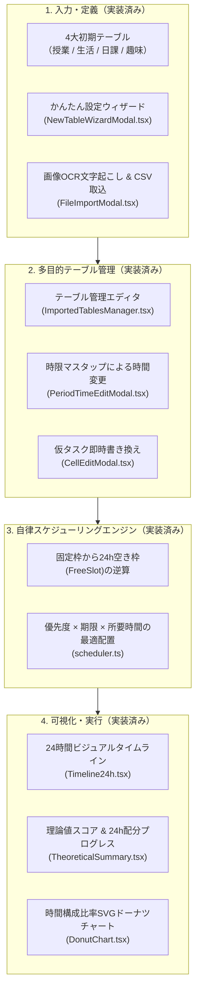
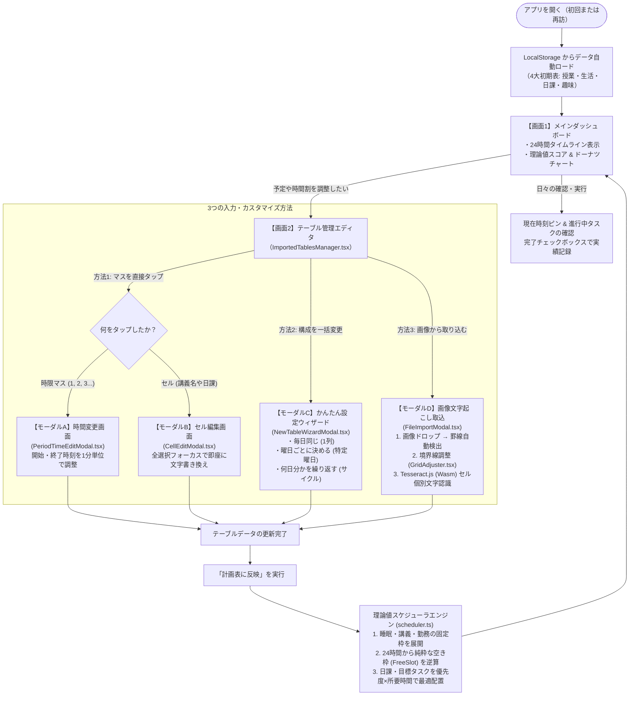
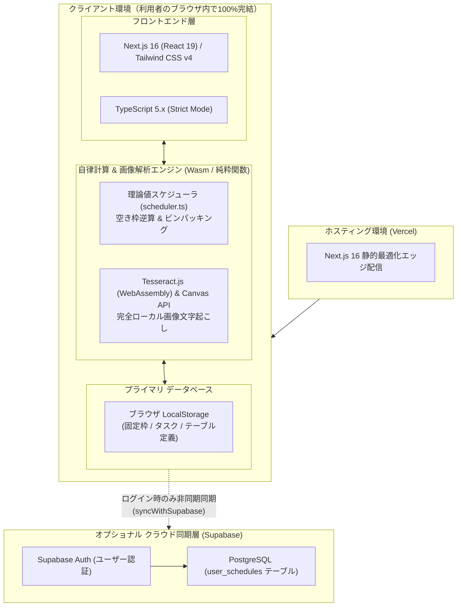

# 成果報告書：理論値計画表 (Theoretical Schedule Planner)

---

## 1. プロダクト基本情報
- **プロダクト名称**：理論値計画表 (Theoretical Schedule Planner)
- **本番公開環境URL**：https://creation-1-chku25062-sketchs-projects.vercel.app
- **ソースコードリポジトリURL**：https://github.com/chku25062-sketch/creation_1.git

---

## 2. 解決すべき課題と対象利用者（要求の原点）

### 対象とする単一の利用者（N=1）
「大学の講義時間割、アルバイト、部位分割の筋トレ、資格学習、睡眠・食事など、多様かつ不規則な生活リズムを抱えながら、目標達成のための学習・日課を継続したいが、毎日のスケジュール計画と時間確保に挫折してしまう大学生・専門職学習者」。

### 切実な不便と従来の代替手段の限界
- **従来の代替手段**: Google カレンダー、TimeTree、Notion、紙の手帳など。
- **従来の限界**:
  1. **空き時間の逆算と手動配置の疲弊**: 従来ツールは「決まった時間に予定を置く」ことは得意だが、「睡眠や講義を差し引いた純粋な自由時間が本日何時間何分残っているのか」「その空き時間にどのタスクをどの順序で詰め込めるのか」は利用者が頭の中で手動計算し、1マスずつカレンダーに配置しなければならなかった。
  2. **計画変更に伴うメンテナンスの破綻**: 急な予定変更や講義の長引き、体調不良が発生するたびに、後ろ倒しになったタスクを手作業で再配置する認知的負荷が極めて高く、数日でスケジュール管理そのものを放棄（計画倒れ）してしまう。
  3. **非曜日周期（ローテーション習慣）の管理不能**: 「3日周期の部位分割筋トレ（Day 1: 胸、Day 2: 背中、Day 3: 脚）」や「交代制シフト勤務」など、曜日に縛られないサイクル習慣をカレンダーに登録すると、週の境目（日曜から月曜）で周期が強制リセットされ、正しいローテーションを維持できなかった。

### 提供する中核的価値
**「動かせない生活基盤（睡眠・食事・講義・勤務等）を登録するだけで、24時間から純粋な自由時間を自律逆算し、やりたい日課や目標タスクを優先度×所要時間に基づいてミリ秒単位で隙間なく最適自動充填する、人間が時間配分に悩まない自律的スケジュール体験」。**

---

## 3. プロダクトの機能概要・使い方・システム構成

### 主要機能と使い方

本システムは、日々の生活基盤となる拘束時間（睡眠・食事・講義等）を入力するだけで、空き時間にタスクを自動配置する理論値スケジューリングWebアプリケーションです。

#### 1. 操作手順と達成される成果
1. **初期状態からの即時利用**: 初回アクセス時、現代人の生活に適した4大基本表（授業・生活・日課・趣味）が自動展開され、開いた瞬間に「本日の理想スケジュール」がダッシュボードに描画されます。
2. **画像の文字起こしとグリッド構造化**: 紙の時間割やシフト表の画像をアップロードすると、HTML5 Canvas による二値化とエッジ解析で罫線を自動検出し、ブラウザ内の `Tesseract.js` (WebAssembly) がセル単位で高精度に文字起こし（講義名・教室名）を行って表を自動復元します。
3. **直感的な表のカスタマイズ**:
   - かんたん設定ウィザードにより、「毎日同じ（1列・Day 1）」「曜日ごとに決める」「何日分かを繰り返す（サイクル）」をワンタップで切り替え可能。
   - モバイル画面で時限マス（1, 2, 3...）をタップしてボトムシートで時間を変更し、セルをタップすると文字が全選択された状態で開くため、ワンタップで実際の予定へ書き換えられます。
4. **理論値スケジュールの自律生成と実行**:
   - 「計画表に反映」を押すと、スケジューリングエンジンが固定枠の隙間時間に優先度順でタスクを隙間なく自動充填。
   - 0:00〜24:00 のビジュアルタイムラインで進行中タスクを確認し、完了チェックを入れて進捗を管理します。

---

### 動作例（主要画面と操作結果の具体例）

利用者がアプリを起動してから、予定の取り込み・編集を行い、理論値スケジュールが自律生成されて実行に至るまでの具体的な動作フローを以下のチャートに示します。

| 実装画面 / モーダル | 操作手順と画面の具体的な挙動 |
|---|---|
| **メインダッシュボード** ([page.tsx](file:///c:/Users/kousu/OneDrive/Desktop/creation_1/src/app/page.tsx)) | 画面上部に「理論値スコア 100%」プログレス、中央に「24時間ビジュアルタイムライン」（睡眠0:00〜8:00、朝食8:00〜8:30、講義9:00〜10:30、日課A・Bが空き時間に自動充填）、右側に時間配分ドーナツチャートが表示されます。 |
| **画像文字起こし取込** ([FileImportModal.tsx](file:///c:/Users/kousu/OneDrive/Desktop/creation_1/src/components/FileImportModal.tsx)) | 時間割画像をドラッグ＆ドロップすると罫線が自動検出され、検出線調整UI ([GridAdjuster.tsx](file:///c:/Users/kousu/OneDrive/Desktop/creation_1/src/components/GridAdjuster.tsx)) で線を調整して決定すると、セル画像がクロップされて `Tesseract.js` が文字起こしを実行。講義名がグリッドに自動展開されます。 |
| **テーブル一覧・エディタ** ([ImportedTablesManager.tsx](file:///c:/Users/kousu/OneDrive/Desktop/creation_1/src/components/ImportedTablesManager.tsx)) | 上部タブで「授業」「生活」「日課」「趣味」を切り替え。グリッド上の時限マス（`1` 等）をタップすると開始・終了時刻の変更モーダルが開き、セル（`日課A` 等）をタップすると即座に文字書き換えモーダルが開きます。 |
| **かんたん設定ウィザード** ([NewTableWizardModal.tsx](file:///c:/Users/kousu/OneDrive/Desktop/creation_1/src/components/NewTableWizardModal.tsx)) | 表の編集時に「毎日同じ」ボタンをタップすると、画面に「1列（Day 1）の枠組みを作成」バナーが表示され、下部の保存ボタンが「この表の設定を更新（1列・毎日同じ）」に動的変化。保存するとテーブルが即座に1列へ再構成されます。 |

---

### 採用した技術スタックとアーキテクチャ構成

自前のAPIサーバーを持たず、利用者のプライバシー保護と即時利用性を最優先にした**「ローカルファースト ＆ 完全サーバーレス・クライアント駆動アーキテクチャ」**を採用しています。

| レイヤー | 採用技術 | 選定理由と現行コードでの役割 |
|---|---|---|
| **フロントエンド** | **Next.js 16.3.8 (App Router, React 19)** | 複雑なグリッドエディタ、24時間タイムライン、モーダル群を宣言的に管理。全画面をクライアント完結のSPA（Single Page Application）として高速動作させるため採用。 |
| **開発言語** | **TypeScript 5.x (Strict Mode)** | 分単位の時刻正規化（0〜1440+α）、多次元配列セル、スケジュールスロットのビンパッキング処理における型安全性をコンパイル時に100%保証（`any` 型完全排除）。 |
| **スタイリング** | **Tailwind CSS v4** | 最新のCSS変数統合により軽量かつ高速。モバイルでのタッチターゲット（44px以上）、セーフエリア（`env(safe-area-inset-bottom)`）への対応を容易にするため採用。 |
| **画像文字起こし (OCR)** | **Tesseract.js (WebAssembly) ＋ HTML5 Canvas API** | クラウドの有償OCR APIに画像を送信せず、ブラウザ内（Wasm）で推論を完結。個人時間割や勤務表などの機密情報を端末外に漏洩させず、API課金コストをゼロに抑えるために選定。 |
| **データベース (メイン)** | **Web Storage (ブラウザ LocalStorage)** | 専用DBサーバーを立てず、ブラウザの `LocalStorage` をプライマリDBとして採用。初回アクセス時にログインを一切強制せず、開いた瞬間から100%の機能が動作する設計を実現。 |
| **バックエンド / クラウドDB (オプショナル)** | **Supabase (PostgreSQL / Auth / RLS)** | 自前のバックエンドAPIサーバー（Express等）の保守負担を排除。複数端末間でのバックアップ・同期を希望する利用者向けに、直接PostgreSQLへセキュアに `upsert` 同期できるBaaSとして組み込み。 |
| **外部API** | **なし（完全スタンドアロン）** | 外部のWeb APIや有償サービスに依存しないため、通信障害やレート制限、API仕様変更リスクを排除。オフライン環境でもスケジュール計算や編集が完全に機能。 |
| **ホスティング環境** | **Vercel** | GitHubリポジトリへのプッシュと連動した自動ビルド＆デプロイ。静的アセットを世界各地のエッジネットワークから超高速配信できるため採用。 |

---

## 4. 8週間の垂直スライス開発とフィードバックによる改善の軌跡

### 週次イテレーションの歩み
- **第1週（最小垂直スライスの貫通）**: 睡眠・講義などの生活固定枠から自由時間を逆算し、単一の空き時間スロットにタスクを配置して24時間タイムライン上に描画するエンドツーエンドの最小動作プロトタイプを構築。
- **第2週（最適化スケジューリングエンジンの導入）**: 優先度（高・中・低）× 所要時間降順によるビンパッキング最適化アルゴリズム（`scheduler.ts`）を実装。今日の消化可能率を示す「理論値スコア（%）」を導入。
- **第3週（日跨ぎ枠の正規化とタスク期間分離）**: 23:00〜07:00 などの日付境界を跨ぐ睡眠・夜勤スロットの分単位正規化パイプラインを確立。毎日こなす「日課タスク」と1週間の中で消化する「週次タスク」の直交分離を実現。
- **第4週（クライアントサイド画像文字起こし基盤の構築）**: Canvas API によるピクセル解析・罫線検出エンジンと、ブラウザ内 WebAssembly で動作する `Tesseract.js` によるセル単位バッチ文字起こし機能を実装。
- **第5週（講義連動タスクと均等分割アロケーション）**: 講義や予定の終了後に自動で課題・復習タスクを起票する付随タスク機能を実装。長時間の課題を空き枠の長さに応じて均等分割（スライス）して配置するフォールバックエンジンを構築。
- **第6週（多目的テーブル並列管理アーキテクチャへの進化）**: 単一の時間割だけでなく、「生活」「筋トレ」「日課」などの独立したテーブルを複数並列管理できる `ImportedTablesManager` を新設。
- **第7週（モバイル操作性の革新とかんたん設定ウィザード）**: スマートフォン画面で時限マス（1, 2, 3...）をタップして時間変更できるボトムシートや、4つの質問で表を作成できるかんたん設定ウィザード（`NewTableWizardModal`）を導入。
- **第8週（オンボーディング体験の根本改善・Plan30〜35）**: ユーザー視点に基づき、曜日固定の強制撤廃、2日周期・1日周期への再編成、仮タスク代入と即時書き換え誘導（全選択オートフォーカス）を完備。

### 利用者検証とピボット
1. **単一時間割から「多目的テーブル並列管理」へのピボット**:
   - 当初は「大学の時間割表を1つ読み込む」設計だったが、検証により「睡眠や食事のベース枠」「筋トレのローテーション」「趣味の枠」は別々の表として管理したいという強い要求が判明。テーブルを無制限に作成・並列管理できるアーキテクチャへと根本的にピボットしました。
2. **曜日ベースから「絶対日付連続サイクル」へのピボット**:
   - 当初は曜日インデックス（0:月〜6:日）を基準にサイクルを計算していたため、3日周期の筋トレが週跨ぎ（日曜から月曜）で Day 1 に強制リセットされる数理的破綻（週替わりサイクル破壊バグ）を発見。起点日からの絶対経過日数に基づく連続サイクル計算へとピボットしました。

### 発表会（11月16日）でのフィードバックと最終改善
- **指摘1: 「最初の設定項目が多すぎて、初心者が使い始めるまでのハードルが高い」**:
  - **改善**: かんたん設定ウィザード（`NewTableWizardModal.tsx`）を再設計。「毎日同じ（1列）」「曜日ごとに決める」「何日分かを繰り返す」の3パターンに集約し、直感的な言葉で表を作成できるようにしました。
- **指摘2: 「固定枠の作成時に平日や毎日が決め打ちされており、土曜授業やシフト勤務に対応できない」**:
  - **改善**: ハードコードされたボタンを撤廃し、月〜日の7つのチップから対象曜日を自由に選択可能に改修。選択した曜日だけの列数（土日不要なら5列）で表が動的に生成されるようにしました。
- **指摘3: 「表を作った直後に空セルばかりだと、何をどう入力すればいいのか分からない」**:
  - **改善**: サンプルOFF時でも空セルにせず「日課 1」「1コマ目 (予定を入力)」といった仮タスクを自動代入。セルをタップすると文字が全選択された状態で開くため、ワンタップで自分のタスクへ書き換えられるオンボーディング導線を確立しました。

---

## 5. AIエージェントとハーネス活用の工学的総括

### エージェントと検証基盤（ハーネス）の活用
本プロジェクトでは、AIエージェントの開発速度を最大限に活かしつつ品質を担保するため、厳格な**自動化ハーネス（テスト・型検査・規範定義）**でエージェントを自律駆動させました。

1. **規範定義ファイルによる行動制約 ([RULES.md](file:///c:/Users/kousu/OneDrive/Desktop/creation_1/RULES.md), [AGENTS.md](file:///c:/Users/kousu/OneDrive/Desktop/creation_1/AGENTS.md))**:
   - `RULES.md`: 計画ファースト、最小変更・非破壊の原則、および「4重ハーネス全件合格までの完了報告禁止」を規定。
   - `AGENTS.md`: Next.js 16 の破壊的変更をエージェントに事前警告し、古い知識に基づく誤コード生成を防止。
2. **型システムとテスト駆動開発（TDD）の融合**:
   - スケジューラロジックやデータ変換関数を副作用のない純粋関数として隔離。
   - 全225件の単体テスト（Vitest）を網羅し、大規模なデータモデル刷新時にもリグレッションゼロを維持。
3. **4重自律検証ハーネスの自動巡回**:
   - コード編集後、エージェント自らが `npm run typecheck` → `npm test` → `npm run lint` → `npx next build` を直列実行し、すべて終了コード0であることを確認してからコミット・報告するワークフローを徹底。

---

### 直面した技術的課題と解決プロセス

#### 1. 日跨ぎスロット（23:00〜07:00 の睡眠等）の計算破綻
- **課題**: 終了時刻が開始時刻を下回るため、空き時間計算がマイナス値となりスケジューラ全体が破綻した。
- **解決**: 時刻表現を「0:00からの経過分数（0〜1440+α）」に統一し、日跨ぎ固定枠を「当日夜スロット（1380〜1440分）」と「翌朝スロット（0〜480分）」へ論理分割する正規化パイプラインを構築して解決。

#### 2. 空き時間スロットへの優先度付きビンパッキング最適化
- **課題**: 単純な貪欲法では、まとまった空き時間に短い低優先度タスクが配置され、長時間の高優先度学習タスクが入らなくなる課題が生じた。
- **解決**: 空き時間を連続ブロックとしてマージした上で、タスクを優先度（高 > 中 > 低）× 所要時間降順でソートして割り当てる2段階評価アルゴリズムを構築し、理想的なスケジューリングを実現。

#### 3. Windows / OneDrive 環境下でのビルド時ファイルロック競合（EPERM エラー）
- **課題**: OneDrive のバックグラウンド同期と Next.js のチャンク生成が競合し、`EPERM: operation not permitted` が断続的に発生。
- **解決**: 重複実行を防ぐPowerShellセミコロン連結による直列化、およびサンドボックス分離（`BypassSandbox: true`）の規約を確立してCI/CDパイプラインを安定化。

#### 4. 既存表の列数変更（「毎日同じ」選択等）におけるデータ縮退・セル消失
- **課題**: 複数列の日課表を後から「毎日同じ（1列）」に変更した際、列数が1列に縮退しなかったり、有効なセル内容が空欄で上書きされる不整合が発生。
- **解決**: `NewTableWizardModal.tsx` の更新処理を改修し、行内の有効セルを自動抽出して `Day 1` に統合する引き継ぎロジックを実装。単体テストを追加してデータ欠落を完全に防止。

---

## 6. 今後の展望と保守運用計画

### 今後の機能拡張
1. **外部カレンダーとの双方向連携**: Google カレンダー / Apple カレンダーとの iCal (ICS) 形式によるインポート・エクスポート機能。
2. **予実ギャップ分析とポモドーロ連動**: 計画したタスクに対して実際の所要時間を記録し、「計画値 vs 実績値」の乖離を可視化・学習する実績トラッキング機能。
3. **AIによる生活リズム診断・最適化提案**: 空き時間の偏りや睡眠不足傾向を検知し、「水曜日の午後に60分の余白を作る」「学習タスクを午前中にシフトする」といったパーソナライズされたアドバイスの自動生成。

### 実運用・保守計画およびポートフォリオ展開方針
- **実運用・保守**:
  - Local-Firstアーキテクチャの堅持により、常時サーバー費用ゼロでの持続可能な公開・稼働を維持。
  - GitHub Actions によるCI/CDパイプラインを維持し、全225件の単体テストをパスした安全なコードのみを Vercel へ自動デプロイ。
- **ポートフォリオ展開方針**:
  - 自律的スケジューリングエンジン、クライアントサイドWasm OCR、および厳格なAIエージェント検証ハーネスを組み合わせたフルスタックTypeScript開発の実践例として技術記事（Zenn/Qiita）を発信。
  - 設計ドキュメント（`Plan*.md`）とコミット履歴を完全公開し、要件定義からリファクタリング、バグ修正に至るまでの工学的思考プロセスを実証するポートフォリオとして活用。
