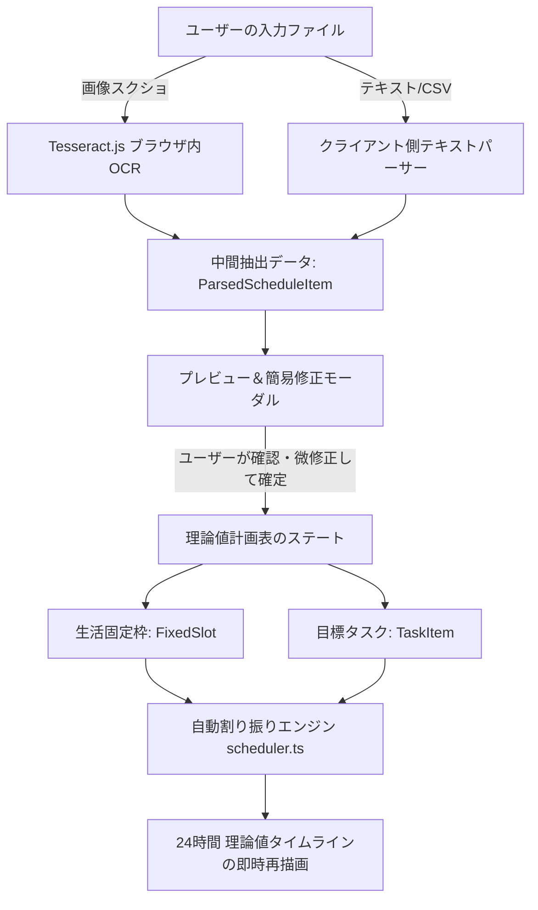

# アップデート計画書：入力手間の極小化と外部API不要ファイルインポート（update_plan1）

## 1. 概要と目的

本計画は、Webアプリケーション「理論値計画表」における**「手間の削減 (Effortless Import)」**を達成するための第1弾アップデート計画書です。  
利用者が日々の固定枠や目標タスクを1つずつ手動入力する負担を解消し、**既存の時間割アプリの表スクリーンショット（画像）**や**メモ書き（テキスト／CSV）**を取り込むだけで、一瞬にして目標を100%達成する理想の24時間タイムスケジュールを生成できるようにします。

本機能は、**有料クラウドAPIや外部サーバーを一切利用せず、ブラウザ内完結（オープンソースOCR）**で動作するため、コストゼロ・プライバシー安全・オフライン耐性を両立します。

---

## 2. コア機能要件

### (1) 時間割表画像のブラウザ内OCR取り込み（外部API不要）

- **対象画像**: 既存の時間割アプリの画面キャプチャ、スケジュール表の写真・スクリーンショット。
- **採用技術**: `tesseract.js`（WebAssembly / Web Worker ベースのブラウザ完結型オープンソースOCRエンジン）。
- **抽出ロジック**:
  - 画像内の日本語・英語・数値を認識。
  - 「1限 (09:00-10:30)」「英語」「月曜」などの時限・時刻表記や講義・予定名を正規表現および位置情報からパース。
  - 大学の標準的な時限プリセット（1限: 9:00〜10:30、2限: 10:45〜12:15 等）をフォールバックとして保持。

### (2) テキスト／CSVファイル取り込み

- **対象ファイル**: `.txt`, `.csv`, `.md`
- **解析仕様**:
  - `09:00 - 10:30 講義` のような時刻範囲指定。
  - `読書 60分`、`筋トレ 45分` のような所要時間指定。
  - CSV形式（`科目名,開始時刻,終了時刻` または `タスク名,所要時間,優先度`）の自動判別。

### (3) スマートプレビュー＆簡易修正モーダル (Review & Import Modal)

- OCRやテキストから抽出されたデータを、計画表へ適用する前に確認・微調整できる親切なUI。
- **機能**:
  - 「生活固定枠」か「目標タスク」かの自動判定およびワンタップ切り替え。
  - タイトル、時間（開始・終了・所要時間）、カテゴリのインライン修正。
  - 不要な認識行の除外（ゴミ箱アイコン）。
  - 「理論値計画表へ取り込む」ボタンで一括反映。

---

## 3. システムアーキテクチャとデータフロー



---

## 4. データ構造定義

抽出時に使用する中間インターフェース：

```typescript
export interface ParsedScheduleItem {
  id: string;
  title: string;
  type: 'fixed' | 'task'; // 固定枠か目標タスクか
  startMinutes?: number; // 固定枠の場合
  endMinutes?: number; // 固定枠の場合
  durationMinutes: number;
  category: string;
  confidence?: number; // OCR認識の確信度
}
```

---

## 5. 実装ステップとスケジュール

### ステップ 1: パッケージ導入とパーサーコアの実装

- `tesseract.js` の開発・本番依存追加。
- `src/lib/importers/textParser.ts`: テキストおよびCSVパースエンジンの実装。
- `src/lib/importers/ocrParser.ts`: 画像OCRおよび表テキスト構造化ロジックの実装。
- `src/lib/importers/timetablePresets.ts`: 一般的な学校・大学の時限マッピング。
- `src/lib/importers/*.test.ts`: Vitest 単体テストで様々なテキスト・時刻パターンのパースを網羅検証。

### ステップ 2: 取り込みモーダル UI（`FileImportModal.tsx`）の実装

- ドラッグ＆ドロップ対応のファイルアップロードゾーン。
- OCR解析中のプログレスバー表示（`Tesseract` の進捗イベント連動）。
- 抽出結果のテーブル表示・インライン編集・種別トグル（固定枠 ⇄ タスク）。

### ステップ 3: メイン画面への統合

- [Header.tsx](file:///c:/Users/kousu/OneDrive/Desktop/creation_1/src/components/Header.tsx) に「ファイルから取り込む（画像/テキスト）」ボタンを追加。
- 確定時に `FixedSlot` および `TaskItem` の既存データと安全にマージ（追加または置換を選択可能）。
- `scheduler.ts` による理論値の自動再計算。

### ステップ 4: 自律検証と品質ゲートの実行

- [RULES.md](file:///c:/Users/kousu/OneDrive/Desktop/creation_1/RULES.md) に則り、以下の5つの検証コマンドを全件実行：
  1. `npm run typecheck`（型検査エラー 0 件）
  2. `npm run test`（Vitest テスト全件パス）
  3. `npm run lint`（ESLint 規約準拠）
  4. `npm run format`（Prettier スタイル準拠）
  5. `npm run build`（Vercel デプロイ用 Next.js ビルドの成功確認）

---

## 6. 次のアクション

本計画書（`update_plan1.md`）について開発者の承認をいただいた後、ステップ1（パッケージ導入およびパーサーエンジンの実装）から順次実装に着手します。
