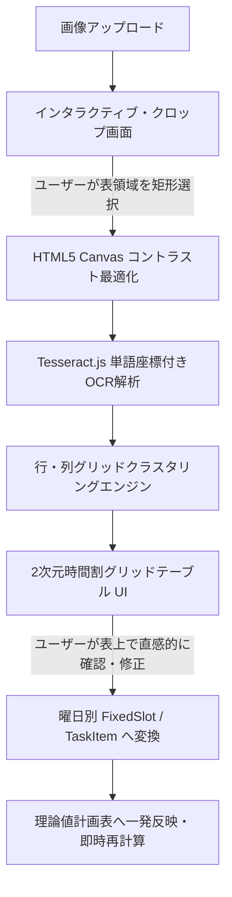

# アップデート計画書：画像クロップと行列・位置関係認識による時間割抽出の高精度化（update_plan2）

## 1. 概要と課題意識

前回の第1弾アップデート（ファイル取り込み機能）において、画像全体を一括OCR解析する方式では以下の課題が生じました：

- **課題1（ノイズの混入）**: スマホのステータスバー、ナビゲーションバー、広告などの余計な文字列を誤認識する。
- **課題2（表構造の欠落）**: 時間割アプリ特有の「横軸＝曜日（列）」「縦軸＝時限（行）」という2次元の位置関係が失われ、ただの平文テキストとして解釈されてしまう。

本計画（`update_plan2`）では、**「画像トリミング（クロップ）」**と**「2次元座標バウンディングボックスによる行・列グリッド認識」**、および**「時間割グリッドプレビューUI」**を導入し、外部APIを使わない完全ブラウザ完結型のまま、認識精度と使い勝手を劇的に向上させます。

---

## 2. コア機能と設計方針

### (1) 表領域の画像クロップ（トリミング & 前処理）

- **操作**:
  - 画像アップロード後、モーダル内でマウスやタッチ操作により「時間割の表部分」だけをドラッグして矩形選択（クロップ）。
  - 不要なヘッダー・フッター・余白を完全排除。
- **画像前処理（HTML5 Canvas）**:
  - クロップした領域を Canvas で取得し、グレースケール化およびコントラスト自動補正を実施して Tesseract.js に渡すことで、文字の認識率を最大化。

### (2) 座標バウンディングボックスによる行・列（位置関係）と改行の自動クラスタリング

Tesseract.js が出力する単語単位の座標情報（`bbox: { x0, y0, x1, y1 }`）を活用：

1. **列（曜日）の判定**:
   - クロップ領域の横幅（Width）を列数（例: 月〜金なら5等分、土曜含むなら6等分）でグリッド分割。各単語の中心X座標がどの列に属するかを幾何学的に判定。
2. **行（時限）の判定**:
   - 縦幅（Height）を行数（例: 1限〜5限なら5等分）でグリッド分割。各単語の中心Y座標がどの行に属するかを判定。
3. **セル内の改行・複数行テキストの結合（重要）**:
   - 時間割の1つのコマ内に「講義名」「教室名」「担当教員」などが複数行で記載されているケースに完全対応。
   - 同一セル内の単語・テキスト行をY座標順（上から下へ）に並べ替え、適切な改行（`\n`）を保持して結合。
   - 先頭行を「主タイトル（講義名）」、2行目以降を「教室・備考」として整理。

### (3) 時間割グリッドプレビュー＆セル編集UI (Grid Preview UI)

- 抽出結果を単なる縦リストではなく、**「月〜金 × 1〜5限の時間割表（テーブル形式）」**で視覚的にそのまま表示。
- **機能**:
  - セル内の改行（`whitespace-pre-line`）を維持した複数行表示。
  - 表上のセルをクリックして複数行テキストエリア（`<textarea>`）で講義名や教室名、改行を直接修正可能。
  - 列数（月〜金 / 月〜土）や行数（4限〜6限）をワンタップで切り替え可能。
  - 「理論値計画表へ取り込む」ボタンで、曜日ごとの `FixedSlot`（開始・終了時刻付き）として一発反映。

---

## 3. データフローとアーキテクチャ

---

## 4. 実装ステップ

### ステップ 1: クロップコンポーネント & 前処理エンジンの実装

- `src/components/ImageCropModal.tsx`（Canvas による軽量で外部ライブラリ非依存の矩形トリミングUI）。
- 画像のコントラスト最適化（白黒2値化・高解像度化）。

### ステップ 2: グリッド位置関係解析エンジンの実装

- `src/lib/importers/gridOcrParser.ts`
  - Tesseract 単語座標（`bbox`）から `GridCell[][]`（曜日 × 時限）を再構築するアルゴリズム。
- 単体テスト（`gridOcrParser.test.ts`）を作成し、座標クラスタリングロジックを検証。

### ステップ 3: 時間割グリッドプレビューUIの実装

- `FileImportModal.tsx` を拡張し、従来の箇条書きリストに加えて**「時間割表（グリッド表示）」**タブを提供。
- セルをクリックして直接テキストを編集できる使いやすい表UI。

### ステップ 4: 既存コードとの統合および品質ハーネス検証

- [RULES.md](file:///c:/Users/kousu/OneDrive/Desktop/creation_1/RULES.md) に則り、5大品質検査を全件実行：
  1. `npm run typecheck`
  2. `npm run test`
  3. `npm run lint`
  4. `npm run format`
  5. `npm run build`

---

## 5. 次のアクション

本計画書（`update_plan2.md`）について開発者の承認をいただいた後、ステップ1から順次実装に着手します。
